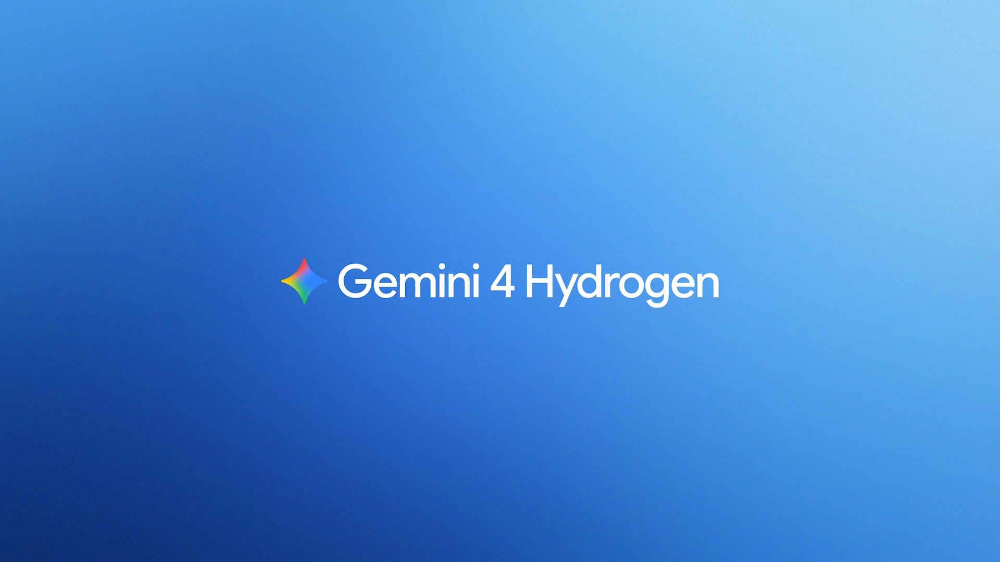
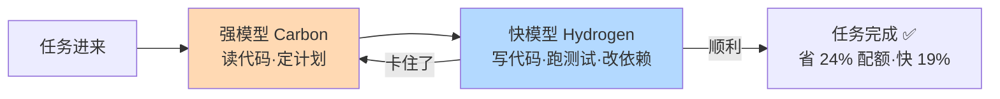
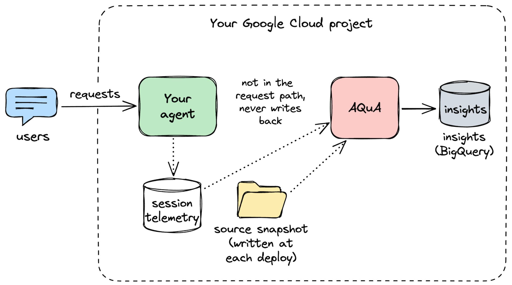
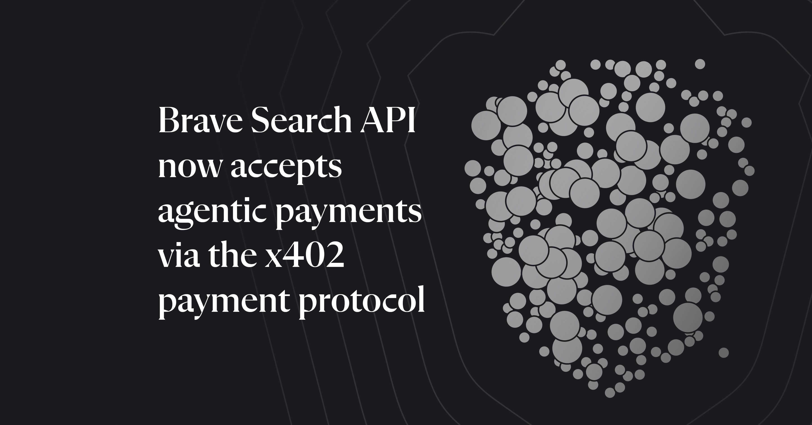

# 🗞️ LLM / Agent / Java 前沿日报 · 2026-11-14

> 数据窗口：2026-11-12 ~ 2026-11-13（美西时间）· 信源：GitHub Trending / Hacker News / arXiv / Spring & Inside.java & InfoQ & Foojay & SimonWillison RSS / web_search

## 📌 今日速览

| 板块 | 一句话头条 |
|---|---|
| 🧠 LLM | **Edge0-145B 开源**：1450 亿参数的大模型塞进一台笔记本/单张消费级显卡（峰值内存 29GB、每秒吐 80+ token），跑分逼近 Claude Opus 4.6——"前沿模型必须上云"的默认假设第一次被认真动摇（HN 312 分） |
| 🤖 Agent | Google 发布 **Gemini 4 Hydrogen + Orchestrator**：Antigravity 里大模型（Carbon）当"总工程师"、快模型（Hydrogen）当"施工队"，同一任务内自动来回交接，官方数据省 24% 配额、快 19%、成功率接近纯 Carbon |
| ☕ Java | Foojay 发布 **Java 27 全特性解读**：G1 垃圾回收器在**所有**环境成为默认（小容器不再偷偷降级成 Serial）、TLS 1.3 内置抗量子混合密钥交换、紧凑对象头默认开启（对象头从 128 位压到 64 位） |

**今日暗线**：三条头条指向同一个方向——**"贵的大模型"正在被拆开用**。Edge0 用稀疏专家架构让 145B 只激活 10B 参数；Google 用 Orchestrator 让一个任务里只在关键节点调用贵模型；Java 27 用紧凑对象头把每个对象省 8 字节。大而不浪费，是 2026 年末工程界共同的主题词。

---

## 🧠 LLM 前沿

### 🔬 深度解析：Edge0-145B——把"前沿级"大模型塞进一台笔记本的开源实验

*图：Edge0-145B 的单层结构——注意力层用 2560 维全宽读写，然后 D 投影压缩到 1792 维，路由器从 512 个专家里挑 10 个激活，算完再由 U 投影还原。绝大部分参数躺在"专家池"里按需从内存/硬盘调入（出处：[Edge0 GitHub 仓库](https://github.com/Edge0-AI/Edge0/blob/main/docs/models/edge0-145b.md)）*

**🎯 30 秒版本**：11 月 12 日 Edge0 团队开源了 Edge0-145B 和 Edge0-120B 两个模型（含推理引擎），宣称是**全球第一个能在个人电脑上本地运行的 1450 亿参数开源模型**：峰值内存 29GB、生成速度 80+ token/秒、功耗约 120W，跑分逼近云端旗舰。对你意味着：敏感代码/数据不出本机、零 API 账单、断网也能用。

**背景铺垫**：① 参数量 ≈ 模型的"脑容量"，145B（1450 亿）是什么概念——GPT-3 是 175B，业界一直认为这个量级需要多张 H100 服务器才能跑；一张 RTX 5090 显卡只有 24GB 显存，连模型权重的零头都装不下。② **MoE（Mixture of Experts，混合专家）**：把模型拆成几百个"专家"小组，每个 token 只叫醒其中少数几个干活——好比一家 500 人的医院，每个病人只看 10 个相关科室的医生。Edge0-145B 每 token 只激活 10.12B 参数（约 7%），这是它能跑起来的根本原因。

**它怎么做到的、关键数字**：三板斧。第一，**专家共享大矩阵**：512 个专家共用两组大投影矩阵（D/U），每个专家只存自己独特的 163 万字节小参数——相当于 500 个科室共用同一栋大楼和电梯，各科室只放自己的专科器械。第二，**三级存储流水线**：常用"热专家"驻留显存（约几千个），40GB 专家库放系统内存，48GB 词表放 SSD，读取和计算重叠进行——像餐厅把常点菜放灶台、次常点放冰箱、冷门菜放库房。第三，**CPU/GPU 并行 + 投机解码**（一次猜多个 token 再批量验证）。实测：RTX 5090（24GB 显存）上 Q3_K 4bit 量化版 agent 任务解码 121 token/秒，只需 16GB 显存 + 20GB 内存；连 M2 Ultra 的 MacBook 也能跑 57 token/秒。跑分参照系：GPQA-Diamond（研究生级科学题）90.4 vs Claude Opus 4.6 Max 的 91.3；Terminal-Bench 2.1（终端编程任务）86.5，反而**超过** Claude 的 78.2；指令遵循 IFBench 80.6 大幅领先 Claude 的 62.5。

**前因后果**：之前是什么样？本地模型 = 小模型 = "能聊天但干不了正经活"，真干活必须上云，按 token 付费且数据出本机。为什么现在变？模型架构（稀疏 MoE + 4bit 原生训练）和存储介质（大容量 SSD、高带宽内存）两头同时成熟，Edge0 干脆**从第一天就按"笔记本部署"的约束来训练**，而不是先训云端大模型再压缩。变了之后谁受影响？做私有化部署、离线场景、成本敏感的团队最先受益；云厂商的 API 生意在"中等复杂度任务"上会被分流。要泼的冷水：这是刚发布的新团队自测数据，HN 评论区（312 分、91 评论）质疑点集中在"跑分是否可复现"和"派生自 Qwen3.8-Flash-Next 的许可证边界"；且 145B 在超长轨迹、复杂多步任务上和真旗舰仍有差距。**据报道，未经独立验证**。

**💡 所以呢**：如果你有 24GB 显存的卡或大内存 Mac，值得下载 Q3_K 版实测自己的真实工作负载——它提供 OpenAI/Anthropic 兼容接口，现有代码换个 base_url 就能试。配套还开源了 Decision0（40ms 多模态决策小模型）、Embedding0（多模态向量）等，本地 agent 全家桶齐了。

[官方博客](https://edge0.ai/blog/introducing-edge0-145b-frontier-ai-capabilities-on-your-own-computer) · [GitHub](https://github.com/Edge0-AI/Edge0) · [HuggingFace 模型卡](https://huggingface.co/Edge0/Edge0-145B-q3k) · [HN 讨论](https://news.ycombinator.com/item?id=50475713)

### 📰 LLM 要闻简报

- **Apple Foundation Models 框架走向开源，且不再只服务苹果自家模型**：苹果开发者站上线的框架页显示，Foundation Models（苹果给 App 调用大模型的官方框架，去年随 Apple Intelligence 推出）现在支持接入**任意** LLM——本地模型、Private Cloud Compute（苹果自建的隐私云）或任何第三方服务器模型；WWDC26 session 宣布核心框架将开源，并新增 `fm` CLI + Python SDK、Evaluations 评测框架、图像理解多模态等。对开发者的意义：以前"苹果端上 AI"是封闭花园，现在同一套 Swift API 可以换任意后端，还能在 Linux 服务器上跑 Swift 时复用。HN 248 分。[官方框架页](https://developer.apple.com/foundation-models-framework/) · [HN 讨论](https://news.ycombinator.com/item?id=50474361)
- **Simon Willison 的 llm-gemini 插件火速跟进 0.37**：Gemini 4 Hydrogen 发布当天，llm 生态的 Gemini 插件就更新适配（支持新模型名与 thinking 级别参数）——想低成本试新模型，`llm` 命令行永远是最快通道。[链接](https://simonwillison.net/2026/Nov/12/llm-gemini/)
- **Rust 1.100 发布**（顺带一提：系统语言界的里程碑版本号）：Rust 语言 20 周年之际迎来 1.100 大版本，HN 808 分、297 评论。虽然不是 LLM 新闻，但 AI 基础设施（推理引擎、向量库）大量用 Rust 写，值得留意。[发布博客](https://blog.rust-lang.org/2026/11/12/Rust-1.100.0/) · [HN](https://news.ycombinator.com/item?id=50472038)

---

## 🤖 Agent 进展

### 🔬 深度解析：Google 的 Orchestrator——大模型和快模型在同一任务里"自动换班"

*图：Gemini 4 Hydrogen 发布配图——Hydrogen 定位是"日常干活的快模型"，与旗舰 Carbon 组成 Antigravity 的双模型阵容（出处：[Google Antigravity 官方博客](https://antigravity.google/blog/gemini-4-hydrogen-in-google-antigravity)）*

**🎯 30 秒版本**：11 月 12 日 Google 在 Antigravity（它的 agent 编程平台）上线两样东西：新模型 **Gemini 4 Hydrogen**（接替原 3.8 Flash 的"快而省"定位），以及一个叫 **Orchestrator** 的模型选项——选中它之后，你不用管模型切换，系统会在旗舰 Carbon 和快模型 Hydrogen 之间**动态来回交接**同一个任务。官方数据：Terminal-Bench 4.1（agent 终端任务基准）上成功率接近纯 Carbon，但少花 24% 配额、快 19%。

**背景铺垫**：① **模型路由（model routing）**：不同任务难度用不同价位的模型——简单活派便宜快的，难题派贵而强的。之前的路由都是"静态"的：看一眼第一条 prompt 就猜难度，一锤定音派给某个模型从头干到尾。② 为什么静态路由不够？一个真实的编程任务**内部难度是波动的**：读代码理解需求很难（需要强模型），但改三行代码、跑测试、看日志很机械（快模型足够）。静态路由要么全程用贵模型（浪费），要么全程用便宜模型（在难点翻车）。

**Orchestrator 怎么工作**：Google 称之为"动态、双向"的交接。典型流程：Carbon（总工程师）先读任务、定计划、拆解步骤 → Hydrogen（施工队）接手写代码、更新依赖、跑测试 → Hydrogen 撞到搞不定的问题时**把控制权交回** Carbon，Carbon 检查现场、修复计划，然后再派 Hydrogen 继续执行。注意关键词是"双向"——不是一次性分流，而是同一轨迹内可以来回切换多次。这和本周日报一直在追的"决策模型/大小模型分工"暗线一脉相承：上周 Anthropic 的 Fable 5.2 推荐 Orchestrator 角色、亚马逊用 2B 小模型省 98% 成本、前天 Google 发 Decisions API，今天是这套分工哲学的"全自动版"。

**关键数字给参照系**：Hydrogen 独立使用时的定价是 $1.50/百万输入 token、$7.50/百万输出 token，上下文 100 万 token（参照系：输入价约为 Claude Sonnet 级模型的 1/2，输出价约 1/2~1/3）。智能水平上 Google 称它在 Artificial Analysis 智能指数上超过上代 Argon（51 比 50，最高思考档 54），Terminal-Bench 4.1 拿 57%、而旧 3.8 Flash 只有 18.2%——三倍差距。"省 24% 配额"换算成账单：原来 100 块的 agent 任务变 76 块，还快两成。思考深度给了四档（low/medium/high/xhigh），可以自己权衡质量和速度。

**前因后果**：之前是什么样？Antigravity 用户要么手选 Carbon 全程烧配额，要么手选 Flash 赌任务不难。为什么现在变？agent 任务越跑越长（几百轮工具调用），模型费用成了实际使用的第一痛点，Google 上周刚发 /swarm（多 agent 并行工作树），本周补上 Orchestrator，凑成"广度（swarm）+深度（orchestrator）"的组合拳。变了之后谁受影响？重度 agent 编程用户最直接（付费 Pro/Ultra 订阅者已可用）；做 agent 编排框架的团队应该抄这个"动态双向交接"的设计——它比市面上大多数"一次性分类路由"更接近真实任务的难度曲线。局限：目前只在 Antigravity 内自动生效，通过 API 自己搭管道的话交接逻辑要自己实现（Google 给了开源 issue 分诊 demo 参考）。

**💡 所以呢**：如果你自己写 agent，本周就值得实现的启发是——**不要在第一轮就给任务定型**，让强模型只出现在"计划、排错、验收"三个环节，中间的执行循环全交给快模型，这就是 24% 省额的来源。

[Antigravity 官方博客](https://antigravity.google/blog/gemini-4-hydrogen-in-google-antigravity) · [blog.google 模型发布](https://blog.google/innovation-and-ai/models-and-research/gemini-models/introducing-gemini-4-hydrogen) · [HN 讨论（468 分）](https://news.ycombinator.com/item?id=50472260)

*怎么读这张图：橙色节点是"贵而强"的总工程师，只负责计划和排错；蓝色节点是"快而省"的施工队，负责所有机械执行。箭头"卡住了"是 Orchestrator 的灵魂——交接是双向的，不是单向分流。*

### 📰 Agent 要闻简报

- **Google 开源 AQuA（Ambient Quality Agent）：给生产环境 agent 做"验尸"的质量侦探**：AQuA 是一个旁路运行的质量 agent——它不在线上请求路径里，而是定时/每次部署后扫描生产会话轨迹（从 Cloud Trace/Logging/BigQuery 读），把重复出现的失败聚类，再对照**部署时保存的源码快照**定位根因（能引用到具体文件和行号，且行号会针对当时版本重新校验）。为什么重要：agent 的"静默失败"（HTTP 200、无报错，但任务其实没完成——比如订座 agent 没查座位余量就确认了）传统监控根本看不见。它只诊断不动手，修复留给开发者或 coding agent。Google 自测 32 个会话诊断成本 $3.76（约每会话 0.12 美元）。v0.1.0 Alpha，绑 ADK + Google Cloud 技术栈。[InfoQ 报道](https://www.infoq.com/news/2026/11/google-ambient-agent-prod/) · [Google 开发者博客](https://developers.googleblog.com/the-outer-loop-insights-first-an-ambient-quality-agent-that-diagnoses-your-production-agent)
- **Brave Search API 接受 agent 用 x402 协议直接付钱搜索——"机器钱包"时代开张**：x402 是基于 HTTP 402 状态码（"需要付费"，一个预留了几十年没用起来的协议位）的开放支付协议。流程：agent 不带账号直接请求 → 服务器返回 402 和价格 → agent 用 CLI 钱包签一笔 USDC 稳定币（Base 链上，每查 $0.005）重试 → 拿到结果和链上收据。为什么重要：这是**第一批不需要注册账号、不需要 API key、agent 自主完成付款**的主流商业 API——agent 经济的"支付轨道"开始铺了。HN 212 分，评论区对"链上支付的摩擦和反洗钱"争论不少。[Brave 博客](https://brave.com/blog/search-api-agentic-payments/) · [HN](https://news.ycombinator.com/item?id=50477649)
- **Anthropic 服务大故障：claude.ai / Claude Code / API 全线高错误率**：11 月 13 日 status 页确认多产品 elevated errors，HN 热帖 414 分、339 评论——重度依赖单一 agent 后端的团队再次被提醒：LLM 服务现在还是"会停机的电网"，不是自来水。生产系统要有降级路径（备用模型/本地模型，见今日 Edge0）。[状态页](https://status.claude.com/incidents/nn11wk485zfn) · [HN](https://news.ycombinator.com/item?id=50481187)
- **foojay 实用帖：各家 coding agent 的 skills 目录终于有了统一方案**：Claude Code 把技能放 `~/.claude/skills`，而规范定义的跨客户端位置是 `~/.agents/skills`——作者实测 Mistral Vibe 因为没触发他的技能而疯狂幻觉。结论：技能统一放 `.agents/skills`，再软链回各家私有目录，一次编写处处生效。[链接](https://foojay.io/today/skills-across-coding-assistants/)
- **arXiv 新论文《Actor, Judge, or Teacher?》给"决策模型当老师"正名**：研究发现决策模型（只输出选项+概率的模型）当执行者（actor）表现平庸——会被简单子目标带偏——但当**评判者/教师**（看完整轨迹给每一步打分）却很称职，问"这步有没有帮助"比问"任务会不会成功"更能区分好坏步骤。这解释了为什么决策模型的正确用法是教练和裁判，不是运动员。[arXiv](http://arxiv.org/abs/2611.17167v1)

*图：AQuA 的 sidecar（旁路）架构——它跑在你的 agent 旁边而不是请求路径里，读生产轨迹和部署时的源码快照做诊断，绝不回写线上系统（出处：[Google 开发者博客](https://developers.googleblog.com/the-outer-loop-insights-first-an-ambient-quality-agent-that-diagnoses-your-production-agent)）*

*图：Brave Search API 接入 x402 协议的官方配图——agent 无需账号即可按次付费搜索（出处：[Brave 官方博客](https://brave.com/blog/search-api-agentic-payments/)）*

---

## ☕ Java 工程

### 🔬 深度解析：Java 27 全特性解读——G1 一统天下、TLS 抗量子、对象头减半，每一个都动你的生产环境

**🎯 30 秒版本**：Java 27（9 月 15 日 GA，非 LTS）共 9 个 JEP，foojay 的 Loic Mathieu 本周发布了逐条解读。三个最影响日常工作的变化：**① G1 垃圾回收器在所有环境成为默认**（以前小容器会被 JVM 偷偷降级成 Serial GC）；**② TLS 1.3 内置抗量子混合密钥交换**（为量子计算机时代提前布防）；**③ 紧凑对象头默认开启**（每个 Java 对象省 8 字节，大堆应用内存直降）。

**背景铺垫**：① **GC（垃圾回收器）**= JVM 里自动清理不再使用的内存的组件。**G1** 是现在的主力 GC（Java 9 起默认），**Serial** 是最老的单线程 GC——简单粗暴，单核小内存时反而开销最小。② **对象头（object header）**：每个 Java 对象在内存里除了数据本身，还有一段"户籍信息"（指向类的指针、哈希码、GC 年龄等），传统上占 128 位（16 字节）——比很多小对象的数据本身还大。

**逐条拆解三个关键变化**：

**JEP 523（G1 全环境默认）**：之前是什么样？JVM 有个"人体工学"逻辑：检测到 1 核以下 CPU 或小于 1792MB 内存的环境，自动改用 Serial GC，因为老版 G1 在资源紧张时同步开销大、还多吃原生内存。为什么现在变？经过 JEP 522 减少同步开销等改进，G1 在小环境的性能和内存已与 Serial 持平或更好，"降级"逻辑失去存在理由。**谁受影响**：跑在 K8s 小容器（<1.75GB 内存限额）里的 Java 服务——升级后 GC 行为会变，DZone 的另一篇文章提醒：G1 的原生内存略多，紧绷的容器可能升级后被 OOM kill，**升级前先用 GC 日志对比 Serial 和 G1 的内存曲线**。

**JEP 527（抗量子 TLS）**：量子计算机理论上能破解现在保护 HTTPS 的椭圆曲线加密。业界对策是"混合密钥交换"——同时用一套传统算法（ECDHE）和一套抗量子算法（ML-KEM，基于格密码）协商密钥，**只要一套没被破，通信就安全**（双保险：新算法还没经过几十年实战检验，老算法防的是"现在"，新算法防的是"量子计算机造出来的那天"）。Java 27 实现了三套组合（X25519MLKEM768 等）。谁受影响：金融、政务等对"现在截获、未来解密"（harvest now, decrypt later）攻击敏感的场景，这是 JDK 层面第一次原生给出答案。

**JEP 534（紧凑对象头默认开）**：对象头从 128 位压到 64 位：类指针 22 位、哈希码 31 位、**给 Valhalla 值类预留 4 位**、其余留给 GC 年龄和标志位。参照系：一个只装一个 int 的小对象，从 16（头）+4（数据）+4（对齐）= 24 字节降到 16 字节——**堆里对象越多省得越多**，缓存友好的堆实测能省 10-20% 内存，等于同样的机器能多塞两三成的对象。注意对象头里给 Valhalla 留了位置——和本月 Inside.java 连发值类文章（Valhalla Ticker、JDK 28 值类质量外联）互相印证：值类冲刺在即。

**前因后果**：Java 27 是"小版本"（9 个 JEP，比 Java 26 的 10 个还少），但它把过去几年最重要的实验特性**转正**（紧凑对象头从 JDK 24 的实验选项变默认），又在安全上抢先布防（Oracle JDK 21 许可收紧的背景下，免费跟进的 OpenJDK 阵营靠这类实打实的特性吸引升级）。谁受影响最大？还在 Java 21 上的团队：21.0.13 起 Oracle 构建转 OTN 许可（见昨日日报），而升 27 可以全程免费——**"要么买订阅留在 21，要么免费跳到 25/27"**的选择题越来越清晰。

**💡 所以呢**：三条可操作建议——① 升级 27 前，给小容器服务做 Serial→G1 的 GC 日志对比（重点看原生内存）；② 检查你的 TLS 客户端配置，金融类系统把混合密钥交换排进路线图；③ 紧凑对象头是"免费午餐"，大堆应用升级后直接白赚内存，值得作为升级 27 的第一理由。

[Foojay 解读全文](https://foojay.io/today/java-27-whats-new/) · [DZone：G1 默认化与小容器测试](https://dzone.com/articles/jdk-g1-garbage-collector) · [Inside.java G1 教程](https://inside.java/2026/11/10/g1gc-tutorial/)

| 关键概念 | 白话解释 | 为什么重要 |
|---|---|---|
| G1 / Serial GC | 两代垃圾回收器：G1 多线程分区回收，Serial 单线程一把梭 | Java 27 起小容器不再降级 Serial，GC 行为统一 |
| ML-KEM | 基于"格"数学的抗量子密钥封装算法 | 量子计算机造出来也解不开今天的密文 |
| 紧凑对象头 | 对象"户籍信息"从 16 字节压到 8 字节 | 堆内存省 10-20%，缓存命中率上升 |
| JEP | JDK Enhancement Proposal，Java 的正式特性提案编号 | 每个 JEP 有官方文档，升级前按号查坑 |

### 📰 Java 要闻简报

- **A Bootiful Podcast 新期：Atomikos 创始人 Guy Pardon 谈分布式事务**：分布式事务（跨多个数据库/服务的转账要么全成、要么全不成的难题）领域的老牌公司 Atomikos，其创始人聊了数据完整性在微服务时代的演进——Spring 生态做 XA/两阶段提交的团队值得一听。[链接](https://spring.io/blog/2026/11/12/a-bootiful-podcast-guy-pardon)
- **foojay：Jakarta EE 三大测试工具横评（WeldInitiator / Arquillian / Testcontainers）**：三种给 CDI（Jakarta 的依赖注入规范）应用写集成测试的路线对比——轻量单元级、容器级、真 Docker 级，各有适用场景。写 Java EE/Jakarta 测试不知道选哪个的先看这篇。[链接](https://foojay.io/today/jakarta-ee-testing-tools-compared-weldinitiator-arquillian-and-testcontainers/)
- **foojay：DuckDB-Wasm + Java 后端的浏览器内分析架构**：把列式分析数据库 DuckDB 编译成 WebAssembly（让数据库直接跑在浏览器标签页里的技术）嵌进前端，Java 后端只管发数据文件——分析查询不打服务器，适合做 BI 面板的 Java 团队。[链接](https://foojay.io/today/analytics-in-the-browser-with-duckdb-wasm/)
- **InfoQ：Netflix 把运维数据建成知识图谱，做 AI 驱动的可观测性**：把告警、部署、服务依赖连成图（知识图谱=用"实体+关系"存数据的结构），让 AI 在故障时顺着关系链推理影响面——大厂 AIOps 的最新样本，JVM 系微服务架构同样适用。[链接](https://www.infoq.com/news/2026/11/netflix-ai-driven-observability/)

---

## 📋 今日其余动态

| # | 板块 | 动态 | 链接 |
|---|---|---|---|
| 1 | Agent | GitHub Trending 第一：alibaba/open-code-review——阿里开源的代码评审 agent，"确定性+LLM 混合架构"，今日 +206 star | [GitHub](https://github.com/alibaba/open-code-review) |
| 2 | LLM | openai/codex-security 持续爬榜（今日 +754 star）：官方安全扫描 CLI，找漏洞→验证→出补丁 | [GitHub](https://github.com/openai/codex-security) |
| 3 | Agent | ChromeDevTools/chrome-devtools-mcp（+145 star）：让 coding agent 直接操作 Chrome 开发者工具调试前端 | [GitHub](https://github.com/ChromeDevTools/chrome-devtools-mcp) |
| 4 | Agent | backnotprop/plannotator：给 agent 工作流做"批注台"——shape/decide/plan/annotate/review，今日 +100 star | [GitHub](https://github.com/backnotprop/plannotator) |
| 5 | Agent | block/buzz（Rust，37k star）：Block 开源的"蜂巢思维"agent 通信平台 | [GitHub](https://github.com/block/buzz) |
| 6 | LLM | hyperionaidev/smolmaxxing（HN 438 分）：让 LLM 跑在小旧设备上的实践合集 | [GitHub](https://github.com/hyperionaidev/smolmaxxing/) |
| 7 | LLM | Show HN：$300 刺绣机要订阅才能用，作者自建 App 破解（zigzag，666 分）——硬件订阅制的又一次民间反击 | [GitHub](https://github.com/simpsoka/zigzag) |
| 8 | 通用 | 微软 365 全球服务降级（HN 1086 分）：云依赖的又一记警钟 | [状态页](https://status.cloud.microsoft/) |
| 9 | LLM | Jonathan Blow 视频：《如果 AI 解决了编程，为什么我的软件还是一样？》（HN 热帖） | [YouTube](https://www.youtube.com/watch?v=IRK8h67ol7Q) |
| 10 | Agent | arXiv：CapLite——给小模型 agent 的提示注入防御，不依赖模型自写安全产物 | [arXiv](http://arxiv.org/abs/2611.17115v1) |
| 11 | Agent | arXiv：Discovering Effective Agent Memory Designs through Program Evolution——用程序进化自动搜索 agent 记忆结构设计 | [arXiv](http://arxiv.org/abs/2611.17068v1) |
| 12 | LLM | arXiv：LazyWeights——边缘 LLM 按需解码权重，进一步压低端侧内存 | [arXiv](http://arxiv.org/abs/2611.17108v1) |
| 13 | Agent | InfoQ：Apple Siri AI 开发者预览——第三方 iOS/macOS App 可接入 Siri | [InfoQ](https://www.infoq.com/news/2026/11/apple-siri-ai-integration/) |
| 14 | Java | Java Annotated Monthly 十一月刊：JDK 28 前瞻（结构化并发转正、Simple JSON API、值对象预览） | [JetBrains Blog](https://blog.jetbrains.com/idea/2026/11/java-annotated-monthly-november-2026) |
| 15 | Agent | 新星仓库 agentes-chat（1302 star）：自托管 Slack 替代品，人类和 AI agent 同频道协作 | [GitHub](https://github.com/agentes-chat/agentes-chat) |

---

## 💡 一句话点评

Edge0 把 145B 塞进笔记本、Google 让贵模型只上关键班、Java 27 把每个对象削掉 8 字节——2026 年末的技术界达成了罕见的共识：**规模不再值得炫耀，"每一分算力/内存/美元花在哪"才是新的工程审美**。

---

🤖 本报告由 Hermes Agent 每日凌晨自动调研生成 · [HermesReports](https://github.com/knolonzhou/HermesReports)
