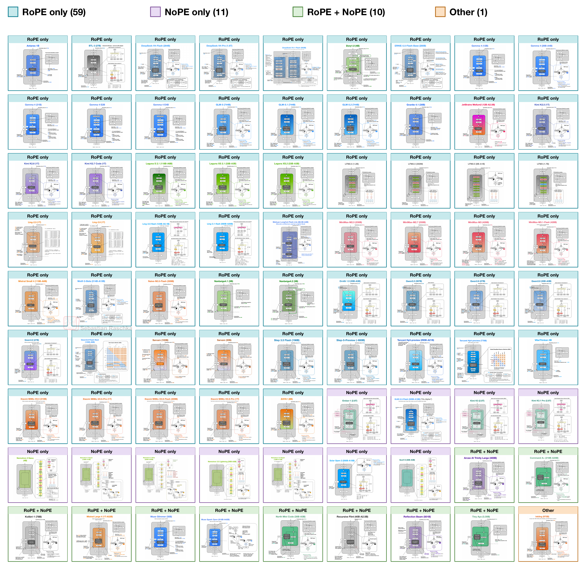
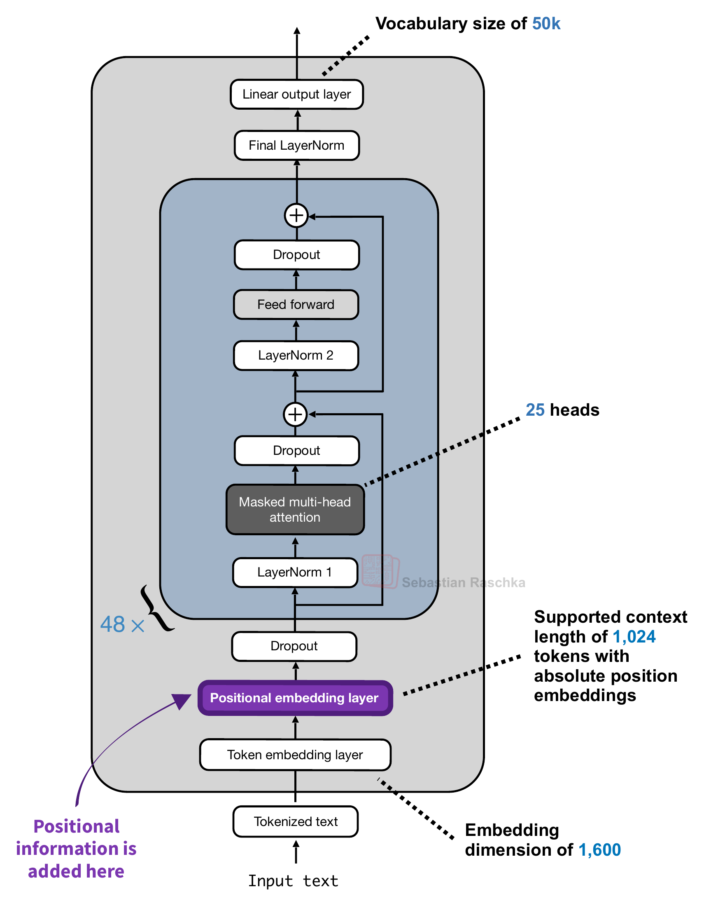
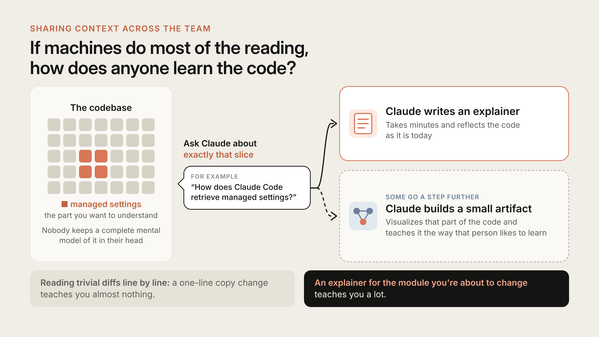
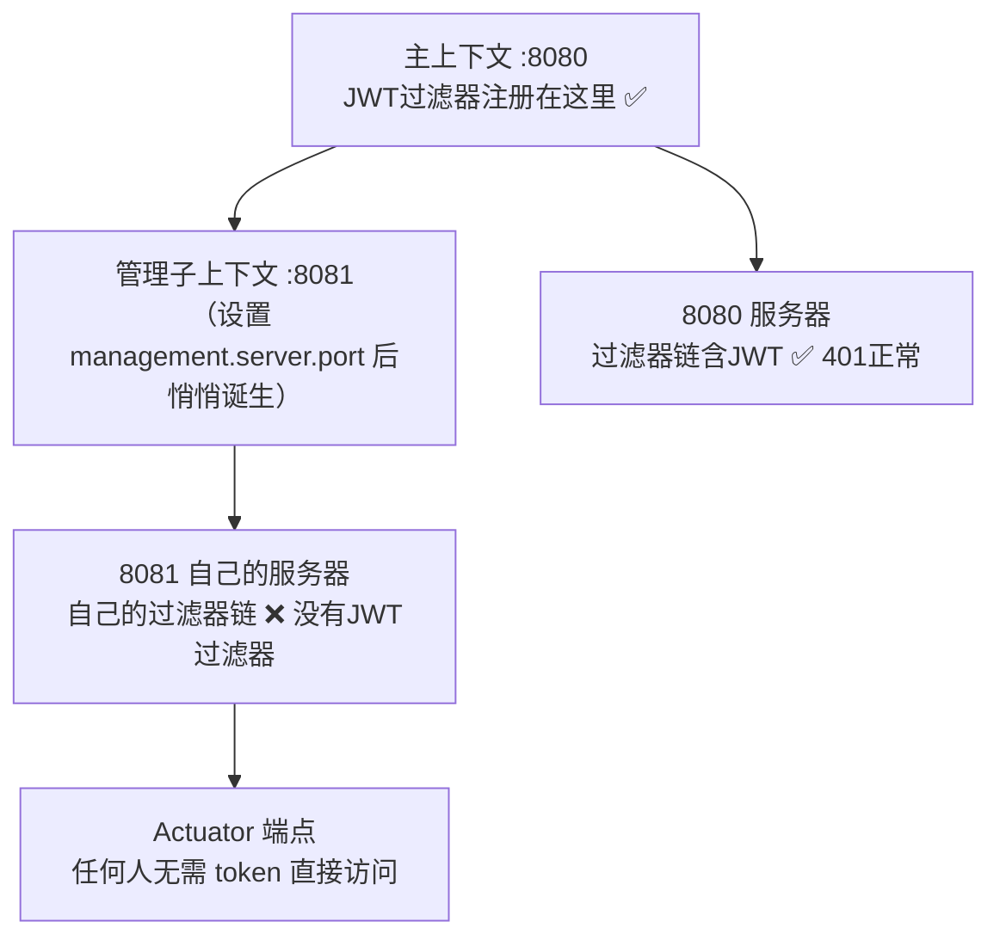

# 🚀 LLM / Agent / Java 前沿日报 · 2026-11-16

> 周一早安 ☕ 过去 48 小时横跨周末：Sebastian Raschka 放出一篇把"大模型怎么知道字的前后顺序"讲透的长文冲上 HN 首页；InfoQ 周日重新聚焦 Anthropic 那套"机器读代码、人类只看风险"的评审流水线；Java 侧则是一个价值极高的安全复盘——一行 `management.server.port` 配置如何让 JWT 过滤器"人间蒸发"。本期 A 档三条深度解析如下。

## 📌 今日速览

| 板块 | 今日最重要一件事 |
|---|---|
| 🧠 LLM | **Sebastian Raschka 发布位置编码全景长文**：从 GPT-2 的"每个座位发一个号码牌"到 RoPE 的"旋转时钟指针"，一次讲清 2026 年所有开源模型怎么选——GPT-2 式位置表若扩到 10 万 token 上下文会占模型权重 22%，这就是全行业转向 RoPE 的根本原因 |
| 🤖 Agent | **InfoQ 深度报道 Anthropic 的 Claude Code 评审流水线**：6-9 月合并 PR 翻倍、回滚率反降 40%+；六层检查里五层是机器，人类按"风险分级"出场——低风险改动 0 人审批，但"agent 的批准永远不算人的批准" |
| ☕ Java | **foojay 高价值安全复盘：Spring 上下文层级如何酿成高危 CVE**——Actuator 挪到独立端口时 Spring Boot 会悄悄创建第二个容器，注册在主容器里的 JWT 过滤器对新端口完全失效，应用还不报任何错 |

---

## 🧠 LLM 前沿

### 🔬 深度解析：Raschka《Understanding Positional Embeddings in Modern LLMs》——大模型是怎么知道"谁在前谁在后"的



*图：Raschka 整理的 2026 年开源模型"位置编码选型全景"——按所用方法分组（RoPE、部分 RoPE、学习式相对偏置、NoPE 等），一眼看出 RoPE 仍是绝对主流（出处：[Ahead of AI](https://magazine.sebastianraschka.com/p/understanding-positional-embeddings)）*

**🎯 30 秒版本**：11 月 15 日，Sebastian Raschka（《Build a Large Language Model (From Scratch)》作者，LLM 教学圈公认最会画图讲原理的人）在 Ahead of AI 发布长文，系统讲解位置编码（positional embedding，告诉模型"这个字排在第几位"的机制）：从 GPT-2 的学习式绝对位置、原始 Transformer 的正弦编码，讲到如今一统天下的 RoPE（旋转位置编码），并盘点了 2026 年各开源模型的实际选型。文章当天冲上 HN 首页。对读者的价值：这是理解"为什么现在的模型能塞进 100 万 token 上下文"的钥匙。

**背景铺垫**：Transformer 的注意力机制本身是"无序"的——它像把一句话的所有字同时摊在桌上两两比较，天然分不清"红狐狸跳过灰狐狸"和"灰狐狸跳过红狐狸"（两句用词完全相同，含义相反）。所以必须额外注入位置信息。类比：一屋子人开会都戴着同样的名牌，你得再给每人发一个座位号，才能知道谁坐谁旁边。

**前因后果**：之前是什么样？GPT-2 用最笨也最直接的办法——给每个座位号（位置 0、1、2……1023）各学一个向量，加到词向量上。问题在于这张"座位号表"是定死的：GPT-2 只学了 1024 个位置，上下文就永远超不过 1024。想扩到 10 万 token？表要跟着扩 100 倍。Raschka 给了一个扎心的数字：GPT-2 Medium 的位置表在 1024 长度下只占模型总权重的 **0.30%**，若扩到 10 万上下文，会膨胀到 **超过 22%**——相当于你为了记住座位号，把会议室本身拆了四分之一。

为什么现在变？2021 年 RoFormer 论文提出的 RoPE（Rotary Position Embedding，旋转位置编码）换了个思路：不发号码牌，而是**把每个位置的查询/键向量"旋转"一个与位置成正比的角度**——像时钟指针，位置越靠后转得越多。妙处在于两个向量做点积（注意力打分）时，结果只依赖两者的**角度差**，也就是相对距离。"相隔 3 个位置"这件事，不管发生在句首还是第 10 万个 token，旋转差都一样。这就天然支持外推到没见过的长度。

变了之后谁受影响？所有人。Raschka 盘点的 2026 年开源模型几乎清一色 RoPE，但玩法开始分化：**SmolLM3** 只在 36 层里的 3/4 层用 RoPE（剩下 1/4 玩"NoPE"——干脆不加位置信息，靠因果掩码自带的隐式顺序感）；**MiniMax M3** 用"部分 RoPE"，每个头 128 维只旋转其中 64 维，再配 QK-Norm 稳住数值；Thinking Machines 的 **Inkling** 则退回学习式相对偏置。Raschka 判断 RoPE 到 2027 年仍是标准答案，但"Inkling 式"混合设计会越来越多。



*图：GPT-2 把位置向量在进第一个 Transformer 块之前一次性加到词向量上（紫色高亮处）；而 RoPE 是在每一层的注意力内部旋转 Q/K——注入点从"门口一次"变成"每层都有"（出处：[Ahead of AI](https://magazine.sebastianraschka.com/p/understanding-positional-embeddings)）*

**💡 所以呢**：如果你在调长上下文应用（整库代码问答、长文档 RAG），"模型宣称支持 1M token"背后的成色，很大程度取决于它 RoPE 的频率基数（base，原文用 b=10000）和是否做过长文继续训练——角度可以算到任意位置，但模型没见过的长度不保证质量。想补基础的，这篇是目前中文圈外最好的免费教材，配完整 PyTorch 实现。

[原文链接](https://magazine.sebastianraschka.com/p/understanding-positional-embeddings) · [HN 讨论](https://news.ycombinator.com/item?id=50506376)

### 📰 LLM 要闻简报

- **Google DeepMind 发布 AlphaGenome 2：预测 DNA 变异对"特定细胞类型"的影响**。基因模型（预测哪段 DNA 突变会导致疾病的 AI）的新版本能识别的"改变基因表达的变异"数量接近前代两倍，且细化到细胞类型级别——同一个变异在肝细胞和神经细胞里的后果可以完全不同。API 向非商业研究开放，DeepMind 强调预测仍需实验验证。对普通人的意义：罕见病诊断和药物靶点筛选的"海选"环节会更快。[来源](https://completeaitraining.com/news/google-deepmind-releases-alphagenome-2)
- **operator0x 发布可视化研究：几千段对话在 Qwen 模型内部"长什么样"**。作者用可解释性技术（把模型内部的高维激活投影成能看的图）观察发现：大量并发会话在模型的状态空间里挤成结构化的"星团"，会话身份、语言、任务类型各占一个方向。这是少见的把"上下文窗口里塞了很多东西时模型内部发生了什么"画出来给人看的工作，HN 热帖。[原文](https://operator0x.com/field-notes/qwen-conversation-state-space/) · [HN 讨论](https://news.ycombinator.com/item?id=50481321)
- **腾讯混元发布 Hy Realtime 实时语音模型：自己决定"什么时候该搜一下"**。实时语音（延迟和抢话处理比答案质量更难的场景）新玩家：模型在对话中自主判断是否需要外部搜索，还能应要求唱歌。语音助手赛道（OpenAI Realtime、Gemini Live 之后）继续升温。[来源汇总](https://zglg.work/en/ai/news)
- **arXiv 新作《Goal Encoding in LLMs》：大模型内部真的存在"目标"表征吗？** 研究者在模型内部找到了先于行动出现、且能引导多条不同执行路径的神经表征——相当于在"黑箱"里找到了类似"意图"的东西，对 agent 可预测性和对齐研究都有直接价值。[arXiv:2611.17297](http://arxiv.org/abs/2611.17297v1)
- **arXiv 新作《LazyWeights: Decode-on-Demand Edge LLMs》：边缘设备按需"解压"权重**。4GB 内存的 Jetson Nano 跑大模型的瓶颈是内存容量、8GB 的 Orin Nano 是带宽——这篇提出按 token 需求动态解码权重，让同一份模型在低配设备上"用到哪解到哪"，边缘 LLM 部署的实用方向。[arXiv:2611.17108](http://arxiv.org/abs/2611.17108v1)

---

## 🤖 Agent 进展

### 🔬 深度解析：InfoQ 详解 Anthropic 的 Claude Code 评审流水线——"机器读代码，人类只看风险等级"



*图：Anthropic 官方博客配图——当机器承担了大部分"读代码"工作后，团队靠"让 Claude 现场写一份针对你要改的那个模块的讲解"来补上下文：读一行文案改动学不到东西，读一份为你量身定制的模块讲解学到的多得多（出处：[claude.dev 博客](https://claude.dev/blog/solving-code-review-at-anthropic/)）*

**🎯 30 秒版本**：11 月 15 日（周日），InfoQ 发布深度报道，完整拆解 Anthropic 内部 Claude Code 团队如何做代码评审——这个团队约 90% 的代码由 Claude 自己写。核心数据：6 月到 9 月合并 PR 数量翻倍以上，需要回滚的比例反而下降超过 40%；一轮评审+修复就通过的 PR 占比从 65% 升到 78%，需要五轮以上的从 8.9% 暴跌到 1.5%。它回答的问题是所有引入 AI 编码的团队都要面对的：**代码产量爆炸后，评审怎么办？**

**背景铺垫**：代码评审（code review，同事合并代码前互相检查的传统流程）有两个作用：抓 bug + 传播代码库知识。Anthropic 的出发点是承认第一个作用大部分可以交给机器，然后把省下来的人类注意力精确投到"只有人能判断"的地方。类比：机场安检不再要求每个旅客开箱人工翻包（X 光机翻），安检员只处理 X 光机报警的箱子。

**前因后果**：之前是什么样？传统流程是"写完代码→开 PR→等同事逐行看"，评审是流程末尾的一道闸门。Anthropic 的 monorepo（单体大仓库）日合并量从 5 月的约 2500 个涨到 9 月的 3 万+，逐行人工评审物理上不可能了。为什么现在变？他们把评审从"末尾闸门"改成"全程拼写检查"——写代码时 Claude 就边写边被审。变了之后是什么形态？六层防线：① PR 打开前，Claude 先自己跑测试/构建/lint，另一个"新鲜上下文"的子 agent 审一遍 diff；② 每个 PR 过 Claude 评审——多个 agent 并行找 bug，再由**另一组 agent 投票验证**每条发现，够票数才发出来（防"AI 噪音淹没人类"）；③ 独立的安全评审可以一票否决合并；④ 传统 CI 检查；⑤ 人类按风险分级出场；⑥ 合并队列+特性开关+灰度发布兜底。

最值得注意的是第⑤层的设计细节：**风险等级由"改动内容"决定，不由作者决定**——一个分类器读改动选风险档，低危（文档、开关后面的新功能）0 人审批，中危 1 人，高危 2 人，CI 配置文件永远要人看。三条铁律：agent 的批准永远不算人的批准；指挥 agent 改代码的人自己算一个必需评审人（"你让它写的，你负责"）；批准只覆盖特定 commit，新 push 进来要重新批。

还有一个只有"作者和评审者都是 AI"时才会出现的坑：**评审死循环**。一个 CLI 的 PR 曾一夜之间来回 50+ 轮评审-修复。团队用 git blame 分析发现，评审者反复标记的问题里 59% 从第一轮起就存在——它不是在找新 bug，是每轮多翻出几个旧 bug。对策：3 轮封顶，之后要求作者退一步重新考虑方案；后续轮次只审新 diff。

**谁受影响**：任何让 agent 提 PR 的团队。Anthropic 文末直接给了"照抄清单"：写好 CLAUDE.md（项目说明文件）和 REVIEW.md（告诉评审 agent 这部分代码什么算失败）、PR 模板加"怎么测的/怎么回滚"、风险分级从严格起步再放宽、把每次事故变成评审 agent 的评测集。InfoQ 评论区也有反对声音值得记录：有人质疑"代码评审是否已变成测试的别名、QA 团队何去何从"；上月 HN 上更尖锐的批评是——当团队里没有任何人保有完整心智模型时，系统出了没人能查的深层 bug 要找谁？Anthropic 自己的回答是"让 Claude 现场写讲解"，批评者认为这是把信任完全押在"Claude 永远能理解系统"上。双方都有道理，这场争论不会很快结束。

[InfoQ 报道](https://www.infoq.com/news/2026/11/claude-code-review/) · [Anthropic 原文](https://claude.dev/blog/solving-code-review-at-anthropic/) · [上月 InfoQ 评论分析](https://www.infoq.com/news/2026/10/anthropic-code-review/)

### 📰 Agent 要闻简报

- **NVIDIA 开源 SkillEvaluator 并公布首批基准：300+ 个官方 skill、平均"技能增益"41 分**。Agent Skills（给 agent 装的"说明书+脚本"能力包，如 Claude Code 的 SKILL.md）正在成为生态热点，但"装了到底有没有用"一直没人量化。NVIDIA 的做法：同一个任务跑两遍——带 skill 和不带 skill——对比正确性和有效性得分。300 多个 NVIDIA 验证过的 skill 在 Claude Code 和 Codex 两个 harness 上平均提升 41 分（百分制）；但个别 skill 反而让 token 消耗暴涨 120%。配套三层评测（静态质检→语义查重→真机跑分）可接 CI 做合并门禁。值得注意的是文中点名与 Nous Research 的 Hermes Agent 集成——本报告的运行环境正是它。[NVIDIA 博客](https://developer.nvidia.com/blog/evaluating-ai-agent-skill-performance-with-nvidia-skillevaluator/) · [GitHub](https://github.com/NVIDIA/SkillEvaluator)
- **Google Labs 开源 stitch-skills：设计稿→React 代码的 Agent Skills 库**（GitHub Trending #3，+248★/日）。Google Stitch（AI 生成 UI 设计稿的工具）官方 skill 集，遵循 Agent Skills 开放标准，可被 Claude Code/Codex 等任意兼容工具调用：把 Stitch 项目一键转成 React/React Native 组件、生成带过渡动画的项目演示视频。设计-代码流水线的"agent 化"样本。[GitHub](https://github.com/google-labs-code/stitch-skills)
- **arXiv《From Delegation to Coordination》：多 agent 深度研究系统，"放权"不如"协同"**。当前 deep research（自动查资料写报告）类系统流行把子任务"外包"给子 agent 以保持主上下文干净；这篇发现：当任务分配和子任务执行质量都不可靠时，外包反而亏——改成让多个 agent 在共享状态下协同调度，效率更高。做研究类 agent 编排的值得一读。[arXiv:2611.17041](http://arxiv.org/abs/2611.17041v1)
- **arXiv《CapLite》：不给小模型 agent 写"安全作业"的提示注入防御**。提示注入（让 agent 读到的网页/文件里藏恶意指令骗它执行）的现有防御多要求 agent 自己写安全策略文件——小模型根本写不好。CapLite 改为外部轻量能力约束，专为小模型 agent 设计。[arXiv:2611.17115](http://arxiv.org/abs/2611.17115v1)
- **安全警报两连发：agent 生态的供应链和"vibe coding"风险集中暴露**。① Cursor 确认攻击者用从 Fireworks AI 窃取的密钥，在官方市场发布了两个木马版 Claude Code 扩展，约 5000 名开发者可能已下载（[BleepingComputer](https://www.bleepingcomputer.com/news/security/cursor-confirms-security-breach-led-to-malicious-claude-code-extension)）；② 德国安全公司 Crissy Field 检查 15.9 万个 Lovable"氛围编程"项目，发现 2.4 万个站点的 Supabase 数据库无需认证即可读取，泄露 20 万+ 条私信、1000+ 本护照信息——AI 快速建站的"能跑就行"文化正在批量制造裸奔数据库（[研究报告](https://www.crissyfield.de/research/lovable-en/) · [HN](https://news.ycombinator.com/item?id=50499017)）。

---

## ☕ Java 工程

### 🔬 深度解析：foojay 高危 CVE 复盘——一行端口配置，如何让 Spring 的 JWT 过滤器"人间蒸发"

**🎯 30 秒版本**：foojay.io 11 月 12 日刊登 Axelix（一个开源的 Spring Boot 应用诊断平台）技术负责人的复盘长文：外部安全研究员发现其 Actuator 端点在特定配置下**完全绕过 JWT 认证**。根因不是忘了加过滤器、也不是校验写错——过滤器在，而且工作完美，只是**不在那个端口上**。这篇 14 分钟长文把 Spring 一个存在约 20 年、但大多数 Boot 开发者从没想过的机制讲透了：ApplicationContext 层级（上下文可以分父子树，不是一个扁平大容器）。

**背景铺垫**：两个概念。① ApplicationContext（Spring 的中央容器：所有 bean——你写的服务和组件——都住在里面，由它创建和装配）；② Actuator（Spring Boot 自带的运维端点，暴露健康检查、配置、日志级别等信息，通常要保护起来）。很多人的心智模型是"我的应用就一个大容器，所有 bean 都在里面"——绝大多数时候确实如此，但这正是本次事故的起点。

**前因后果**：之前是什么样？Axelix 通过 Actuator 暴露一批诊断端点，用一个 `JwtAuthorizationFilter`（JWT 鉴权过滤器）保护。Actuator 和主应用同在 8080 端口时，没带 token 的请求正确返回 401。为什么出事？他们做了一个**看起来非常标准的安全实践**——把管理端点挪到独立端口：

```yaml
server:
  port: 8080        # 业务 API
management:
  server:
    port: 8081      # Actuator 独立端口，方便在网络层封掉
```

很多人不知道的是：这行配置会让 Spring Boot **悄悄创建第二个 ApplicationContext**（父=主上下文，子=管理上下文），子上下文里跑着一个**全新的嵌入式 Web 服务器和全新的 Servlet 过滤器链**。而 Axelix 的 JWT 过滤器是用普通自动配置注册在**主上下文**里的。关键机制（文中反复强调的一句话）："**子能看见父的 bean，不等于子会用父的基础设施**"——8081 的服务器构建自己的过滤器链时，只登记自己上下文里的 Filter，父上下文里的那个"看得见但用不上"。于是：应用正常启动、零报错零警告、端点全部就位、8080 上鉴权照常工作，8081 上的同一批端点却对任何人敞开。



*怎么读这张图：上面是主上下文（过滤器在这儿），下面是它悄悄生出的管理子上下文（端点在这儿）——子上下文能"查到"父亲的 bean，但建自己的过滤器链时不会把父亲的 Filter 拉进来，两边等于两个独立 Web 应用。*

变了之后谁受影响？任何用 `management.server.port` 的 Spring Boot 应用和**给 Actuator 加自定义保护的 starter 库作者**。修复方式：用 `@ManagementContextConfiguration`（Spring 专门给管理上下文注册配置的注解）把过滤器同时注册到子上下文，并登记到专门的 `.imports` 文件里。作者自嘲"Spring Boot 文档其实诚实警告过这一点，但我们不读文档，我们 vibe-code"。文中还有个精彩细节：部分端点在 8081 上返回 500 而非 200，报错"Security Context is expected to be present"——它们等着过滤器填充安全上下文，可过滤器根本不在场；这个异常当时没人深究。

**💡 所以呢**：三个可直接带走的检查项——① 你的项目或依赖里有没有 `management.server.port`？有的话，所有自定义 Filter/Interceptor 是否也覆盖了管理上下文？② 写 starter 库时，安全相关组件一律考虑 `@ManagementContextConfiguration`；③ 测试别只打主端口。另外记住 Spring 上下文层级的通用规则：父看不见子、兄弟互不相认、子上下文的事件会向上传播（父级 `@EventListener` 可能被触发两次）。

[foojay 原文](https://foojay.io/today/spring-context-hierarchy/)

### 📰 Java 要闻简报

- **Rainbow Gum 1.0.0 正式发布：JDK 21+ 原生日志后端，Logback/Log4j2 的现代挑战者**。BSD 许可，从第一天就用 Scoped Values（JDK 21 引入的"虚拟线程友好的 ThreadLocal 替代品"）、原生输出 JSONL/LTSV 结构化日志、支持彩色主题，GraalVM native-image 友好。它挂在 SLF4J 门面下，意味着现有代码一行不改即可切换。定位是"最常用的功能做到极简"，灵活性刻意少于 Logback——适合新项目直接上。[GitHub](https://github.com/jstachio/rainbowgum) · [bytecode.news 报道](https://bytecode.news/)
- **Inside Java Newscast #117（11-14）：除了 ZGC 自适应堆（11-15 日报已深度解析），本期还讲了数值转换与 Primitive Patterns 撤回的后续**——官方再次确认撤回与 Valhalla 数值类型设计的纠缠，JDK 28 的 value class（值类：像 int 一样零开销的不可变对象）质量外联持续进行。[Newscast #117](https://inside.java/newscast/117/)
- **foojay 本周还有两篇实用文**：《How I got a thread dump from a timed-out GitHub Actions test》——JVM 测试挂死被 CI 取消后进程往往还活着，教你三招把线程转储（thread dump，JVM 当前所有线程在干什么的快照）抢救出来，附现成 GitHub Action；《Skills across coding assistants》——盘点 Claude Code/Codex/Cursor 各自的 skill 目录约定，用 symlink 统一。前者对维护 Java CI 的人立即可用。[thread dump 文](https://foojay.io/today/how-i-got-a-thread-dump-from-a-timed-out-github-actions-test/) · [skills 文](https://foojay.io/today/skills-across-coding-assistants/)
- **JDK 28 进入最后冲刺：Rampdown Phase One 定于 12 月 3 日**（特性冻结、切稳定分支），GA 2027 年 3 月 9 日。目前 10 个目标 JEP 几乎全部越过 Targeted 状态——value class、AOT 编译（JEP 544，提前编译加速启动）已在 jdk.java.net/28 的 early-access 构建里，想验证兼容性的现在就可以跑测试套件；未来几周没赶上的特性将顺延 JDK 29。[JDK 28 项目页](https://openjdk.org/projects/jdk/28/) · [JavaRubberDuck 汇总](https://javarubberduck.com/java/news-2026-11-08-java-jdk/)
- **Spring 生态节奏**：Boot 4.2.0-RC2 已于 11-05 发布，正式版按支持表排在 11 月内；当前 GA 是 4.1.2（Spring Framework 7、最低 Java 17）。另外 Spring for Apache Pulsar 宣布迁入 Apache 软件基金会孵化（11-10 官宣）——Spring 官方孵化、社区中立治理，用 Pulsar 消息队列的 Java 团队可关注坐标变化。[Spring 博客](https://spring.io/blog/2026-11-10/spring-pulsar-new-home-asf)

---

## 📋 今日其余动态

| # | 板块 | 动态 | 链接 |
|---|---|---|---|
| 1 | 🧠 LLM | arXiv《ArchSpace》：把 LLM 架构研究做成可记录、可复现、可引用的实验空间——架构实验的"可复现性危机"有了工具解法 | [arXiv:2611.17332](http://arxiv.org/abs/2611.17332v1) |
| 2 | 🧠 LLM | arXiv《Negative-Only Policy Optimization》：只有"能判错、不能判对"的验证器（如数学竞赛判分）下如何做 RLVR 强化学习 | [arXiv:2611.17287](http://arxiv.org/abs/2611.17287v1) |
| 3 | 🧠 LLM | arXiv《Cited but Unused》：RAG 系统给的引用经常"标了但没用上"——参数化溯源测量揭示引用与真实信息来源脱节 | [arXiv:2611.17161](http://arxiv.org/abs/2611.17161v1) |
| 4 | 🤖 Agent | GitHub Trending #1：dream-num/univer（+1041★/日）——开源在线办公套件 SDK，主打"给 AI agent 用的文档/表格/幻灯片引擎" | [GitHub](https://github.com/dream-num/univer) |
| 5 | 🤖 Agent | Trending：ag-ui-protocol/ag-ui（+393★/日）——Agent-User 交互协议，把 agent 状态流式渲染进前端应用，微软 Agent Framework 已内置支持 | [GitHub](https://github.com/ag-ui-protocol/ag-ui) |
| 6 | 🤖 Agent | Trending：ChromeDevTools/chrome-devtools-mcp 持续高热（+718★/日，总星 5.6 万）——Chrome 官方给 coding agent 的 DevTools MCP | [GitHub](https://github.com/ChromeDevTools/chrome-devtools-mcp) |
| 7 | 🤖 Agent | Trending：GoogleChrome/modern-web-guidance-src（+1220★/日）——Google 官方"现代 Web 最佳实践"知识库，专为喂给 coding agent 保持技术栈不过时 | [GitHub](https://github.com/GoogleChrome/modern-web-guidance-src) |
| 8 | 🤖 Agent | Trending：tradermonty/claude-trading-skills（+707★/日）——面向股票投资者的 Claude Code skill 集：行情分析、技术图表、财报日历、选股器 | [GitHub](https://github.com/tradermonty/claude-trading-skills) |
| 9 | 🤖 Agent | Trending：elementalsouls 红队 skill 包（+221★/日）——82 个 bug 狩猎/渗透测试 skill、681 个已披露漏洞报告模式，安全研究向 | [GitHub](https://github.com/sponsors/elementalsouls) |
| 10 | 🤖 Agent | arXiv《Metal Sandbox》：Apple Silicon 上给"写 GPU kernel 的 coding agent"做隔离执行与命令调度的沙箱 | [arXiv:2611.17294](http://arxiv.org/abs/2611.17294v1) |
| 11 | 🤖 Agent | arXiv《CoReMem》：连续编码任务中的 agent 记忆选择——下一个任务未知时，如何按"未来价值"决定往记忆里写什么 | [arXiv:2611.17316](http://arxiv.org/abs/2611.17316v1) |
| 12 | ☕ Java | HN 热文《All AI-generated code should be Open Source》：AI 生成的代码应强制开源吗——版权归属与社区反哺的正反激辩 | [原文](https://jakub.jankiewicz.org/blog/ai-code-open-source/) · [HN](https://news.ycombinator.com/item?id=50507303) |
| 13 | ☕ Java | InfoQ：Cloudflare 为应用服务推出 Private Origins——源站不再暴露公网 IP，Java 后端部署在 Cloudflare 后面的可以评估 | [InfoQ](https://www.infoq.com/news/2026/11/cloudflare-private-origins/) |
| 14 | ☕ Java | InfoQ：Cohere 研究发现自托管开源权重模型照样需要出口流量管控（egress control）——"模型在我机房里"不等于数据不外流 | [InfoQ](https://www.infoq.com/news/2026/11/cohere-open-weight-egress-risk/) |
| 15 | 🌐 综合 | GitHub 新星：deepseek-ai/chat-demo（3 天 2.6k★，DeepSeek 官方聊天前端示例）；HybridRobotics/supermimic（1.5k★，可微世界模型做人形机器人全身动作追踪） | [chat-demo](https://github.com/deepseek-ai/chat-demo) · [supermimic](https://github.com/HybridRobotics/supermimic) |

---

## 💡 一句话点评

今天的主线是"**信任的重新布线**"：Raschka 讲清了模型内部怎么建立对"顺序"的信任（位置编码），Anthropic 展示了团队怎么把对代码的信任从"人读过"重新布线到"风险分级+机器验证"，Axelix 的 CVE 则提醒你——Spring 里你对容器结构的默认信任（"一个应用一个大容器"）可能早就被一行配置悄悄改掉了。三者殊途同归：**系统越自动化，隐式假设越危险，把假设写成显式的检查（旋转公式、风险分类器、集成测试）才是正解。**

---

<sub>🤖 本报告由 Hermes Agent 每日凌晨自动调研生成 · [HermesReports](https://github.com/knolonzhou/HermesReports)</sub>
