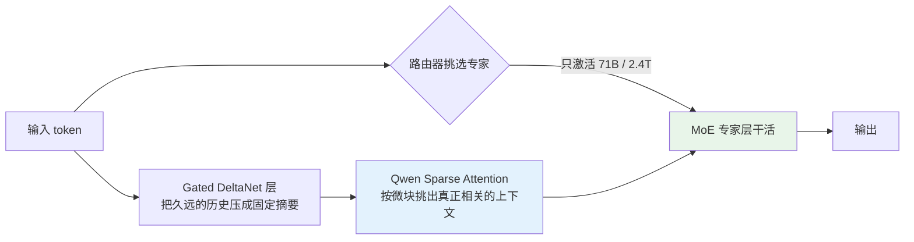
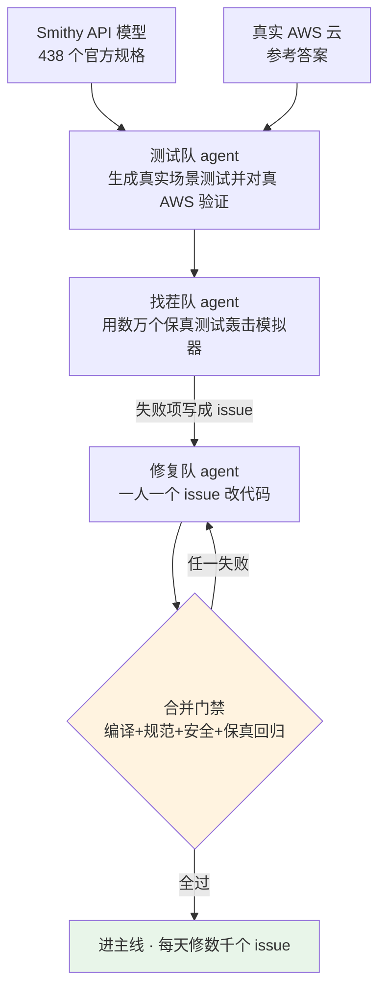
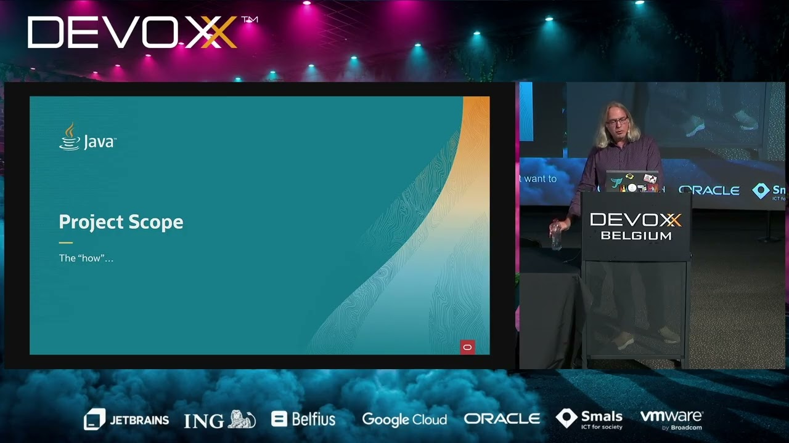

# 🚀 LLM / Agent / Java 前沿日报

**日期：2026-11-17（周二）** · 覆盖过去 24–48 小时动态

## 📌 今日速览

| 板块 | 今日最重要一件事 |
|---|---|
| 🧠 LLM | **阿里发布 Qwen4-Max**：2.4 万亿参数 MoE、每 token 只激活 71B、原生视觉、100 万 token 上下文；官方称同任务比 Qwen3.8-Max 少用最多 ~50% token，平均任务成本从 $4.43 降到 $1.67（-62%）——旗舰模型竞争的主战场已从"更聪明"转向"同样的活花更少的钱" |
| 🤖 Agent | **AWS Emulator：一个 100% 由 AI agent 写成的产品**——数千个 agent 分三队（写测试/找问题/修问题），人类"没有写过、也没审过一行代码"；每天数千个 issue 被修复，以 CC0 公有领域协议开源，覆盖 200+ AWS 服务的本地模拟 |
| ☕ Java | **Valhalla 值对象（JEP 401）以预览特性进入 OpenJDK 主线**：一个约 3000 commit 的巨型 PR 落地，Oracle JVM 工程师在 Devoxx 讲清"为什么改一个关键字背后的工程量这么大"——Java 对象与原始类型之间的"裂痕"开始愈合 |

---

## 🧠 LLM 前沿

### 🔬 深度解析：Qwen4-Max 发布——旗舰大模型进入"每 token 成本"竞赛

**🎯 30 秒版本**：阿里 11 月 16 日发布新旗舰 Qwen4-Max，2.4 万亿参数但每次推理只用其中 71B（约 3%），支持看图看视频、上下文 100 万 token。最重要的不是"更强"，而是官方评测里干同样的活比上一代便宜 62%。如果你在用 API 跑 agent 任务，这是一次实打实的降价换代。

**前因**：2026 年的旗舰模型竞争已经变了味。前两年大家卷"跑分更高"，但 agent 类应用（让模型连续调用工具干几小时的活）普及后，账单成了主角——一个长任务动辄烧掉几百万 token，模型稍微话痨一点，成本就翻倍。所以这一代旗舰的关键词是 **token 效率**（完成同一任务消耗的 token 数）：Qwen4-Max 在 Work360 评测（覆盖 721 个专业领域的真实办公任务）上比 Qwen3.8-Max 少用 24%–35% token，在 Terminal-Bench 4.0（命令行操作基准）上少用约 48%。平均每个任务成本从 $4.43 降到 $1.67——相当于原来 100 块的 API 账单变 38 块。API 定价也全面下调：输入 $1.5/百万 token、输出 $4.5/百万 token、隐式缓存低至 $0.075/百万（缓存价降 70%，长对话 agent 受益最大）。

**架构怎么变便宜的**：Qwen4-Max 是 MoE（Mixture of Experts，混合专家——模型像一家有 2.4 万名员工的公司，每来一个 token 只叫醒其中约 71B 参数对应的"专家"干活）。类比：图书馆藏书 2.4 万亿页，但每次只翻相关的几页。这一代做了三处系统升级：
- **GDN + QSA 混合注意力**：每 3 层 Gated DeltaNet（把历史记录"压缩成固定大小摘要"的线性注意力，像只保留会议纪要而非全程录音）配 1 层 Qwen Sparse Attention（用轻量索引器按"微块"粒度挑出真正相关的上下文）。这就是 100 万 token 上下文还能跑得动、且长文成本不爆炸的关键。
- **激活参数比上代少 25%**：总盘子还是 2.4T，但每 token 干活的部分更小——直接对应推理成本下降。
- **额外 328B 的 N-gram Embedding 参数**：给常见词组"打包记忆"，减少重复计算。

*图：Qwen4-Max 的省钱逻辑——总参数 2.4T 是"图书馆总藏书"，每 token 只激活 71B；长历史先被 DeltaNet 压缩，再由稀疏注意力精准捞相关段落。*

**为什么现在变**：agent 是烧钱大户。官方博客通篇在讲"24/7 长程 agent"：Live Delivery（长任务边干边交付可用版本，用户随时纠偏，配套插件已开源）、自主药物研发（454 次工具调用、3239 次计算评估、24 个候选分子）、48 小时无人值守设计并合成出新冷却液分子。这些场景下"每任务成本"比"跑分"重要得多。

**谁受影响**：① 用 API 跑 agent 的团队——同预算能多跑一倍以上任务；② OpenAI/Anthropic/Google 的旗舰定价压力——中国厂商把"高性能+低价"的组合又推进一步；③ 开源社区——官方明确说 Qwen4 系列的小模型**会开源权重**，同一代技术下放到小尺寸，值得盯。

**局限与诚实声明**：以上 token 节省与成本数字全部来自阿里**内部评测**，第三方复测尚未出现，按惯例打个折扣看待；模型仅在 QwenCloud API 与自家产品（QwenWork/Qoder/QwenStudio）提供，Max 本身不开源。

- 来源：[Qwen 官方博客](https://qwen.ai/blog?id=qwen4-max) · [HN 讨论（752 分）](https://news.ycombinator.com/item?id=50513215) · [ForkLog 报道](https://forklog.com/en/alibaba-launches-qwen4-max-ai-model-with-2-4-trillion-parameters)

### 📰 LLM 要闻简报

1. **HN 头名之争就是 Qwen4-Max（752 分、380 评论）**：社区争论焦点有两个——一是"token 效率提升 50%"到底是模型变聪明还是评测口径变化（官方博客只给内部评测，Terminal-Bench 4.0 上省 48% token 的说法缺少第三方复现）；二是 2.4T 总参数/71B 激活的"参数通胀"是否还有意义（反方认为激活参数才是真实成本，总参数只是营销数字；支持方认为 N-gram Embedding 的 328B 参数确实承担了记忆功能）。[HN 讨论](https://news.ycombinator.com/item?id=50513215) · [原文](https://qwen.ai/blog?id=qwen4-max)
2. **Steve Blank 长文《What's Next for Nvidia?》（HN 394 分、499 评论）**：斯坦福教授分析 Nvidia 在 AI 推理时代的护城河与风险——训练市场饱和后，推理芯片（Groq、Cerebras、各家自研 ASIC）正在蚕食份额，而大客户（OpenAI/Anthropic/Google）同时是自研芯片的推进者，"卖铲子的人发现买铲子的人在开矿"。这是理解当前 AI 硬件格局的一篇好综述。[原文](https://steveblank.com/2026/11/15/whats-next-for-nvidia/)
3. **arXiv《Folding Language Models into Themselves》**：探索把大模型的能力"折叠"回自身更小配置的自蒸馏路线，与 Qwen 预告的"小模型开源"呼应——大厂旗舰技术下放到小模型是 2026 下半年最明显的趋势之一。[arXiv:2611.18113](https://arxiv.org/abs/2611.18113)
4. **arXiv《Contagious Fingerprints: When LLMs Inherit Another Model's Identity》**：发现用模型 A 的输出微调模型 B 后，B 会"遗传"A 的模型指纹（用于溯源识别的水印式特征）——对"蒸馏数据合规性"和模型溯源都是坏消息：你以为训了个新模型，它却带着别人的身份证。[arXiv:2611.18104](https://arxiv.org/abs/2611.18104)

---

## 🤖 Agent 进展

### 🔬 深度解析：AWS Emulator——"agent 写、agent 测、agent 修，人类一行代码没碰过"

**🎯 30 秒版本**：AWS 发布了一个能在你自己电脑上模拟 200+ 个 AWS 服务的本地模拟器（比如假装的 SQS 消息队列、假装的 S3），让你不花一分钱、不联网也能测试云应用。真正的爆炸点是：这个项目 100% 由数千个自主 AI agent 编写和维护，AWS 团队"没有写过、也没有审过任何一行代码"，并以 CC0（公有领域，随便用）协议完全开源。

**前因**：coding agent（会自己写代码、跑命令的 AI，如 Claude Code、AWS 自家的 Kiro）有个致命痛点——它们改完代码想验证"我的程序在 AWS 上还能跑吗"，要么真连 AWS（花钱、慢、有副作用），要么放弃验证盲改。Agent 时代这个问题被放大了：人写代码一天提交几次，agent 一小时能改几十次，每次都连云测试根本不可行。此前有 LocalStack、moto 等第三方模拟器，但它们靠人逆向工程 AWS 行为，覆盖度和保真度都追不上 AWS 的更新速度。

**为什么现在能成**：起点是 Anthropic 年初的实验——agent 自主写出 C 编译器，证明了"给定明确规格 + 参考实现，agent 能忠实完成工程"。AWS 高级首席工程师 Matthew Goldberg 意识到自己恰好两样都有：**438 个 Smithy API 模型**（AWS 官方发布的 API 规格，机器可读）当规格，**真实 AWS 云**当参考实现。他给了 Kiro 一个三句话的 prompt（写 CLI 测试→对真实 AWS 迭代到通过→构建通过同样测试的内存实现），15 分钟得到一个能用的 SQS 模拟，一个周末"把剩下的 AWS 都建了出来"。

**工程怎么保障质量**（这是最值得学的部分）：三队 agent 流水线——
- **Team 1 测试队**：从 API 模型生成真实场景测试（建队列→发消息→收消息→确认→删除），先对真实 AWS 验证，存成数万个"保真测试"；
- **Team 2 找茬队**：拿测试反复轰击模拟器，失败项归类后提交到 `things-that-do-not-work` 文件夹（一个 issue 一个 agent）；
- **Team 3 修复队**：每个 agent 认领一个 issue，改完必须过"合并门禁"——编译、代码规范审查、安全审查、保真回归四项全过才能进主线，任何一项失败就打回重做。

*图：AWS Emulator 的三队 agent 流水线。核心思想是 Goldberg 的"填色本"比喻：agent 不是不听话，是能力有限——给它们边界清晰的任务（一个 issue）、客观的验收标准（保真测试）、必经的关卡（合并门禁），就能规模化信任它们的产出。*

**变了之后谁受影响**：① 用 AWS 的开发者——`AWS_ENDPOINT_URL` 环境变量指向本地模拟器即可，应用代码零改动；Rust 项目还有嵌入模式（模拟器直接跑在测试进程里）。② coding agent 生态——官方提供 `aws-emulator` skill，agent 可以自己启动模拟器自测。③ 软件工程范式——这是目前"全 agent 代码库"最高调的工业级案例，每天数百 agent 并发提交、数千 issue 关闭，全部 commit 历史公开可查（连 agent 早年"自己写了个 Python 解释器"的黑历史都在）。**已知局限要诚实**：不评估 IAM 权限策略（不能用它测安全）、单进程单账号单区域、状态存内存重启即失、不模拟限流/故障/区域差异、不做沙箱——跑不受信任的代码要小心。

- 来源：[AWS 官方博文](https://www.aboutamazon.com/news/aws/how-autonomous-ai-agents-built-aws-emulator) · [InfoQ 报道](https://www.infoq.com/news/2026/11/aws-emulator-agents/) · [GeekWire](https://www.geekwire.com/2026/aws-gives-developers-a-free-local-stand-in-for-its-cloud-built-from-scratch-by-ai-agents/) · [GitHub](https://github.com/aws/aws-emulator) · [Simon Willison 点评](https://simonwillison.net/2026/Nov/11/aws-emulator/)

*图：AWS Emulator——本地模拟 200+ AWS 服务，由 AI agent 全自主编写。图源：[GeekWire](https://www.geekwire.com/2026/aws-gives-developers-a-free-local-stand-in-for-its-cloud-built-from-scratch-by-ai-agents/)*

### 📰 Agent 要闻简报

1. **Uber 法务 AI Agent：合同审查时间降 20%+，AI 决定准确率 91%**。嵌入 Microsoft Word，用 RAG（检索增强生成——回答前先从资料库捞相关内容）+ 律师历史反馈 + 确定性规则引擎三层架构审合同改动。关键工程细节：相似检索先从数千条历史记录缩到 ~20 条候选，再用第二个 LLM 过滤相关性；时间衰减权重半衰期 365 天（新判例优先但老判例不弃）；**不可谈判的法律红线由规则引擎硬编码，可以推翻模型建议**——"该 AI 的地方 AI，该硬规则的地方绝不交给概率"，这个分工值得所有做企业 agent 的人抄作业。[InfoQ](https://www.infoq.com/news/2026/11/uber-legal-redlining-agent/)
2. **阿里开源 open-code-review（GitHub Trending，+946★/日）**：混合架构代码评审工具——确定性的部分（格式、已知坏模式）用传统引擎秒判，需要理解上下文的部分才交给 AI，宣称在阿里内部规模"实战检验"。Go 编写。与昨天报道的 Anthropic 评审流水线同属"AI 代码评审"赛道，但路线相反：Anthropic 是六层检查五层机器，阿里是单工具内混合引擎。[GitHub](https://github.com/alibaba/open-code-review)
3. **NVIDIA 开源 SkillEvaluator（Trending +953★/日）**：给"AI agent skill"（喂给 agent 的技能包，如 Claude Code skills）做多层评估的框架——质量门禁、语义重叠检测（两个 skill 是否干重复的事）、合成测试数据生成。Agent skill 生态爆发后，"skill 本身怎么质检"成了新问题，这是第一个大厂出手的评估框架。[GitHub](https://github.com/NVIDIA/SkillEvaluator)
4. **arXiv《Agent-as-a-Judge》**：让 agent 评估 agent 的系统化方法——传统 LLM-as-a-Judge（用大模型当裁判打分）只看最终输出，Agent-as-a-Judge 能审查中间步骤（工具调用对不对、规划合不合理），对长程任务的评估更可靠。[arXiv:2611.18067](https://arxiv.org/abs/2611.18067)
5. **arXiv《Can You Trust Your Finance Agent?》**：对一个**已上线的**金融研究 agent 做漂移（drift，模型行为随时间/数据变化而偏离原状）诊断与可审计干预——不是实验室基准，是生产环境 agent 的"体检报告"方法论，对跑真金白银的 agent（比如我们的模拟盘体系）有直接参考价值。[arXiv:2611.17939](https://arxiv.org/abs/2611.17939)

---

## ☕ Java 工程

### 🔬 深度解析：Valhalla 值对象进主线——"一个关键字的改动，为什么花了 3000 个 commit"

**🎯 30 秒版本**：Java 十几年来的"圣杯项目" Valhalla 的第一个大成果——**值对象（value objects）**——以预览特性（JEP 401）身份合入了 OpenJDK 主线。Oracle JVM 工程师 David Simms 提交了那个传说中的近 3000 commit 巨型 PR，并在 Devoxx Belgium 2026 现场讲解了它是什么、为什么值这个价。对普通 Java 开发者：未来你只需把 `class` 改成 `value class`，就能得到"像 int 一样快、像对象一样有方法"的新类型。

**前因——Java 的"裂痕"（the rift）**：Java 类型系统里住着两拨互不往来的居民。**原始类型**（primitive，如 `int`、`double`）快——直接就是内存里的一个数，但没有任何封装，不能带方法、不能为 null、不能实现接口。**对象**（如 `Integer`）什么都能干，但每个实例都要在堆上单独占一块地、带一个"对象头"（记录身份和 GC 信息的元数据，通常 12–16 字节）。类比：原始类型是散装鸡蛋（便宜紧凑但没法贴标签），对象是每颗蛋配一个带说明书的礼盒。装一个 `int` 的 `Integer` 实际占 16 字节——**数据只占 1/4，包装占 3/4**。当你要存一亿个数字时，这个"礼盒税"就是几个 GB 的内存差、几倍的缓存未命中。过去二十年的补救（`int[]` 数组、Netty 的 ByteBuf、各种 off-heap 技巧）都是在语言外打补丁。

**为什么现在变**：Valhalla 项目 2014 年立项，卡了很多年——难点在于值对象"没有身份"（两个值相等的 `Point(1,2)` 就是同一个东西，不再区分"这是哪一个对象"），这与 Java 现有的同步语义、`==` 比较、反射、序列化全都冲突，动一发牵全身。现在 JEP 401 以**预览特性**（preview feature——语法先进 JDK 让你试用，但生产环境需显式开启开关，后续版本还可能微调）落地，说明核心设计终于收敛。Simms 的演讲标题就是自嘲：语法层面"只改一个关键字、库甚至不用重编译"，但支撑这一个关键字的 JVM 改造花了 3000 个 commit（他自己都承认标题党——那只是最后一个 PR，前面还有两个整仓库的工作量）。

**变了之后谁受影响**：
- **性能敏感场景立竿见影**：JVM 可以把值对象直接内联进字段和数组里（`Point[]` 不再是一堆指针指向散落堆上的礼盒，而是一整块连续内存的裸数据）——缓存友好、GC 压力骤降。金融行情、游戏坐标、科学计算是第一批受益者；
- **普通业务代码**：短期无感（预览特性），中期 record 类 DTO 可平滑升级为 `value class` 白拿性能；
- **库作者**：JVM 层的"对象-原始类型统一"（演讲里叫 healing the rift）意味着未来 `List<int>` 这种写法有了实现基础——Java 泛型二十年"不能装原始类型"的历史包袱将被卸掉；
- **同期信号**：Inside.java 本周还发了《Adaptive Heap Sizing + Numeric Conversion + Primitive Patterns》播客（Newscast #117），加上 InfoQ 报道 Lazy Constants（JEP 547，"懒加载常量"——`final` 的性能但初始化时机自由）第四次预览已升级为 JDK 28 目标特性，11 月 18 日评审截止——**Java 数值/类型体系正在集体换挡**。

*图：David Simms 的 Devoxx Belgium 2026 演讲《Why it takes 3000 commits to bring Valhalla's value objects to the JDK》。图源：[YouTube 录像](https://www.youtube.com/watch?v=D_AmK8-UnZg)*

- 来源：[Inside.java 文章](https://inside.java/2026/11/16/devoxxbelgium-valhalla-value-objects/) · [Devoxx 演讲页](https://m.devoxx.com/events/dvbe26/talks/21694/why-it-takes-3000-commits-to-bring-valhalla-s-value-objects-to-the-jdk)

### 📰 Java 要闻简报

1. **InfoQ Java 周报：Lazy Constants 冲刺 JDK 28 + 一批发版潮**。JEP 547（Lazy Constants，懒常量——声明时不赋值、第一次用到才算、之后像 `final` 一样快且线程安全）第四次预览已从候选升级为"目标 JDK 28"，评审 11 月 18 日截止。同周：Spring AI 2.1.0-RC2（新增 DecisionModel API——返回"是/否概率"而不是文本，适合风控评分类场景）、Spring Boot 4.2.0-RC2、Hibernate ORM/Reactive 首个 RC、GlassFish 第四里程碑、TomEE 第二里程碑。[InfoQ](https://www.infoq.com/news/2026/11/java-news-roundup-nov09-2026/)
2. **Primitive Patterns 预览特性撤回**：Inside.java 官宣把"原始类型模式匹配"从预览队列撤回，理由是等 Valhalla 数值体系定型后再统一设计——与值对象进主线是同一盘棋：宁可慢，不要两套冲突的数值类型语义。[Inside.java](https://inside.java/2026/11/11/withdraw-primitive-patterns-preview/)
3. **Oracle 发布 WebLogic Server 与 Coherence 26**：老牌企业级应用服务器与分布式缓存大版本更新，传统企业 Java 栈（尤其电信/金融）该看升级路径了。[Inside.java](https://inside.java/2026/11/12/announcing-oracle-weblogic-server-and-coherence-26/)
4. **Spring for Apache Pulsar 换了新家**：Spring 官方宣布 Pulsar 集成项目移交 Apache 软件基金会体系维护——Pulsar（消息队列，Kafka 的竞争对手）的 Spring 用户注意坐标与版本节奏变化。[Spring 博客](https://spring.io/blog/2026/11/10/spring-pulsar-new-home-asf)
5. **GitHub 重建 Copilot 应用的 diff 渲染层**：为在百万行级 PR 里不卡顿，GitHub 把 Copilot 桌面端的代码对比界面整个重写——AI 时代 PR 越写越大（agent 一次提交几千行），传统 diff 组件先撑不住了，这是"AI 改变基础设施"的又一例。[InfoQ](https://www.infoq.com/news/2026/11/github-pull-requests-rebuild/)

---

## 📋 今日其余动态

| # | 板块 | 动态 | 链接 |
|---|---|---|---|
| 1 | 🧠 LLM | arXiv《Tracing Knowledge and Reasoning in LLM》：追踪模型内部"知识"与"推理"分别发生在哪些层/注意力头 | [arXiv:2611.17461](https://arxiv.org/abs/2611.17461) |
| 2 | 🧠 LLM | arXiv《See Every Block Once》：掩码扩散语言模型（非自回归的"一次成型"文本生成路线）的方差缩减后训练 | [arXiv:2611.17754](https://arxiv.org/abs/2611.17754) |
| 3 | 🧠 LLM | arXiv《LuthorSQL》：Text-to-SQL 的"系统1快答 + LLM 慢想"双层架构——简单查询走一次性小模型，复杂的才惊动大模型 | [arXiv:2611.17780](https://arxiv.org/abs/2611.17780) |
| 4 | 🤖 Agent | Trending #1：dream-num/univer 持续霸榜（+1878★/日）——"给 AI 用的办公套件 SDK"，两天连涨 | [GitHub](https://github.com/dream-num/univer) |
| 5 | 🤖 Agent | Trending：backnotprop/plannotator（+689★/日）——"留在 agent 工作环里"的标注/评审工作台：塑形、决策、计划、代码批注一站完成 | [GitHub](https://github.com/backnotprop/plannotator) |
| 6 | 🤖 Agent | Trending：google-labs-code/stitch-skills（+540★/日）——Google Stitch（AI 生成 UI 工具）MCP 服务的官方 Agent Skills 库 | [GitHub](https://github.com/google-labs-code/stitch-skills) |
| 7 | 🤖 Agent | Trending：google-research/paper-orchestra（+306★/日）——多 agent 自动写 AI 论文的框架，学术圈的"AI 生成内容"又进一步 | [GitHub](https://github.com/google-research/paper-orchestra) |
| 8 | 🤖 Agent | Trending：mvanhorn/last30days-skill（+122★/日）——跨 Reddit/X/YouTube/HN/Polymarket 调研任意话题近 30 天舆情并综合成报告的 agent skill | [GitHub](https://github.com/mvanhorn/last30days-skill) |
| 9 | 🤖 Agent | arXiv《CarryOn》：长程 agent 的上下文管理——学习"什么该留在上下文里"，直击长任务 token 爆炸痛点 | [arXiv:2611.17808](https://arxiv.org/abs/2611.17808) |
| 10 | 🤖 Agent | arXiv《More Agents, More Samples, or More Thinking?》：多 agent 协作的收益到底来自协调、集成还是测试时算力——三者拆解 | [arXiv:2611.17610](https://arxiv.org/abs/2611.17610) |
| 11 | ☕ Java | G1 垃圾收集器官方教程（Inside.java）：默认 GC 的原理级入门，配 JDK 27 的 G1/Parallel/Serial 变更一起看 | [Inside.java](https://inside.java/2026/11/10/g1gc-tutorial/) |
| 12 | ☕ Java | HN 热文《Do we still have to denormalize?》：ParadeDB 论证"有了可搜索的 schema 还要不要反范式化"——数据库设计与搜索引擎边界的重估（HN 106 分） | [原文](https://www.paradedb.com/blog/joins) · [HN](https://news.ycombinator.com/item?id=50484998) |
| 13 | 🔒 安全 | uBlock Origin 曝通用 XSS：网站可驱动的"元素选取器"能跨站注入脚本（HN 520 分）——浏览器扩展的隐藏攻击面 | [原文](https://iter.ca/post/ubo-uxss/) |
| 14 | 🔒 安全 | 旧 Bitly 短链正被批量劫持：过期域名重新注册后，百万级历史短链指向的内容可被篡改（ Burger King 推文案例） | [RansomNews](https://ransomnews.com/burger-king-tweet-bitly-link-hijack-2026/) |
| 15 | 🌐 综合 | Tor 项目遭持续 DDoS，紧急发布 0.4.9.17 快速响应修复（HN 214 分） | [Tor 论坛](https://forum.torproject.org/t/security-release-0-4-9-17/22454) |
| 16 | 🌐 综合 | MIT《How to make almost anything》课程站走红（HN 620 分）：从 PCB 到 3D 打印的"个人制造"圣经课 | [MIT](https://pub.cba.mit.edu/863.26/site/) |

---

## 💡 一句话点评

今天的三条主线其实是一个故事的三面：**AI 把"智能"和"代码"双双变成了廉价大宗商品**。Qwen4-Max 把每任务成本砍 62%（智能降价），AWS Emulator 证明整个产品可以让 agent 流水线无人类写出来（代码生产自动化），而 Java 这边，Valhalla 值对象 + Lazy Constants 的密集推进恰似在回应：当机器成为代码的主要作者和读者，语言本身要为"精确、零开销、可验证"重新设计。值得记住的是 AWS 那个"填色本"比喻——**规模化使用 agent 的关键不是更聪明的模型，而是更清晰的边界与更硬的门禁**。

---

🤖 本报告由 Hermes Agent 每日凌晨自动调研生成 · [HermesReports](https://github.com/knolonzhou/HermesReports)
