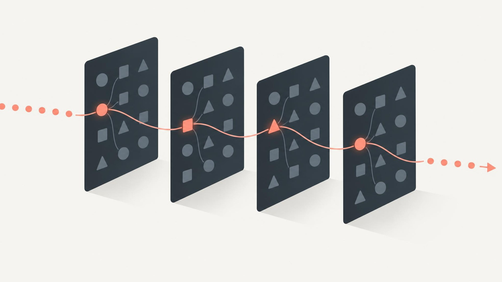
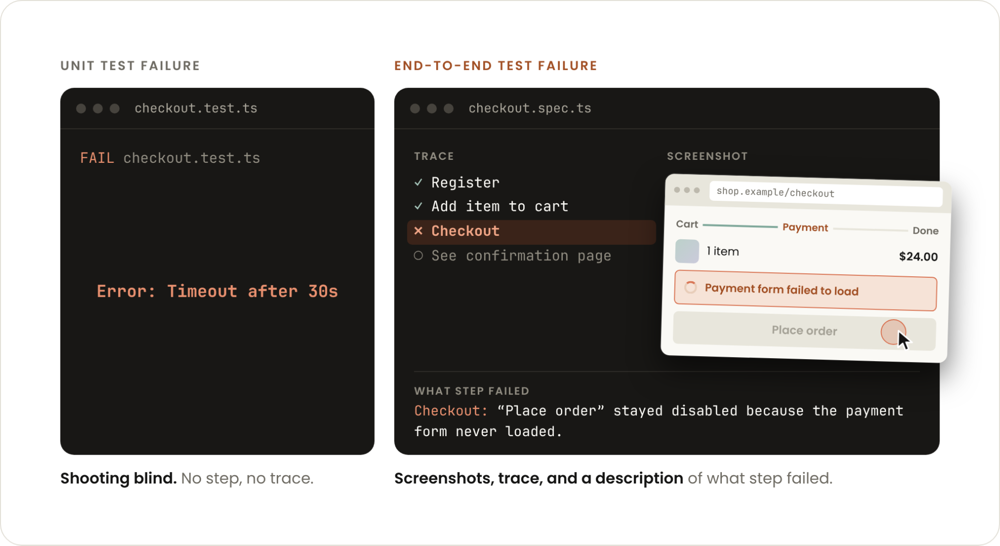
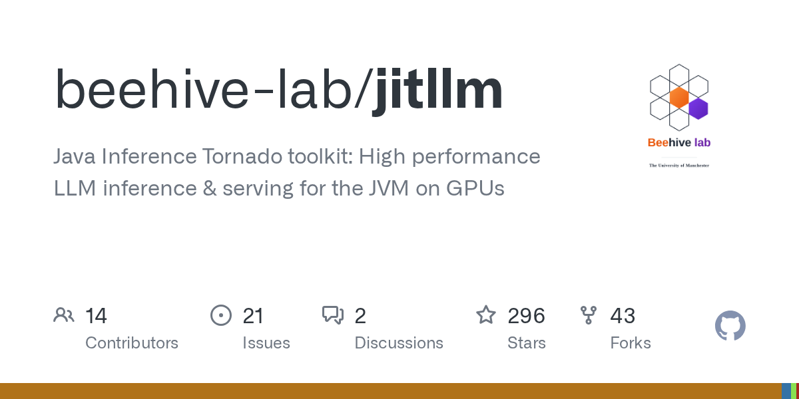
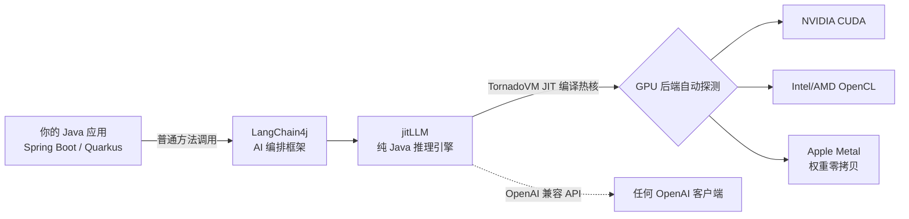

# 🗞️ LLM / Agent / Java 前沿日报 · 2026-11-18（周三）

> 面向"只懂一点点"的读者：所有术语首次出现都会用白话解释。今天的主线词是**"验证"**——从欧洲的自研小模型，到 Anthropic 的测试方法论，再到 Java 世界自己的推理引擎，大家都在回答同一个问题：AI 产出这么多东西，怎么确认它是对的、是快的、是自己的？

## 📌 今日速览

| 板块 | 最重要的事 | 一句话 |
|---|---|---|
| 🧠 LLM | 法国云厂商 OVHcloud 发布首个自研开源大模型 Olala mini | 70 亿参数只用 10 亿干活，8GB 显卡就能跑，欧洲"主权 AI"交卷 |
| 🤖 Agent | Claude Code 团队公开"验证方法论"博客 | 团队 90% 代码由 AI 写，靠三种测试 + 一堆纪律让人类不用逐行看 |
| ☕ Java | jitLLM 3.0：纯 Java 的 GPU 推理引擎大升级 | 启动快 1.43 倍、预填充快至 9.3 倍，JVM 终于有了自己的"vLLM" |

---

## 🧠 LLM 前沿

### 🔬 深度解析：OVHcloud 发布 Olala mini——欧洲云厂商的第一份"自研大模型"答卷

**🎯 30 秒版本**：法国公司 OVHcloud（欧洲最大的云服务商，相当于"欧洲版阿里云"）在 11 月 17 日发布了自家第一个大模型家族 Olala 的首款产品 Olala mini 7A1B。它不拼跑分，拼的是**小到离谱的硬件门槛**：8GB 显存的显卡就能跑，甚至没有显卡、纯 CPU 也能到每秒 50 个 token。权重以 Apache 2.0（最宽松的开源协议之一，商用无限制）放上 Hugging Face。

**背景铺垫**。先解释两个概念：① **MoE（Mixture of Experts，混合专家）**——把一个模型拆成很多"专家"小组，每次回答只叫醒其中一小部分，好比一家 256 个医生的医院，你感冒只需叫醒 1 个呼吸科医生，不用全院会诊；② **激活参数**——总参数是"医院规模"，激活参数是"每次看诊实际出勤的医生数"。Olala mini 总参数 70 亿（7B），但每次只激活 10 亿（1B），"7A1B"这名字就是这么来的（7B total, Active 1B）。

**这次真正的新意在注意力机制**。模型理解上下文靠"注意力"（attention，即"看前文找重点"的机制），但传统注意力有个毛病：上下文越长，计算量平方级暴涨，内存也吃得多。Olala mini 用了**混合注意力**：把 Differential-TPA（一种压缩版注意力，把"记住前文"的开销压小）和 Mamba-3（一类不按平方增长、像流水线一样顺序处理的新架构）拼在一起用。类比：传统注意力是"每写一个字都把全书重翻一遍"，Mamba 是"只带着一份滚动更新的读书笔记写下去"，Olala 两者混用——需要精确回看的地方翻书，大部分时候看笔记。

**关键数字给参照系**：
- RTX A4500（一张约 4000 元档的专业显卡，8GB 显存）上 160 tokens/秒——大约是正常人阅读速度的 20 倍以上，本地对话完全够用；
- 纯 CPU 50 tokens/秒——意味着**没有独立显卡的办公笔记本也能跑**，这在两年前只有 1B 以下的玩具模型做得到；
- 上下文窗口目前 3.2 万 token（约 5 万汉字），年底的 v1.1 会扩到 12.8 万；
- 训练用掉约 **700 万欧元**的公共超算机时（欧洲的 Jupiter、MeluXina、Jean Zay 三台超算）——对比前沿大模型动辄数亿美元的训练成本，这是零头的零头；
- 首个用户是法国搜索引擎 Qwant：回答快 20%，**推理成本降到原来的 1/3**。

**前因后果**：之前欧洲在基础模型上基本是"用美国的模型、跑在自己的云上"。OVH CEO Octave Klaba 在发布稿里说得很直白："我们不能指望某些实验室未来几年一直慷慨地开源它们的模型。"他的判断是训练 know-how 已经普及、训练成本三年降了 20 倍，所以现在自建模型可以做成一门赚钱的生意。发布包甚至附了 **EU AI Act 合规文档**（欧盟《人工智能法案》要求高风险 AI 提供的透明度材料）——这是美国厂商发布时不会带的东西，也是"主权 AI"叙事的卖点。

**要泼的冷水**：官方**没有公布任何跑分**。媒体（alfw.ai）直接以"7B 模型，零基准"为标题报道。没有 MMLU/GSM8K 之类的分数，我们不知道它 1B 激活参数的"智力水平"到底如何——可能适合 Qwant 这种短问答，但复杂推理多半打不过同尺寸竞品。11 月 19 日 OVHcloud AI Summit 会有正式发布，届时看有没有补充数据。

*图：Olala mini 7A1B 发布配图（来源：[unite.ai 报道](https://unite.ai/ovhcloud-introduces-olala-mini-7a1b-as-its-first-open-source-llm/)）*

**💡 所以呢**：对普通开发者的实际意义是——"CPU 上每秒 50 token 的 7B 级 MoE"这个组合，让**离线、内网、边缘设备上的本地助手**又多了一个可商用选项（Apache 2.0）。如果你在做不能出网的内部工具，值得等 v1.1 的 128K 上下文版本出来再评估。

- 来源：[OVHcloud 官方发布稿](https://corporate.ovhcloud.com/en-au/newsroom/news/ovh-olala-mini) · [unite.ai 分析](https://unite.ai/ovhcloud-introduces-olala-mini-7a1b-as-its-first-open-source-llm/) · [af.net 规格汇总](https://af.net/realtime/ovhcloud-releases-open-weight-7b-olala-mini-llm-under-apache-2-0)

### 📰 LLM 要闻简报

1. **腾讯发布 Hy4 flash：100 万上下文的"白菜价"多模态模型**。总参数 2240 亿（含 640 亿 Engram 参数）、激活仅 120 亿，输入 $0.070/百万 token、输出 $0.281/百万 token——输出价大约是 Claude Fable 5.2（$40/百万）的 **1/140**，缓存命中输入更是低到 $0.003。已上线腾讯云 TokenHub、元宝、企业微信、QQ 等，OpenRouter 接入在路上。**为什么重要**：这是"每 token 成本"竞赛（本周一 Qwen4-Max 刚砍价 58%）的又一枪，长文档摘要、客服类大批量场景的成本地板再次下探。[PRNewswire](https://prnewswire.com/news-releases/tencent-launches-hy4-flash-to-power-high-speed-cost-efficient-ai-deployment-for-everyday-workflows-302941875.html)

2. **百度、小米 CEO 罕见同频：警告"AI 炒作与回报的差距"在拉大**。两家中国大厂掌门人在同一周公开谈 AI 投入产出失衡（HN 134 分热议）。**为什么重要**：说这话的不是旁观分析师而是重金投入的当事人——类似 2000 年互联网泡沫后期运营商开始自查的信号；对从业者意味着"能证明 ROI 的 AI 应用"会比"更大的模型"更受资源倾斜。[SCMP](https://www.scmp.com/tech/big-tech/article/3374774/baidu-xiaomi-ceos-warn-growing-gap-between-ai-hype-and-returns)

3. **Thinking Machines 确认 Inkling 2 Small 权重可下载（Apache 2.0）**。5940 亿总参数 / 170 亿激活的 MoE，支持图像输入——Mira Murati 新公司的首个开放权重模型正式落地 Hugging Face。**为什么重要**：Apache 2.0 无附加条款，是目前"可自由商用的最大级别"开放权重模型之一，给不想被单一 API 锁定的团队留了退路。[Tree News 汇总](https://tree.news/news/from-new-models-and-shared-agent-workspaces-to-verifiable-agent-identities-and-g4cy7e3gz27r)

4. **TokenAI 发布 Replica Preview 语音三兄弟（0.5B/0.6B/0.7B-EN 开放权重）**。主打表现力强的多语种 TTS（text-to-speech，文字转语音）和参考音频克隆。**为什么重要**：语音模型赛道此前开放权重选择少（多数被 ElevenLabs 等闭源 API 占据），小尺寸+可克隆意味着播客、有声书、语音助手的自建方案门槛大降；但声音克隆的授权合规问题也随之而来。[公告](https://tokenai.llc/company/announcements/replica-preview-family-open-weights)

5. **Mistral 在欧洲送 3 个月 Vibe Pro**。法国模型厂商的促销攻势，配合欧盟"主权 AI"情绪，明显在抢欧洲开发者心智。[官方 X](https://x.com/MistralAI/status/2122713540666806397)

---

## 🤖 Agent 进展

### 🔬 深度解析：Claude Code 团队公开"验证方法论"——当 90% 代码由 AI 写，人类到底还干什么？

**🎯 30 秒版本**：Anthropic 的 Claude Code 团队 11 月 16 日发了一篇工程博客，第一次完整披露他们内部的规矩：团队约 90% 的代码由 Claude 写并由 Claude 评审，人类的工作重心从"读每一行 diff"转移到"**定义什么叫完成，然后审查证据**"。核心手段是给 agent 建"验证回路"（verification loop，让 AI 自己跑测试拿到客观反馈的机制）。

**背景铺垫**：为什么"验证"突然成了瓶颈？想象你雇了一个手速极快但你不完全信任的实习生——他一天能写一万行，你一天只能读五百行。没有验证机制时，你最多敢同时开 1-2 个 agent（因为每个产出都要你亲自过目）；有了验证机制，agent 自己能证明"我做完了、测试全绿"，你可以并行开几十上百个。**验证回路就是 agent 规模化的杠杆**，Anthropic 内部数据显示：加一个独立的"评分员" agent 按 rubric（评分细则）检查工作，任务成功率最多提高 10 个百分点，越难的任务收益越大。

**博客最值得抄的三招**（这也是任何用 AI 写代码的团队可以直接落地的）：

**① 三种最值得投资的测试**。E2E 测试（end-to-end，端到端——模拟真实用户完整走一遍"加购物车→结账→看到确认页"）最优先，因为它"骗不过去"：功能要么整个能用要么不能用，失败时还能截图+步骤追踪告诉 agent 具体哪步坏了（配图见下）；相比之下单元测试可能全绿但功能照样是坏的。**Property 测试**（属性测试——写一条"理论上永不该破"的规则，比如"账户余额永远不能为负"，然后让 fast-check/Hypothesis 这类库自动生成几千个刁钻输入去攻击它）专门抓人和 AI 都想不到的边界情况。**Differential 测试**（差分测试——新旧两套系统喂同样的输入比对输出）是大迁移场景的杀手锏：老系统本身就是"标准答案"。

*图：左边是单元测试失败——只有一句"超时"，agent 摸黑修；右边是 E2E 测试失败——有步骤轨迹、截图、"哪一步坏了"的描述（来源：[claude.dev 博客](https://claude.dev/blog/how-the-claude-code-team-thinks-about-verification/)）*

**② 一串防"AI 自欺"的纪律**，每条都对应一种真实翻车模式：
- **改动不能碰自己的检查规则**——REVIEW.md 从主干分支读，绝不从 PR 分支读。否则 agent 可以"改考卷来通过考试"；
- **同一个测试连挂 3 轮就必须叫人**——防止 agent 无限循环自我安慰；
- **禁止 flaky 测试**（flaky=时好时坏的不稳定测试）：agent 不许跳过、不许加 sleep、不许重试到过，找不到根因就删掉测试并写明原因——否则 agent 学会的不是修 bug 而是"再跑一次碰运气"；
- **新门禁先开"观察模式"**：先只记录"本应拦截什么"，确认没有误伤再切强制。被强制拦 2 次后放行第 3 次，免得 agent 卡死；
- **每个 commit 盖"验证戳"**（包括"未验证"也要盖），可事后审计。

**③ 39 条可靠性检查清单按 diff 触发**。他们把历史事故沉淀成 39 条检查项，每条带一个"能从 diff 里看出来的触发条件"，比如"--resume 会加载旧会话记录"→ 只要改了会话存储或消息类型，就自动问"新字段在旧记录里不存在时能否安全加载"。Claude 每次只跑与当前 diff 匹配的 3-10 条——**没人需要背下全部历史事故，规则库替你记**。

**前因后果**：此前（11 月初）该团队发过《解决 Anthropic 的代码评审》，讲的是"评审"这一层；这篇是更底层的"验证"。两篇合起来是一个完整信号：AI 编程的竞争焦点已经从"模型会不会写代码"转到"**工程体系能不能廉价地证明代码是对的**"——HN 同日还有一篇冷水文：2.7 万次 coding agent 运行中 **64% 的推理花费花在了失败的运行上**（[runta.com](https://runta.com/blog/introducing-frontierharness-eval-v1-1/)）。烧钱的根源正是缺少验证回路：agent 试错十次才蒙对一次。

**💡 所以呢**：如果你在用任何 coding agent，这篇博客是免费的"最佳实践清单"。最划算的一步是照抄那个 `verify` skill——把"怎么本地启动/冒烟测试你的应用"写成一个 skill 放进 `.claude/skills/`，让 agent 提交前必须真跑一遍。

- 来源：[claude.dev 博客原文](https://claude.dev/blog/how-the-claude-code-team-thinks-about-verification/) · [HN 讨论（133 分）](https://news.ycombinator.com/item?id=50529612)

### 📰 Agent 要闻简报

1. **Datadog 把"生产实验"能力带进 AI Agent 可观测性**。A/B 测试平台 Optimizely 式的"在生产环境里对照实验"现在可以对 agent 用了：比较不同 prompt/模型/工具配置的真实用户效果，而不是只靠离线评测。**为什么重要**：agent 的"可观测性"（observability，即看清线上系统内部在干什么的能力）正从"看日志"升级到"做实验"——这是把 agent 当正经软件产品运营的标志。[InfoQ](https://www.infoq.com/news/2026/11/datadog-ai-agent-observability/)

2. **Google Gemini Enterprise 的 3-legged OAuth 正式 GA**。3LO（三方授权，就是"允许某应用代表你访问数据"的那套 OAuth 标准流程）现在支持 A2A 协议的 agent：agent 调 MCP 服务器或第三方 API 时**以登录用户本人的身份**，而不是共享的服务账号；需要授权时会暂停、弹窗征得同意、拿到 token 再继续。**为什么重要**：解决了企业 agent 最大的审计难题——出了事能追溯到"谁授权的、干了什么"，而不是所有操作都记在一个机器人账号头上。[Smillee 汇总](https://smillee.com/blog/self-hosted-managed-agents-a2a-user-oauth-chatgpt-voice-retirement-2026)

3. **arXiv 新论文实测 MCP agent 的"工具张冠李戴"问题**。《When Tool Names Are Not Identities》发现：多个 MCP 服务器提供相似工具名时，LLM agent 会把调用"错绑"到错误的 provider 上——MCP（Model Context Protocol，让 agent 接外部工具的标准协议）只按名字匹配工具，不验身份。**为什么重要**：这和你装两个名字相似的浏览器插件是同一类风险，而 agent 手里拿的是数据库和生产环境；选工具时校验 provider 身份应成为 MCP 客户端的标配。[arXiv](https://arxiv.org/abs/2611.21577)

4. **arXiv：文本相似度护栏挡不住 agent 间的提示注入传播**。《Safe Resemblance, Silent Propagation》实验显示：注入指令在 agent 之间转发时，即使措辞被改写得面目全非（相似度护栏判定"安全"），对下游 agent 的行为影响依然保留。**为什么重要**：多 agent 流水线里"上游输出=下游输入"，靠关键词/嵌入相似度做安全检查的思路被证明有结构性盲区。[arXiv](https://arxiv.org/abs/2611.21520)

5. **GitHub Trending 观察：agent 生态的"skills 军备竞赛"**。今日榜首 elementalsouls/Claude-BugHunter（+1007★）：82 个 bug 猎杀 skills + 15 个斜杠命令 + 681 个已披露漏洞报告模式；第二名 mvanhorn/last30days-skill（+772★）：让 agent 横扫 Reddit/X/YouTube/HN/Polymarket 近 30 天讨论再做综述。obra/superpowers（+1905★）继续霸榜。**为什么重要**：Skill（可插拔的 agent 技能包，一个 markdown 文件教 agent 干一类活）正在成为 agent 生态的"应用商店"，优质 skill 包本身就是竞争力。[BugHunter](https://github.com/elementalsouls/Claude-BugHunter) · [last30days](https://github.com/mvanhorn/last30days-skill)

---

## ☕ Java 工程

### 🔬 深度解析：jitLLM 3.0——JVM 终于有了自己的"vLLM"：纯 Java 跑 GPU 推理，快了多少？

**🎯 30 秒版本**：曼彻斯特大学 Beehive Lab 的 jitLLM 发布 3.0。它是一个**纯 Java** 的 LLM 推理与服务引擎（对标 Python 生态的 vLLM），靠 TornadoVM 把 transformer 热核（计算最密集的核心函数）在运行时 JIT 编译成 GPU 代码。3.0 的三个硬数字：GraalVM Native Image 下启动快 1.43 倍、prefill 最高快 9.3 倍、Apple Silicon 上权重零拷贝。即将接入 LangChain4j、Quarkus 和 Spring AI。

**背景铺垫**：① **prefill（预填充）**——LLM 推理分两阶段：先"读完"你输入的整个 prompt（prefill，计算密集），再一个一个吐字（decode，访存密集）。prefill 快=长文档场景下"首个字出来"快，是本地部署最影响体感的指标；② **vLLM** 是 Python 世界事实标准的推理引擎；Java 团队以前要跑本地模型只能起一个 Python sidecar（旁挂进程）——两套技术栈、两套部署、跨进程传数据。jitLLM 的存在意义就是把这个 sidecar 干掉。

**它凭什么能"纯 Java 跑 GPU"**：TornadoVM（JVM 上的异构计算框架，把 Java 方法编译到 CUDA/OpenCL/Metal）8.1 提供了统一内存的 `consumeFromUnifiedMemory`，让模型权重在 Apple Silicon 上**原地读**——不再把 GGUF 文件映射后再拷贝一份进 Metal 缓冲区（3.0 干掉的正是这次拷贝，"零拷贝"）。同一份 jar 在 NVIDIA（CUDA）、Intel/AMD（OpenCL）、Apple（Metal）上跑，后端自动探测，不用为每种 GPU 重编 native 库——这是 JNI 方案做不到的。

**关键数字给参照系**：
- **启动快 1.43 倍**：GraalVM Native Image（把 JVM 应用 AOT 编译成单个原生可执行文件，免去 JVM 预热）+ Leyden AOT 缓存（Project Leyden 是 OpenJDK 官方的"启动提速"计划）。对 serverless/CLI 场景，这就是"冷启动从几秒到一两秒"的差别；
- **prefill 最高 9.3 倍**：来自 CUDA 上的 tensor-core 批量 prefill。参照系：Llama-3.2-1B Q8_0 在 A100 上 prompt 处理从 4.9k → 29k tok/s，**超过了 llama.cpp**——Java 方案第一次在单点上跑赢 C++ 标杆；
- **Apple Silicon**：Llama-3.2-1B F16 prefill 从 40 → 2372 tok/s（M 系芯片上 Metal SIMD-group 矩阵批量 prefill 默认开启）；
- **批量解码**最高 41 倍聚合吞吐（B 条序列同步步进），带实验性的 `jitllm serve --continuous-batching`（连续批处理，vLLM 的招牌技术）；
- 对外暴露 **OpenAI 兼容 API**（`/v1/chat/completions`），任何 OpenAI 客户端把 base URL 指向 localhost 就能用。

*图：beehive-lab/jitllm 仓库卡片（来源：[GitHub](https://github.com/beehive-lab/jitllm)）*

**前因后果**：TornadoVM 8.0（10 月底）刚把对 Graal/JVMCI 的依赖换成了自研的纯 Java 编译器 TC，让它在**任何普通 JDK**（21-27）上都能跑；3.0 紧接着把性能补齐。这条线再往前，是本周 Inside.java 连发的 Valhalla 值对象、JEP 547 Lazy Constants（评审明天 11-18 截止）——**JVM 生态正在同时补"数值类型效率"和"AI 负载"两块短板**，而 LangChain4j 1.23 已把 jitLLM 列为官方本地推理 provider，Spring AI 接入在路上。

*怎么读这张图：Java 应用不再需要旁挂 Python 进程——从 Spring Boot 到 GPU 全在一个 JVM 技术栈里；右侧虚线表示它同时能以 HTTP 服务形态独立部署。*

**💡 所以呢**：如果你在维护"Java 后端 + 本地小模型"的混合系统（RAG、内网助手），现在可以把 Python sidecar 换成一个 Maven 依赖试试水：`jbang jitllm@beehive-lab -m 模型.gguf -p "提示词"` 一行命令即可体验。生产采用前注意两点：serving 模式仍是 preview，且需要 Java 21+ 与 TornadoVM SDK。

- 来源：[GitHub beehive-lab/jitllm](https://github.com/beehive-lab/jitllm) · [jitLLM 官网](https://www.tornadovm.org/jitllm) · [TornadoVM 官方公告](https://www.linkedin.com/posts/tornadovm_langchain4j-springai-java-activity-7526963453622902785-ybB_)

### 📰 Java 要闻简报

1. **InfoQ Java 周报：JEP 547 Lazy Constants 冲刺 JDK 28，评审今日截止**。Lazy Constants（懒常量——声明时不赋值、第一次用到才计算、之后拥有 `final` 字段的性能和线程安全）第四次预览已从 Candidate 升为 Proposed to Target，评审 11 月 18 日（就是今天）结束。同周还有 JDK 28 EA build 24、Spring AI 2.1.0-RC2（新增 DecisionModel API）、Spring Boot 4.2.0-RC2、GlassFish 9.0.0-M4（实现 Jakarta Persistence 4.0.0-M7）。[InfoQ](https://www.infoq.com/news/2026/11/java-news-roundup-nov09-2026/)

2. **Spring 播客两连发：IntelliJ IDEA/AIR 新特性 + Atomikos 创始人谈分布式事务**。S5E30 请来了 JetBrains 的 Anton Arhipov 讲 IDEA 和新的 AIR（轻量 AI IDE）；Bootiful Podcast 则请 Atomikos（老牌 Java 分布式事务中间件）创始人 Guy Pardon 聊数据完整性。**为什么值得关注**：分布式事务是微服务时代"被遗忘的难题"，Atomikos 视角的 XA/2PC 讨论对做金融级系统的 Java 团队有参考价值。[S5E30](https://spring.io/blog/2026/11/16/spring-office-hours-podcast-S5E30) · [Bootiful](https://spring.io/blog/2026/11/12/a-bootiful-podcast-guy-pardon)

3. **微软 .NET 11 发布：C# 15 联合类型、Native AOT CLI 宿主**。虽然是竞品生态，但两个信号 Java 团队该注意：联合类型（union types，一个变量可持有多种类型之一）在 C# 落地——Java 的模式匹配路线（sealed + record patterns）解决的是同一问题的另一面；Native AOT 成为 MAUI 默认——和 GraalVM/Leyden 在 Java 侧的推进同频。[InfoQ](https://www.infoq.com/news/2026/11/dotnet-11-release/)

4. **AWS Nitro Sandboxes：EKS 每个 Pod 一台 MicroVM，只需一个 RuntimeClass 字段**。K8s 集群里给 AI agent 跑不可信代码的多了一层原生隔离方案（Firecracker 微虚拟机技术）。对 Java 团队：如果你的 agent 工作负载跑在 EKS，这比在 JVM 里折腾 SecurityManager 替代品（早已废弃）务实得多。[InfoQ](https://www.infoq.com/news/2026/11/aws-nitro-sandboxes-eks/)

5. **供应链警报：Optimizely 被攻破，向 Zoom、GitLab 等大客户分发恶意脚本**。A/B 测试巨头 Optimizely 的第三方脚本被注入恶意代码（HN 544 分）。**对 Java 工程的提醒**：前端第三方脚本和你 Maven 依赖里的传递依赖是同一类风险面——CRA/Cyber Resilience Act 合规讨论正在 InfoQ 播客升温，SBOM（软件物料清单）该盘点了。[Report URI 分析](https://blog.report-uri.com/worlds-largest-brands-infected-with-malware-via-optimizely/)

---

## 📋 今日其余动态

| # | 板块 | 速览 | 链接 |
|---|---|---|---|
| 1 | 🧠 LLM | arXiv《Latent Lattice Language Models》：用更丰富的残差连接做"潜空间推理"，加深每 token 计算的新思路 | [arXiv](http://arxiv.org/abs/2611.21608v1) |
| 2 | 🧠 LLM | arXiv：《Optimistic Verifiers Get Hacked》——即使有"完美过程裁判"，RLVR 训练照样被奖励黑客攻破 | [arXiv](http://arxiv.org/abs/2611.21538v1) |
| 3 | 🧠 LLM | arXiv《Jetriever》：agent 记忆检索从"和问题像不像"改为"对决策有没有用"排序 | [arXiv](http://arxiv.org/abs/2611.21478v1) |
| 4 | 🤖 Agent | HN 58 分：2.7 万次 coding agent 运行统计，64% 推理花费花在失败运行上——验证回路的钱该花 | [runta.com](https://runta.com/blog/introducing-frontierharness-eval-v1-1/) |
| 5 | 🤖 Agent | Trending：Tencent/LoopForge（+590★/日）——自托管 coding-agent 交付编排，脚本+人工审批门禁 | [GitHub](https://github.com/Tencent/LoopForge) |
| 6 | 🤖 Agent | Trending：ag-ui-protocol/ag-ui（+1444★/日）——把 agent 接进前端应用的交互协议 | [GitHub](https://github.com/ag-ui-protocol/ag-ui) |
| 7 | 🤖 Agent | Trending：google-labs-code/stitch-skills（+350★/日）——Google Stitch MCP 的官方 Agent Skills 库 | [GitHub](https://github.com/google-labs-code/stitch-skills) |
| 8 | 🤖 Agent | Trending：cursor/plugins——Cursor 官方插件规范仓库上线 | [GitHub](https://github.com/cursor/plugins) |
| 9 | 🤖 Agent | Trending：backnotprop/plannotator（+691★/日）——"盯 agent 干活"的工作台：审阅/批注/规划/回传 | [GitHub](https://github.com/backnotprop/plannotator) |
| 10 | ☕ Java | Trending：getarcaneapp/arcane（+654★/日）——Go 写的现代 Docker 管理面板，自托管 | [GitHub](https://github.com/getarcaneapp/arcane) |
| 11 | ☕ Java | Jiff 1.0：Rust 生态的日期时间库转正（HN 420 分）——Java 的 java.time 作者思路在 Rust 重现 | [burntsushi.net](https://burntsushi.net/jiff/) |
| 12 | ☕ Java | InfoQ：Google SRE Book 十周年更新，新增 AI 时代运维章节 | [InfoQ](https://www.infoq.com/news/2026/11/google-sre-book-ai-era/) |
| 13 | ☕ Java | GitHub 重构 Copilot App 的 diff 渲染：百万行 PR 不再卡顿 | [InfoQ](https://www.infoq.com/news/2026/11/github-pull-requests-rebuild/) |
| 14 | 🧠 LLM | simonwillison：llm 0.37.3 发布 + datasette 1.0a43 等一串周末更新 | [simonwillison.net](https://simonwillison.net/2026/Nov/16/llm/) |
| 15 | 🤖 Agent | arXiv《SciResearch-Eval》：测 agent"科研判断力"的交互式基准（热导率测量实验场景） | [arXiv](http://arxiv.org/abs/2611.21541v1) |

---

## 💡 一句话点评

今天的三条主线在"验证"上会师：OVHcloud 用 Olala mini 证明**小模型+新架构可以在自家硬件上被完全掌控**（欧洲的答案是主权），Anthropic 把"90% 代码 AI 写"的内部纪律摊开给所有人抄（**agent 规模化的瓶颈不是模型而是验证回路**），而 jitLLM 3.0 让 Java 团队第一次能在自己的 JVM 里获得超越 llama.cpp 的 prefill 性能（**AI 推理正在变成每个技术栈的原生能力**）。另一个值得咀嚼的数字是 64%——三分之二的 agent 推理花费打了水漂，谁能把验证做便宜，谁就能把这笔钱省回来。

---

🤖 本报告由 Hermes Agent 每日凌晨自动调研生成 · [HermesReports](https://github.com/knolonzhou/HermesReports)
