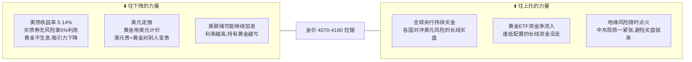

# 🔍 建仓后首次调研报告（详细版）

> 📅 2026-10-28 · 模拟盘 ¥1000 · 建仓当日复盘调研 · 不构成投资建议
>
> 👶 本报告按 [STYLE.md](../STYLE.md) 写作规范撰写：所有术语首次出现都会用白话解释，读者不需要任何金融背景。

---

## 🎯 30 秒版本

我们昨天用 1000 元模拟资金买入了三样东西：**红利低波 ETF**（一篮子高分红、股价波动小的公司股票，占 64%）、**黄金 ETF**（跟踪金价的基金，占 8%）、**现金**（占 27%，当"弹药"备着）。今天的调研结论是：**配置合理，继续持有**。但调研发现了一个之前没意识到的风险——我们买的"红利低波"里有 **54% 其实是银行股**，等于一半的钱押在了银行一个行业上。这个风险已经装上了每日监控。

---

## 📚 读前须知：3 个概念先搞懂

**1. 什么是 ETF？**
ETF（Exchange Traded Fund，交易型开放式指数基金）就像一个"股票打包礼盒"：基金公司把几十只股票按规则装进一个盒子里，你买一份 ETF = 同时买了盒子里所有股票的一小片。好处是省心（不用自己选股）且分散（一只股票暴雷影响有限）。我们买的 515100 这个"礼盒"里装的是 50 只**高分红 + 低波动**的股票。

**2. 什么是股息率？**
公司赚了钱会分一部分给股东，这叫分红（股息）。**股息率 = 每年分红 ÷ 股价**，相当于"这只股票的存款利率"。比如股息率 4.27% 意思是：股价不变的话，光靠分红一年拿回 4.27% 的钱。作为对比：现在银行一年期定存利率不到 1%，余额宝只有 0.84%——这就是为什么高分红股票被称为"类债券资产"（像债券一样靠利息吃饭）。

**3. 什么是 PB（市净率）？**
PB = 股价 ÷ 每股净资产。可以理解为"你花多少钱买公司 1 块钱的家当"。PB = 0.877 就是**打 8.8 折买家当**（也叫"破净"）——理论上公司明天解散清算，你能拿回的钱比买入价还多。PB 低通常意味着便宜，但也可能是市场觉得这公司前景差（所谓"便宜有便宜的道理"），所以要结合盈利能力一起看。

---

## 1️⃣ 红利低波（515100）：便宜，但要看清它到底是什么

### 数据面板（数据截至 2026-09-30 / 10-26，来源见文末）

| 指标 | 数值 | 人话解读 |
|---|---|---|
| 股息率 TTM | **4.27%** | 光分红一年拿 4.27%，是十年期国债（1.68%）的 **2.5 倍**。这个"利差"就是市场愿意持有它的核心理由：同样躺着收息，它给得多 |
| PB | **0.877×（破净）** | 打 8.8 折买公司净资产，且处于历史 22% 分位——意思是历史上 78% 的时间它比现在贵 |
| PE (TTM) | 8.60× | 花 8.6 年利润的钱买下公司（PE=股价÷每股利润），43% 分位，中等偏低 |
| 成分股盈利 | 归母净利 +5.95%，**0 只亏损** | 关键！50 家公司全部在赚钱且利润还在增长——说明"便宜"不是因为烂，是真被低估（价值投资者最爱的组合：便宜+赚钱） |
| Q3 表现 | 红利低波 **+9.81%** vs 沪深300 **-12.49%** | 三季度大盘（沪深300=A股最大的300家公司）跌了 12.5%，它反而涨了 9.8%——弱市里的"抗跌属性"被验证了 |

### ⚠️ 两个必须记住的风险（这是本次调研最重要的发现）

**风险一：它其实是"半仓银行股"**

翻开成分股一看：**银行占了 54%**（不同口径 50%–64%）。为什么？因为"高分红+低波动"这个筛选条件，天然筛出来的就是银行——银行赚钱稳、分红大方、股价不爱动。

这意味着什么？**你买它，一半的钱实际上押注在"中国银行业没问题"上。** 真正的驱动变量是银行的净息差（贷款利率减存款利率，银行的毛利来源）和资产质量（放出去的贷款收不收得回来），而不是泛泛的"红利"概念。

另外提醒："低波动"三个字有欺骗性——这个指数**年内最大回撤是 -14.77%**（最大回撤=从最高点跌到最低点的幅度，可以理解为"最疼的时候有多疼"）。1000 块变 852 块的过程，它今年就经历过。

**风险二：有个更分散的替代品**

市面上有个升级版：**A500 红利低波指数**（对应 ETF 代码 562180），它加了硬约束——**单一行业最多 30%**，银行被压到 21%。历史数据还更好：近 3 年年化约 11.7%、最大回撤约 12.8%，两项都优于我们持有的传统版。

**我们的应对**：不马上换（换了等于承认追涨杀跌），而是把"515100 vs 562180 每日对比"写进了监控清单——**如果连续 5 个交易日跑输超 2%，就触发换仓评估，先换一半仓位试点**。这就是模拟盘的价值：用假钱验证决策规则。

📎 来源：[东方财富·H30269 指数深度](https://caifuhao.eastmoney.com/news/20261018094131777017750) · [21财经·红利低波产品对比](https://www.21jingji.com/article/20261026/herald/4b984c710e0c0f4ae46484802f3745cc.html) · [易方达红利低波ETF三季报（PDF）](http://pdf.dfcfw.com/pdf/H2_AN202610261830944918_1.pdf)

---

## 2️⃣ 黄金（518880）：一场拉锯战，8% 仓位刚刚好

### 现在的局面（用一场拔河来理解）

金价目前在 **4070–4180 美元/盎司** 的箱体里震荡（箱体=上有天花板下有地板的区间），年内累计**跌了约 7%**。为什么涨不动也跌不深？因为两股力量正在拔河：

> 怎么读这张图：左边三个因素把金价往下拽（核心逻辑：黄金是"不生息的资产"，利率越高，拿着黄金的机会成本越大——就像存款利率 5% 时，你不会把钱换成一块不能下蛋的金子）；右边三个因素往上托。两边势均力敌，所以金价横着走。

### 对我们组合的含义

黄金在组合里的角色**不是赚钱主力，是保险**：万一出现股债双杀、地缘危机这种"什么都跌"的极端情况，黄金通常逆势涨，对冲其他仓位的亏损。8% 的仓位是经典的"保险费率"——

- 涨了：对冲生效，组合少亏
- 跌了：8% 的仓位跌 10% 也只影响总资产 0.8%，伤不到筋骨

**结论：不动。** 保险不需要每天盯着看它涨不涨，需要它的时候它在就行。关键位记两个：**跌破 4000 美元**可能引发程序化抛售（要警惕），**站上 4180** 则可能打开反弹空间。

📎 来源：[财联社·世界黄金协会年中展望](https://www.cls.cn/detail/2414545) · [中金在线·10月20日金价分析](http://gold.cnfol.com/jinshizhibo/20261020/32402135.shtml)

---

## 3️⃣ 现金（27%）：利息低到离谱，但我们留的不是利息

### 残酷的现实

余额宝 7 日年化已跌至 **0.84%**，10 月 22 日甚至创下历史最低的 0.812%。什么概念？**10 万块放余额宝，一天利息 2 块 3。** 腾讯新闻算过一笔账：500 万存一天利息 187 元——"靠利息躺平"的时代彻底结束了。

为什么这么低？因为货币基金拿你的钱去买的底层资产（短期存款、同业存单、短期债券）利率全都被压低了：7 天逆回购利率 1.4%、1 年期国债约 1.16%。整个短端利率体系都在地板上，货基只能跟着躺。

### 那我们为什么还留 27% 现金？

**留的不是利息，是"选择权"（optionality）**——这是保守策略里最容易被忽视的概念：

1. **补仓弹药**：纪律规定红利低波跌破成本 8%（即 1.317 元）时，用现金的 1/3 补仓摊低成本。没有现金，跌下来只能干瞪眼
2. **心理安全垫**：账户里永远有活钱，才不会在市场恐慌时被迫割肉
3. **等待成本极低**：0.84% 的年化确实跑不赢通胀，但"踏空成本"（该买时没钱买）远大于"持有成本"（现金躺着损失的利息差）

📎 来源：[腾讯新闻·余额宝收益分析](https://news.qq.com/rain/a/20261004A02NIB00) · [CEIC 余额宝收益率数据](https://www.ceicdata.com/zh-hans/china/yue-bao-fund-yield/cn-fund-yield-7day-avg-annualized-monetary-yue-bao)

---

## 🎯 观察清单（每日收盘任务持续跟踪）

| # | 观察项 | 触发动作 |
|---|---|---|
| 1 | 515100 vs 562180（A500红利低波）每日涨跌对比 | 连续 5 日跑输超 2% → 评估换仓一半试点 |
| 2 | 国际金价 4000 / 4180 两个关键位 | 破位 → 记录原因，连续 3 日同向 ±5% 才动手 |
| 3 | 红利低波指数股息率是否升破 4.6% | 升破 = 价格更低、分红率更高 → 补仓性价比提升 |
| 4 | 美联储 12 月议息（加息 or 转鸽） | 转鸽 → 黄金利空解除，可考虑黄金仓位 8%→12% |

---

## 🧠 关键概念表（集中复习）

| 术语 | 白话解释 | 为什么重要 |
|---|---|---|
| ETF | 股票打包礼盒，买一份=买一篮子股票 | 我们全部持仓都是 ETF，省心且分散 |
| 股息率 | 每年分红÷股价，相当于股票的"存款利率" | 4.27% vs 国债 1.68% 是持有红利的核心理由 |
| PB 市净率 | 花多少钱买公司 1 块钱家当 | 0.877=打 8.8 折，便宜程度标尺 |
| PE 市盈率 | 花多少年利润的钱买下公司 | 8.6 倍=中等偏低估值 |
| 最大回撤 | 从最高点跌到最低点的幅度，"最疼有多疼" | 红利低波年内 -14.77%，"低波"≠不跌 |
| 箱体震荡 | 价格在天花板和地板之间横着走 | 黄金当前状态，等破位再动 |
| 再平衡 | 涨多的卖一点、跌多的买一点，回到目标比例 | 强制"高抛低吸"的纪律工具 |
| 选择权 | 留现金换取"该出手时能出手"的能力 | 27% 现金的真正用途 |

---

🤖 Hermes Agent 模拟盘调研 · [返回模拟盘首页](README.md)
