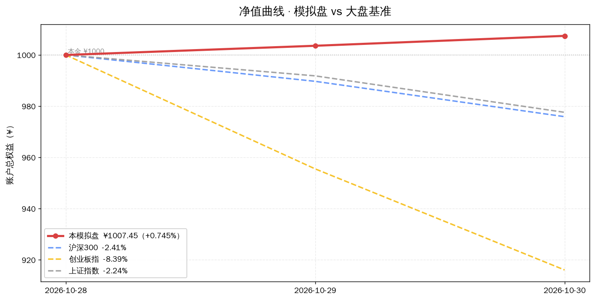
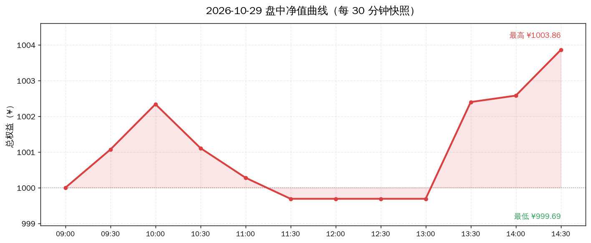
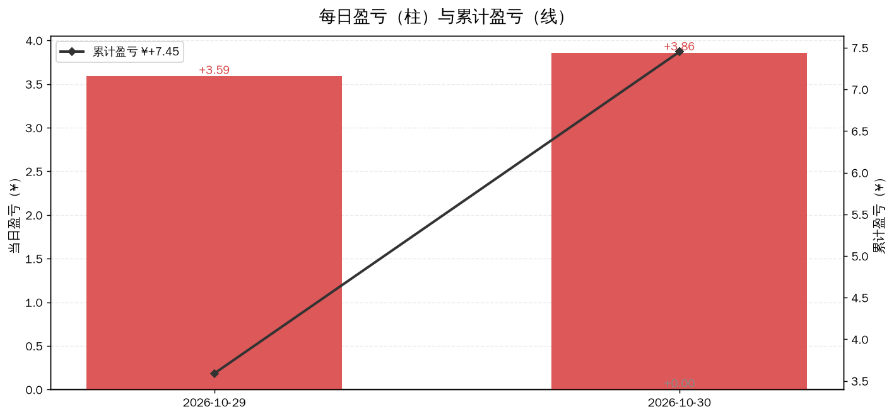
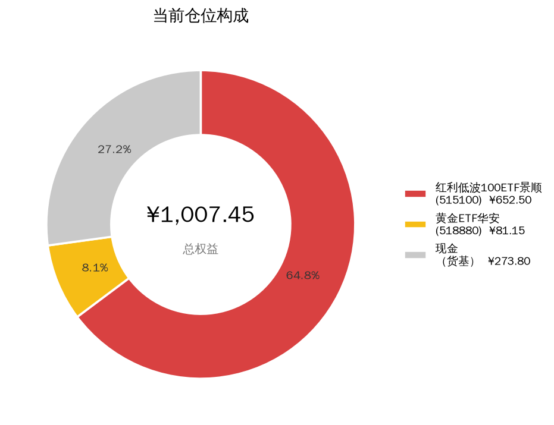

# 📊 模拟盘动态看板

> **自动生成** · 最后更新 **2026-10-30 22:56** · 数据源：腾讯财经公开接口（实时行情）
>
> 本金 **¥1000.00** · 开仓 **2026-10-28** · 当前总权益 **¥1007.45** · 累计 **+0.745%**
>
> ⚠️ **纯模拟盘学习实验，不构成投资建议。**
>
> ⏸️ **当前状态：已冻结**（不再买卖，仅每日估值记录净值）

---

## 🎯 30 秒版本

1. 从 2026-10-28 开仓到今天，账户从 ¥1000 变成 **¥1007.45**，赚了 **¥7.45（+0.745%）**。
2. 今天单日 **+0.00%**，持平 **¥0.00**。
3. 同期大盘：**上证指数 -2.24%** 最强，**创业板指 -8.39%** 最弱 —— 本组合跑赢同期最强基准 +2.98 个百分点。

## 📈 盈亏曲线

**怎么读这张图**：红色实线是本模拟盘的账户总值（含现金），三条虚线是大盘指数——为了放在同一张图上比较，指数都被换算成「如果开盘那天拿 ¥1000 买指数，今天值多少钱」，所以起点都是 ¥1000。红线在虚线上方 = 跑赢大盘。

### ⏱️ 盘中走势

**怎么读**：2026-10-29 当天每 30 分钟记录一次的账户总值。灰色虚线是当天开盘起点，曲线在虚线上方就是当天浮盈。A 股中午 11:30–13:00 休市，所以那段是平的。

### 💵 每日盈亏明细图

**怎么读**：柱子是「那一天赚/亏了多少元」（红涨绿跌，A 股习惯），黑色折线是「从开仓到今天一共赚/亏了多少元」。柱子忽高忽低但黑线稳步向上，说明策略在波动中持续积累收益。

---

## 💼 账户概览

| 指标 | 数值 | 人话解读 |
|---|---|---|
| 总权益 | **¥1007.45** | 现在全部卖掉能拿回多少钱（持仓市值 + 现金） |
| 持仓市值 | ¥733.65（72.8%） | 买成 ETF 的部分 |
| 现金 | ¥273.80（27.2%） | 留着没买的钱，按货基利率计息 |
| 累计盈亏 | **¥+7.45（+0.745%）** | 相对 ¥1000 本金 |
| 今日盈亏 | **+0.00%** | 今天一天的变化 |
| 历史最高 | ¥1007.45 | 账户到过的最高点 |
| 当前回撤 | +0.000% | 离最高点还差多少（负数=没回到最高点） |

### 持仓明细

| 标的 | 代码 | 持股 | 成本价 | 现价 | 今日 | 市值 | 浮动盈亏 | 人话解读 |
|---|---|---|---|---|---|---|---|---|
| 红利低波100ETF景顺 | 515100 | 450 | ¥1.431 | ¥1.450 | 🔺+0.76% | ¥652.50 | **+8.55（+1.33%）** | 赚钱了 |
| 黄金ETF华安 | 518880 | 10 | ¥8.226 | ¥8.115 | 🔻-1.33% | ¥81.15 | **-1.11（-1.35%）** | 还亏着 |
| 现金 | — | — | — | — | — | ¥273.80 | — | 货基计息，年化 0.84% |

---

## 🧾 交易流水（今天买了什么 / 卖了什么）

| 日期 | 操作 | 标的 | 代码 | 股数 | 成交价 | 金额 | 已实现盈亏 |
|---|---|---|---|---|---|---|---|
| 2026-10-28 | 🟢 买入 | 红利低波100ETF景顺 | 515100 | 450 | ¥1.431 | ¥643.95 | — |
| 2026-10-28 | 🟢 买入 | 黄金ETF华安 | 518880 | 10 | ¥8.226 | ¥82.26 | — |

> 最近一次交易：**2026-10-28**。此后无新交易（账户已冻结，仅估值）。

---

## 🧠 交易决策逻辑（我为什么这么判断）

### 一、策略宪法：这个盘遵循什么规则

**核心思路：不预测行情，靠配置和纪律赚钱。**

普通散户亏钱的主因是「追涨杀跌」——看到涨了就追进去，跌了就慌忙割肉，结果买在最高点、卖在最低点。这个模拟盘反过来做：

| 规则 | 白话解释 | 为什么这么定 |
|---|---|---|
| **目标仓位固定** | 红利低波 65% / 黄金 8% / 现金 27%，一开始就定好 | 先决定「拿多少」，而不是每天猜「明天涨不涨」。猜短期走势的成功率≈抛硬币 |
| **偏离 10 个百分点才再平衡** | 某类资产占比跑偏超过 10pp 才动手调回来 | 频繁交易会被手续费和情绪吃掉收益；10pp 是个「值得动手」的门槛 |
| **成本价 -8% 补仓（最多 2 次）** | 跌到成本价的 92% 时加买，摊低成本，但只加 2 次 | 分批买入比一次性满仓风险低；限制 2 次是防止「越跌越买」把子弹打光 |
| **回撤 -5% 只记录、不割肉** | 账户从高点跌 5% 时写进日志，但不卖 | 回撤是波动的正常部分，恐慌卖出往往卖在坑里 |
| **红利打底** | 主仓买高分红+低波动 ETF | 股息率约 4.3% vs 国债 1.68%，即使股价不涨也有现金流，抗跌性强 |
| **黄金对冲** | 配 8% 黄金 ETF | 黄金和股票相关性低，股灾时常常反向走，是组合的「安全气囊」 |

### 二、再平衡是什么（关键概念）

**再平衡（Rebalancing）= 把涨多的卖一点、跌多的买一点，回到原定比例。**

打个比方：你规定自己每天吃「65% 米饭 + 8% 肉 + 27% 菜」。某天肉特别好吃你吃多了，占比变成 30%——再平衡就是下一顿少吃肉、多吃菜，回到 8%。**它天然做到「高抛低吸」，而且不需要你预测哪个更好吃。**

### 三、每日纪律检查（今天的判断依据，可审计）

下面不是「我觉得」，而是**把策略的每条规则摊开、代入今天的真实数字算一遍**。任何一次买卖都必须先通过这里的检查，所以你能追溯我每个决定的来龙去脉。

#### ① 仓位偏离检查（规则：任一类资产偏离目标 >10pp 才再平衡）

| 资产 | 目标占比 | 实际占比 | 偏离 | 判定 |
|---|---|---|---|---|
| 红利低波100ETF景顺 | 65% | 64.8% | -0.2pp | 🟢 正常，不动 |
| 黄金ETF华安 | 8% | 8.1% | +0.1pp | 🟢 正常，不动 |
| 现金（货基） | 27% | 27.2% | +0.2pp | 🟢 正常，不动 |

#### ② 补仓条件检查（规则：跌到成本价 -8% 触发补仓，每只最多 2 次）

| 标的 | 成本价 | 现价 | 距成本 | 已补仓 | 判定 |
|---|---|---|---|---|---|
| 红利低波100ETF景顺 | ¥1.431 | ¥1.450 | +1.33% | 0/2 | 🟢 未触发（还差 9.3pp 才到 -8%） |
| 黄金ETF华安 | ¥8.226 | ¥8.115 | -1.35% | 0/2 | 🟢 未触发（还差 6.7pp 才到 -8%） |

#### ③ 回撤检查（规则：账户从最高点回撤 -5% 只记录、不割肉）

| 指标 | 数值 |
|---|---|
| 历史最高净值 | ¥1007.45（2026-10-30） |
| 当前净值 | ¥1007.45（2026-10-30） |
| 回撤幅度 | **+0.000%** |
| 触发阈值 | -5% |

> 🟢 **未触发**：距阈值还有 5.00pp 缓冲。即使触发，纪律也是记录而非卖出。

#### ④ 今日结论

> ⏸️ **账户已冻结，不执行任何交易。** 以上检查仅作记录用途——共扫描 6 项纪律，触发 **0** 项。冻结状态下即使触发也不动手（用户决定不投 A 股）。

### 四、每日决策记录（当时怎么判断的）

#### 📅 2026-10-30 · 权益 ¥1007.45（累计 +0.745%）

- 总权益 **¥1007.45**（当日 +0.38% / 累计 +0.745%）
- 红利低波100ETF景顺 1.450 (+0.76%)
- 黄金ETF华安 8.115 (-1.33%)
- 现金 ¥273.80
- 📝 模拟盘已冻结：仅估值记录，无任何交易。大盘全线下跌日，组合逆势 +0.38%。

#### 📅 2026-10-30 · 权益 ¥1007.45（累计 +0.745%）

- 总权益 **¥1007.45**（当日 +0.38% / 累计 +0.745%）
- 红利低波100ETF景顺 1.450 (+0.76%)
- 黄金ETF华安 8.115 (-1.33%)
- 现金 ¥273.80
- 📝 模拟盘已冻结：仅估值记录，无任何交易。大盘全线下跌日，组合逆势 +0.38%。

#### 📅 2026-10-29 · 权益 ¥1003.59（累计 +0.359%）

- 总权益 **¥1003.59**（当日 +0.36% / 累计 +0.359%）
- 红利低波100ETF景顺 1.439 (+0.56%)
- 黄金ETF华安 8.224 (-0.02%)
- 现金 ¥273.80
- 大盘背景：创业板指 -4.45%、深证成指 -2.92%、中证500 -2.82%、沪深300 -1.03%、上证 -0.82%，仅上证50 +0.36%。组合 +0.36% 与上证50 同步，跑赢创业板 4.8pp——成长股踩踏日里防御配置生效。

#### 📅 2026-10-28 · 权益 ¥1000.00（累计 +0.000%）

- 买入 红利低波100ETF景顺(515100) 450股 @ 1.431 = ¥643.95
- 买入 黄金ETF华安(518880) 10股 @ 8.226 = ¥82.26
- 剩余现金 ¥273.79（按货币基金 0.84% 年化计息）
- 建仓后总权益 ¥1000.00

---

## 📐 同期大盘对比（超额收益）

**超额收益（Alpha）= 我的收益率 − 大盘收益率。** 正数说明策略比「无脑买指数」强。

| 指数 | 同期涨跌 | 本组合超额 | 人话解读 |
|---|---|---|---|
| 沪深300 | -2.41% | **+3.15pp** | 跑赢 3.15 个百分点 |
| 创业板指 | -8.39% | **+9.14pp** | 跑赢 9.14 个百分点 |
| 上证指数 | -2.24% | **+2.98pp** | 跑赢 2.98 个百分点 |

> 注：`pp` = percentage point（百分点），是两个百分比相减的单位。「+2.5pp」意思是「比它高 2.5 个百分点」，不是「高 2.5%」。

### 净值历史

| 日期 | 总权益 | 持仓市值 | 现金 | 累计收益 |
|---|---|---|---|---|
| 2026-10-28 | ¥1000.00 | ¥726.21 | ¥273.79 | +0.000% |
| 2026-10-29 | ¥1003.59 | ¥729.79 | ¥273.80 | +0.359% |
| 2026-10-30 | ¥1007.45 | ¥733.65 | ¥273.80 | +0.745% |
| 2026-10-30 | ¥1007.45 | ¥733.65 | ¥273.80 | +0.745% |

---

## ⚠️ 重要声明

- 这是**纯模拟盘**，本金 ¥1000 为虚拟数字，**没有任何真实资金交易**。
- 目的是学习资产配置和纪律化投资的机制，**不构成任何投资建议**。
- 历史表现不代表未来收益。真实投资涉及本金损失风险，请自行判断并咨询持牌机构。
- 行情数据来自腾讯财经公开接口，可能存在延迟或误差；估值不含交易手续费和滑点。

---

_本页由 `dashboard.py` 自动生成于 2026-10-30 22:56:53，每个交易日收盘后刷新。_
