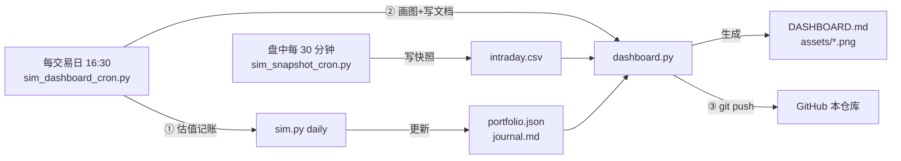

# 💰 模拟盘 · 动态看板

> **主看板：[📊 DASHBOARD.md](DASHBOARD.md)** ← 净值曲线、交易流水、决策逻辑都在这里
>
> 本金 ¥1000 · 2026-10-28 开仓 · **每个交易日 16:30 自动刷新并推送本仓库**
>
> ⏸️ **当前状态：已冻结**（用户决定不投 A 股）——持仓保留、净值继续记录，但不再买卖。
> 解冻需要用户明确指示。

## 这个目录有什么

| 文件 | 是什么 | 谁写的 |
|---|---|---|
| **[DASHBOARD.md](DASHBOARD.md)** | **动态看板**：盈亏曲线图、仓位构成、交易流水、每日纪律检查、决策逻辑 | `dashboard.py` 自动生成 |
| [assets/](assets/) | 看板用的 4 张图（净值曲线/每日盈亏/仓位构成/盘中走势） | `dashboard.py` 自动生成 |
| [journal.md](journal.md) | 每日操作日志（决策理由全文） | `sim.py daily` 追加 |
| [portfolio.json](portfolio.json) | 机器可读账本（持仓、历史净值、交易流水） | `sim.py` 维护 |
| [intraday.csv](intraday.csv) | 盘中每 30 分钟净值快照（画盘中曲线用） | `sim_snapshot_cron.py` |
| [2026-10-28-research.md](2026-10-28-research.md) | 建仓前调研报告（为什么选红利低波+黄金） | 一次性研究 |

## 自动更新机制



**怎么读这张图**：左边两个是定时任务。盘中那个每 30 分钟记一次净值（只写文件，很轻量）；
收盘那个（16:30）做三件事——先估值记账、再重画图重写看板文档、最后推送到 GitHub。
所以你在 GitHub 上看到的 `DASHBOARD.md` 永远是最近一个交易日收盘后的状态。

两个任务都是**纯脚本、不花 LLM token**，而且**幂等**（重复跑不会产生重复数据）。

## 手动刷新

```bash
# 只重画看板（不记账、不推送）
/root/mcp-servers/chart-venv/bin/python /root/stock-tool/sim/dashboard.py

# 完整流程：估值 → 画图 → 推送 GitHub
/root/mcp-servers/chart-venv/bin/python /root/.hermes/scripts/sim_dashboard_cron.py
```

## 策略与纪律（摘要）

**核心思路：不预测行情，靠配置和纪律赚钱。**

目标仓位：红利低波 65% / 黄金 8% / 现金 27%

| 规则 | 触发条件 | 动作 |
|---|---|---|
| 再平衡 | 任一类资产偏离目标 >10pp | 卖多的、买少的，回到目标比例 |
| 补仓 | 某标的跌到成本价 -8% | 加买，每只最多 2 次 |
| 回撤 | 账户从最高点跌 -5% | **只记录、不割肉** |

完整规则解释和「为什么这么定」见 **[DASHBOARD.md · 交易决策逻辑](DASHBOARD.md#-交易决策逻辑我为什么这么判断)**。

## ⚠️ 声明

- **纯模拟盘**，¥1000 是虚拟数字，没有任何真实资金交易
- 目的是学习资产配置机制，**不构成投资建议**
- 历史表现不代表未来收益；估值不含手续费和滑点
- 行情数据来自腾讯财经公开接口，可能有延迟
