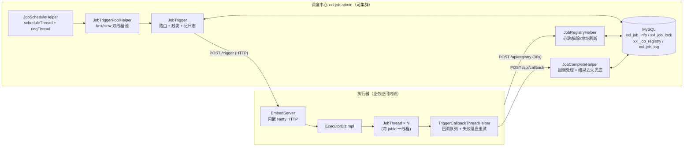
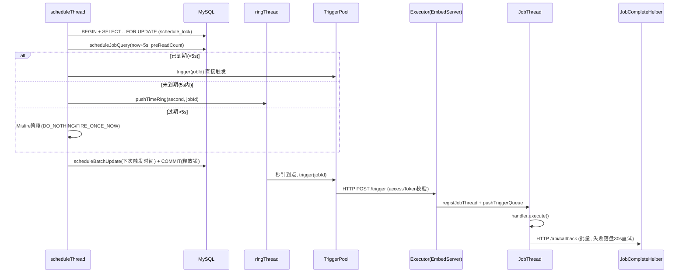

# 源码解剖：XXL-JOB 调度核心（3.x）——从一行 `FOR UPDATE` 到时间轮的完整链路

> 解剖对象：[xuxueli/xxl-job](https://github.com/xuxueli/xxl-job) `3.5.1-SNAPSHOT`（master @ `693d276`，2026-10）
> 关注模块：admin 侧调度引擎（`JobScheduleHelper` / `JobTriggerPoolHelper` / `JobTrigger`）+ executor 侧执行模型（`EmbedServer` / `JobThread`）

---

## 一、为什么读这个

做 Java 后端的几乎都绕不开一个问题：**"每天凌晨 2 点跑对账"这件事，怎么在分布式环境下做到不重、不漏、可观测？**

`@Scheduled` 单机够用但多实例会重复执行；Quartz 集群模式依赖 11 张表的行锁竞争，QPS 上不去；自研调度又要把 misfire、失败重试、路由、优雅停机重造一遍。XXL-JOB 用 **"DB 行锁抢占 + 预读时间轮 + 中心化 HTTP 触发"** 给出了一个工程上非常务实的答案——调度中心无状态可水平扩展，执行器靠心跳自注册。它也是国内事实标准（GitHub 28k+ star）。

值得强调：本文基于 **3.x 源码**。网上绝大多数分析文章还停留在 2.x，而 3.x 有几个实质性变化：admin→executor 通信从自研 RPC 换成了 `xxl-tool` 的 **HTTP 动态代理**；新增了 **Misfire 策略** 和 **ScheduleType（CRON/FIX_RATE）抽象**；调度回写从逐条 update 改成 **CASE WHEN 批量 update**。老文章的结论要打个折。

## 二、整体架构



一次调度的时序：



## 三、核心链路逐步拆解

### 3.1 集群互斥：一行 `FOR UPDATE` 撑起整个高可用

3.x 里 `XxlJobAdminBootstrap`（`InitializingBean`）在 `afterPropertiesSet` 中按序拉起 6 个 Helper。调度主循环在 `JobScheduleHelper#start()` 的 `scheduleThread` 里，每一轮做三件事：**开事务 → 抢锁 → 扫描**。

抢锁就是一条 SQL（`XxlJobLockMapper.xml`）：

```sql
SELECT * FROM xxl_job_lock WHERE lock_name = 'schedule_lock' FOR UPDATE
```

多个 admin 实例同时跑这个循环，谁先拿到 `schedule_lock` 这行的排他锁谁调度，其他实例阻塞在 `FOR UPDATE` 上；持锁实例提交事务的瞬间，下一个实例醒来发现"该扫的任务已经被别人扫走/推进了 next_time"，自然空转。**没有引入 ZooKeeper/Redis，锁的生死和"扫描+回写"绑在同一个数据库事务里**——这是它最聪明也最被低估的设计：锁释放的原子性由事务提交保证，不存在"锁过期了但任务还没写完"的窗口。

### 3.2 预读 + 时间轮：把 DB QPS 从"每秒扫全表"降下来

拿到锁后并不只查"当前这一秒到期"的任务，而是预读未来 5 秒（`PRE_READ_MS = 5000`）：

```java
List<XxlJobInfo> scheduleList = xxlJobInfoMapper.scheduleJobQuery(nowTime + PRE_READ_MS, preReadCount);
```

`preReadCount = (fast池max + slow池max) * 10`，注释里写了推导：单次 trigger 约 100ms，线程池理论 QPS 上限 × 10 就是 1 秒能消化的量，按 5 秒预读窗口放大。查回的任务按到期程度分三路：

1. **过期超 5s**（`nowTime > nextTime + PRE_READ_MS`）：走 Misfire 策略（见 3.5），不直接补触发；
2. **已到期**（误差 <5s）：立刻丢进触发线程池；若它的下次触发时间仍在 5s 内（高频 FIX_RATE 任务），同时压入时间轮；
3. **未到期**：只压时间轮，`ringSecond = (nextTime/1000) % 60`——**一个 60 格的秒级环形数组**（`ConcurrentHashMap<Integer, List<Integer>>`），key 是"一分钟内的第几秒"，value 是 jobId 列表。

然后 `scheduleBatchUpdate` 用一条 `CASE WHEN` 语句批量回写所有任务的 `trigger_next_time`（每批 `xxl.job.schedule.batchsize=100`，且 `WHERE ... AND trigger_status = 1` 防止把用户刚停掉的任务改回运行态），最后 COMMIT 释放锁。

消费端 `ringThread` 每秒对齐秒针醒一次，但它不只取当前刻度：

```java
for (int i = 0; i <= 2; i++) {   // 避免调度遗漏：处理耗时太长、跨过刻度，除当前刻度外 + 向前校验2个刻度
    List<Integer> ringItemList = ringData.remove((nowSecond + 60 - i) % 60);
    ...distinct()...              // 避免调度重复：同一刻度重复 push 只保留一个
}
```

**取当前刻度 + 前两个刻度**，是对"ringThread 某次 GC/卡顿跨秒"的补偿；`distinct()` 是对"任务被重复压轮"的去重。一漏一重，两个土办法把时间轮的可靠性兜住了。整个机制的效果：DB 从"每秒精确扫描"变成"每秒预读一批 + 内存秒级派发"，触发精度仍是秒级，但锁持有时间和 SQL 次数大幅下降。

### 3.3 触发线程池：fast/slow 隔离 + 按分钟窗口自动降级

`JobTriggerPoolHelper` 维护两个池：fast（core 10 / max 300 / 队列 2000）和 slow（core 10 / max 200 / 队列 5000，均可配）。选池逻辑：

```java
AtomicInteger jobTimeoutCount = jobTimeoutCountMap.get(jobId);
if (jobTimeoutCount != null && jobTimeoutCount.get() > 10) {  // 1分钟内超500ms达10次
    triggerPool_ = slowTriggerPool;
}
```

每次触发结束，若耗时 >500ms 就给该 jobId 计数 +1；`minTim`（分钟数）翻页时整表 clear。**一个拖慢触发的任务（比如执行器网络抖动导致 HTTP 3s 超时）连续慢 10 次后被踢进 slow 池，不再污染 fast 池的吞吐**——本质是舱壁隔离 + 熔断降级的极简实现，代价只有一个 ConcurrentMap。

注意两个池的拒绝策略都只是 `logger.error`：**队列打满时触发会被静默丢弃**（只留日志），这是后面"局限"一节要展开的坑。

### 3.4 路由与触发：`JobTrigger` 的六步曲

`JobTrigger#processTrigger` 顺序清晰：存 log 拿 logId → 组装 `TriggerRequest` → 路由选址 → HTTP 触发 → 拼触发报告 → 回写 log。两个细节：

- **分片广播在路由之前分叉**：`SHARDING_BROADCAST` 策略不走 router，直接对 `group.getRegistryList()` 的每个下标调一次 `processTrigger(i, total)`，每个分片一条独立 log；
- **执行器客户端是接口动态代理**：`XxlJobAdminBootstrap.getExecutorBiz()` 用 `HttpTool.createClient().url(address).header(token).proxy(ExecutorBiz.class)` 生成代理，按 `address|token|appname` 做缓存（超 1000 直接 clear 防膨胀）。`ExecutorBiz` 接口五个方法（`beat/idleBeat/trigger/kill/log`）与 executor 端 `EmbedServer` 的五个 URI 一一对应——2.x 的 `ExecutorBizClient` 手写 HTTP 已被扔进 `util/deprecated`。

路由策略 9 种（FIRST/LAST/ROUND/RANDOM/一致性HASH/LFU/LRU/FAILOVER/BUSYOVER）。FAILOVER 是遍历地址逐个 `beat()` 取第一个活的；一致性 HASH 用 MD5 取低 32 位 + 每地址 100 个虚拟节点的 TreeMap 环，解决 `String.hashCode` 分布不均。

### 3.5 Misfire 与 ScheduleType：3.x 新增的两层策略抽象

任务错过触发时间（admin 宕机、锁被长事务卡住）怎么办？3.x 引入 Quartz 同款概念但只给两个选项：`MisfireStrategyEnum.DO_NOTHING`（默认，直接算下次时间）和 `FIRE_ONCE_NOW`（立即补一发，`TriggerTypeEnum.MISFIRE`）。策略对象挂在枚举上，`match()` 找不到就回落默认值——枚举即策略注册表，加策略不用改调度主循环。

`ScheduleType` 同构：CRON 走内置 `CronExpression.getNextValidTimeAfter`；FIX_RATE 是 `fromTime + conf*1000` 再**向上取整到整秒**（`setMilliseconds(0) + 1s`），保证固定频率任务的触发时间永远落在秒边界上，和时间轮的秒级刻度对齐。

### 3.6 执行器侧：内嵌 Netty + "每 jobId 一条线程"

执行器没有引入 Web 容器依赖，`EmbedServer` 手写了一个极简 Netty HTTP 服务：`HttpServerCodec + HttpObjectAggregator(5MB) + IdleStateHandler(90s)`（90 = 3 倍心跳周期，闲置即断），业务在独立的 `bizThreadPool`（max 200）里跑，不阻塞 EventLoop。`dispatchRequest` 校验 `XXL-JOB-ACCESS-TOKEN` 和 `XXL-JOB-APPNAME` 双 header 后 switch URI 分发。3.x 起 accessToken 为空直接启动失败（`XxlJobExecutor#start` 抛 RuntimeException），默认不配 token 裸奔的时代结束了。

真正执行任务的是 `JobThread`——**一个 jobId 常驻一条线程 + 一个 `LinkedBlockingQueue<TriggerRequest>`**：

```java
triggerParam = triggerQueue.poll(3L, TimeUnit.SECONDS); // 不用take(): 要周期性检查toStop
...
if (idleTimes > 30) {           // 空转30次×3s≈90s
    if (triggerQueue.isEmpty()) // 双重检查,避免并发触发导致jobId丢失
        XxlJobExecutor.getInstance().removeJobThread(jobId, "excutor idle times over limit.");
}
```

- **串行语义免费获得**：同一 jobId 的触发天然在队列里排队，这就是默认阻塞策略 `SERIAL_EXECUTION`；`DISCARD_LATER` 在入队前检查 `isRunningOrHasQueue()` 直接拒绝，`COVER_EARLY` 则杀掉旧线程重建；
- **幂等**：`triggerLogIdSet`（ConcurrentHashMap.newKeySet）按 logId 去重，admin 网络重试不会重复执行；
- **超时控制**：配了 `executorTimeout` 就把 `handler.execute()` 包进 FutureTask 另起线程，`get(timeout)` 超时后 `interrupt`——但注意 interrupt 只能打断阻塞态，死循环的业务代码杀不掉（源码注释自己也承认这一点）；
- **停止协议**：`toStop` 标志位 + interrupt 双管齐下，线程退出前把队列里没跑的请求全部以 FAIL 回调给 admin，不留悬空 log。

### 3.7 闭环：心跳注册、结果回调与三重兜底

**注册**：执行器每 30s（`Const.BEAT_TIMEOUT`）向所有 admin `POST /api/registry`；admin 侧 `JobRegistryHelper` 异步落库（`registrySaveOrUpdate` 一条 upsert），监控线程每 30s 删除 90s（`DEAD_TIMEOUT`）无心跳的记录并重算各 group 的地址列表。执行器优雅停机时会主动 `registryRemove`。

**回调**：`JobThread` 执行完把 `CallbackData` 推进 `MessageQueue`（批量 1~50 条聚合发送）；全部 admin 都失败则**序列化到本地文件**，`retryCallbackThread` 每 30s 扫目录重放——执行器和调度中心同时重启也不丢结果。admin 侧 `doCallback` 用 `log.getHandleCode() > 0` 挡重复回调（防子任务重复触发）。

**兜底**：即便如此仍可能丢（执行器回调前被 kill -9）。`JobCompleteHelper` 的监控线程每分钟执行一条 LEFT JOIN：`trigger_code=200 AND handle_code=0 AND 触发超10分钟 AND 执行器地址已不在注册表` → 判定结果丢失，直接标 FAIL。**"运行中"状态的日志永远不会悬挂超过 10 分钟 + 一个监控周期。** 失败日志则由 `JobFailAlarmMonitorHelper` 处理：先用 `updateAlarmStatus(id, 0, -1)` 做 CAS 式抢占（多 admin 只有一个能锁到这条），再执行失败重试（`TriggerTypeEnum.RETRY`，重试次数递减）和告警。

## 四、设计亮点与可借鉴模式

1. **事务边界即锁边界**：分布式互斥不引第三方组件，`FOR UPDATE` + 同事务内完成"读-算-写"，锁的释放和数据的一致性天然原子。适合所有"已有共享 DB、调度频率不高（秒级）"的场景。
2. **预读 + 秒级时间轮**：用 5s 预读窗口换 DB 压力，用 60 格环形数组做内存派发，"取 3 个刻度 + distinct"两行代码解决漏与重。这是比引入 Quartz RAMJobStore 更轻的混合方案。
3. **fast/slow 双池 + 分钟窗口计数降级**：一个 ConcurrentMap 实现慢任务隔离，思路可直接搬到任何"共享线程池被个别慢请求拖垮"的系统。
4. **每 jobId 一线程 + 队列**：用线程模型免费换来任务内串行、任务间并行，阻塞策略退化为"入队前检查/杀线程重建"两个 if。
5. **枚举即策略注册表**：Misfire/ScheduleType/RouteStrategy 全部是"枚举持有策略单例 + match 回落默认"，新增策略零侵入主流程。
6. **三层结果可靠性**：内存队列批量回调 → 失败落盘定时重放 → admin 端 LEFT JOIN 丢失兜底。任何一层挂了，最坏也只是延迟标失败，不会状态悬挂。

## 五、踩坑与局限

- **触发线程池打满 = 静默丢任务**：fast/slow 池的 `RejectedExecutionHandler` 只打 error 日志，被拒绝的触发不会重试也不会记 FAIL log（log 已 insert，会永远停在"触发中"直到 10min 兜底把它标丢）。极端洪峰下要靠告警日志发现问题。
- **单点 DB 是吞吐天花板**：`schedule_lock` 决定同一时刻全集群只有一个 admin 在扫描派发。任务量到数万级/秒级高频时，预读窗口内 `scheduleBatchUpdate` 的事务时长会成为瓶颈（3.x 的批量 CASE WHEN 正是为此打的补丁）。
- **时间轮在 admin 内存里**：持锁 admin 崩溃时，已预读但未派发的 ringData 丢失。靠 Misfire 兜底：新 admin 下一轮扫描发现过期 >5s，按策略补发或跳过——**DO_NOTHING（默认）意味着这次触发就没了**，对"必须执行"的任务要显式配 FIRE_ONCE_NOW。
- **超时杀不掉死循环**：executorTimeout 依赖 `Thread.interrupt`，业务代码若吞中断或纯 CPU 死循环，只能等 JobThread 泄漏（kill 也一样）。
- **路由信息有 30s 级滞后**：地址列表来自注册表异步刷新，执行器刚挂的 90s 内 FAILOVER 之外的策略仍可能把任务打给死节点（有失败重试兜底，但会白等一次 HTTP 超时，默认 `xxl.job.timeout=3s`）。
- **`registrySaveOrUpdate` 异步 + 无锁 upsert**：注册请求进线程池就返回 success，极端情况下 admin 返回成功但落库失败，靠下一轮心跳（30s）自愈。

## 六、参考源码路径

均相对仓库根（xxl-job @ master `693d276`）：

- `xxl-job-admin/.../business/scheduler/config/XxlJobAdminBootstrap.java` —— 启动编排、ExecutorBiz HTTP 代理缓存
- `xxl-job-admin/.../business/scheduler/thread/JobScheduleHelper.java` —— scheduleThread/ringThread、预读、时间轮、优雅停机
- `xxl-job-admin/src/main/resources/mapper/business/XxlJobLockMapper.xml` —— `schedule_lock FOR UPDATE`
- `xxl-job-admin/src/main/resources/mapper/business/XxlJobInfoMapper.xml` —— `scheduleJobQuery` / `scheduleBatchUpdate`
- `xxl-job-admin/.../scheduler/thread/JobTriggerPoolHelper.java` —— fast/slow 双池与超时降级
- `xxl-job-admin/.../scheduler/trigger/JobTrigger.java` —— 触发六步曲、分片广播
- `xxl-job-admin/.../scheduler/route/strategy/ExecutorRouteFailover.java`、`ExecutorRouteConsistentHash.java` —— 路由策略
- `xxl-job-admin/.../scheduler/misfire/MisfireStrategyEnum.java`、`strategy/MisfireFireOnceNow.java` —— Misfire 抽象
- `xxl-job-admin/.../scheduler/type/strategy/CronScheduleType.java`、`FixRateScheduleType.java` —— ScheduleType 抽象
- `xxl-job-admin/.../scheduler/thread/JobRegistryHelper.java` —— 心跳落库、死节点摘除、group 地址刷新
- `xxl-job-admin/.../scheduler/thread/JobCompleteHelper.java`、`complete/JobCompleter.java` —— 回调处理、结果丢失兜底、子任务
- `xxl-job-admin/.../scheduler/thread/JobFailAlarmMonitorHelper.java` —— 失败重试与告警抢占
- `xxl-job-core/.../server/EmbedServer.java` —— 内嵌 Netty HTTP、token 校验、URI 分发
- `xxl-job-core/.../openapi/executor/impl/ExecutorBizImpl.java` —— 触发入队、阻塞策略、handler 热替换
- `xxl-job-core/.../thread/JobThread.java` —— 每 jobId 一线程、幂等、超时、停止协议
- `xxl-job-core/.../executor/XxlJobExecutor.java` —— jobThreadRepository、destroy 流程
- `xxl-job-core/.../thread/TriggerCallbackThreadHelper.java`、`ExecutorRegistryThreadHelper.java` —— 回调落盘重试、注册心跳
- `xxl-job-core/.../constant/Const.java` —— BEAT_TIMEOUT=30s / DEAD_TIMEOUT=90s
