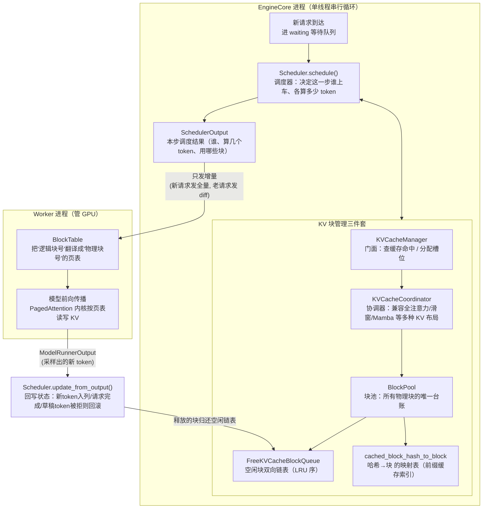
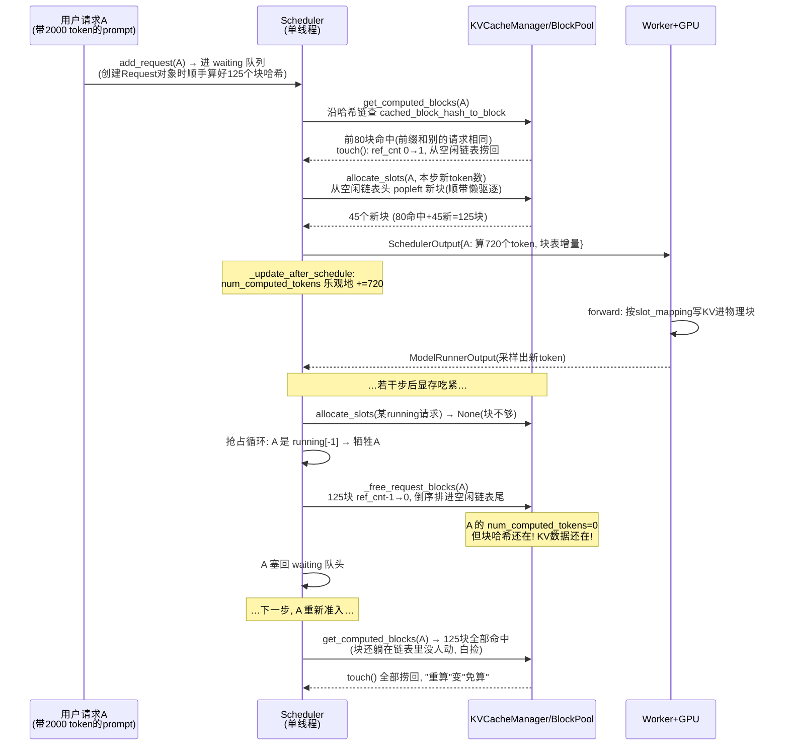

# 源码夜读：vLLM 调度器与 PagedAttention —— GPU 显存里的"操作系统虚拟内存"

> 项目：vLLM（master `c1d8fad`，2026-11-03 快照）
> 模块：V1 引擎调度核心 —— `Scheduler.schedule()` + `KVCacheManager` + `BlockPool` + `FreeKVCacheBlockQueue`
> 阅读日期：2026-11-04 · 所有结论基于真实源码，文件路径见文末参考

---

## 🎯 30 秒版本

vLLM 是目前最主流的开源 LLM 推理引擎，它的调度器干的事本质上和操作系统的内存管理一模一样：把 GPU 显存切成固定大小的"页"（默认 16 个 token 一块），用引用计数+LRU 空闲链表管理，用"内容哈希"实现跨请求的 KV Cache 复用（相同前缀只算一次）。读它的源码，你会看到一个教科书级的"如何在单线程 Python 里把昂贵的 GPU 资源榨干"的工程样本——预算循环、乐观推进、抢占重算、懒淘汰，每一招都能搬到自己的资源池代码里。

---

## 📚 读前须知：3 个前置概念

**1. KV Cache（推理时的"半成品缓存"）**
大模型生成文字是一个 token 一个 token 往外蹦的。每生成一个新字，注意力机制都要"回看"前面所有字。如果每次都从头重算前面所有字的中间结果（K 向量和 V 向量），计算量是平方级爆炸的。所以推理引擎把算过的 K/V 存起来复用——这就是 KV Cache。类比：做菜时把切好的配菜放碗里，下一道菜直接用，不用重新切。
**关键事实：KV Cache 非常大。** 一个 7B 模型、4K 上下文的请求，KV Cache 能吃掉约 1-2 GB 显存（参照系：一张 A100 总共 80GB，刨去模型权重后留给 KV Cache 的可能只有 50GB 左右——也就是同时只能"住"几十个长请求）。所以 KV Cache 的管理效率直接决定推理服务的吞吐量。

**2. Prefill 与 Decode（两个吃资源方式完全不同的阶段）**
- **Prefill（预填充）**：把用户输入的整段 prompt 一次性算完，建立 KV Cache。特点：计算密集（一次算几千个 token），像大货车——单次运量大但启动慢。
- **Decode（解码）**：之后每步只算 1 个新 token。特点：显存带宽密集（为了算 1 个 token 要把整个模型权重从显存搬进计算单元），像小轿车——单次运量小但频次高。
vLLM V0 时代一个 batch 要么全是 prefill 要么全是 decode；V1 把两者混在同一个 batch 里，靠统一的"token 预算"来配平。

**3. 连续批处理（Continuous Batching）**
传统批处理要等一批请求全部生成完才换下一批——先跑完的请求干等着，GPU 空转。连续批处理则每个 step（一次模型前向传播，几十毫秒）都重新组批：谁跑完了立刻下车，空位马上让排队的新请求补上。类比：公交车每站都上下客，而不是拉满一车人开到终点站才放行。**调度器就是那个每站决定"谁上谁下"的调度员。**

---

## 为什么读这个：不读源码你会在哪里踩坑

如果你在用 vLLM 部署服务（或者自己写任何"昂贵资源的池化管理"代码），这些现象不看源码根本解释不了：

1. **为什么两个请求共享同一段 system prompt，第二个请求首 token 延迟骤降？** —— 前缀缓存（prefix caching）命中了，但你得知道命中粒度是 16 token 一个块、按块对齐，前缀差 15 个 token 就整块白算。
2. **为什么显存明明"看着够"，请求却被挂起重算？** —— 调度器有 watermark（水位线）预留 + 抢占机制，KV 块不够时会把最倒霉的请求整个踢回等待队列（v1 只有"重算式抢占"，被踢的请求 KV 全部作废）。
3. **为什么 `max_num_batched_tokens` 调大调小对延迟/吞吐影响这么诡异？** —— 因为它就是调度循环的 token 预算，prefill 大块会挤占 decode 的"1 token 席位"，代码里有一整套 `long_prefill_token_threshold` 防饿死逻辑。

上期我们读了 XXL-JOB（任务调度），这期读 vLLM（token 调度）——同样是"有限的资源 + 排队的请求 + 谁能上车的决策"，但 vLLM 把资源管理精细到了"块"级别，而且全部逻辑跑在**单线程**里（调度器不加锁，靠"一个 step 一个 step 串行推进"来天然规避并发问题）。这个对比本身就很有味道。

---

## 整体架构：一次 engine step 里发生了什么



**怎么读这张图**：左边是调度侧（纯 CPU、纯 Python、单线程），右边是执行侧（GPU）。调度器每一步产出 `SchedulerOutput`，执行完拿回 `ModelRunnerOutput`，再把状态回写。中间那坨"三件套"是本文重点：`KVCacheManager` 是门面（facade，只提供统一入口的包装类），`BlockPool` 是真正管块的账本，`FreeKVCacheBlockQueue` 是它的空闲链表。注意左右两边**共享同一套块编号**——调度器说"用 37 号块"，Worker 就把 KV 写进物理显存的 37 号槽位，中间没有任何数据拷贝，只有编号传递。这就是 PagedAttention 的精髓：**像操作系统的虚拟内存一样，逻辑上连续的 token 序列，物理上散落在显存各处的 16-token 小块里，靠一张"页表"（block table）对齐。**

---

## 核心链路拆解

### 第 0 步：调度器眼里没有 prefill/decode，只有"欠了多少 token"

先看 `scheduler.py` 第 698 行 `schedule()` 开头 woosuk（vLLM 主作者之一）留下的一段注释，这是整个 V1 设计的灵魂：

```python
# NOTE(woosuk) on the scheduling algorithm:
# There's no "decoding phase" nor "prefill phase" in the scheduler.
# Each request just has the num_computed_tokens and num_tokens_with_spec.
# At each step, the scheduler tries to assign tokens to the requests
# so that each request's num_computed_tokens can catch up its num_tokens_with_spec.
```

**这几行在干嘛**：V1 调度器把"请求"抽象成两个数字的赛跑——`num_computed_tokens`（已经算完的 token 数）追着 `num_tokens_with_spec`（应该算到的 token 数 = prompt 长度 + 已生成长度 + 投机草稿长度）跑。差多少就补多少：
- 新请求差 2000 个 token → 这一步给它算 2000 个（prefill）；
- 老请求每步差 1 个 → 给它算 1 个（decode）；
- 预算不够 2000？那就先算 512 个，下一步接着算——**chunked prefill（分块预填充）不是一个特殊功能，而是这个抽象的自然结果**。

> 🧠 **此刻内存里有什么**：`Scheduler` 对象持有 `self.waiting`（等待队列）、`self.running`（运行列表，就是个 Python list）、每个 `Request` 对象上的几个整数计数器。没有任何 GPU tensor——调度侧是纯元数据操作，这也是为什么它敢用 Python 单线程写。

**token 预算**在循环开头初始化（第 719 行）：

```python
token_budget = self.max_num_scheduled_tokens  # 即 max_num_batched_tokens，默认常见 8192/16384
```

之后所有决策都在花这个预算：每给一个请求排 N 个 token，`token_budget -= N`，花完这一步就收工。

### 第 1 步：先保运行中的车（running 循环）

`schedule()` 的第一个 while 循环遍历 `self.running`——**已经上车的请求优先续命**。为什么？因为 decode 请求每步只要 1 个 token 的预算，让它断流对用户是可感知的卡顿（正在流式输出的回答突然停住）；而等待队列里的新请求晚一个 step 上车没人感知得到。

每个 running 请求要做的事：

```python
num_new_tokens = (request.num_tokens_with_spec + request.num_output_placeholders
                  - request.num_computed_tokens)
# 然后连砍几刀：
if 0 < long_prefill_token_threshold < num_new_tokens:
    num_new_tokens = long_prefill_token_threshold   # 防长 prefill 独占预算
num_new_tokens = min(num_new_tokens, token_budget, input_budget - draft_slots)
new_blocks = self.kv_cache_manager.allocate_slots(request, num_new_tokens, ...)
```

**逐段解释**：第一行算"还欠多少 token"；然后被"长 prefill 限流阈值"（`long_prefill_token_threshold`，防止一个 128K 长 prompt 把整步预算吃光饿死别人）和"剩余预算"依次截断；最后向 `KVCacheManager` 申请 KV 块的槽位。源码里还有个细节：当场上只剩这一个请求时阈值自动归零（`num_eligible_reqs > 1` 才启用）——没人跟你抢预算，就不用限你的流。

> 🧠 **此刻线程在跑什么**：还是 EngineCore 那个单线程。`allocate_slots` 返回 `None` 表示"块不够"——注意这里有个精妙的细节，见第 2 步的抢占循环。

**为什么块会不够？** decode 每步只加 1 个 token，看起来微不足道，但一个请求写满 16 个 token 就要新开一个块。几百个请求同时跑到"第 17、33、49 个 token"时，块消耗是脉冲式的。块池见底时，调度器的选择是：**牺牲一个请求，保住其他人**。

### 第 2 步：抢占——被踢下车的人 KV 全部作废

`allocate_slots` 返回 None 后进入一个 `while True` 抢占循环（第 912 行起）：

```python
while True:
    new_blocks = self.kv_cache_manager.allocate_slots(request, num_new_tokens, ...)
    if new_blocks is not None:
        break  # 分到了，皆大欢喜
    # 分不到 → 挑一个受害者
    if self.policy == SchedulingPolicy.PRIORITY:
        preempted_req = max(self.running, key=lambda r: (r.priority, r.arrival_time))
    else:
        preempted_req = self.running[-1]   # FCFS：最后上车的先被踢
    self._preempt_request(preempted_req, ...)
```

**这几行在干嘛**：块不够就踢人腾地方。默认 FCFS 策略下受害者是 `self.running[-1]`——**列表最后一个，即最晚上车的请求**（新来的倒霉蛋）。PRIORITY 策略则按 `(priority, arrival_time)` 挑优先级数值最大的。踢完一个人如果还不够，循环继续踢，直到够为止、或者受害者轮到自己头上（`if preempted_req == request: break`，自己抢自己的命没意义）。

`_preempt_request`（第 1798 行）做的事相当狠：

```python
self._free_request_blocks(request)      # 释放它名下所有 KV 块
request.status = RequestStatus.PREEMPTED
request.num_computed_tokens = 0         # 已算进度清零！
request.num_preemptions += 1
self.waiting.prepend_request(request)   # 塞回等待队列的队头
```

**注意 `num_computed_tokens = 0`**：V1 只有"重算式抢占"（recompute preemption）——被踢请求已经算好的几千个 token 的 KV **直接扔掉**，将来重新上车时从头再算。V0 时代还支持 swap（把 KV 换出到 CPU 内存），V1 删掉了，因为实践发现"重算"往往比"换出再换入"更快（GPU 算力相对显存带宽越来越便宜），代码路径也干净得多。但有个救命稻草：被踢的请求塞回队头（`prepend`），且它的前缀块大概率还留在前缀缓存里没被覆盖——释放的块进的是空闲链表**尾部**，是最后才会被复用的位置。所以"重算"经常变成"查哈希→命中→白捡"。这个环环相扣第 5 步会讲。

### 第 3 步：等待队列准入——前缀缓存的哈希链

running 处理完，第二个循环从 `self.waiting` 拉新请求上车（源码里还有一个更高优先级的 `kv_holding_waiting` 队列，专门放"还攥着 KV 块的等待者"，防止它们被普通请求堵死）。新请求的第一件大事是查前缀缓存：

```python
(new_computed_blocks, num_new_local_computed_tokens, ...) = \
    self._get_local_prefix_cache_hit(request, max_cache_hit_length)
# 内部走到 KVCacheManager.get_computed_blocks：
computed_blocks, num_new_computed_tokens, ... = self.coordinator.find_longest_cache_hit(
    request.block_hashes, max_cache_hit_length)
```

`request.block_hashes` 是什么时候算好的？——**请求对象创建时**（`request.py` 第 233 行 `self.update_block_hashes()`），不在调度热路径上现算。每个哈希怎么来的？看 `kv_cache_utils.py` 的 `hash_block_tokens`（第 709 行）：

```python
def hash_block_tokens(hash_function, parent_block_hash, curr_block_token_ids, extra_keys=None):
    if not parent_block_hash:
        parent_block_hash = NONE_HASH
    return BlockHash(hash_function((parent_block_hash, tuple(curr_block_token_ids), extra_keys)))
```

**这几行在干嘛**：每个块的哈希 = hash(**前一个块的哈希**, 本块的 16 个 token, 额外键)。这是一条**哈希链**——第 N 块的哈希把前 N×16 个 token 的全部内容都"卷"进去了。所以"哈希相等"约等于"整个前缀相等"，查一个哈希就等价于验证一段前缀。默认哈希函数是 SHA-256（`config/cache.py`：`prefix_caching_hash_algo = "sha256"`，牺牲一点 CPU 换跨进程可复现与抗碰撞）。`extra_keys` 里塞了 LoRA 名、多模态特征哈希、以及 `cache_salt`（用户自定义隔离盐，只注入第一块——保证不同租户的请求绝不互相命中，这是多租户部署的安全边界）。

然后 `find_longest_cache_hit`（`single_type_kv_cache_manager.py` 第 743 行）沿着哈希链从头往后查：

```python
# Phase 1: longest run of cached full blocks from the start. A missing
# block implies every later block misses too (chained hashes).
for block_hash in itertools.islice(full_block_hashes, max_length // block_size):
    cached_block = block_pool.get_cached_block(block_hash, kv_cache_group_ids)
    if not cached_block:
        break   # 断链即停
    computed.append(cached_block)
hit_length = len(computed_blocks[0]) * block_size
```

**逐段解释**：从第 0 块开始逐个查 `cached_block_hash_to_block` 这张全局哈希表；因为是哈希链，**一旦某块查不到，后面必然全查不到**（后面的哈希都依赖它），直接 break——命中查询就是"顺序扫到断链为止"，天然只有前缀能命中，中间片段命中不了（这不是 bug 而是设计约束：注意力机制要求前缀完整）。命中长度向下取整到块边界——**前缀共享 100 个 token、块大小 16，能复用的只有 96 个**，剩 4 个还得重算。

> 🧠 **此刻内存里有什么**：命中的 `KVCacheBlock` 对象可能正处于两种状态——(a) 正被别的请求使用（`ref_cnt > 0`）；(b) 已"释放"躺在空闲链表里但哈希还在（懒淘汰，见第 5 步）。无论哪种，只要还没被真正复用改写，块里的 KV 数据就是有效的。

### 第 4 步：allocate_slots——一个函数里的"申请内存 + 水位检查 + 提交缓存"

`kv_cache_manager.py` 第 379 行的 `allocate_slots` 是调度器与块池之间唯一的分配入口，它的 docstring 里画了一张块布局 ASCII 图（源码原图）：

```
----------------------------------------------------------------------
| < comp > | < new_comp > | < ext_comp >  | < new >  | < lookahead > |
----------------------------------------------------------------------
```

`comp` = 已算 token 占的块，`new_comp` = 本次前缀缓存命中的块，`ext_comp` = 从远端（P/D 分离场景的 KV connector）加载的块，`new` = 本步要新算的，`lookahead` = 投机解码预留的。分配流程三段式：

```python
# 1) 先释放确定不再需要的块（滑窗注意力里滑出窗口的），减少驱逐压力
self.coordinator.remove_skipped_blocks(request.request_id, ...)
# 2) 算需要几个新块，检查够不够（含水位线）
num_blocks_to_allocate = self.coordinator.get_num_blocks_to_allocate(...)
available_blocks = self.block_pool.get_num_free_blocks() - reserved_blocks
required_blocks = num_blocks_to_allocate + watermark_blocks
if required_blocks > available_blocks:
    return None          # ← 就是这里返回 None 触发上层的抢占循环
# 3) 真分配 + 把本次新写满的块注册进前缀缓存哈希表
new_blocks = self.coordinator.allocate_new_blocks(...)
self.coordinator.cache_blocks(request, num_tokens_to_cache)
```

**几个值得咀嚼的细节**：

- **watermark（水位线）**：`watermark_blocks = int(watermark * num_blocks)`（比如 0.01 × 30 万块 = 3000 块），**只对新准入的 waiting/preempted 请求生效**，running 请求续命不受水位限制（`allocate_slots` 第 517 行的条件判断）。这是"优先保住已上车的人"的又一层体现——准入时留余量，避免刚放进来就触发抢占的颠簸。
- **`full_sequence_must_fit` 可选准入门**：开启后要求"整条序列的块都能放下"才准入，防止 chunked prefill 只看第一个 chunk 就放人进来、算到一半块不够被反复抢占（over-admission）。
- **cache_blocks 的封顶**：`num_tokens_to_cache = min(total_computed_tokens + num_new_tokens, request.num_tokens)`——投机解码的草稿 token **不注册进前缀缓存**，因为它们可能被拒绝；只有"已成定局"的 token 才配拥有哈希。

### 第 5 步：BlockPool 的双链表——本文最精彩的 200 行

所有物理块的台账在 `block_pool.py`。`BlockPool.__init__` 里三样东西：

```python
self.blocks = [KVCacheBlock(idx, pool=self) for idx in range(num_gpu_blocks)]  # 全量块对象，block_id 即下标
self.free_block_queue = FreeKVCacheBlockQueue(self.blocks)                     # 空闲块双向链表
self.cached_block_hash_to_block = BlockHashToBlockMap()                        # 哈希 → 块
self.null_block = self.free_block_queue.popleft()                              # 0 号块永久征用为占位符
```

`KVCacheBlock` 是个 `@dataclass(slots=True)`（slots 省内存，几十万个对象不是闹着玩的）：`block_id`、`ref_cnt`（引用计数）、`_block_hash`、`prev_free_block`/`next_free_block`（链表指针直接存在块对象上）。

`FreeKVCacheBlockQueue` 为什么不用 Python 自带的 `deque`？源码注释说得直白：**deque 不支持 O(1) 删除中间元素**。而前缀缓存命中时恰恰需要"从链表中间把某个块捞出来"（它本来躺在空闲链表里等死，突然被新请求认领了）。于是 vLLM 手写双向链表，把指针内嵌进块对象（注释明说这是为了"close the performance gap to the builtin deque which is implemented in C++"，操纵链表时不分配任何新 Python 对象），并用假头假尾节点（`fake_free_list_head/tail`）消除边界判断。链表序即驱逐序：**队头是最久未使用（LRU）的块，分配时从队头拿**。

**三条关键操作的配合**（这是前缀缓存"零开销"的秘密）：

① `get_new_blocks`（分配）——**懒淘汰**：

```python
ret = self.free_block_queue.popleft_n(num_blocks)   # 从链表头部拿（LRU 最久未用的先拿）
for block in ret:
    self._maybe_evict_cached_block(block)           # 拿到的块如果还挂着旧哈希 → 此刻才真正驱逐
    block.ref_cnt += 1
```

注意：**块被"释放"时并不清除它的哈希和缓存登记**，它带着旧 KV 数据躺进空闲链表尾部；只有当它真的被重新分配出去、即将被改写的前一刻，才调用 `_maybe_evict_cached_block` 摘掉哈希。这就是"free 不等于失效"——躺在链表里的已释放块仍然是**可命中的缓存**，这正是第 2 步说的"被抢占的请求重算时大概率白捡回来"的机制基础。

② `touch`（缓存命中时认领）：

```python
for block in blocks:
    if block.ref_cnt == 0:                    # 躺在空闲链表里 → 从"等死名单"里捞回来
        self.free_block_queue.remove(block)   # O(1) 中间删除，这就是双链表存在的意义
    block.ref_cnt += 1
```

③ `free_blocks`（释放）——**两种归还姿势**：

```python
block.ref_cnt -= 1
if block.ref_cnt == 0:
    if block.block_hash is None or not self.enable_caching:
        blocks_to_evict_first.append(block)   # 没哈希的块（永远不会被命中）→ 插链表头部，下次优先复用
    else:
        blocks_to_evict_last.append(block)    # 有哈希的块（还能被命中）→ 排链表尾部，能躺多久躺多久
self.free_block_queue.prepend_n(blocks_to_evict_first)  # LIFO 复用，GPU 局部性
self.free_block_queue.append_n(blocks_to_evict_last)    # LRU 驱逐序
```

**逐段解释**：没缓存价值的块插队头（马上被用掉，注释说是"LIFO reuse of non-cached blocks for better GPU locality"——刚释放的块物理上还热着，立刻复用对 GPU 访问局部性友好）；有缓存价值的块排队尾（LRU 语义——链表头部是"最久没被摸过的块"，分配时从头部拿，等于按 LRU 顺序驱逐缓存）。另外请求结束时 `KVCacheManager.free` 按**倒序**归还它的块（docstring 原话："We free the blocks in reverse order so that the tail blocks are evicted first"）——尾部块（只属于这条请求、共享概率最低）先进链表先被驱逐，头部块（大概率是公共 system prompt，共享概率最高）后驱逐。一行 `reversed()`，把缓存存活率做出了梯度。

> 🧠 **此刻锁的状态**：没有锁。EngineCore 单线程串行执行 schedule → execute → update_from_output，块池的所有变更都发生在这一个线程里，`ref_cnt` 不需要原子操作。这是 V1 相对 V0 的一个重大简化——把并发问题用架构（单线程事件循环）而不是原语（锁）消解掉，和 Redis/Node.js 是同一个哲学。

### 第 6 步：乐观推进与回滚——调度器敢在"GPU 还没算完"时就把账记了

`schedule()` 的最后一步 `_update_after_schedule`（第 1844 行）有个反直觉的操作：

```python
for req_id, num_scheduled_token in num_scheduled_tokens.items():
    request = self.requests[req_id]
    request.num_computed_tokens += num_scheduled_token   # 还没跑 forward 就先把进度加上！
    request.num_in_flight_tokens += num_scheduled_token
```

**这几行在干嘛**：调度器把"本步计划算的 token"直接计入 `num_computed_tokens`——**此时 GPU 还没开始算**。这是乐观推进（optimistic accounting）：好处是下一步 `schedule()` 可以立刻基于最新进度做决策，不用等 GPU 结果（配合 async scheduling 可以让调度和执行流水线重叠，CPU 不等 GPU）；代价是出问题时要能回滚。回滚在 `update_from_output`（第 2255 行）里，投机解码草稿被拒绝时：

```python
num_rejected = num_draft_tokens - num_accepted
if request.num_computed_tokens > 0:
    request.num_computed_tokens -= num_rejected   # 拒收的草稿 token，进度倒扣
```

同时 `num_in_flight_tokens` 专门追踪"已调度但 GPU 还没吐出结果"的 token 数——`remove_skipped_blocks` 释放滑窗外的块时以 `total_computed_tokens - num_in_flight_tokens` 为安全边界（第 566 行 `max(0, ...)`），因为**在途的那几步 forward 还在读这些块**，提前释放会把正在被 GPU 读的内存改掉。乐观记账 + 在途水位 + 精确回滚，三件套配齐。

### 第 7 步：调度结果怎么到达 GPU——只发增量

`SchedulerOutput`（`sched/output.py` 第 232 行）分两拨：

```python
scheduled_new_reqs: list[NewRequestData]     # 首次上车：全量数据（prompt token、采样参数、块列表）
scheduled_cached_reqs: CachedRequestData     # 老面孔：只发 diff（新增块 id、新 token）
```

Worker 进程缓存了每个请求的完整数据，之后每步只收增量——一个跑了 500 步的请求，第 2 步起每步的传输/序列化开销只有"1 个新 token + 偶尔几个新块 id"。到了 Worker 侧，`BlockTable`（`worker/block_table.py`）维护一张 `[max_num_reqs, max_num_blocks_per_req]` 的 CPU numpy 数组（每行一个请求的逻辑块→物理块映射，就是页表），`add_row` 填行、`commit_block_table` 一次性拷到 GPU，再由 `compute_slot_mapping`（一个 CUDA/numpy 内核）把"第 i 个 token 该写进哪个物理槽位"算成 `slot_mapping` 张量——attention 内核拿页表读 KV、拿 slot_mapping 写 KV，全程无数据搬移。

---

## 时序图：一个请求从进门到被抢占再到白捡回来



**怎么读这张图**：注意两次 `touch()`——第一次是常规前缀命中，第二次是抢占后"复活"。抢占看似残暴（进度清零），实际损失经常被空闲链表里的"尸体未寒"兜住：只要块没被新分配覆盖，重算就是免费的。当然高负载下块很快会被复用改写，那时抢占的真实代价就是完整重算——这也是为什么监控 `num_preemptions` 指标很重要。

---

## 设计亮点与可借鉴模式

1. **"free ≠ 失效"的懒淘汰**。块释放时不摘哈希、不清数据，只是排进 LRU 链表；直到被重新分配的最后一刻才驱逐。相当于把"删除"改成"标记删除 + 惰性回收"。**可借鉴**：任何带缓存的资源池（连接池、对象池、页缓存）都可以让"归还"的资源保持可用状态一段时间，用 LRU 序决定谁先被真正回收——命中率白涨。
2. **哈希链 = 内容寻址的前缀树**。`hash(parent_hash, my_tokens, extra_keys)` 一行代码，同时解决"前缀相等性验证"和"跨进程可复现"（SHA-256 + 确定性种子，两个 vLLM 进程对同样内容算出同样哈希，可以共享外部 KV 存储；源码注释专门解释了为什么加密哈希用固定种子、非加密哈希必须用随机种子防离线碰撞攻击 #12621）。**可借鉴**：Git 对象模型、Merkle 树、数据去重都是同款套路；`cache_salt` 混入首块哈希实现租户隔离的手法尤其值得抄。
3. **单线程消灭并发**。整个调度器 3700+ 行没有一把锁，靠 EngineCore 串行 step 循环保证一致性，重活（forward）扔给独立进程。**可借鉴**：CPU 密集的元数据决策逻辑与其加锁，不如学 Redis/Node 的事件循环架构——但前提是你得像 vLLM 一样把"每步耗时要短"当成纪律（源码里连空闲链表都拒绝分配 Python 对象，手写内嵌指针）。
4. **乐观推进 + 在途水位 + 精确回滚**。`num_computed_tokens` 敢在 GPU 执行前就 +=，靠 `num_in_flight_tokens` 划出"在途不可动"的安全边界，靠 `update_from_output` 里的 `- num_rejected` 回滚。**可借鉴**：任何"决策先行、执行滞后"的流水线系统（订单预扣库存、资源预留）都是这个三件套。
5. **驱逐顺序里的业务语义**。倒序归还（尾巴先死）、无哈希块插队头（LIFO 保 GPU 局部性）、有哈希块排队尾（LRU 保缓存）——三种归还策略编码了三种业务判断。**可借鉴**：资源回收顺序不是实现细节，是缓存策略的一部分。

---

## 踩坑与局限

- **抢占只有重算式**：V1 砍掉了 V0 的 swap-to-CPU。长请求 + 显存紧张时会发生"准入→被踢→重准入→又被踢"的颠簸（thrashing），`num_preemptions` 持续非零就是在烧钱重算。缓解手段：调低 `max_num_seqs`、开启准入水位、或 P/D 分离部署。
- **前缀命中按 16-token 块对齐且必须从头连续**：共享前缀 999 token 只能复用 984 个（61 块）；更要命的是把动态内容（时间戳、随机 ID）写在 system prompt 开头会让整条哈希链全断，前缀缓存瞬间归零。工程纪律：**静态内容前置，动态内容后置**——这直接是钱（TTFT 和 GPU 成本）。
- **哈希算法可配带来的碰撞面**：默认 SHA-256 抗碰撞，但若为提速换成 xxhash（`prefix_caching_hash_algo` 可配），碰撞会导致错误的 KV 被复用——生成内容悄悄串台，且无报错。生产多租户场景务必配合 `cache_salt`。
- **Python 单线程调度器本身是天花板**：源码注释自己承认 `update_from_output` 里对上千请求的循环"can be a performance bottleneck"；每步调度耗时直接叠加在 TTFT/ITL 上。这是 V1 把热路径不断 numpy 化、以及社区持续做 CPU overhead 优化的原因。
- **本文基于 master 开发版快照**：`schedule()` 里混入了大量 feature 分支（DP 均衡、Mamba 对齐、EC connector、流式会话、HiSparse），主线逻辑被淹没。自己读的时候认准"token_budget / allocate_slots / 抢占"三要素，其余先跳过。

---

## 🧠 关键概念表

| 术语 | 白话解释 | 为什么重要 |
|---|---|---|
| KV Cache | 把已算过的注意力中间结果（K/V 向量）存显存里复用 | 不存就要平方级重算；太大又挤爆显存，必须精细管理 |
| PagedAttention | 像 OS 虚拟内存一样把 KV Cache 切成固定小块（页）管理 | 消灭显存碎片，vLLM 的成名绝技 |
| Block（块） | KV Cache 的分配单位，默认 16 个 token 一块 | 分配、缓存命中、驱逐全部按块进行 |
| Block Table（页表） | 逻辑块号→物理块号的映射表，随 SchedulerOutput 发给 Worker | attention 内核靠它找到散落的 KV |
| slot_mapping | "第 i 个 token 写进哪个物理槽位"的张量 | KV 写入的定位器，由页表现场算出 |
| 前缀缓存（APC） | 哈希链索引的跨请求 KV 复用：相同前缀只算一次 | system prompt 共享场景 TTFT 大幅下降 |
| ref_cnt（引用计数） | 一个块被几个请求共用 | 归零才进空闲链表；touch/free 的核心状态 |
| FreeKVCacheBlockQueue | 手写的空闲块双向链表，支持 O(1) 中间删除 | 前缀命中"捞回等死块"的性能基础 |
| 懒淘汰 | 块释放后哈希和数据保留，被重新分配前一刻才驱逐 | "free≠失效"，抢占后重算经常白捡 |
| 抢占（recompute preemption） | 块不够时踢最晚的请求回等待队列，进度清零 | V1 唯一的降级手段，颠簸时看 num_preemptions |
| watermark（水位线） | 新请求准入时预留的块余量 | 防止刚准入就触发抢占的抖动 |
| chunked prefill | 长 prompt 分多步算，与 decode 混批 | 不是特殊功能，是 token 预算抽象的自然结果 |
| token_budget | 每步最多排多少 token（max_num_batched_tokens） | 调度循环的核心资源，延迟/吞吐的总旋钮 |
| 乐观推进 | GPU 没算完就先把 num_computed_tokens 加上 | 让调度与执行流水线重叠；配在途水位和回滚兜底 |
| NONE_HASH / cache_salt | 哈希链首块的固定种子 / 用户注入的租户隔离盐 | 跨进程哈希可复现 & 多租户缓存不串台 |
| P/D 分离 | Prefill 与 Decode 分开部署，KV 用 connector 传输 | allocate_slots 里的 ext_comp 块就是为它准备的 |

---

## 💡 所以呢

- **在用 vLLM 部署的同学**：把"静态前缀前置"当成硬纪律；盯 `num_preemptions` 和前缀缓存命中率两个指标；`max_num_batched_tokens` 是延迟/吞吐总旋钮，`long_prefill_token_threshold` 防长请求饿死。
- **写资源池代码的同学**：懒淘汰、引用计数、O(1) 中间删除的空闲链表、乐观记账三件套——这 200 行 `BlockPool` 几乎可以直接当你自己对象池的设计蓝本。
- **下期预告**：候选池轮转，大概率是 SGLang RadixAttention（同样做 KV 复用，但用 radix tree 替代哈希链，支持更灵活的部分共享）——正好和本文形成对照组。

---

## 参考（源码文件，精确到类/函数）

基于 vLLM master `c1d8fade8d392a010b80aaa0de55f6f0f02a4ebb`（2026-11-03）：

- `vllm/v1/core/sched/scheduler.py` — `Scheduler.schedule()`（L698）、抢占循环（L912）、`_preempt_request()`（L1798）、`_update_after_schedule()`（L1844）、`update_from_output()`（L2255）
- `vllm/v1/core/kv_cache_manager.py` — `KVCacheManager.get_computed_blocks()`（L266）、`allocate_slots()`（L379，含块布局 ASCII 图与 watermark 判断）、`free()`（L628，倒序归还）
- `vllm/v1/core/block_pool.py` — `BlockHashToBlockMap`（L36）、`BlockPool.__init__()`（L159）、`cache_full_blocks()`（L230）、`get_new_blocks()`（L708）、`_maybe_evict_cached_block()`（L771）、`touch()`（L794）、`free_blocks()`（L818）
- `vllm/v1/core/kv_cache_utils.py` — `NONE_HASH` 种子设计注释（L92 起）、`KVCacheBlock`（L164）、`FreeKVCacheBlockQueue`（L260）、`hash_block_tokens()`（L709）、`get_request_block_hasher()`（L955）
- `vllm/v1/core/single_type_kv_cache_manager.py` — `FullAttentionManager.find_longest_cache_hit()`（L743）
- `vllm/v1/request.py` — `Request.__init__`（L60，创建时 `update_block_hashes()` L233）、`RequestStatus`（L399）
- `vllm/v1/core/sched/output.py` — `SchedulerOutput`（L232，new/cached 双通道增量协议）
- `vllm/v1/worker/block_table.py` — `BlockTable.add_row()`（L127）、`compute_slot_mapping()`、`commit_block_table()`（L181）
- `vllm/config/cache.py` — `CacheConfig.DEFAULT_BLOCK_SIZE = 16`（L185）、`prefix_caching_hash_algo = "sha256"`（L262）
- 交叉验证：vLLM 官方博客《Inside vLLM: Anatomy of a High-Throughput LLM Inference System》（vllm.ai/blog/anatomy-of-vllm，2025-09-05）——调度循环顺序、allocate_slots 三段式、懒淘汰时机（"blocks become invalid only when about to be reallocated"）均与源码一致。
