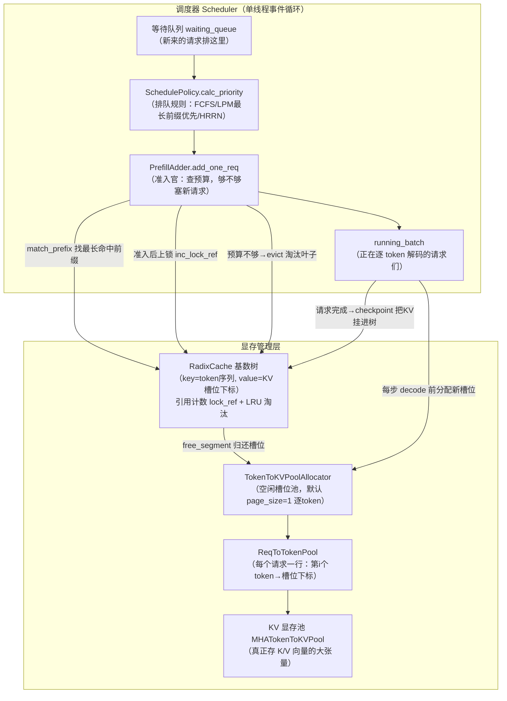
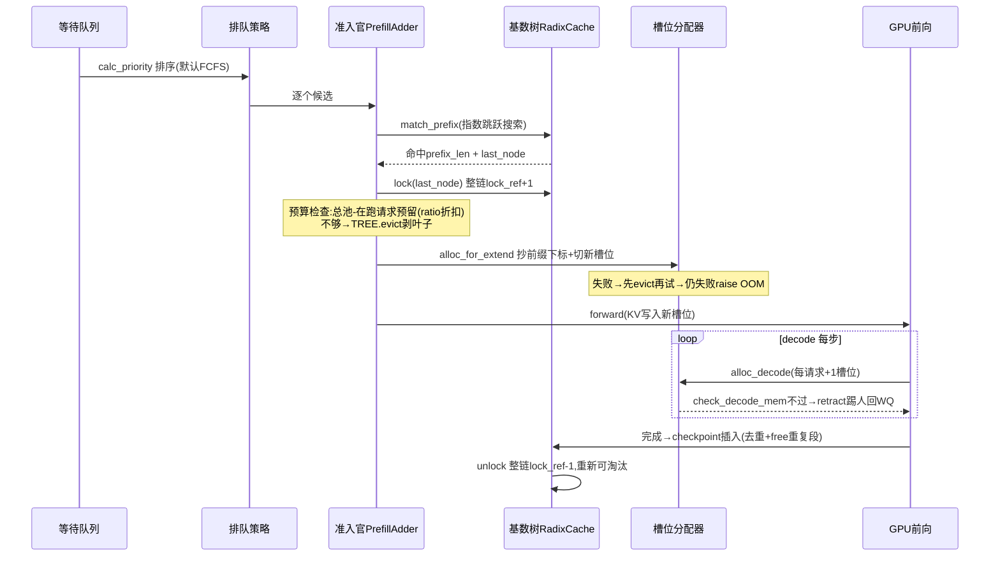

# 源码夜读 · SGLang：RadixAttention 前缀缓存与调度器内存记账

> **版本**：sgl-project/sglang master `9a1979b`（2026-11-10 快照）
> **模块**：RadixCache 基数树 + 调度器准入/撤回链路（`mem_cache/radix_cache.py` 839 行、`managers/schedule_policy.py` 2073 行、`mem_cache/common.py`、`mem_cache/allocation.py`）
> **阅读时间**：约 25 分钟

---

## 🎯 30 秒版本

SGLang 的招牌技术 RadixAttention，核心就是一棵**按 token 序列索引的基数树（Radix Tree）**：所有算过的 KV Cache（模型推理时缓存的中间结果）不删除，而是挂到树上按引用计数+LRU 管理，新请求来了先在树上找最长公共前缀，命中的部分**一个 token 都不用重算**。它是 vLLM PagedAttention（上一篇已解剖）的最大竞品方案——vLLM 用"哈希链+固定 16-token 块"做前缀匹配，SGLang 用"真·前缀树+任意长度段"做匹配，粒度更细、匹配更精确，代价是树操作全在 Python 里跑（所以它们写了 Rust 树核来加速）。读完你会明白：**为什么多轮对话场景 SGLang 常常首 token 更快，以及"缓存复用"这件事在调度器层面要付出多少记账复杂度**。

## 📚 读前须知

三个前置概念，都有类比：

1. **KV Cache**：Transformer 每算一个 token，都会为"已经见过的所有 token"生成一份 Key/Value 中间向量。把它存下来，下次接着算就不用重算——相当于做菜时把切好的配菜存冰箱，下次直接下锅。显存里最值钱的就是它。
2. **前缀复用（Prefix Caching）**：两个请求如果开头一模一样（比如同一个 system prompt），这段开头的 KV Cache 理论上完全相同，可以共享一份。1000 个用户带同一段 2000 token 的 system prompt，只需算 1 次——相当于同一份菜谱的备菜，一桌客人共享。
3. **基数树（Radix Tree）**：一种"压缩前缀树"。普通 Trie 一个节点存一个字符，基数树把**只有一个孩子的长链压成一个节点**，节点里存一整段子串。查"最长公共前缀"是它的看家本领，路由表、自动补全都用它。SGLang 把"token id 序列"当作字符串，把"这段 token 对应的 KV 显存槽位下标"当作值存进树里。

与 vLLM 的关键差异，一句话记住：**vLLM 按固定块（16/64 token）切分并用哈希当 key；SGLang 按 token 原样存树、段长任意，匹配时现算公共前缀**。vLLM 是"页式内存管理"，SGLang 是"字典式前缀匹配"。

## 为什么读这个：不读源码你会在哪里踩坑

- 你以为"开了 RadixCache 命中率就高"，实际上**调度策略默认是 FCFS**（`arg_groups/fields/schedule.py` 中 `schedule_policy = "fcfs"`），缓存感知的 LPM（最长前缀优先）要手动开；而且等待队列一超过 128 个请求，LPM/HRRN 会**自动降级回 FCFS**（`_determine_active_policy`）——高并发下你以为在跑的缓存亲和调度其实没在跑。
- 你以为"显存不够会优雅排队"，实际 decode 阶段 OOM 会触发 **retract（撤回）**：把已经在跑的请求踢回等待队列、**KV 直接丢弃不入库**、之后重算。什么请求先被踢、`new_token_ratio` 这个神秘参数怎么变，不看源码根本不知道。
- 你在做自己的缓存系统时，"引用计数怎么防止共享前缀被误删"“淘汰怎么保证只删叶子”这两个经典难题，SGLang 这份 839 行的实现是目前工程上最干净的答案之一。

## 整体架构



**怎么读这张图**：左边是"谁先跑"的决策（排队→准入→运行），右边是"显存怎么分"的三层账本——**基数树管"可共享的历史 KV"，分配器管"空闲槽位"，req_to_token 表管"每个请求当前用的槽位"**。三者都是 CPU 侧的 Python 对象，真正的 KV 数据一直躺在 GPU 大张量里不动，动的只是"下标"。整个调度器跑在一个线程里（`event_loop_normal`/`event_loop_overlap`），所以全程无锁——这点和 vLLM V1 一模一样，是这类系统的共同选择。

## 核心链路逐步拆解

### 第 1 步：树长什么样——RadixKey 与 TreeNode

```python
# mem_cache/radix_cache.py
class TreeNode:
    def __init__(self, id=None, priority=0):
        self.children = defaultdict(TreeNode)   # 孩子表：key是"下一页token"
        self.parent: TreeNode = None
        self.key: RadixKey = None               # 本节点存的那段 token 序列
        self.value: Optional[torch.Tensor] = None  # 这段 token 对应的 KV 槽位下标(GPU int64张量)
        self.lock_ref = 0                       # 引用计数：>0 = 有请求正在用，禁止淘汰
        self.last_access_time = time.monotonic()   # LRU 时间戳
        self.hit_count = 0                      # 命中次数（LFU/SLRU 策略用）

    @property
    def evicted(self):
        return self.value is None
```

**这几行在干嘛**：一个节点 = "一段 token + 这段 token 的 KV 存在显存哪些槽位"。`value` 是 int64 下标张量，不是 KV 数据本身——**树只是目录，数据在池子里**。`lock_ref` 是引用计数，`evicted` 判断很直白：value 为 None 就是已被淘汰。

此刻内存里：CPU 侧一堆 Python 对象（每节点几百字节），GPU 侧两个大张量——`req_to_token`（int32，形状 `[请求槽数+1, max_context_len]`，第 0 行是给 CUDA Graph 填充用的"垃圾行"）和 KV 池本体。**默认 `page_size=1`**（`arg_groups/overrides.py` 的 `_page_size_default` 在非 MUSA 平台返回 `{"page_size": 1}`），即逐 token 粒度，比 vLLM 的 16-token 块细 16 倍。

树的命名空间不只有 token：`RadixKey` 还携带 `extra_key`（LoRA 适配器名等）和 `cache_salt`（多租户隔离盐值），孩子表的 key 是 `((extra_key, cache_salt), 首页token)` 的元组——**盐和租户不同的请求即使 token 全同也绝不同树**，等价于 vLLM 把 salt 混进哈希的做法，但这里是显式命名空间，不需要哈希。

### 第 2 步：查前缀——match_prefix 与"指数跳跃搜索"

请求进入 prefill 准入时，`Req.init_next_round_input` → `match_kv_cache`（`mem_cache/common.py`）→ `tree_cache.match_prefix`。核心循环：

```python
def _match_prefix_helper(self, node, key):
    access_time = time.monotonic()
    node.last_access_time = access_time          # 摸一下=续命，LRU时钟在这里走
    child_key = key.child_key(self.page_size)     # 用"第一页token"当孩子表键
    value = []
    while len(key) > 0 and child_key in node.children.keys():
        child = node.children[child_key]
        child.last_access_time = access_time
        prefix_len = child.key.match(key, page_size=self.page_size)  # 本段内公共前缀多长
        if prefix_len < len(child.key):
            new_node = self._split_node(child.key, child, prefix_len)  # 段中间分叉→劈开
            value.append(new_node.value); node = new_node
            break
        value.append(child.value); node = child
        key = key[prefix_len:]                    # 吃掉匹配部分，继续往下走
    return value, node
```

**这几行在干嘛**：从根往下走，每到一个节点算"请求 key 和节点段的公共前缀长度"。三种结局：整段匹配（继续往下）、部分匹配（**把节点从分叉处劈成两半**，`_split_node` 会 clone 两截 value 张量、重挂父子指针——这就是基数树区别于普通 Trie 的自维护操作）、孩子表查不到（停）。

**藏在这段里的性能狠活**是 `RadixKey.match_at`：找两个 token 序列的公共前缀，它不用逐 token 的 Python for 循环，而是**指数跳跃（galloping）+ 二分**——窗口按 1、2、4、8…倍增地做 C 层切片比较 `t0[lo:hi] != t1[lo:hi]`，越界后在最后一个窗口内二分定位分叉点。共享前缀几千 token 的多轮对话场景，Python 逐 token 比较要几毫秒（调度器单线程，这是纯 CPU 阻塞），galloping 只要几十次切片比较。源码注释原话："no per-token Python loop on long shared prefixes"。

此刻线程状态：**只有调度线程在跑**，没有任何 GPU 同步（纯 CPU 元数据操作）。匹配结束时 `req.prefix_len = 命中的 token 数`，`req.last_node = 停在的节点`，命中链路上所有节点的 `last_access_time` 已被刷新——**查询本身就是 LRU 的"访问"事件**。

### 第 3 步：上锁——引用计数如何防止"共享前缀被误删"

准入官 `PrefillAdder.add_one_req`（`schedule_policy.py` L1640+）在评估一个请求时，先用 contextmanager 把候选节点**临时钉住**：

```python
# The temporary pin excludes this prefix from the evictable budget.
with self._lock_node(req.last_node):
    admission = self._select_prefill_admission(req, ...)   # 算预算：够不够
    ...
# 准入成功后（_commit_prefill_admission）：
req.extend_end = admission.prefix_len + admission.extend_len
req.lock = self.tree_cache.lock(req.last_node)             # 正式上锁，挂在请求上
self.can_run_list.append(req)
```

`lock()` 的本质是 `inc_lock_ref`：

```python
def inc_lock_ref(self, node):
    while node != self.root_node:
        if node.lock_ref == 0:
            self.evictable_size_ -= len(node.key)    # 从"可淘汰额度"划走
            self.protected_size_ += len(node.key)    # 记入"受保护额度"
        node.lock_ref += 1
        self._update_leaf_status(node)
        node = node.parent                            # 一路加到根！
```

**这几行在干嘛**：从命中节点**一路向上把整条祖先链的引用计数 +1**。为什么必须锁整条链？因为树的语义是"父段是子段的前缀"——如果只锁叶子，淘汰器把中间某个祖先删了，叶子就变成断根的孤儿，前缀不完整没法用。这和 vLLM 的块级 ref_cnt 只锁单块不同，是树结构逼出来的设计。

同时注意 `evictable_size_`/`protected_size_` 这对计数器：**调度器的每个"显存够不够"判断，读的都是这两个 O(1) 维护的数字**，从不遍历树。锁一条链是 O(树深)，比遍历便宜几个量级。

此刻内存里：请求对象上多了一个 `req.lock`（TreeLock，记着节点和解锁回执）；祖先链每个节点 `lock_ref += 1`；这些节点从 `evictable_leaves` 集合里被摘除（`_update_leaf_status` 维护"没锁、没孩子、value 非空"的叶子集合——**只有叶子有资格被淘汰**，这是树式缓存的铁律：删中间节点等于删掉它下面所有分支）。

### 第 4 步：分配显存——把树的目录抄进请求的行

准入通过、批次组装时 `prepare_for_extend` → `alloc_for_extend`（`mem_cache/allocation.py`）：

```python
prefix_tensors = [_prefix_kv_indices(batch, r) for r in batch.reqs]
# _prefix_kv_indices: 已持有行的请求直接读自己的行；新请求从树上读——
#   return batch.tree_cache.prefix_device_indices(req)   # 根→last_node 各节点 value 拼接
...
out_cache_loc = alloc_token_slots(batch.tree_cache, alloc_extend_num_tokens)  # 新token的空闲槽位
write_cache_indices(out_cache_loc, req_pool_indices_device, ..., prefix_tensors, batch.req_to_token_pool)
```

**这几行在干嘛**：三步——①把树上命中链路的槽位下标（各节点 `value` 张量 `torch.cat` 起来）**抄写进这个请求自己的 `req_to_token` 行**；②给"没命中的尾巴"从空闲池切新槽位；③新槽位下标也写进行里。写完之后，**请求行 = 完整的前缀下标 + 新分配下标**，attention kernel 拿这一行就能读旧 KV、写新 KV。树和行是"硬链接"关系：同一份 KV 槽位同时被树节点 value 和请求行引用，物理数据零拷贝。

分配失败会怎样？`alloc_token_slots` 里 `make_room=_room_in(tree_cache)` ——分配前先**按需淘汰**（`evict_from_tree_cache` → `tree_cache.evict`），淘汰完还不够就 `raise RuntimeError("Out of memory...")` 并 `tree_cache.pretty_print()` 把整棵树打印到日志。这是 fail-loud 设计：准入层已经算过预算，走到这里还 OOM 说明记账有 bug，直接炸出来。

paged 模式（`page_size>1`）下分配走 Triton kernel（`alloc_extend_kernel`）一次性为整个 batch 生成页对齐下标；释放走 `free_segment`——**利用"页对齐+连续"的性质用 `free_index[::page_size]` 每页取一个代表，避开 `torch.unique` 的 GPU→CPU 同步**。这种"用数据布局的不变量换掉一次 device sync"的微优化，在单线程调度器里就是吞吐量。

### 第 4.5 步：准入的账怎么算——PrefillAdder 的三重预算

第 4 步说"分配失败会 raise"，但正常情况下根本走不到那——因为 `PrefillAdder` 在准入时已经把账算死了。它同时看三本账（`schedule_policy.py` `PrefillAdder.__init__` 和 `memory_budget`）：

1. **chunk 预算**（`rem_chunk_tokens`，即 `--chunked-prefill-size`）：这一批 prefill 最多算多少 token，超长的请求被切成 chunk 分几步喂（chunked prefill），防止一个 128K 长 prompt 独占 GPU 把其他请求的 decode 全饿死。
2. **总 KV 预算**：`rem_total_tokens = 池子可用 + 可淘汰 - 在跑请求的未来预留`。"未来预留"就是 `new_token_ratio` 登场的地方——每个在跑的请求按 `max_new_tokens × ratio` 预扣未来 decode 要吃的显存。ratio=0.7 意思是"平均而言请求只会用掉它声明的最大生成长度的 70%"，这是拿超卖换吞吐。
3. **请求槽预算**（`req_to_token` 的行数）：`get_num_allocatable_reqs` 管着"最多同时几个请求"，行用完了一样进不来。

三本账任何一本不够，`add_one_req` 返回 `NO_TOKEN`/`OTHER`，本轮准入到此为止（后面的请求连评估机会都没有——所以队首卡死会阻塞整队，源码里管这叫 head-of-line blocking，专门有日志）。**此刻没有任何显存被真正分配**，准入纯粹是 CPU 上的算术；只有全部候选过完账，`prepare_for_extend` 才一次性为整个 batch 做真实分配。先记账后动手，算错账的代价被隔离在一个 batch 内。

### 第 5 步：请求完成——checkpoint 把 KV"捐"给树

请求生成结束（或 chunked prefill 的一段跑完），走 `release_kv_cache`（`mem_cache/common.py` L381）：

```python
def release_kv_cache(req, tree_cache, *, checkpoint: bool):
    ...
    if checkpoint:
        req.refresh_fill_ids()
        tree_cache.checkpoint(req, up_to=owned_kv_len)   # ① 把算好的KV挂进树
    # ② 树没接管的部分，归还分配器
    tree_cache.free_kv_row(req.kv, [(req.kv.cache_protected_len, owned_kv_len)])
    tree_cache.unlock(req.lock)                          # ③ 解锁祖先链，重新可淘汰
    req.lock = None
```

`RadixCache.checkpoint` → `_insert_cache` 是"捐赠仪式"：

```python
values = kv_indices[:key_len].to(dtype=torch.int64, copy=True)  # 从请求行拷一份下标
result = self.insert(InsertParams(key=radix_key, value=values, ...))
# 关键一步：树里本来就有的重复段，请求自己那份是多余的，还给分配器
self.token_to_kv_pool_allocator.free_segment(
    kv_indices[req.kv.cache_protected_len : result.prefix_len], ...)
# 然后重新 match_prefix，把请求行改写为指向树的（可能已被去重的）下标
```

**这几行在干嘛**：插入时发现"树里已经有这段前缀"（比如另一个并发请求先捐了同样的 system prompt），就把**自己行里那份重复槽位释放掉**，再把行重新指向树里的规范副本（`req_to_token_pool.write`）。这就是去重：两个请求各算了一份相同前缀，后捐的自动回收，显存里只留一份。`split_prompt=True` 还会在 prompt 边界额外劈一刀并提高优先级——让淘汰器先删生成的输出 KV、保住更值钱的 prompt KV。

此刻的状态变化：树多了新节点（`evictable_size_ += len(key)`），请求行和锁都释放（`req_to_token` 行号回 free_slots），整条链 `lock_ref -= 1`，归零的节点回到可淘汰集合。**KV 数据本身一个字节没动**——它从"请求私有"变成了"树上公共"，只是归属关系变了。

### 第 6 步：淘汰——叶子小根堆，策略是个函数

显存不够时 `RadixCache.evict`：

```python
def evict(self, params):
    leaves = list(self.evictable_leaves)
    eviction_heap = [(self.eviction_strategy.get_priority(node), node) for node in leaves]
    heapq.heapify(eviction_heap)
    while num_evicted < num_tokens and len(eviction_heap):
        _priority, x = heapq.heappop(eviction_heap)
        self.token_to_kv_pool_allocator.free_segment(x.value, start_pos=0)  # 槽位还给池子
        num_evicted += len(x.value)
        self._delete_leaf(x)
        if len(x.parent.children) == 0 and x.parent.lock_ref == 0:
            heapq.heappush(eviction_heap, (new_priority, x.parent))  # 父亲变成新叶子→入堆
```

**这几行在干嘛**：经典的"剥洋葱"式树淘汰——只从叶子开始删，删完一个叶子，它父亲如果也变成了无孩无锁的叶子，就入堆候选下一轮。和 vLLM 的全局 LRU 双向链表相比，这里**没有常驻数据结构**，每次 evict 现场建堆（可淘汰叶子通常几百个，堆操作微秒级）。

`eviction_strategy` 是策略模式（`mem_cache/evict_policy.py`）：LRU（`last_access_time`）、LFU、FIFO、MRU、SLRU（命中≥2次进保护区）、Priority，还有一个 2025 年新论文 T-LRU（arXiv:2510.15152）——对多轮对话，只保留"下轮 TTFT 预算内用得到"的前缀，超出部分标记为"无限老"优先删。默认 `"lru"`（`arg_groups/fields/memory.py`）。**淘汰策略被抽象成"给节点算一个可比较的优先级"这一个函数**，堆驱动逻辑完全复用——想抄的话这是最干净的样板。

### 第 7 步：OOM 撤回——decode 阶段的保命机制

decode 每步只产 1 个 token，但几百个请求同时产，池子仍会被榨干。`update_running_batch`（`scheduler.py` L5016+）每步检查：

```python
kv_full_retract_flag = not batch.check_decode_mem()   # 下一步decode的槽位够不够
if kv_full_retract_flag:
    retracted_reqs, new_token_ratio, reqs_to_abort = batch.retract_decode(self.request_retirer)
    for req in retracted_reqs:
        self._add_request_to_queue(req, is_retracted=True)   # 踢回等待队列
```

`retract_decode` 的选人逻辑（`schedule_batch.py` L2956）：按 `(len(output_ids), -len(origin_input_ids))` 排序后**从队尾开始踢**——即"已生成输出最少、输入最长"的请求先被牺牲（重算代价看起来最大，但它丢掉的历史最少；且它的 prompt 前缀大概率还在树上，重算时能命中）。循环踢到 `check_decode_mem` 通过为止，**最后一个请求永远保留**，连它都放不下就 abort 它而不是让调度器崩掉。

被踢请求的 KV 去哪了？`request_retirer.retract` → `release_kv_cache(req, tree_cache, checkpoint=False)`，源码注释原话："release memory and don't insert into the tree because we need the space instantly"——**不入库、立即释放**，重算时靠树里残存的公共前缀止损。这和 vLLM 的重算式抢占同源，但 SGLang 多一层保险：PD 分离部署的 decode 节点可以把 KV 备份到 host 内存（`backup_kv_cache`），恢复时免重算。

踢完之后还有一步"惊弓之鸟"记账：`new_token_ratio` 被重置为按当前 batch 实际输出进度估计的值（`estimate_new_token_ratio_after_retract`），然后每步衰减。这个 ratio 是准入时给"未来 decode 要占多少显存"打的折扣系数（初始 0.7，最低衰减到 0.7×0.14≈0.098，600 步衰减完）——**刚发生过 OOM 撤回，准入就变保守；长期太平，就逐渐激进**。一个标量实现了自适应的内存超卖，这是整套调度里最"控制论"的设计。

### 请求一生 · 时序图



**怎么读**：树在生命周期里被碰了四次——查（match）、锁（lock）、捐（checkpoint）、删（evict）。分配器只在"查锁之后、GPU 之前"被真正调用，所有"够不够"的判断都提前用树维护的 `evictable_size_`/`protected_size_` 计数器做掉了。

## 设计亮点与可借鉴模式

1. **"目录与数据分离"的三层账本**：树（可共享目录）→ req_to_token（请求私有目录）→ KV 池（数据）。共享=两份目录指向同一批数据下标，去重/释放/淘汰全在目录层操作，数据零拷贝。任何"大对象+细粒度共享"的系统（对象存储去重、CDN 缓存、你自己写的连接/文件句柄池）都能抄这个分层。
2. **引用计数沿依赖链传播**：锁叶子必锁祖先，因为父是子的语义前提。对比很多缓存系统只给条目本身计数、忘了"条目间有依赖"导致悬空引用——记住 SGLang 这个 while 循环。
3. **O(1) 计数器代替遍历**：`evictable_size_`/`protected_size_` 在每次锁/解锁/插入/删除时增量维护，"够不够"的判断永远不扫树。你的系统里所有"当前可用量"查询都应该是这种维护出来的数字，而不是现场 sum 出来的。
4. **淘汰策略=一个优先级函数**：`get_priority(node) -> 可比较值`，LRU 返回时间戳、SLRU 返回 `(是否进保护区, 时间戳)` 元组、T-LRU 返回 `(是否尾冗余, 时间戳)`——堆驱动代码一行不改。策略模式的教科书级落地。
5. **galloping 搜索**：在"两个序列找公共前缀"这种热路径上，用倍增窗口+二分把 Python 循环换成 C 层切片比较。任何解释型语言里的序列比较都值得这一招。
6. **new_token_ratio 自适应超卖**：出过一次事故（retract）就把资源预估调保守，随时间指数恢复激进。比静态水位线聪明得多，适合一切"预估未来资源占用"的准入控制。
7. **等待队列里的"影子树"防重复准入**（`_compute_prefix_matches`）：用一棵 `create_simulated()` 的模拟树（不挂显存、纯 token）扫等待队列，发现队列内部互为重复前缀的请求时把后来者**临时降权**——让第一个先跑、把前缀"种"进真树，后面的自然全命中。批量同 prompt 请求场景下这一下能把重复 prefill 从 N 次降到 1 次。

## 踩坑 / 局限

- **树操作是纯 Python 单线程**：galloping 再快也扛不住超大树+超高 QPS，所以官方另写了 `rust_tree_core`（Rust 实现的树核）和 `UnifiedRadixCache`（当前默认树，统一管设备/host 分层缓存、Mamba 状态、会话）。本文的 `RadixCache` 是经典设备端实现，概念同源但生产环境跑的多是 unified 版——读源码时别走错门。
- **默认调度策略不感知缓存**：`schedule_policy` 默认 `"fcfs"`，想要缓存亲和要显式 `--schedule-policy lpm`；且队列长度 >128（`WAITING_QUEUE_PREFIX_MATCH_MAX`）时 LPM/HRRN 自动退化 FCFS（前缀匹配太贵），高压下缓存命中率会悄悄劣化。
- **retract 不入库**：被踢请求的 KV 直接丢弃（checkpoint=False），重算靠树里残留的公共前缀止损；如果它的历史前缀恰好刚被淘汰，就是全量重算。`--schedule-conservativeness` 调大（初始 ratio 更保守）可以减少 retract 频率。
- **page_size=1 的双刃剑**：逐 token 粒度让复用达到理论最优（vLLM 块粒度会浪费块内尾巴），但树的节点数和 Python 对象开销更大；这也是为什么新后端（FlashMLA 等）会强制 page_size=64。
- **匹配是精确 token 匹配**：语义等价但 token 不同的前缀（比如换了个空格、system prompt 里嵌了时间戳）完全无法复用——和 vLLM 同样的坑，**动态内容务必放 prompt 尾部**，别污染前缀。

## 🧠 关键概念表

| 术语 | 白话解释 | 为什么重要 |
|---|---|---|
| Radix Tree（基数树） | 压缩前缀树：长链压成一个节点，节点存一整段 | RadixAttention 名字的来源，前缀复用的数据结构本体 |
| KV Cache | 推理中间结果缓存 | 显存大头，复用它=省算力=降 TTFT |
| lock_ref | 节点引用计数，>0 不可淘汰 | 防止共享前缀被误删的核心机制 |
| evictable/protected_size | 可淘汰/受保护的 token 数，增量维护 | 调度器所有"够不够"判断的 O(1) 依据 |
| checkpoint | 请求完成时把私有 KV 插入树 | "私有→公共"的捐赠仪式，含自动去重 |
| retract（撤回） | decode OOM 时踢请求回队列、丢 KV 重算 | 系统不崩的保命阀，也是延迟毛刺的来源 |
| new_token_ratio | 预估"未来还要生成多少 token"的折扣系数 | 出事后保守、平时激进的自适应超卖旋钮 |
| galloping search | 倍增窗口+二分找公共前缀 | 单线程 Python 调度器扛长前缀匹配的关键优化 |
| page_size | 分配粒度（默认 1 token） | 越细复用越精，但管理开销越大 |
| UnifiedRadixCache | 当前默认树：设备+host+Mamba+会话统一管 | 生产环境实际在跑的版本，本文 RadixCache 是其概念基座 |

## 💡 所以呢

- **用 SGLang 的话**：多轮对话/共享 system prompt 场景显式开 `--schedule-policy lpm`（低并发时）；监控日志里的 "Retract requests" 告警，出现就调大 `--schedule-conservativeness` 或降并发；prompt 模板的动态部分放尾部。
- **自己写系统的话**：三层账本（目录/私有映射/数据）、沿依赖链传播的引用计数、O(1) 增量计数器、"优先级函数+堆"的淘汰框架——这四件套适用于几乎所有资源池化问题，和语言无关。
- **对比记忆**：vLLM=页式+哈希链+全局 LRU 链表（管理便宜、粒度粗）；SGLang=真前缀树+引用计数+叶子堆淘汰（粒度精、Python 树操作贵到要上 Rust）。两家在"重算式抢占""单线程无锁调度""缓存感知准入"上殊途同归——这些才是 LLM 推理调度的真正共识。

## 参考（源码文件，精确到类/函数）

- `python/sglang/srt/mem_cache/radix_cache.py`：`RadixKey.match_at`（galloping）、`TreeNode`、`RadixCache._match_prefix_helper`、`_split_node`、`_insert_helper`、`_insert_cache`、`checkpoint`、`evict`、`inc_lock_ref`/`dec_lock_ref`、`_update_leaf_status`
- `python/sglang/srt/mem_cache/evict_policy.py`：`LRUStrategy`/`SLRUStrategy`/`TLRUStrategy`/`PriorityStrategy`
- `python/sglang/srt/mem_cache/common.py`：`match_kv_cache`、`checkpoint_kv_cache`、`release_kv_cache`、`evict_from_tree_cache`、`_room_in`
- `python/sglang/srt/mem_cache/allocation.py`：`alloc_for_extend`、`_prefix_kv_indices`、`alloc_token_slots`、`write_cache_indices`
- `python/sglang/srt/mem_cache/allocator/token.py` / `allocator/paged.py`：`TokenToKVPoolAllocator.alloc/free`、`PagedTokenToKVPoolAllocator.free_segment`、`alloc_extend`
- `python/sglang/srt/mem_cache/memory_pool.py`：`ReqToTokenPool`、`MHATokenToKVPool`
- `python/sglang/srt/managers/schedule_policy.py`：`SchedulePolicy.calc_priority`、`_determine_active_policy`、`_compute_prefix_matches`（影子树）、`PrefillAdder.add_one_req`、`_lock_node`、`_commit_prefill_admission`、`preempt_to_schedule`
- `python/sglang/srt/managers/schedule_batch.py`：`Req.init_next_round_input`、`prepare_for_extend`、`check_decode_mem`、`retract_decode`、`_get_decode_retraction_order`
- `python/sglang/srt/managers/scheduler.py`：`event_loop_normal`/`event_loop_overlap`、`_get_new_batch_prefill_raw`、`update_running_batch`
- `python/sglang/srt/managers/scheduler_components/request_retirer.py`：`release`、`retract`
- `python/sglang/srt/managers/scheduler_components/new_token_ratio_tracker.py`：`NewTokenRatioTracker`
- `python/sglang/srt/mem_cache/registry.py`：`create_tree_cache`、`default_radix_cache_factory`
- `python/sglang/srt/arg_groups/fields/schedule.py` / `fields/memory.py`：默认值（fcfs、lru、page_size）
