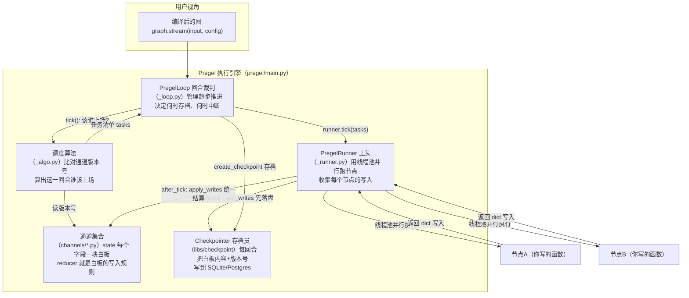
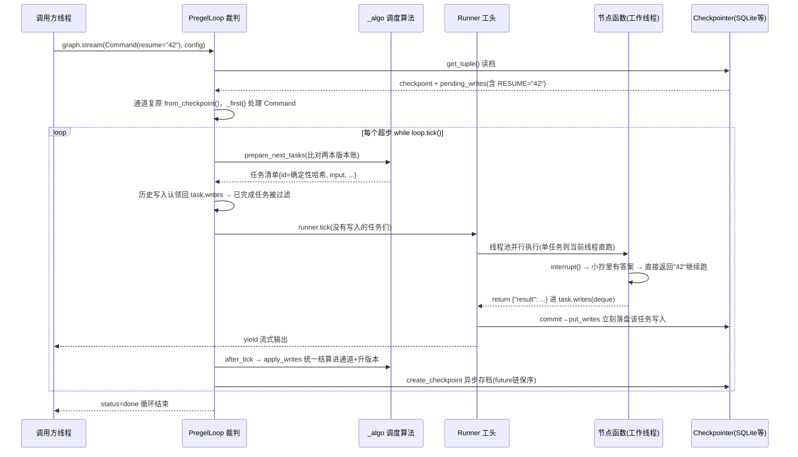

# 源码夜读：LangGraph 的 Pregel 调度器——状态、通道、检查点与 interrupt 的全部真相

> 项目：LangGraph（Python 库 `langgraph` v1.2.22，master `02f2c2e`，2026-11-16 快照）
> 模块：Pregel 执行引擎——通道（Channel）状态模型、超步循环、版本触发调度、检查点持久化、`interrupt()`/`Command(resume)` 人机协同机制
> 阅读时长：约 20 分钟。所有结论基于真实源码，文件路径精确到类/函数，见文末参考。

---

## 🎯 30 秒版本

LangGraph 的执行引擎是 Google Pregel 论文（图计算的"整体同步并行"模型）的 Python 复刻：**每个节点不直接调用下一个节点，而是往"通道"里写数据；调度器靠比较通道版本号决定下一轮谁跑；每一轮结束都把全部状态存成检查点**。理解了这三句话，你就理解了它为什么能做到"任意节点暂停等人类输入、进程崩了换台机器接着跑"——因为节点之间根本没有内存耦合，一切状态都在可序列化的通道里。对你最大的用处：`interrupt()` 恢复时会**从头重跑整个节点函数**，节点里的副作用（发请求、扣款）会执行两次——不读源码你几乎必踩这个坑。

---

## 📚 读前须知：三个前置概念

**1. BSP（Bulk Synchronous Parallel，整体同步并行）**——想象一个回合制游戏：所有玩家（节点）同时行动，行动期间彼此看不见对方的新动作；等所有人行动完，裁判（调度器）统一结算，把结果公布出来，然后进入下一回合。LangGraph 的一次"回合"叫一个**超步（superstep）**，源码注释原话：*"Channel updates from step N are only visible in step N+1"*（第 N 步的写入只在第 N+1 步可见）。这意味着节点函数执行期间，整个图的状态是**冻结**的——你可以放心读 state，不会有并发修改。

**2. 通道（Channel）**——不是消息队列的 channel，更像一块**带规则的共享白板**。每个 state 字段背后都对应一个通道对象，通道自己决定"多个节点同时往我这写字段怎么办"：有的只留最后一个值（`LastValue`），有的把所有值累加起来（`BinaryOperatorAggregate`，你写的 `Annotated[list, operator.add]` reducer 就是它）。

**3. 检查点（Checkpoint）**——每回合结束后给整个游戏存的档：所有白板的当前内容 + 每块白板的版本号 + 每个节点"上次看到过哪个版本"的记录。存档存到 SQLite/Postgres，所以进程死了、换台机器，读档就能精确续跑。

---

## 为什么读这个：不读源码会在哪里踩坑

LangGraph 是目前最主流的 Agent 编排框架之一（LangChain 官方出品），文档写得漂亮，但有几个行为**文档一句话带过、源码里是一整套机制**：

- **坑 1**：`interrupt()` 之后 resume，节点函数会**从第一行重新执行**。你的节点里如果有"调用 LLM → interrupt 问人类 → 写库"，resume 时 LLM 会再被调用一次（再花一次钱），写库前的代码全部重跑。为什么？读了 `interrupt()` 的实现（30 行）你就秒懂。
- **坑 2**：两个并行节点同时更新一个**没有 reducer** 的 state 字段，直接抛 `InvalidUpdateError`。这不是 bug，是 `LastValue` 通道的设计——但你不知道"字段=通道"这个模型，就会觉得报错莫名其妙。
- **坑 3**：`recursion_limit`（默认 25）限的是**超步数**不是节点数。一个带循环的 Agent 每轮"LLM→工具→LLM"要吃掉好几个超步，复杂 Agent 莫名 `GraphRecursionError` 的根源在这。
- **坑 4**：崩溃恢复时，同一超步内**已成功的节点不会重跑**（写入已落盘），**失败/被打断的节点整个重跑**。哪些算"已成功"？源码用"有没有输出写入"来判断——一个只抛 interrupt、没写任何业务字段的节点，永远算"未成功"。

这些都是生产环境的真金白银问题。下面拆开看。

---

## 整体架构：五个部件一张图



**怎么读这张图**：核心是中间那个环——`PregelLoop`（裁判）每回合先问 `_algo.py`（调度算法）"根据白板版本号，这回合谁该跑"，得到任务清单交给 `PregelRunner`（工头）并行执行；节点返回的 dict 不会立刻改状态，而是先作为"写入"落盘到 Checkpointer，等本回合所有节点跑完，才由 `apply_writes` 统一结算到通道里，最后存一次档。节点之间**没有任何直接引用**——这就是可恢复性的来源。

---

## 核心链路逐步拆解

### 第 0 步：state 字段是怎么变成"通道"的

你写的：

```python
class State(TypedDict):
    question: str                                # 没有 reducer
    messages: Annotated[list, operator.add]      # 有 reducer
```

编译时 `graph/state.py` 把 `question` 映射成一个 `LastValue` 通道，`messages` 映射成一个 `BinaryOperatorAggregate(list, operator.add)` 通道。**此刻内存里**：一个 `dict[str, BaseChannel]`，key 是字段名，value 是通道对象。

`LastValue`（`channels/last_value.py`）的全部业务逻辑就这几行：

```python
def update(self, values: Sequence[Value]) -> bool:
    if len(values) == 0:
        return False
    if len(values) != 1:
        raise InvalidUpdateError(   # 一步收到多个值 → 直接报错
            f"At key '{self.key}': Can receive only one value per step. ...")
    self.value = values[-1]
    return True
```

**这几行在干嘛**：一个超步里如果两个并行节点都写了 `question`，`values` 长度是 2，直接抛 `InvalidUpdateError`。这就是坑 2 的源码现场——报错信息甚至告诉你解法："Use an Annotated key to handle multiple values"（加个 reducer）。

而 `BinaryOperatorAggregate.update`（`channels/binop.py`）就是经典 fold：`self.value = self.operator(self.value, value)` 逐个累加。注意一个细节：多个写入的**应用顺序**由 `apply_writes` 开头的一行排序保证——`tasks = sorted(tasks, key=lambda t: writes_sort_key(task_path_str(t.path)))`，按任务路径字符串排序。也就是说 reducer 的折叠顺序是**确定性**的（按任务创建路径），不是"谁先跑完谁先进"——这对 `operator.add` 无所谓，对不可交换的 reducer（比如字符串拼接）就是行为正确性的保证。

通道还有两个生命周期钩子（`channels/base.py`）：`consume()`（"你被读过了，可以清空自己"）和 `finish()`（"图要结束了"）。`Topic` 通道（存放 `Send` 动态任务的路由通道，非 accumulate 模式）每次 `update` 先清空再装新值，`NamedBarrierValue`（多条入边汇合的"等所有人到齐"通道）在 `consume()` 里把 `seen` 集合清零。**记住 consume/finish，第 3 步 apply_writes 会用。**

### 第 1 步：超步主循环——30 行的"操作系统内核"

`pregel/main.py` L3081 附近，整个引擎的心跳：

```python
# Similarly to Bulk Synchronous Parallel / Pregel model
# computation proceeds in steps, while there are channel updates.
# Channel updates from step N are only visible in step N+1
while loop.tick():                              # ① 裁判：算出本回合任务
    for task in loop.match_cached_writes():     # ② 命中节点缓存的直接抄答案
        loop.put_writes(task.id, task.writes, cached=True)
    for _ in runner.tick(                       # ③ 工头：并行执行任务
        [t for t in loop.tasks.values() if not t.writes],  # 只跑"没有写入"的任务！
        timeout=self.step_timeout, ...):
        yield from _output(...)                 # ④ 边跑边流式吐输出
    loop.after_tick()                           # ⑤ 统一结算 + 存档
```

**这几行在干嘛**：注意 ③ 的过滤条件 `if not t.writes`——一个任务如果已经有写入（来自缓存命中，或崩溃恢复时从数据库"归还"的历史写入），**根本不会被执行**。这是整个断点续跑机制的支点，第 5 步细讲。

**此刻线程里发生了什么**：这段代码跑在调用 `graph.stream()` 的那个线程上（同步版），`loop.tick()` 返回 False 时循环结束。图的"生命周期"就是这一个人的 while 循环，没有后台守护线程——这是它和 XXL-JOB 那种常驻调度器最大的气质差异。

`loop.tick()`（`_loop.py` L658）做四件事：查超步数是否超限（`self.step > self.stop` → `status="out_of_steps"`，最终抛 `GraphRecursionError`，坑 3 的源头）；调 `prepare_next_tasks` 算任务；检查 `interrupt_before` 断点；没有任务就 `status="done"` 收工。

### 第 2 步：调度决策——不用队列、不用事件，就比两个版本号

这是全库最优雅的 30 行，`_algo.py` 的 `_triggers()`：

```python
def _triggers(channels, versions, seen, null_version, proc) -> bool:
    if seen is None:                       # 节点从没跑过：任何订阅的通道有值就触发
        for chan in proc.triggers:
            if channels[chan].is_available():
                return True
    else:                                  # 跑过：通道当前版本 > 我上次见到的版本 → 有新数据 → 触发
        for chan in proc.triggers:
            if channels[chan].is_available() and \
               versions.get(chan, null_version) > seen.get(chan, null_version):
            return True
    return False
```

**这几行在干嘛**：每个节点（`PregelNode`）声明自己订阅哪些通道（`triggers`，通常由入边决定——`add_edge("a", "b")` 会让 b 订阅一个 `branch:to:b` 路由通道）。checkpoint 里有两本账：

- `channel_versions`：每块白板现在的版本号（全局单调递增的整数）；
- `versions_seen[node_name]`：这个节点上次执行时，见到的各白板版本号。

**当前版本 > 见过的版本 = 有新消息 = 该你上场**。没有事件总线、没有就绪队列、没有回调注册——调度就是一个纯函数，输入是 checkpoint 里的两本账，输出是布尔值。这意味着：**只要存档在，调度决策就能在任何机器上精确重放**，因为它不依赖任何进程内的易失状态。

还有个性能优化值得抄（`prepare_next_tasks`）：`trigger_to_nodes` 是编译期建好的倒排索引（通道→订阅它的节点列表）。上一回合哪些通道被更新了（`updated_channels`）是已知的，所以候选节点直接取交集，不用遍历全部节点。图有几百个节点时这是明显加速。

每个被触发的节点会生成一个 `PregelExecutableTask`，其 id 由 `xxh3_128(checkpoint_id字节, 命名空间, 步数, 节点名, "PULL", 触发通道...)` 哈希得出——**任务 id 是确定性哈希，不是随机 UUID**。同一个 checkpoint 重放，算出来的任务 id 一模一样，这正是"历史写入能认领回新任务"的前提（写入是按 task_id 存的）。

### 第 3 步：并行执行与统一结算

`PregelRunner.tick()`（`_runner.py` L179）先走快速路径：**只有一个任务且无超时无 waiter 时，直接在当前线程同步跑**（省线程切换，Agent 里"LLM→工具"交替的单链场景全走这条路）。多任务时才 `submit` 到线程池，然后 `concurrent.futures.wait(..., FIRST_COMPLETED)` 循环收割，每完成一个就 `yield` 把控制权还给上层吐流式输出。

节点执行完，`commit()` 按三种结局把写入交给 `loop.put_writes()`：

```python
if isinstance(exception, GraphInterrupt):      # 暂停：只存 INTERRUPT 控制写入
    writes = [(INTERRUPT, exception.args[0])]
elif exception:                                 # 失败：存 ERROR 写入（供恢复时路由错误处理器）
    task.writes.append((ERROR, exception))
else:                                           # 成功：若没有任何业务输出，补一个 NO_WRITES 标记
    if all(chan in CONTROL_WRITES for chan, _ in task.writes):
        task.writes.append((NO_WRITES, None))
    self.put_writes()(task.id, task.writes)
```

`NO_WRITES` 这个看似多余的标记是坑 4 的答案：**"任务完成"的判据是"有输出写入"**（`_task_status.py` 模块文档写得很清楚），所以一个啥也不返回的成功节点必须留个"到此一游"的标记，否则崩溃恢复时会被当成"没跑完"重跑。

关键并发细节：节点的写入先进 `task.writes`——一个 `deque`，源码注释 *"deque.extend is thread-safe"*（CPython 的 deque 单操作有内部锁），所以多个节点并行写各自的 deque 互不干扰；**通道本身在整个超步内不被任何人修改**（BSP 保证），真正的合并发生在回合结束的 `apply_writes`（`_loop.py` 的 `after_tick` 调用它）：

```python
# apply_writes（_algo.py L234）节选
tasks = sorted(tasks, key=...)            # ① 按路径排序保证 reducer 折叠顺序确定
for task in tasks:                        # ② 记账：每个节点"现在见过这些版本了"
    checkpoint["versions_seen"].setdefault(task.name, {}).update(
        {chan: checkpoint["channel_versions"][chan] for chan in task.triggers ...})
for chan in {本回合被读过的触发通道}:      # ③ consume()：路由类通道读完即焚
    if channels[chan].consume(): checkpoint["channel_versions"][chan] = next_version
for chan, vals in pending_writes_by_channel.items():   # ④ 真正的状态合并
    if channels[chan].update(vals):                    #    reducer 在这里被调用
        checkpoint["channel_versions"][chan] = next_version
```

**此刻内存里发生了什么**：`versions_seen` 追平 `channel_versions`（第 2 步的比较基准更新了）；`branch:to:*` 这类一次性路由通道被 consume 清空（防止下一回合重复触发）；业务通道吃进本回合所有写入并升版本。被升版本的通道进入 `updated_channels`，成为下一回合 `prepare_next_tasks` 倒排索引查询的输入。一个回合闭环。

### 第 3.5 步：Send 动态任务——调度器的另一半（PUSH）

第 2 步讲的都是 PULL 任务（节点被边触发），但 map-reduce 式 Agent 需要运行时才决定"派几个活、给谁"——这就是 `Send`。机制上它复用了同一套通道体系：

- 节点返回 `Command(goto=Send("worker", {...}))` 时，写入翻译层把它变成一条写往 **`TASKS` 通道**（内部名 `__pregel_tasks`）的记录；`TASKS` 是一个 `Topic` 通道（可累积列表型白板）。
- 下一回合 `prepare_next_tasks` 开头专门处理它：`TASKS` 通道里每个 `Send` 按序号生成一个 `(PUSH, idx)` 任务——所以 10 个 Send 就是 10 个并行任务，每个任务的 input 是 Send 自带的 arg（不走 state）。
- 还有一条更快的路：函数式 API 里节点执行中途调 `call()` 派子任务时，`loop.accept_push()` 被 runner 直接回调，**当场** `prepare_single_task` 生成新任务塞进 `self.tasks` 并立即开跑——不用等下一回合。这是"Pregel 严格回合制"上开的一个受控口子，专为低延迟的 Agent 动态工具调用设计。

**此刻内存里**：PUSH 任务的 id 同样是确定性哈希（checkpoint_id + 命名空间 + 步数 + 节点名 + "PUSH" + 序号），所以崩溃恢复时"上回合派了 3 个 Send、跑完 2 个"这种中间态也能精确认领——第 3 个的写入还在 pending_writes 里等着。

### 第 4 步：检查点——存档是异步的，但顺序是保证的

`after_tick` 末尾调 `_put_checkpoint({"source": "loop"})`（`_loop.py` L1275）。`create_checkpoint`（`_checkpoint.py`）构造一个全新 dict：新 id 用 `uuid6(clock_seq=step)`（**时间有序 UUID**，天然可按 id 排序还原历史），`channel_values` 逐通道调 `ch.checkpoint()` 拿可序列化快照。

落盘不阻塞主循环：`self.submit(self._checkpointer_put_after_previous, self._put_checkpoint_fut, ...)` 扔给后台线程池，而这个函数的开头是 `if prev is not None: prev.result()`——**每个存档任务先等上一个存档完成**。这是一个不用锁的串行化技巧：把"顺序"编码进 future 依赖链，存档 N+1 物理上不可能先于存档 N 写入。默认 `durability="async"` 模式下主循环完全不等存档；`"sync"` 模式则每步 `loop._put_checkpoint_fut.result()` 硬等（要绝对不丢数据时用）。

节点写入的落盘更激进：`put_writes` 在**每个节点完成的当下**就调 `checkpointer.put_writes` 把该任务的写入追加到当前 checkpoint 名下（存为 pending_writes）。所以崩溃时最多丢"正在跑、还没 commit 的节点"，已完成节点的结果都在库里。

### 第 5 步：崩溃恢复——"归还写入"而不是"重放执行"

进程重启后 `graph.stream(None, config)`（或 `Command(resume=...)`）：`SyncPregelLoop.__enter__` 从 checkpointer 读回最近的 checkpoint **和它的 pending_writes**，`channels_from_checkpoint` 用 `ch.from_checkpoint(值)` 把每块白板复原。**此刻内存里**：通道状态 = 上个存档点，`checkpoint_pending_writes` = 存档后那些"已落盘但还没结算进通道"的写入。

下一个 tick 里 `_reapply_writes_to_succeeded_nodes`（`_loop.py` L841）把这些写入按 task_id **认领**回新建的任务：

```python
writes = (w for w in self.checkpoint_pending_writes if w[0] in tasks)
for tid, status in read_task_statuses(writes).items():
    tasks[tid].writes.extend(status.output)   # 历史输出直接装回任务的 writes
```

认领能对上的原因在第 2 步说过：task_id 是确定性哈希，重放时算出来的 id 和崩溃前一致。装回写入后，主循环那句 `if not t.writes` 就把这些任务过滤掉了——**已成功的节点跳过，只有失败/中断/没跑到的节点真正执行**。执行完的回合结束时，历史写入和新写入一起进 `apply_writes` 结算，状态无缝接上。

### 第 6 步：interrupt() 的 30 行真相——以及为什么节点必须重跑

人机协同的核心，`types.py` 的 `interrupt()`（剥掉 docstring 后就这么点）：

```python
scratchpad = conf[CONFIG_KEY_SCRATCHPAD]        # 每个任务私有的小抄本
idx = scratchpad.interrupt_counter()            # 我是本节点第几个 interrupt（0,1,2...）
if scratchpad.resume:                           # 小抄上有历史答案？
    if idx < len(scratchpad.resume):
        v = scratchpad.resume[idx]              # 按"第几个"对号入座
        conf[CONFIG_KEY_SEND]([(RESUME, scratchpad.resume[: idx + 1])])
        return v                                # ← 直接返回答案，节点继续往下跑
v = scratchpad.get_null_resume(True)            # 有没有刚送达的新答案
if v is not None:
    scratchpad.resume.append(v)
    conf[CONFIG_KEY_SEND]([(RESUME, scratchpad.resume)])
    return v
raise GraphInterrupt((Interrupt(value=value, id=_interrupt_id(ns, len(scratchpad.resume))),))
```

**这几行在干嘛**：`interrupt()` 不是"暂停执行"的魔法——Python 没有暂停线程再继续的原生能力（不像 Go 协程）。它的本质是**抛一个特殊异常把节点炸掉**，把问题（`Interrupt` 对象）随异常带出去存进 checkpoint。resume 时，**整个节点函数从头重新执行**（docstring 原话：*"The graph resumes from the start of the node, re-executing all logic"*），重新执行到第 idx 个 `interrupt()` 调用时，`scratchpad.resume` 里已经有答案了，于是走第一个分支**直接 return**，代码继续往下——看起来就像"从暂停处继续"，实际是"重放 + 快进"。

**答案是怎么对上号的**：`scratchpad.resume` 是一个按顺序累积的列表，第 N 个 interrupt 消费列表第 N 个元素。恢复流程：用户传 `Command(resume="42")` → `_loop.py` 的 `_first()` 里 `map_command` 把它翻译成一条 `(NULL_TASK_ID, "__resume__", "42")` 写入存进 pending_writes（NULL_TASK_ID 是个特殊的"无主任务"，专门放外部注入）→ 节点重跑时 `_scratchpad()` 构造小抄，把这条无主 RESUME 装进 `get_null_resume` → `interrupt()` 拿到答案，同时把它记入自己任务的 RESUME 写入（下次崩溃恢复还能对上号）。

**为什么用计数器而不是调用位置**：`_interrupt_id` 的注释直说了——*"call order isn't stable across parallel calls in one task"*（并行调用下调用顺序不稳定），所以按"已回答数"编号。这也解释了坑 1 的深层原因：**框架无法在任意字节码位置冻结一个 Python 栈**，能持久化的只有"结构化的小抄"，于是选择"确定性重放"路线。代价就是节点内 interrupt 之前的所有代码（LLM 调用、HTTP 请求、print）resume 时全部重来。工程上的标准解法：把昂贵操作放 interrupt **之前**的独立节点里，结果写进 state——写进 state 就进了检查点，重跑时那个节点因为 `t.writes` 非空被跳过。

失败语义也值得看（`_runner.py` 的 `_should_stop_others`）：一个任务抛真异常会**取消同回合所有兄弟任务**；但 `GraphBubbleUp`（`GraphInterrupt` 的父类）**不算失败**——一个节点 interrupt 时，同回合其他节点继续跑完，各自的结果照常落盘。下次 resume 只有 interrupt 的节点重跑，兄弟们的写入被"认领"跳过。并行分支里一个等人、其他人干完活不白干，这个语义设计得很细。

### 一个超步 + 中断 + 恢复的完整时序



**怎么读这张图**：注意两个"落盘"时机的区别——节点写入是**完成即存**（细粒度，保崩溃恢复），检查点是**回合末存**（粗粒度，保时间旅行）。中间"认领"一步就是恢复不重跑的关键。

---

## 设计亮点与可借鉴模式

1. **调度 = 纯函数(两本版本账)**。`versions_seen` vs `channel_versions` 的比对无状态、可重放、易测试。任何"谁该被触发"的调度问题（工作流引擎、增量构建、缓存失效）都能套这个模型：给数据源编版本号，给消费者记"见过哪个版本"，触发条件就是一个大于号。比维护事件队列简单一个数量级，且天然幂等。
2. **确定性 ID 打通持久化**。task_id 由内容哈希而非随机数生成 → 崩溃前后同一个任务算出同一个 id → 落盘的写入能自动认领回新对象，不需要额外的"任务映射表"。你的系统里凡是"落盘的结果要和新创建的对象对上号"的场景（重试队列、断点续传），都可以用"内容寻址 ID"替代"随机 ID + 映射表"。
3. **future 依赖链做异步串行化**。`_checkpointer_put_after_previous` 里 `prev.result()` 一行，让后台存档严格有序又不阻塞主循环——比给 checkpointer 加锁或单线程队列优雅，任何"异步但必须有序落盘"的场景可抄。
4. **"写入即完成"的状态机**。用 `NO_WRITES` 哨兵把"任务完成"定义为"存在输出写入"，判据简单到可以用一条 SQL 表达，恢复逻辑（`read_task_statuses`）因此不需要任何额外的状态表。
5. **重放式恢复代替冻结式恢复**。不做协程序列化/栈冻结（复杂且脆弱），而是"节点幂等重放 + 小抄快进"。约束清晰：节点函数应该是纯的，副作用放独立节点。这其实是数据库 WAL（Write-Ahead Log，预写日志）思想在编排层的翻版——日志（pending_writes）先行，状态（通道）可由日志重建。

## 踩坑/局限（源码视角）

- **节点非纯函数就是雷**：interrupt/重试/崩溃恢复三条路径都会重跑节点。`_retry.py` 的 `run_with_retry` 每次尝试前 `task.writes.clear()`——上次尝试的部分写入直接丢弃，如果写入已经触发了外部副作用（比如 `ChannelWrite` 中途发过 Send），重跑会再来一遍。
- **同步节点没有超时**：`run_with_retry` 开头，`task.timeout is not None` 时直接 `raise sync_timeout_unsupported`——超时只在异步节点生效，同步节点传 timeout 编译期就会被拦。
- **`LastValue` 的并发写报错时机很晚**：冲突在回合末 `apply_writes` 结算时才爆，不是在节点 return 时——两个节点各自跑完都好好的，最后一起炸，堆栈里看不到"肇事节点"，排查时记得看本回合所有任务的写入。
- **interrupt 答案不能是 None**：`_scratchpad` 注释原话 *"None cannot be used as a resume value, because it would be difficult to distinguish from missing"*——`Command(resume=None)` 会被当成"没给答案"。
- **多个待答 interrupt 必须用 id 回答**：`_first()` 里，pending interrupts > 1 且 resume 不是 {id: 值} 映射时直接 raise。设计如此：单值 resume 只能回答"下一个"，有歧义就拒绝。
- **超步数硬上限**：`self.stop = self.step + recursion_limit + 1`，到了就 `GraphRecursionError`，没有"续跑"选项——因为循环图收敛不了的话续跑也没意义。

---

## 🧠 关键概念表

| 术语 | 白话解释 | 为什么重要 |
|---|---|---|
| 超步（superstep） | 一个回合：所有该跑的节点并行跑完，统一结算 | 状态冻结边界，节点内读 state 永远一致 |
| 通道（Channel） | state 每个字段背后那块"带写入规则的白板" | reducer、并发写报错、路由全是通道行为 |
| LastValue | 只留最后一个值的白板，一步收俩值就报错 | 不加 reducer 的字段的默认行为 |
| BinaryOperatorAggregate | 用你给的函数折叠所有写入的白板 | `Annotated[list, operator.add]` 的真身 |
| channel_versions / versions_seen | 白板当前版本号 / 每个节点上次见过的版本号 | 调度决策 = 比较这两本账，全部真相所在 |
| PregelExecutableTask | 一回合里一个节点的执行工单（含确定性 id、输入、写入 deque） | `t.writes` 非空 = 不执行，恢复机制的支点 |
| pending_writes | 已落盘、还没结算进通道的写入日志 | 崩溃恢复的"账本"，WAL 思想 |
| NO_WRITES | "我跑完了但没输出"的到此一游标记 | "任务完成"的判据就是有没有输出写入 |
| GraphInterrupt / GraphBubbleUp | interrupt() 抛的控制流异常，不算失败 | 一个节点等人时兄弟节点继续跑完 |
| scratchpad | 每个任务私有的小抄：interrupt 计数器 + resume 答案列表 | interrupt 重放时"对号入座"的答案本 |
| Command(resume/goto/update) | 外部注入指令，翻译成无主任务(NULL_TASK_ID)的写入 | 人机协同与动态改道的统一入口 |
| durability 模式 | async(默认)/sync/exit：存档等待策略 | sync=每步硬等存档，绝对不丢但慢 |

## 💡 所以呢

1. 用 LangGraph 写生产 Agent，**默认节点函数是纯的**：副作用（写库、发消息、扣款）要么放独立节点（结果进 state 就有检查点保护），要么自己做幂等键。interrupt 前的每一行代码都假设会重跑。
2. 需要人审的节点：把贵的计算放 interrupt 之前的**上一个节点**，别和 interrupt 同居一个函数体。
3. 自己写工作流/编排引擎时，最值得抄的是"版本号两本账"调度和"确定性内容寻址 ID"，两者合力 = 免锁、免事件总线、天然可重放的调度器。

## 参考（源码文件路径，langgraph 仓库 master `02f2c2e`）

- `libs/langgraph/langgraph/pregel/main.py` — `Pregel.stream()` 超步主循环（L3081 附近）
- `libs/langgraph/langgraph/pregel/_loop.py` — `PregelLoop.tick/after_tick/put_writes/_first/_put_checkpoint/_reapply_writes_to_succeeded_nodes`、`SyncPregelLoop.__enter__`
- `libs/langgraph/langgraph/pregel/_algo.py` — `apply_writes`、`prepare_next_tasks`、`prepare_single_task`、`_triggers`、`_scratchpad`、`_interrupt_id` 消费、`LazyAtomicCounter`
- `libs/langgraph/langgraph/pregel/_runner.py` — `PregelRunner.tick/commit`、`_should_stop_others`
- `libs/langgraph/langgraph/pregel/_retry.py` — `run_with_retry`（重试前清 writes）
- `libs/langgraph/langgraph/pregel/_checkpoint.py` — `create_checkpoint/copy_checkpoint`
- `libs/langgraph/langgraph/pregel/_task_status.py` — 模块 docstring（"完成=有输出写入"规则）、`read_task_statuses`
- `libs/langgraph/langgraph/pregel/_io.py` — `map_command`（Command→写入翻译）
- `libs/langgraph/langgraph/types.py` — `interrupt()`、`Interrupt`、`Command`、`PregelExecutableTask`、`_interrupt_id`
- `libs/langgraph/langgraph/channels/` — `base.py(BaseChannel.consume/finish)`、`last_value.py(LastValue)`、`binop.py(BinaryOperatorAggregate/Overwrite)`、`topic.py(Topic)`、`named_barrier_value.py`、`ephemeral_value.py`
- `libs/checkpoint/langgraph/checkpoint/base/__init__.py` — `Checkpoint` TypedDict、`writes_sort_key`、`get_next_version`
