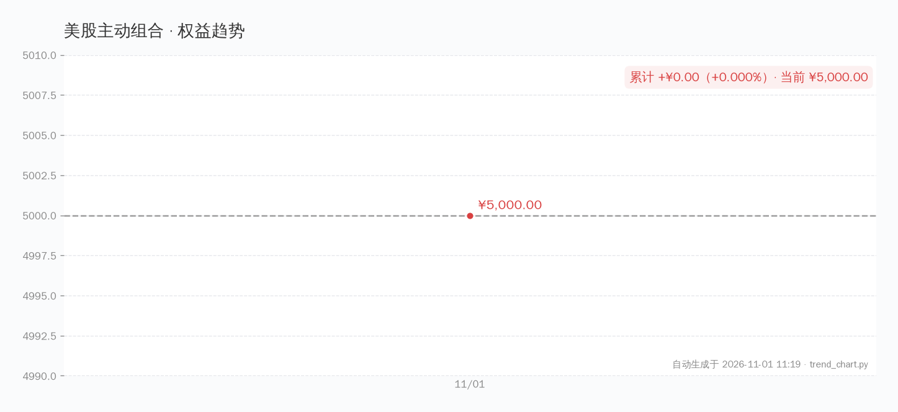
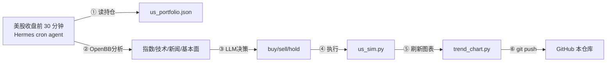

# 💰 美股主动组合 · 动态看板

> **本金 $5,000.00** · 2026-11-01 开仓 · **每个交易日收盘后自动决策并刷新**



> ⚠️ **纯模拟盘学习实验，不构成投资建议。** 所有交易由 AI agent 自动决策，人工不干预。

## 这个目录有什么

| 文件 | 是什么 | 谁写的 |
|---|---|---|
| **[DASHBOARD.md](DASHBOARD.md)** | **动态看板**：趋势图、交易流水、决策逻辑 | `dashboard.py` 自动生成（待适配美股） |
| [assets/](assets/) | 趋势图（trend.png + trend.svg） | `trend_chart.py` 自动生成 |
| [journal.md](journal.md) | 每日操作日志（决策理由全文） | `us_sim.py daily` 追加 |
| [portfolio.json](portfolio.json) | 机器可读账本（持仓、历史净值、交易流水） | `us_sim.py` 维护 |

## 策略

**核心思路：AI agent 多因子自动决策，不靠人工情绪。**

| 规则 | 触发条件 | 动作 |
|---|---|---|
| 再平衡 | 任一类资产偏离目标 >15pp | 卖多的、买少的 |
| 止损 | 单只跌到成本价 -10% | 清仓该标的 |
| 动量入场 | MACD 金叉 + RSI < 70 + 大盘趋势向好 | 买入 |
| 现金下限 | 现金 <20% | 停止买入 |

## 自动更新机制



## 手动操作

```bash
# 查看持仓
/root/mcp-servers/chart-venv/bin/python /root/stock-tool/us-sim/us_sim.py status

# 手动买入
/root/mcp-servers/chart-venv/bin/python /root/stock-tool/us-sim/us_sim.py buy AAPL 5

# 收盘估值（不交易）
/root/mcp-servers/chart-venv/bin/python /root/stock-tool/us-sim/us_sim.py daily

# 查看历史
/root/mcp-servers/chart-venv/bin/python /root/stock-tool/us-sim/us_sim.py history
```

## ⚠️ 声明

- **纯模拟盘**，$5,000 是虚拟数字，没有任何真实资金交易
- 交易由 AI agent 自动执行，不构成投资建议
- 历史表现不代表未来收益；估值不含手续费和滑点
- 数据源：Yahoo Finance via yfinance