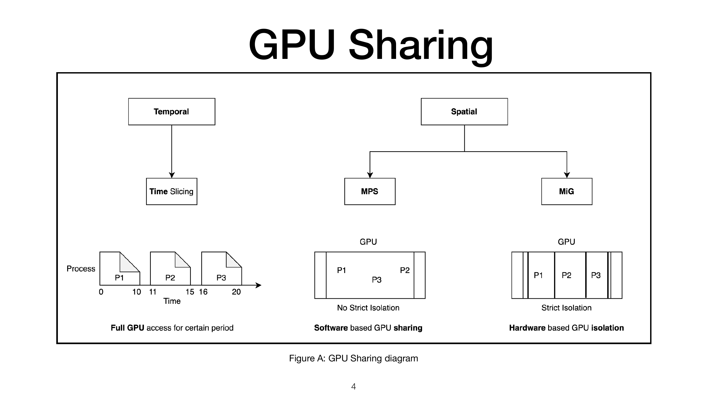
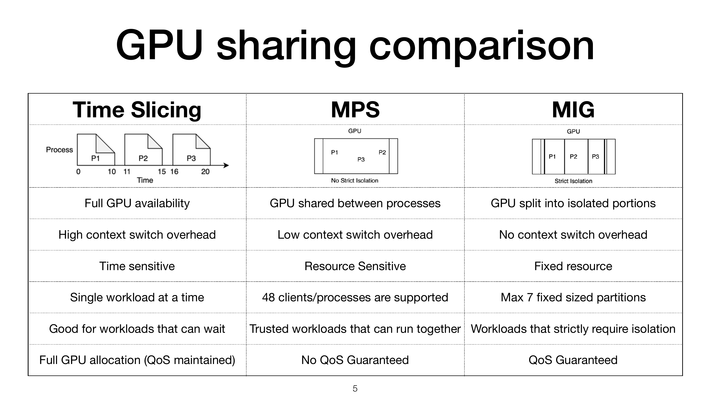
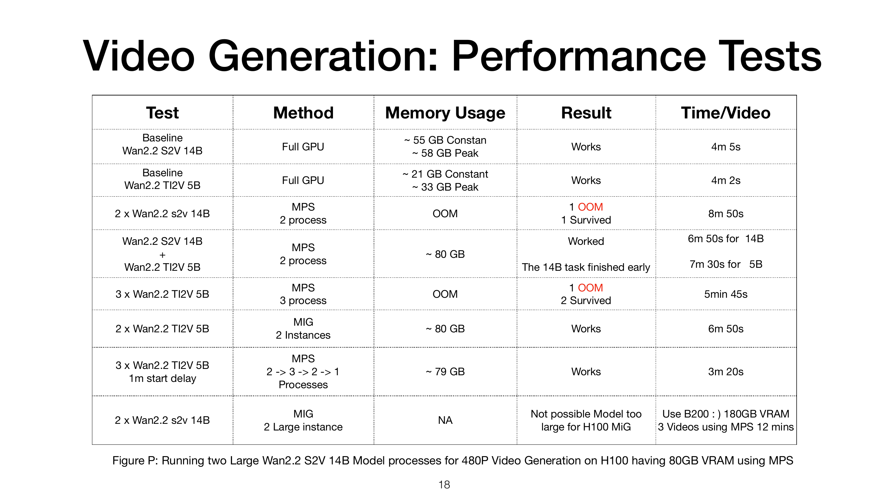
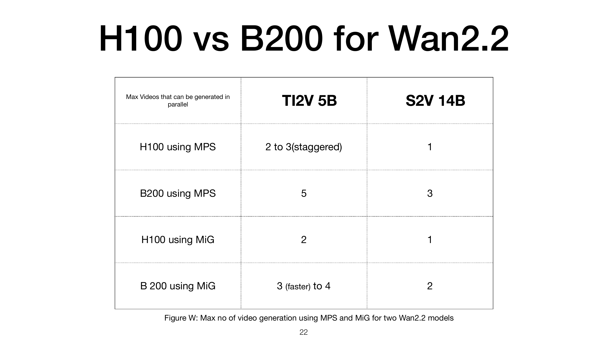

# 一块 GPU 跑多个模型：MIG vs MPS 实测翻车实录（FOSDEM 2026）

> 📺 **One GPU, Many Models: What Works and What Segfaults**
> 演讲者：Yash Panchal（SDET III @ Percona，平时测数据库，业余折腾 GPU）
> 🎬 视频直链：https://video.fosdem.org/2026/ud2120/B39JSW-one-gpu-many-models.mp4 （448 MB，时长约 20 分钟）
> 📄 来源页：https://archive.fosdem.org/2026/schedule/event/B39JSW-one-gpu-many-models/
> 🎞 幻灯片 PDF：https://archive.fosdem.org/2026/events/attachments/B39JSW-one-gpu-many-models/slides/266863/one-gpu-m_cuo5ojs.pdf
> 场合：FOSDEM 2026 · AI Plumbers track · UD2.120 (Chavanne) · 2026-01-31

## 🎯 30 秒版本

一块 8 万块的 H100 显卡（GPU，模型推理的"厨师"）跑一个视频生成模型时经常闲着，能不能让几个模型共用？演讲者在 H100 和 B200 上把两大共享方案——**MIG**（Multi-Instance GPU，硬件级"砌墙"把卡切成物理隔离的几块）和 **MPS**（Multi-Process Service，软件级"合租"，多个进程共享显存和算力）——各测了一遍，结论是：**都能用，但都会以各种姿势崩（OOM/段错误），没有银弹**。对我们（想转 AI Infra 的工程师）价值在于：这是一份少见的"不卖课不卖产品"的踩坑实录。

## 📺 视频讲了什么

演讲分七段：为什么要切 GPU → GPU 共享的三种方法（Time Slicing / MPS / MIG）→ 用 Wan2.2 视频生成模型做实验 → 各种崩溃现场 → 错峰启动的优化技巧 → H100 vs B200 对比 → 结论。测试模型有两个：**Wan2.2 S2V 14B**（140 亿参数大模型，吃 ~55GB 显存）和 **Wan2.2 TI2V 5B**（50 亿参数中型，恒定 ~21GB、结尾 30 秒会冲到 ~33GB）。所有实验都在真机上跑，幻灯片里贴满了 nvidia-smi 截图和 PyTorch OOM 报错。

## 🔑 关键内容

**【画面里看到的】**

- **三种共享方式一句话区分**（幻灯片对比表）：Time Slicing = 轮流独占全卡，切换开销大；MPS = 软件级合租，最多 48 个客户端，无资源保证；MIG = 硬件级分间，最多 7 个固定分区，有 QoS 保证（质量隔离，互不抢资源）。支持面：MPS 消费卡也能用，MIG 只有企业卡（A100 及以后）。
- **MIG 的"没有免费午餐"**：H100 的切片不是整除的——1g 分区 = 16 个 SM（流式多处理器，GPU 的计算核心组），3g = 60 个（不是 48），7g = 132（全部）。切法不巧就会浪费算力。创建三步命令：`nvidia-smi -i 0 -mig 1` → `-cgi 9,9`（建 GPU 实例）→ `-cci`（挂计算实例），顺序不能反。
- **OOM 崩溃实录**：H100 80GB 上用 MPS 同时跑 2×14B 大模型（各需 ~56GB）必然一个挤死另一个；3×5B 同时启动也是"1 死 2 活"——因为大家恒定 22GB 相安无事，**结尾 30 秒集体冲高到 33GB 时峰值叠加**就崩了。
- **错峰启动（staggered start）神来之笔**：既然知道峰值出现在最后 30 秒，就让三个任务每隔 1 分钟启动一个，峰值错开，3 条视频 10 分 30 秒全部成功。MIG 做不到这个（分区数不够）。
- **H100 vs B200 终极对比表**（并行视频数，5B/14B）：H100+MPS = 2~3(错峰)/1；B200+MPS = **5/3**；H100+MIG = 2/1；B200+MIG = 3~4/2。B200 的 180GB 显存直接大力出奇迹。
- **结论五条**：①没有完美的分区方法；②MIG 干不了的地方 MPS 往往行；③14B 级大视频模型要用 MIG 就得上 B200；④先摸清负载的显存曲线再选方案；⑤尽量优化模型本身。

**【资料补充，非画面内容】**

- Wan2.2 是阿里通义万相 2025 年开源的视频生成模型系列；S2V = Speech-to-Video（声音+图+文生成视频），TI2V = Text-Image-to-Video。它们和 LLM 不同，**不支持 batching**（把多个请求拼一批算），所以"一模型一实例"的需求更普遍，这正是本话题的实际背景。
- 演讲者还现场预告了同届另两场关联演讲（MIG 专题、GPU 监控），可作后续选题。

配图（幻灯片原图，来自官方 PDF）：

*三种共享方式：按时间轮流 vs 软件合租 vs 硬件分间*

*关键数字：MPS 最多 48 客户端无 QoS；MIG 最多 7 分区有 QoS*

*全部实验的结果总表：方法 / 显存 / 成败 / 单条视频耗时*

*H100 vs B200 在不同共享方式下最多能并行生成几条视频*

## 🛠 值得学的点（写给想转 AI Infra 的 Java 工程师）

1. **MIG/MPS 的取舍逻辑和 Java 世界很像**：MIG ≈ 给每个服务分独立容器（硬隔离、资源固定、浪费边角料），MPS ≈ 共享 JVM 里跑多线程（省资源、无隔离、一个 OOM 全家遭殃）。理解"隔离 vs 利用率"这对矛盾，是 AI Infra 调度的第一课。
2. **错峰启动是最便宜的调度优化**：不改代码、不换硬件，只靠"摸清负载的显存曲线、错开峰值"就把 3 个必崩的任务跑成功了。这和消息队列削峰、线程池错峰预热是同一个思想——**先测 profile，再做调度**。
3. **GPU 容量规划要按峰值算，不是按均值算**：5B 模型恒定 21GB 但峰值 33GB，按均值规划必翻车。相当于 JVM 堆要按 GC 前峰值留 headroom，不是按存活对象大小。

## ⚠️ 局限

- 视频理解（qwen3-vl-plus）识别的是画面/幻灯片文字，**听不到音频**；演讲口语内容全部来自 FOSDEM 官方 VTT 字幕（机器转写，个别人名/术语有错，如把 Yash 转成 "Josh"、MIG 转成 "make"），我已对照幻灯片 PDF 校正。
- 幻灯片中的终端截图分辨率有限，部分 nvidia-smi 输出数字由视觉模型读出，个别 MiB 数值可能有 ±1% 误差；性能表格数字以 PDF 原文为准。
- 实验只覆盖 Wan2.2 视频生成负载，结论（尤其显存数字）不能直接外推到 LLM 推理（LLM 支持 batching、显存曲线形态不同）。

---
*信源：视频画面（bl vision describe）+ 官方 VTT 字幕 + 官方幻灯片 PDF，三者交叉验证。笔记生成：2026-10-30。*
