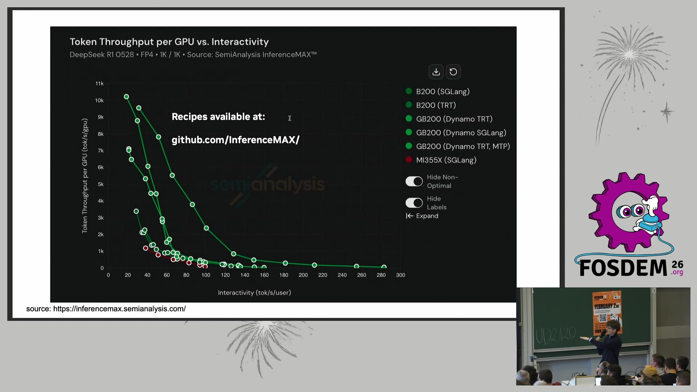
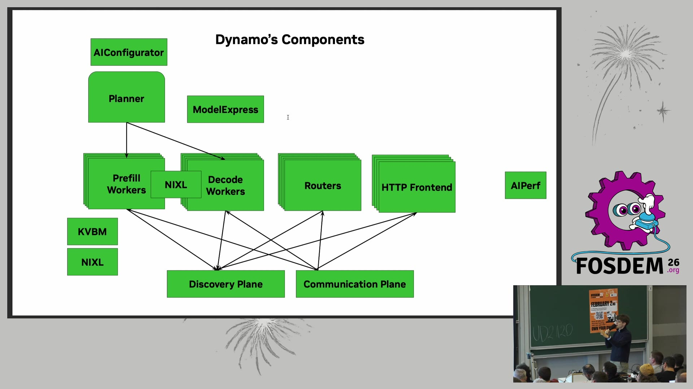
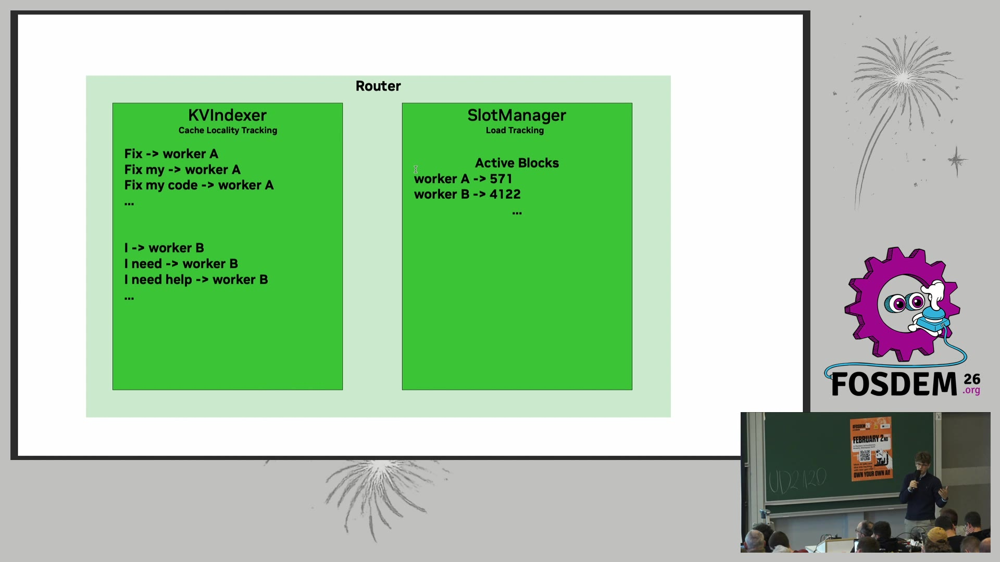
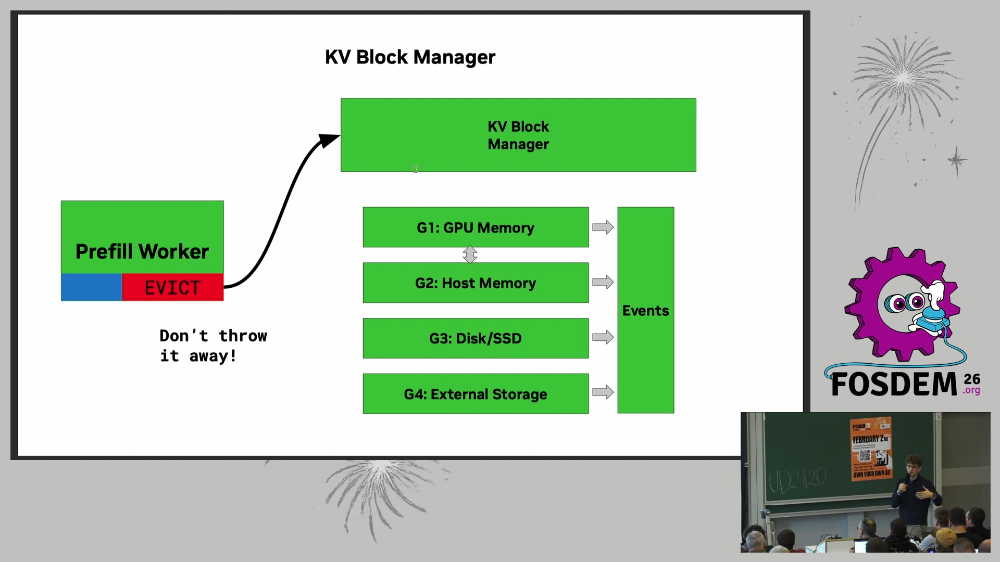
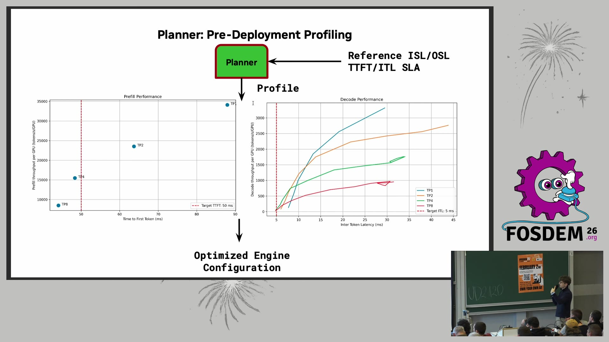
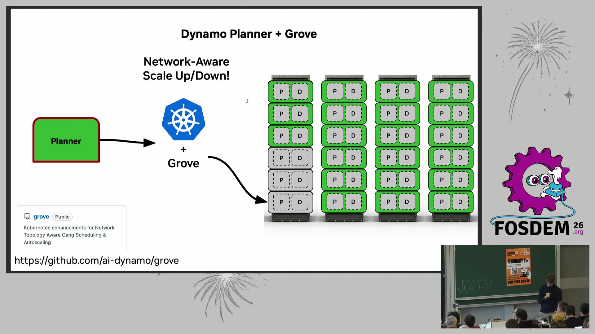

# NVIDIA Dynamo：给 LLM 推理装上"调度中心" —— FOSDEM 2026《Supercharging LLM serving with Dynamo》精读

> 🎬 视频直链：https://video.fosdem.org/2026/ud2120/Z7LBYT-supercharging_llm_serving_with_dynamo.mp4（410MB，18 分 40 秒）
> 📄 来源页：https://archive.fosdem.org/2026/schedule/event/Z7LBYT-supercharging_llm_serving_with_dynamo/
> 🎤 演讲者：Piotr Tarasiewicz（NVIDIA 高级软件工程师，Dynamo 分离式推理方向，也参与 vLLM；原始幻灯片作者 Alec Flowers、Ekin Karabulut）
> 📅 FOSDEM 2026 · AI Plumbers devroom · UD2.120 (Chavanne) · 2026-01-31
> 📖 理解方式：bl vision describe 画面识别 + 官方 VTT 字幕全文 + web 资料交叉核对

## 🎯 30 秒版本

这是 NVIDIA 工程师在 FOSDEM 讲的 **Dynamo**（一套开源的大模型推理"编排层"，跑在 vLLM/SGLang/TensorRT-LLM 之上，负责路由、KV 缓存搬运、自动扩缩容）的全景介绍。核心论点一句话：**"好模型 ≠ 成功，好模型 + 好系统 = 成功"**——大规模推理的瓶颈早就不只是引擎本身，而是请求怎么路由、显存不够时缓存往哪放、流量波动时怎么伸缩。对想转 AI Infra 的工程师，这场 18 分钟的演讲几乎是一张完整的"LLM 推理系统组件地图"，而且 Dynamo 主体用 Rust 写、API 是 Python——正好是 Java 工程师能理解的"微服务编排"思路换了个领域。

## 📺 视频讲了什么

演讲者用约 17 分钟按组件逐个过了一遍 Dynamo 生态：先从 SemiAnalysis InferenceMAX 基准图讲 Dynamo 的定位（横轴"每用户 token 速度"= 交互体验，纵轴"每 GPU token 吞吐"= 成本，目标是右上角），再解释为什么要做 **PD 分离**（Prefill-Decode Disaggregation，预填充与解码两阶段分开部署）：预填充是算力受限、解码是显存带宽受限，两个"完全不同的计算问题"要分开优化。分离带来一堆新麻烦——要跨节点传 KV Cache（模型推理时缓存的中间结果）、要按缓存命中率和负载做智能路由、要容错（"任何一个部件随时可能挂掉"）、要跟着流量曲线扩缩容。Dynamo 的每个组件就是对应一个麻烦：Router（KV 感知路由）、NIXL（点对点 KV 传输库）、KVBM（分级缓存管理）、Planner + AIConfigurator（离线选配置 + 运行时自动伸缩）、Grove（Kubernetes 上的多节点成组调度）、AIPerf（压测工具）、ModelExpress（模型快速加载）。

## 🔑 关键内容

*（标注：👁=画面里看到的，🎙=字幕/口播，🌐=资料补充）*

- 👁🎙 **Dynamo 是"一堆库的集合"而非单一框架**，主体 Rust 实现、公开 API 是 Python，全部开源，已有 200+ 贡献者（GitHub ai-dynamo/dynamo，Rust，约 5.8k stars）。设计哲学是模块化：每个组件（prefill worker、decode worker、router、frontend）本质上只是"多入单出的异步生成器"，可以单独拆出去用——比如 Red Hat 主导的 llm-d 项目就单独复用了 Dynamo 的 Planner 和 Router。
- 👁🎙 **Router 的路由成本公式**（画面原文）：`cost = overlap_weight × prefill_blocks + decode_blocks`。其中 `prefill_blocks = (输入长度 − 已缓存重叠部分)/block size`（来自 KVIndexer，跟踪"哪个前缀缓存在哪个 worker 上"），`decode_blocks = 本请求新增块 + 该 worker 已有请求的活跃块`（来自 SlotManager，跟踪负载）。翻译成人话：**既要去有缓存的节点（省重算），又不能去太忙的节点（排队长），两者加权取最小成本**。类比 Java：这就是一个带"本地缓存亲和性"的负载均衡器，像 Nginx 的 ip_hash 但维度换成了 KV 前缀。
- 👁 **Baseten 实测数字**（画面柱状图，Qwen3-480B-Coder）：开 Dynamo KV 路由 vs 关，RPS 5.53 vs 1.35（约 4 倍），整体 TPS 68.98 vs 43.08（官方标题"2x faster inference"）。
- 👁🎙 **KVBM（KV Block Manager）分级缓存**：KV 块被逐出时不直接扔，而是沿 G1 显存 → G2 主机内存 → G3 本地 SSD → G4 网络存储逐级下沉（画面图），因为重算 prefill 的注意力成本是 O(n²)——"从慢盘读回来通常仍比重算便宜得多"。实测（画面图，Qwen3-8B，2 万 token 上下文全命中）：vLLM+KVBM 的 TTFT（首 token 延迟）稳定在约 0.5s，静态缓存方案升到 3.2s，**TTFT 改善 55%+**。传输底座是 NIXL（NVIDIA Inference Xfer Library，点对点传输库，区别于做集合通信的 NCCL）。
- 👁🎙 **规模参照系**（画面页）：DeepSeek R1 FP4 跑在 4×12 GB200 上时，系统级数字是 103k 在途请求、3.7k 请求/秒、221 万输出 token/秒，共 24 个模型副本、288 块 GPU——前端路由和 KV 传输的吞吐必须撑得住这个量级，这正是"为什么大规模服务难"。
- 👁🎙 **Planner 两段式伸缩**：部署前用 AIConfigurator **不用 GPU 就能模拟**出最优配置（画面终端截图：Qwen3-32B、128 卡场景，选出"disagg 分离式方案，812.92 tokens/s/gpu，比次优好 1.70x"）；运行时按负载预测 + 延迟反馈自动加减 prefill/decode 副本，多节点模型用 Grove 做 gang scheduling（成组调度，一组节点要么全起要么全不起，避免半拉子占坑），最终能落到 GB200 NVL72 整机架拓扑。
- 🎙 **Q&A 亮点**：有人问 Dynamo 是否 LLM 专用，答：Dynamo runtime 本身（组件发现 + 通信协议）完全不绑定 LLM，多模态模型也已支持，LLM 只是目前实现最完整的方向。
- 🌐 补充背景：Dynamo 于 2025 年 GTC 首次发布，定位对标的是 Mooncake（月之暗面）、llm-d 这类"推理编排层"项目；其 KV 路由思路与 vLLM 自带的 prefix caching 互补——vLLM 管单实例内的缓存，Dynamo 管跨实例"该把请求发给谁"。

## 📷 视频关键帧（本机 ffmpeg 从 mp4 提取，真实画面）

| 帧 | 内容 |
|---|---|
|  | 02:20 SemiAnalysis InferenceMAX 基准：右上角=又快又省，Dynamo(GB200) 曲线在最上方 |
|  | 06:00 Dynamo 组件全景图（Discovery/Communication Plane + Router/Workers/前端） |
|  | 09:40 Router：KVIndexer 缓存亲和 + SlotManager 负载跟踪，加权成本公式 |
|  | 12:40 KV Block Manager：显存→内存→SSD→网络存储四级下沉 |
|  | 14:30 Planner：按 SLA 离线选配置 + 运行时自动伸缩曲线 |
|  | 15:50 Dynamo+Grove：Kubernetes 上的拓扑感知成组调度（GB200 NVL72） |

## 🛠 值得学的点（给想转 AI Infra 的 Java 工程师）

1. **把 LLM 推理当分布式系统问题看**：Dynamo 的组件划分几乎能一一映射到你熟悉的 Java 微服务栈——Discovery Plane ≈ 服务注册中心（Nacos/Eureka，它真就用 etcd 或 K8s 做后端）、Router ≈ 带缓存亲和的负载均衡、Communication Plane ≈ RPC 通道、Planner ≈ HPA 弹性伸缩 + 容量规划、Grove ≈ 有状态多副本的 Operator。**领域知识在变，分布式系统的骨架没变**，这是转型时最值得依赖的迁移资产。
2. **"缓存下沉"是普适模式**：KVBM 的四级存储（显存→内存→SSD→远端）本质就是多级缓存 + 淘汰策略，和 Java 里 Caffeine（堆内）→ Redis（远端）→ DB 的结构同构。区别只在成本模型：LLM 的重算是 O(n²) 注意力，所以下沉到最慢一层往往仍划算——学会给"重算 vs 取回"算账，是推理系统的核心直觉。
3. **动手路径**：Dynamo 全家桶（dynamo/nixl/kvbm/aiconfigurator/aiperf/grove）都在 github.com/ai-dynamo，AIPerf 压测工具和 AIConfigurator 的"无 GPU 模拟选配置"可以在没有显卡的机器上先玩起来——先用模拟器理解配置空间（TP 并行度、PD 分离与否、副本配比），再上真卡。

## ⚠️ 局限

- VTT 字幕是官方机器转写，错词很多（vLLM→"Viel LOM"、NCCL→"nickel"、NIXL→"nixel"、KV cache→"decay/cave"、Piotr→"Paul"），本文已按上下文校正，但个别口播细节（如具体客户名）可能仍有偏差。
- bl 视觉理解对幻灯片文字识别很全，但演讲者的板书/口头即兴数字无法二次确认；Q&A 只有两个问题，收音尚可但最后一句"Thank you, brother"疑为转写错误。
- Baseten 的 2x/4x 数字来自厂商合作案例（NVIDIA 演讲 + Baseten 博客图），非独立第三方基准，参考时打个折。

## 🧠 关键概念表

| 术语 | 白话解释 | 为什么重要 |
|---|---|---|
| PD 分离 | 预填充（读题）和解码（写字）两阶段放到不同 GPU 池 | 两阶段瓶颈不同（算力 vs 显存带宽），分开才能各自优化 |
| KV Cache | 推理时把算过的注意力中间结果缓存起来复用 | 命中缓存=省掉 O(n²) 重算，TTFT 直接砍半以上 |
| TTFT / ITL | 首 token 延迟 / token 间延迟 | 用户体感的两个核心 SLA 指标 |
| NIXL | NVIDIA 点对点传输库（区别于集合通信的 NCCL） | PD 分离后 KV 块要跨节点搬运，它负责"快递" |
| KVBM | KV 块分级缓存管理器（显存→内存→SSD→远端） | 把"被逐出=重算"变成"被逐出=下沉"，延长缓存寿命 |
| gang scheduling | 一组节点要么全部调度成功要么都不调度 | 多节点模型（如 4 节点一个副本）不能起一半 |
| InferenceMAX | SemiAnalysis 的公开推理基准 | 衡量"每 GPU 吞吐 vs 每用户体验"的行业参照 |

## 💡 所以呢

如果你只记一件事：**2026 年的 LLM 推理竞争已经从"单引擎快"转向"系统级编排"**——路由、缓存分层、自动伸缩这些"脏活"决定了同样的 GPU 能榨出 2-4 倍吞吐。Java 工程师的分布式系统直觉在这里是硬通货，缺的只是 KV Cache/PD 分离这几个领域概念（本文已补齐）。下一步可以精读 vLLM 的 prefix caching 源码或跑一次 AIPerf 压测，把概念变成手感。

---
*笔记生成：2026-10-31 · 视频理解：bl vision describe (qwen3-vl-plus) + 官方 VTT 字幕 · 关键帧：本机 ffmpeg 提取*
