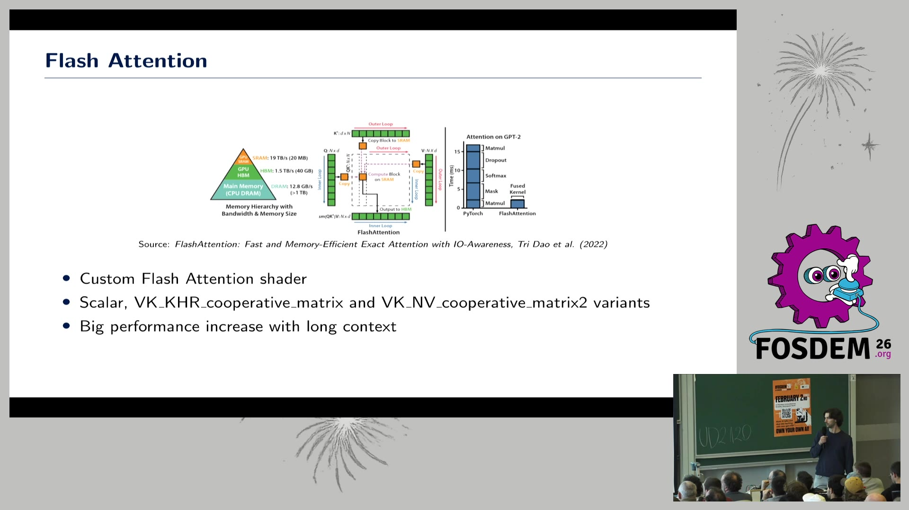
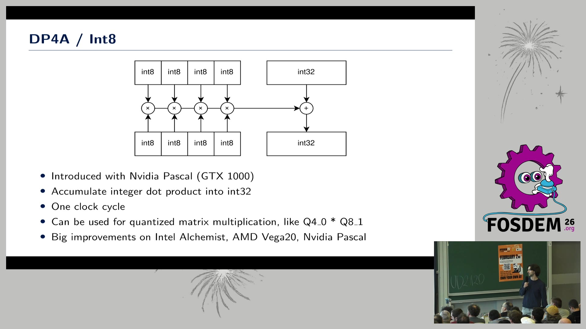
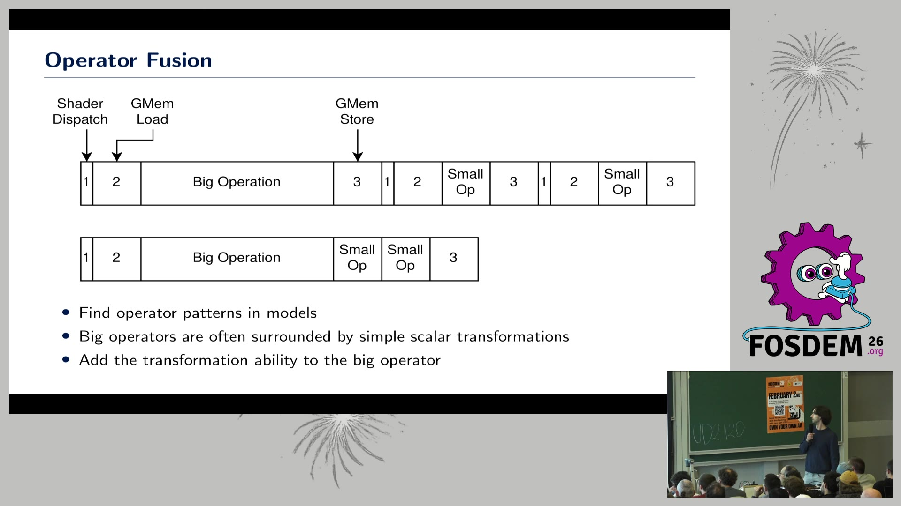
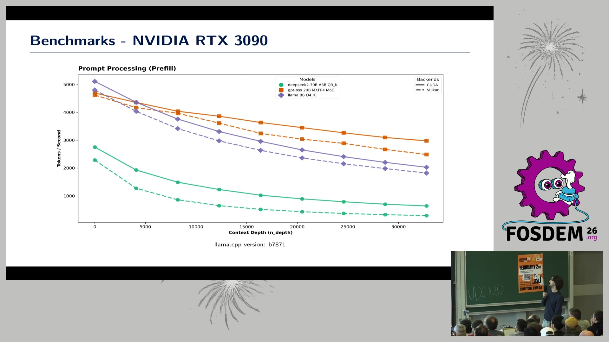
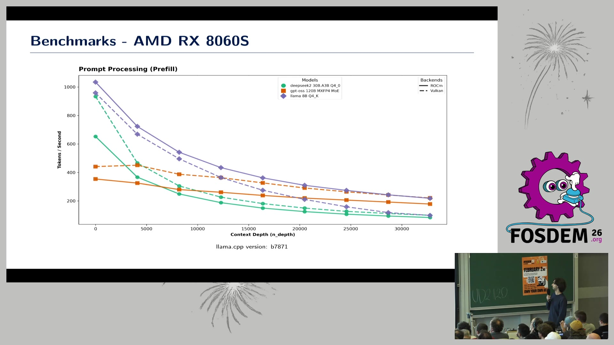
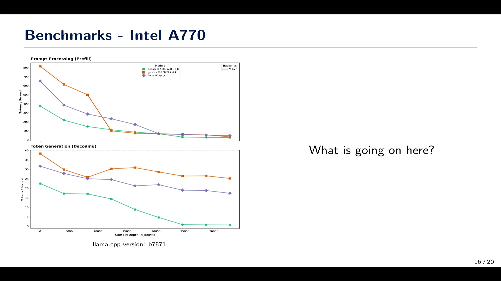
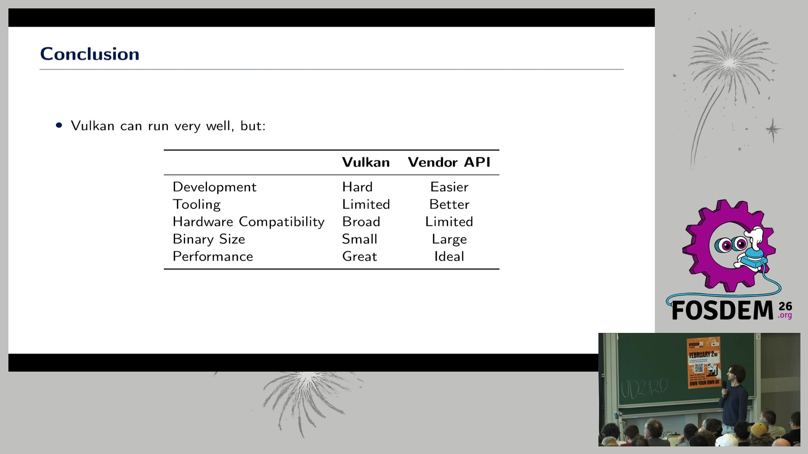

# 用"游戏显卡 API"跑大模型：Vulkan 在 llama.cpp 里硬刚 CUDA/ROCm —— FOSDEM 2026 精读

> 🎬 视频直链：https://video.fosdem.org/2026/ud2120/CZSPSC-llama-cpp-vulkan.mp4（483MB，22 分 02 秒）
> 📄 来源页：https://archive.fosdem.org/2026/schedule/event/CZSPSC-llama-cpp-vulkan/
> 🎤 演讲者：Ruben Ortlam（llama.cpp Vulkan 后端主要维护者之一，现已入职 Red Hat 做 ML 工程师；这项工作实际是业余时间写的）
> 📅 FOSDEM 2026 · AI Plumbers devroom · UD2.120 · 2026-01-31
> 📖 理解方式：bl vision describe 画面识别（20 页幻灯片全部读出）+ 官方 VTT 字幕全文 + web 资料交叉核对

## 🎯 30 秒版本

这是一场关于 **Vulkan**（一个本来是给游戏画图形用的开放标准 API，但它的"计算着色器"功能可以让任何品牌的显卡跑通用计算）如何被用来做机器学习后端的实战汇报。核心结论：**在 AMD/Intel 显卡上，Vulkan 后端已经能追平甚至反超官方专属 API（ROCm），在 N 卡上也只差 CUDA 一到三成**；代价是开发更难、调试工具更少、各家驱动坑更多。对普通人的意义：手里只有旧游戏卡、非 N 卡，也能高效跑本地大模型，不用被 CUDA 生态绑架。

## 📺 视频讲了什么

演讲者是去年同 devroom Vulkan 演讲的返场嘉宾，这次汇报"过去一年我们干了什么"。四件大事：①实现了 **Flash Attention**（一种把注意力计算的多个步骤融合成一个 GPU 核函数、避免巨大中间缓存的著名优化，长上下文下收益巨大），且有标量/CoopMatrix1/CoopMatrix2 三种变体，覆盖有无矩阵加速硬件的所有显卡；②接入 **DP4a**（int8 点积指令，单时钟周期算完 4 对 8bit 乘加，对量化模型特别香）；③**算子融合**（把大算子周围的小变换并进大算子，省掉中间结果的显存读写和多次调度）；④BF16、降低 CPU 开销、fence 等待策略优化等。之后用 llama.cpp 自带 llama-bench 在 RTX 3090（vs CUDA）、RX 8060S 和 Radeon Pro（vs ROCm）、Intel A770 上跑了对比，坦承各硬件互有胜负，最后总结 Vulkan 的取舍：开发难、工具弱、但硬件兼容性最广、二进制体积最小。

## 🔑 关键内容

*（标注：👁=画面里看到的，🎙=字幕/口播，🌐=资料补充）*

- 👁🎙 **llama.cpp 的后端版图**（画面第 5 页）：CPU、CUDA、Metal、Vulkan、ROCm、OpenCL、CANN（华为昇腾）、WebGPU、BLAS、ZenDNN。架构是"计算图发给后端执行，甚至可拆给多个后端"——模型逻辑和硬件执行彻底解耦。🌐 类比 Java：这就是 SPI/驱动模型，图是接口，后端是实现。
- 👁🎙 **Flash Attention 是分水岭**：128K 长上下文下"能看到巨大差异"，因为融合掉了 O(n²) 注意力的中间缓冲。演讲者称最近几周专门优化 AMD 路径后"收到有人推理快了 4 倍的疯狂反馈"。画面引用了 Tri Dao 2022 年 FlashAttention 论文原图。
- 👁🎙 **DP4a 救活老硬件**：NVIDIA Pascal（GTX 10 系，最后一代没有 Tensor Core 的卡）、AMD Vega20（数据中心退役卡 MI50，"从中国淘来的便宜算力"）、Intel Alchemist 都靠它大幅提速。量化格式（Q4_0×Q8_1）天然适配 int8 点积——**一次编写，所有支持 DP4a 的卡通吃**，这正是开放 API 的价值。
- 👁 **RTX 3090 实测（vs CUDA，画面折线图，tokens/s）**：prefill 短上下文 4700~5200 对 4700 基本打平，32k 长上下文落后 15~40%；decoding 约为 CUDA 的 7~9 成。有趣的是 gpt-oss-20B 的 MoE 模型 decoding 上 Vulkan 反而更快。结论：N 卡上 CUDA 仍是首选，但差距已不大——如果你的程序本来就用了 Vulkan 画图形（比如游戏内嵌 AI），直接用 Vulkan 计算省掉集成 CUDA 的巨大麻烦。
- 👁 **AMD RX 8060S / Strix Halo 实测（vs ROCm）**：这是最惊喜的部分——**decoding 阶段 Vulkan 全面持平或超过 ROCm**；Strix Halo（128GB 大显存 APU，跑 MoE 大模型的热门选择）上 gpt-oss-120B 的 prefill 也是 Vulkan 明显领先。也就是说在 AMD 消费级硬件上，"通用开放 API"打赢了"官方专属 API"。
- 👁🎙 **Intel A770 是反面教材**：画面第 16 页配了大字"What is going on here?"——prefill 在 10~15k 上下文处断崖式下跌。演讲者直言这是 Intel Linux Vulkan 驱动没为这类负载优化，且 AMD/Intel 都没有类似 NVIDIA Nsight 的着色器级 profiler，"优化基本靠猜和试错"，他在所有厂商驱动里都发现过 bug。
- 👁 **结论对比表**（画面第 19 页）：Vulkan vs 厂商专属 API——开发：难/较易；工具：有限/更好；硬件兼容：**广**/有限；二进制体积：**小**/大（PyTorch+CUDA 要下载几个 GB 的设备代码，Vulkan 的着色器是运行时按需编译成目标设备指令，产物小得多）；性能：**很好**/理想上限。
- 🌐 补充：Vulkan 后端代码在 llama.cpp 仓库 ggml/src/ggml-vulkan/，Ruben Ortlam 是高频提交者之一；"Vulkan 做 ML"路线与本月另一场演讲提到的 Slang/Khronos 跨平台内核倡议属于同一趋势——业界在系统性降低对 CUDA 的依赖。

## 📷 视频关键帧（本机 ffmpeg 从 mp4 提取，真实画面）

| 帧 | 内容 |
|---|---|
|  | 06:30 Flash Attention 页：论文原图 + Scalar/CoopMatrix 三变体 |
|  | 09:20 DP4a int8 点积示意图 |
|  | 11:30 Operator Fusion：融合前后的显存读写对比图 |
|  | 15:20 RTX 3090 上 Vulkan vs CUDA prefill 折线 |
|  | 17:00 AMD RX 8060S 上 Vulkan vs ROCm 对比 |
|  | 18:30 Intel A770："What is going on here?" 断崖曲线 |
|  | 20:30 结论：Vulkan vs 厂商 API 五维对比表 |

## 🛠 值得学的点（写给想转 AI Infra 的 Java 工程师）

1. **"接口与实现分离"在 GPU 世界同样值钱**。llama.cpp 的 backend 抽象 = JDBC 驱动模型：上层计算图不变，换个后端就换硬件厂商。理解这套抽象（graph → kernel dispatch → 显存管理），就理解了所有推理引擎的骨架，vLLM/Dynamo 只是把同样的思路搬到分布式规模。
2. **性能优化的三板斧是通用的**：融合（减少中间结果落地）、利用专用指令（DP4a ≈ Java 里的 intrinsics/向量化 API）、减少调度开销（fence/busy-idle 的取舍 ≈ 线程 park vs spin）。这些思想从 JVM 调优平移到 GPU 调优几乎无缝。
3. **别迷信厂商专属 API**：AMD 上开放标准打赢官方 ROCm 说明工程实现质量 > 生态站队。选型时"硬件兼容性 + 二进制体积 + 部署摩擦"这些系统属性，和峰值性能同样重要——就像选 GraalVM native image 还是 JIT JVM，看的是场景不是跑分。

## ⚠️ 局限

- benchmark 数字来自 bl vision 对折线图的**目测近似**（演讲幻灯片本身只画曲线不标数值表），误差可能 ±10%，方向性结论（谁快谁慢、在哪反超）与字幕口播一致，可信。
- VTT 是机器转写，错词很多（Vulkan→"Vulcan/working"、Ruben→"Wilmotlam"、llama.cpp→"Lama CPP"），本文已按上下文校正；个别口播细节（如 Vega20 淘卡那段）转写破碎，仅取大意。
- 视频画面无音频理解，Q&A 环节内容（如有）未被字幕覆盖。
- 演讲者提到"去年那场演讲"，本文未回看 2025 版，增量对比基于本场自述。
