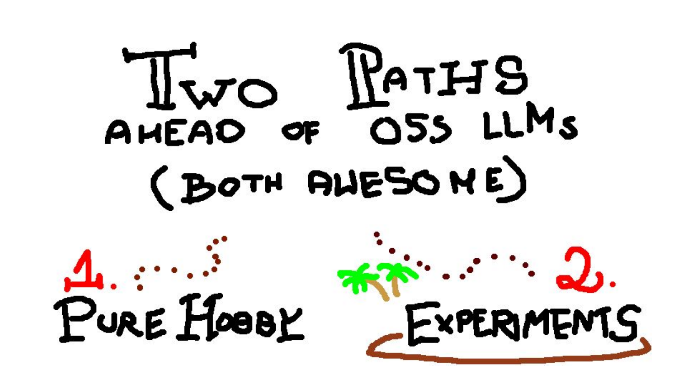
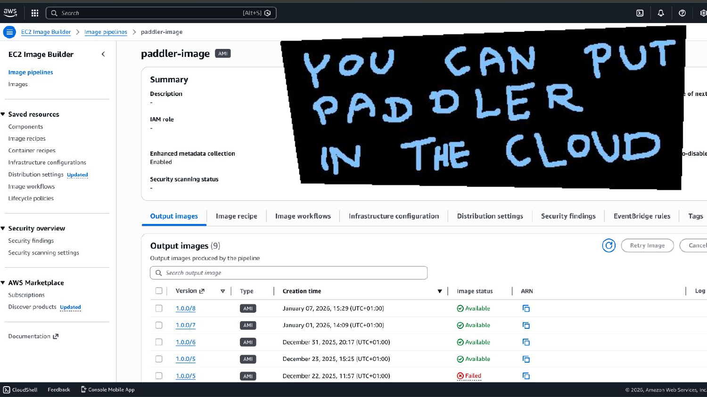
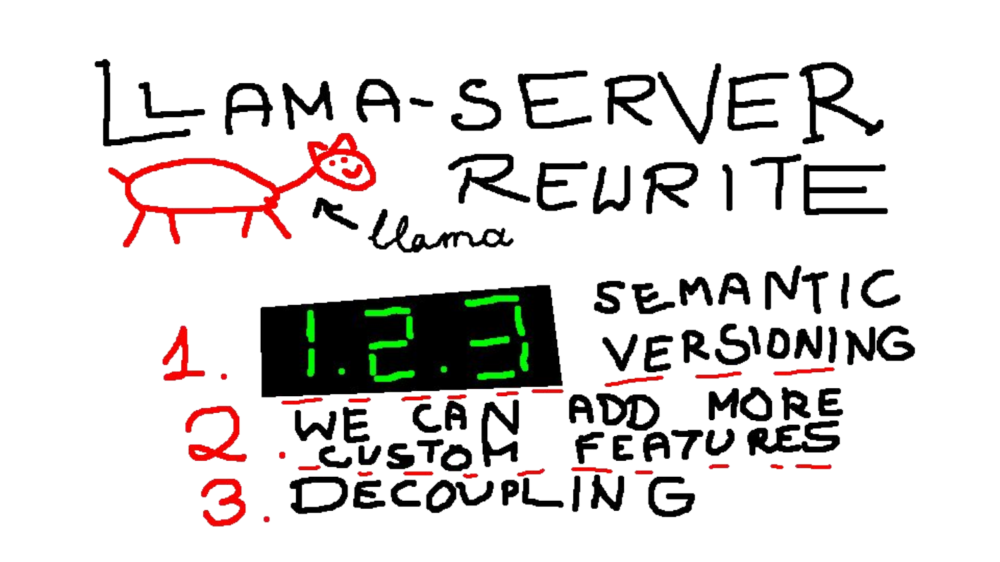
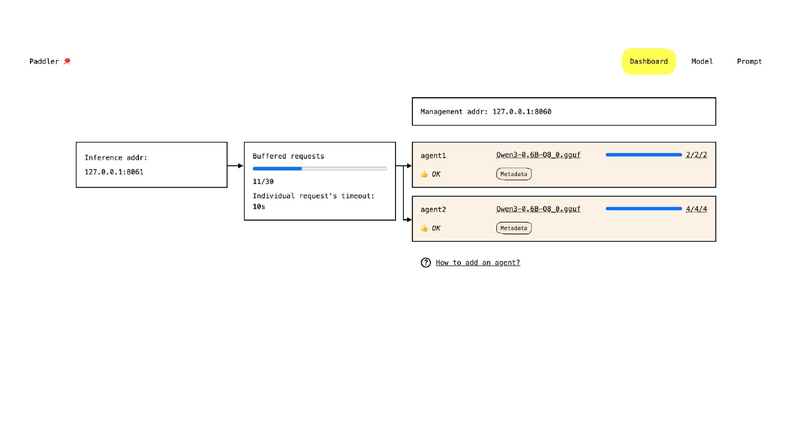
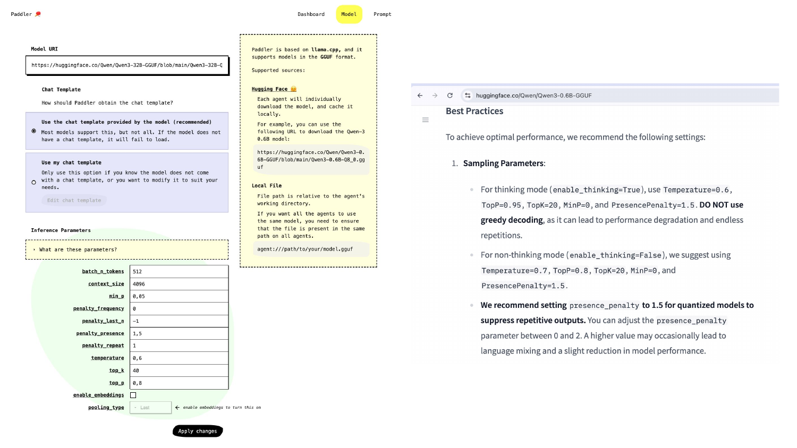
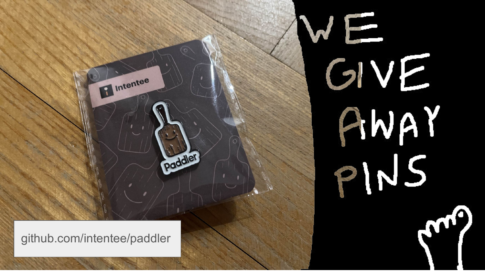

# 自托管大模型一年实战账本：Paddler 团队的"什么好使、什么翻车" —— FOSDEM 2026 精读

> 🎬 视频直链：https://video.fosdem.org/2026/ud2120/PD8WGF-from_infrastructure_to_production_a_year_of_self-hosted_llms.mp4（440MB，约 19 分钟）
> 📄 来源页：https://archive.fosdem.org/2026/schedule/event/PD8WGF-from_infrastructure_to_production_a_year_of_self-hosted_llms/
> 🎤 演讲者：Mateusz Charytoniuk、Gosia Zagajewska、Luiz Miguel（Intentee 团队，Paddler 作者）
> 📅 FOSDEM 2026 · AI Plumbers devroom · UD2.120 (Chavanne) · 2026-01-31（周六 16:30）
> 📖 理解方式：bl vision describe 画面识别（22 页幻灯片全部读出）+ 官方 VTT 字幕全文 + web 资料交叉核对

## 🎯 30 秒版本

Paddler（一个用 Rust 写的开源大模型负载均衡/服务平台，把 llama.cpp 推理引擎直接"烤"进单个二进制，1.7k stars）的作者们回场汇报一年生产实践。三个要点：①他们干脆**重写了 llama.cpp 的 server**——因为上游的 `/slots` 调试接口不让生产用，而负载均衡恰恰最依赖它，只好自己把 C++ 绑定接进来实现语义化版本和可预测部署；②自托管的真正价值不在省钱（大模型要先有规模才省），而在**成本可预测、数据隐私、不被商业模型的静默更新背刺**；③有了稳定推理底座，才敢做上层产品实验——他们展示了两个真实项目：给静态网站生成器 PoET 加"小专家模型做内容一致性检查"，以及用 FIRESPARQL（70B 模型造数据 → 8B 模型微调 → 自然语言转 SPARQL 查询）做无代码系统搭建。对 AI Infra 方向的读者，这是一场少见的"自托管 LLM 从工具到业务闭环"完整案例。

## 📺 视频讲了什么

演讲分两段。前半段（约 0–11 分钟）讲 Paddler 这一年的演进：从"纯 llama.cpp 负载均衡器"变成"内置 llama.cpp 的一体化服务平台"——单个 Rust 二进制，部署到自己服务器、笔记本甚至云上（现场秀了用 AWS EC2 Image Builder 流水线做 AMI 镜像，支持 CloudWatch 指标自动扩缩 GPU 实例，还能 AWS 放负载均衡器 + OVH 放 agent 的多云混搭）。UI 管理面板实时显示每个 agent 的 slot 占用和排队请求，模型支持从 HuggingFace 链接、本地文件直接加载，参数遵循模型作者在 HuggingFace 页面写的推荐值（现场还引用了 Qwen3 官方 Best Practices："量化模型建议 presence_penalty=1.5 抑制重复输出，思考模型禁用贪心解码"）。后半段（约 11–18 分钟）讲"什么时候自托管才划算"和两个上层项目实验。

## 🔑 关键内容

*（标注：👁=画面里看到的，🎙=字幕/口播，🌐=资料补充）*

- 👁🎙 **重写 llama-server 的三个理由**（画面第 6 页"LLAMA-SERVER REWRITE"）：①**语义化版本**——llama.cpp 是滚动发布，生产部署需要可预测、可回滚的版本号；②**加自定义功能**的自由；③**解耦**（decoupling）。直接导火索：llama.cpp 的 `GET /slots` 接口（画面第 7 页原文引用）标注"仅供调试、未来可能修改、强烈不建议生产环境开启"——但负载均衡器偏偏要靠它知道每个 slot 的状态，"我们生产上大量使用它，所以别无选择，重写了"。🌐 这就是"你的核心依赖把你的关键路径当调试玩具"的经典工程困境，Paddler 的选择是不再依赖 llama.cpp 的 HTTP server 层，直接链接其 C++ API（llama.cpp 作为库用）。
- 🎙 **slot 机制被整个重写**：slot 是"把一块上下文显存切成多份、同时处理多个推理请求"的机制（类比 Java 线程池的 worker 槽位）。上游版本没为生产设计，Paddler 重写了它，并作为核心卖点。
- 👁 **云部署自动化**（画面第 5 页 AWS 控制台截图）：用 EC2 Image Builder 维护名为 paddler-image 的镜像流水线，表格显示 2025-12-22 至 2026-01-07 共 5 个 AMI 版本（1 个 Failed、4 个 Available）；Paddler 暴露状态指标接口 → CloudWatch 告警规则 → 自动加减 GPU 实例。🎙 还支持多云："负载均衡器在 AWS，agent 在 OVH 或任何云"。
- 👁 **管理面板架构**（画面第 9 页线框图）：Management addr（127.0.0.1:8080，管理面）与 Inference addr（8081，推理面）分离；面板显示 buffered requests 队列（11/30，单请求超时 30s）、每个 agent 的模型文件与 slot 占用、一键 Restart。🎙 团队内部玩法：办公室连同一个 Wi-Fi，Gosia 的 Mac（统一内存能装大模型）分 8 个 slot 给全组共享——"llama.cpp 能跑在任何设备上"这句话的工程含义。staging 用便宜 CPU 实例、生产换 GPU 实例，同一套配置无缝迁移。
- 🎙 **什么时候自托管才划算**（画面第 15 页）：①成本——用和闭源大模型同级的模型时，硬件前期投入很大，要有规模才回本；**换成小型专用微调模型后成本优势立刻显现**，且成本可预测甚至固定；②数据隐私——医疗等行业刚需；③延迟完全自控；④体验稳定——不怕商业 API"静默更新模型"导致的随机回退（regression）。
- 🎙🌐 **实验一 PoET**：Intentee 的开源静态网站生成器（Rust，JSX 风格语法 + Rhai 脚本，内置 MCP server），正在加 LLM 功能：文本分析、跨文档一致性检查（"元数据和内容是否匹配"、"找出全站的唯一事实源"）。为什么必须自托管：a) 不同领域内容需要不同的小专家模型（Rust 博客 vs 法律网站的词汇完全不同）；b) **商业模型会对成人/犯罪描写类内容拒答或含糊其辞**，专用微调小模型直接干活。
- 👁🎙 **实验二 FIRESPARQL**（画面第 19 页）：他们在做无代码工具——用户用业务语言描述系统，底层用 RDF（资源描述框架，一种三元组知识图谱数据模型）存储，需要把自然语言翻译成 SPARQL（RDF 的查询语言）。方案：70B 大模型造训练数据 → **微调 8B 小模型**专门做 NL→SPARQL → 再用 llama.cpp 的 **grammar 约束采样**（强制输出必须符合 SPARQL 语法）保证格式正确。结论：商业 API 理论上也能做，但"微调小模型 + 语法约束"在输出质量、稳定性、成本、隐私四个维度全面占优。🌐 FIRESPARQL 是一个学术研究项目，这个流程（大模型蒸馏 → 小模型微调 → 受约束推理）正是 2025 年以来"专用小模型"路线的标准打法。
- 👁 **未来计划**（画面第 14 页）：多模态（llama.cpp 上游已支持，Paddler 要移植过来，是头号优先级）、兼容 Gemini/Claude 等第三方 API 格式（"good first issue"，只需做数据结构映射）、浏览器 agent（集群里一部分 agent 跑在用户浏览器里）。
- 🎙 **社区反馈**（画面第 8 页引用）：有用户报告 llama-server 内存泄漏后换 Paddler；还有人受启发用 Rust 包了个 llama.cpp REST 服务器（dots.ocr.runner）。🌐 Paddler：github.com/intentee/paddler，Rust，约 1.7k stars，自我定位是 llm-d、Docker Model Runner 的"轻量替代"（围绕 ggml 生态、更少活动部件、单二进制部署）。

## 📷 幻灯片原图（官方 slides PDF 提取，pdftoppm 转换，file 验证有效）

*开源 LLM 面前的两条路（画面第 2 页）*

*云上部署：EC2 Image Builder 流水线维护 paddler AMI（画面第 5 页）*

*重写 llama-server 的三个理由（画面第 6 页）*

*管理面板线框图：管理面/推理面分离 + slot 可视化（画面第 9 页）*

*模型加载页：HuggingFace 链接直载 + 官方推荐采样参数（画面第 10 页）*

*结尾页：github.com/intentee/paddler，"WE GIVE AWAY PINS"（画面第 22 页）*

## 🛠 值得学的点（写给想转 AI Infra 的 Java 工程师）

1. **"依赖把你的关键接口当调试玩具"是常态，要有 Plan B。** llama.cpp 明说 `/slots` 不保证兼容、不推荐生产用，而负载均衡的核心状态全从这里来。Java 世界里同款问题：Spring 内部 API、JDK internal（`sun.misc.*`）随时会变。Paddler 的解法值得学——**下沉一层，从"调用它的 HTTP 接口"变成"直接链接它的库（C++ 绑定）"**，把不稳定边界挪到自己可控的一侧。类比你熟悉的场景：与其爬 Nginx 的 stub_status，不如嵌一个自己的 metrics 采集器。
2. **自托管 LLM 的经济学拐点在"专用小模型"。** 用 70B 级模型对标 GPT/Claude，前期硬件投入要很大规模才摊得平；但 FIRESPARQL 案例说明真正的甜蜜点是 **70B 造数据 → 8B 微调 → grammar 约束输出**——小模型 + 领域数据 + 输出格式硬约束，质量和成本同时赢。这是"蒸馏 pipeline"的标准工程模板，Java 工程师转 AI Infra 可以把 grammar 约束采样理解为"给模型输出加 JSON Schema 校验，但校验前置到 token 生成阶段"。
3. **管理面/推理面分离 + 指标驱动扩缩容**，这套 Paddler 面板设计（8080 管理、8081 推理、暴露指标给 CloudWatch）就是 Kubernetes 思维的轻量版。和前天读的 Dynamo 对照很有意思：Dynamo 是 NVIDIA 的重型编排层（KV 感知路由、PD 分离），Paddler 是 ggml 生态的"单二进制够用就好"路线——**AI Infra 也分企业级和轻量级两个生态位**，选型时先问规模。

## ⚠️ 局限

- bl vision 模型对第 10 页 Model 配置表的参数数值识别不全（CONTEXT_SIZE、SAMPLING_* 等具体数字部分模糊），本文只引用了能交叉验证的内容（Qwen3 Best Practices 一段与 HuggingFace 官方页面一致）。
- 视频音频未直接转写，口播内容全部来自 FOSDEM 官方 VTT 字幕，该字幕为机器转写，存在明显错误已校正：Padler→Paddler、Lama CPP→llama.cpp、Goshia→Gosia、Mateur→Mateusz、MSVP→（结合上下文推断为 llama.cpp 的 grammar 功能）、"finetuned"多处被转写成"finite/find two answers"等。个别句子语义靠上下文推断。
- Q&A 环节只有一分钟且提问未入字幕，内容未知。
- 第 20–21 页为纯手绘图（房子、火柴人），无文字信息可提取。
