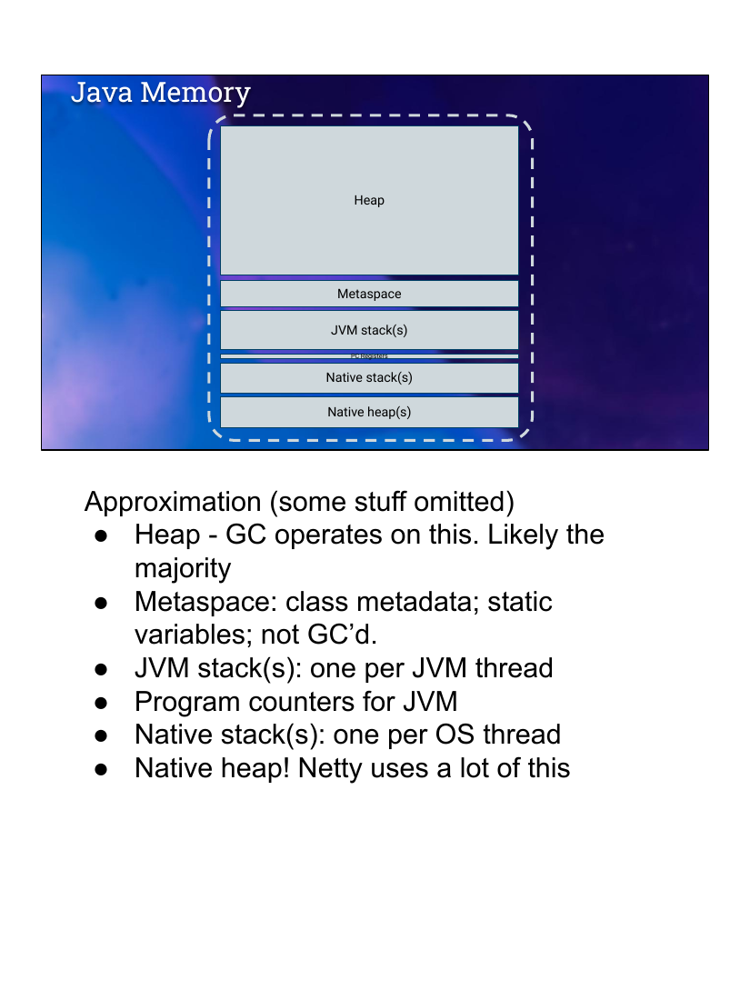
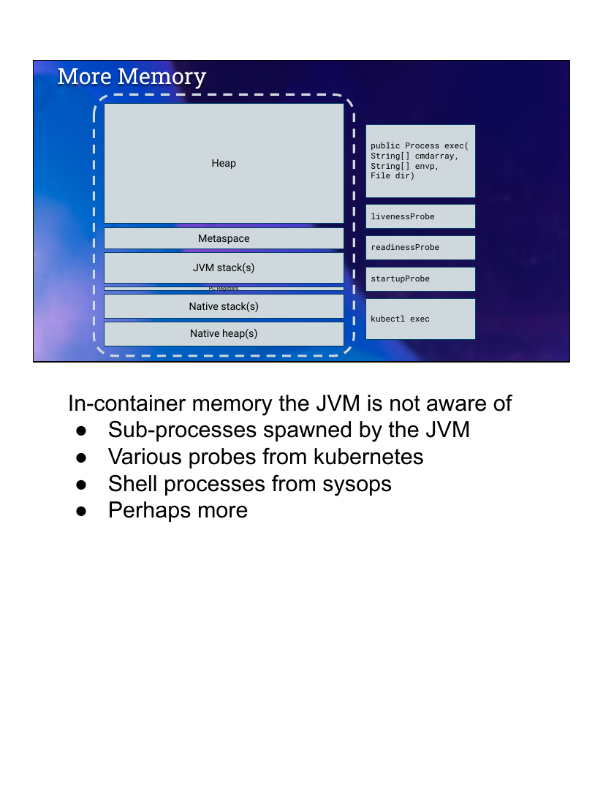
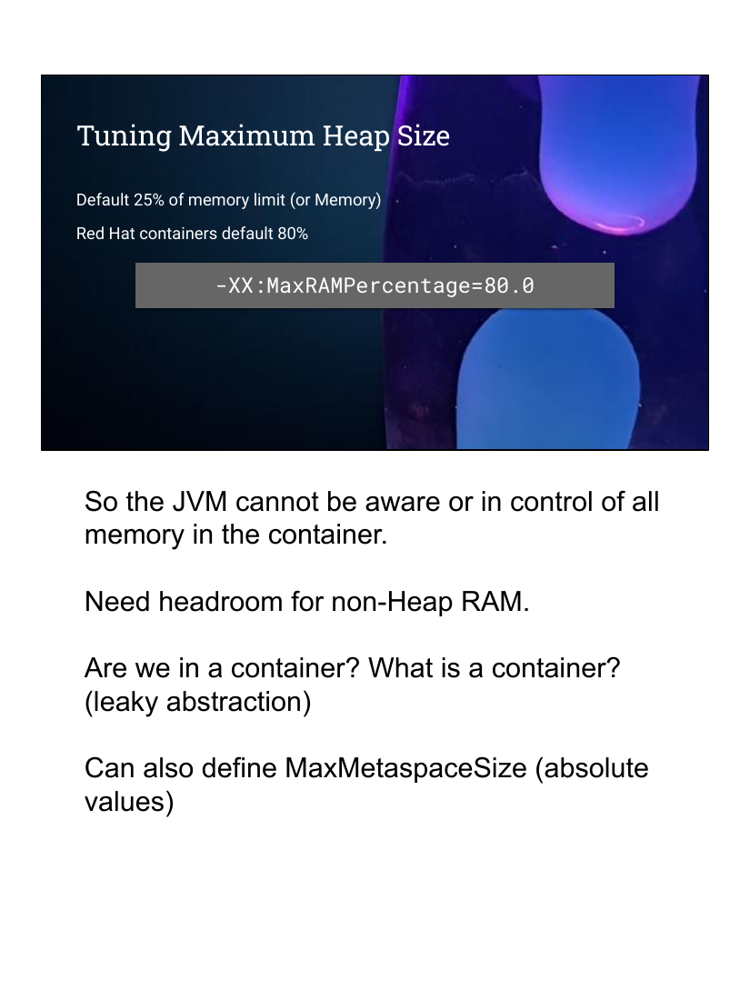
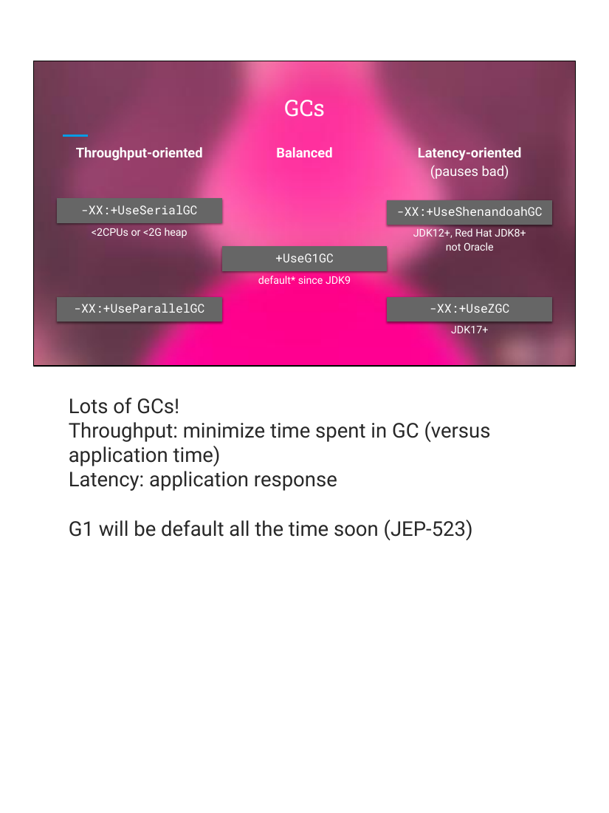
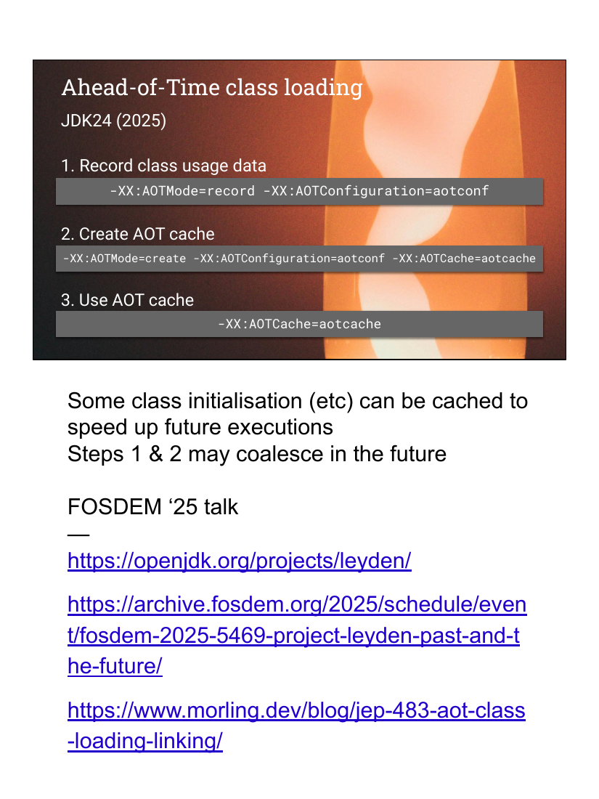
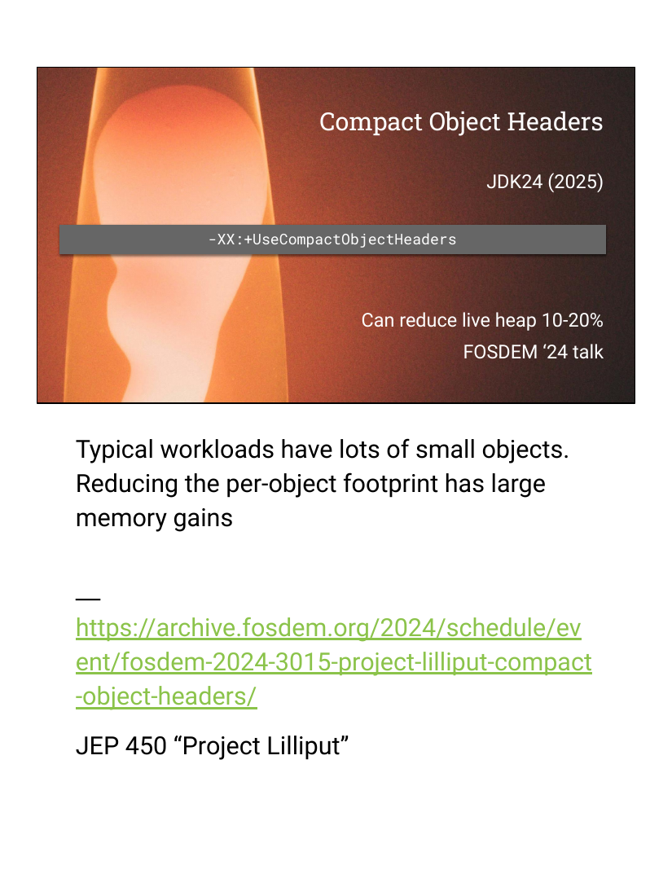
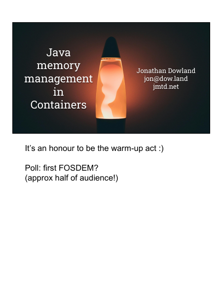

# Java 在容器里怎么管内存：OpenJDK 工程师的 20 分钟全景图 —— FOSDEM 2026 精读

> 🎬 视频直链：https://video.fosdem.org/2026/ua2118/QQFMBG-java-container-memory-management.mp4（441MB，约 20 分钟）
> 📄 来源页：https://archive.fosdem.org/2026/schedule/event/QQFMBG-java-container-memory-management/
> 🎤 演讲者：Jonathan Dowland（OpenJDK 贡献者，原 Red Hat、现 IBM，做"Java + 容器"十年）
> 📅 FOSDEM 2026 · Containers devroom · UA2.118 (Henriot) · 2026-01-31（周六 10:30，开场第一场）
> 📖 理解方式：bl vision describe 逐页画面识别（带时间轴）+ 官方 VTT 字幕全文（已存档）+ 官方幻灯片 PDF（22 页，提取 7 张原图）三源交叉验证

## 🎯 30 秒版本

一场写给"容器人"（不是 Java 人）的 Java 内存管理速成课：你的 Java 应用装进 Docker/Kubernetes 容器后，JVM（Java 虚拟机）看到的内存世界和你以为的不一样。三个最实用的结论：①JVM 默认只敢用容器内存限额的 **25%** 当堆（heap，存对象的内存区）——给 2GB 只吃 500MB，这就是很多人 Java 容器"明明给了内存却很卡/浪费"的原因，改一个参数 `-XX:MaxRAMPercentage=80.0` 就能吃到 80%；②容器里除了 JVM 还有一堆 JVM 管不到的内存消耗（K8s 探针、kubectl exec、子进程），所以别把限额榨到 100%；③"升级 JDK 版本"本身就是免费的性能优化——AOT 类加载缓存（启动加速）、压缩对象头（省 10-20% 堆内存）都是 JDK24/25 才有的，还停在 JDK8 就全错过了。

## 📺 视频讲了什么

演讲分四段（约 20 分钟，现场爆满，是当天 Containers devroom 的暖场第一场）。第一段"哪个 Java"：OpenJDK 是源码项目，二进制由 Oracle/Red Hat/IBM/Temurin 等厂商各自构建，**厂商不同功能开关都不同**（比如 Oracle 的发行版干脆不含 Shenandoah GC）；版本方面 JDK8 要撑到 2030 年，但新特性只进新版本。第二段讲 JVM 的内存构成和容器感知：JVM 从 JDK8 起就能读 cgroups（Linux 内核的资源限额机制，容器就靠它实现）的内存限额，但堆只是容器内存的一部分。第三段讲 GC（垃圾收集器，自动回收不再用的内存的组件）怎么选：吞吐型（Serial/Parallel）、平衡型（G1，默认）、低延迟型（Shenandoah/ZGC），外加一个奇葩的 Epsilon"什么都不回收"GC——专为 FaaS（函数即服务）这种"内存爆了就让调度器杀掉重启"的场景设计。第四段是新特性红利和应用剖析工具（JFR + Cryostat），结论：JVM 自动调优在进步，但极限就在那，想榨干性能还得自己 profile。

## 🔑 关键内容

*（标注：👁=画面里看到的，🎙=字幕/口播，🌐=资料补充）*

- 👁🎙 **开场自嘲**：讲者放了一段真实生产系统的 YAML（嵌套七八层的 `properties: spec: properties: data: properties: mapping:...`）——"都说企业 Java 是 FactoryFactory 套娃，别在玻璃房里扔石头，容器圈的 YAML 一样烂"。🎙 他还坦白自己也不是 Java 出身："我做了十年 Java+容器，但在那之前我就是你们（容器人）中的一员"，所以整场刻意零 Java 前置知识。
- 👁🌐 **厂商决定功能**（画面第 5 页）：OpenJDK 只出源码不出二进制；Temurin（Eclipse Adoptium 基金会的免费构建）是"不知道选哪个就选它"的默认答案。🎙 关键细节：**Oracle 构建 Java 时直接关掉了 Shenandoah GC 的编译**（因为 Oracle 自己主推后出的 ZGC），Red Hat 则把 Shenandoah 反向移植到了 JDK8——同一份 OpenJDK 源码，你拿到的功能取决于谁给你编译的。🌐 这是"发行版差异"的经典案例，类比 Linux：都是内核源码，CentOS 和 Ubuntu 装出来的东西不一样。
- 👁 **版本墓碑图**（画面第 6 页）：JDK8 立着墓碑写"2014–2030"，JDK11 的死亡年份"2026"被红色高亮，活跃的工厂图标是 JDK21（2023–2031）和 JDK25（2025–2033）。🎙 发布节奏：每 6 个月一个功能版、每 2 年一个 LTS（长期支持版）、每季度一个补丁版。🎙 "JDK8 还没死，但我估计我会死在它前面"。
- 👁🎙 **容器感知**（画面第 8 页）：`-XX:+UseContainerSupport` 在 JDK8+ 默认开启（cgroups v1/v2 都支持，且已反向移植回 JDK8）——老文档里让你手动加这个 flag 的说法过时了。🎙 但"cgroup 限额 ≠ 一定是容器"是个漏抽象：多用户裸机上也可能有 cgroup，JVM 无法百分百确定自己在容器里，所以默认值必须保守。
- 👁🎙 **堆默认只有 25%**（画面第 11 页）：JVM 默认拿内存限额的 25% 当堆上限，Red Hat 的容器镜像把默认值提到了 80%（`-XX:MaxRAMPercentage=80.0`）。为什么留 20% 余量？👁 第 9/10 页的内存堆叠图给出了答案：容器限额 = Heap + Metaspace（类元数据区，不归 GC 管）+ 每线程的 JVM 栈 + GC 线程 + 原生栈 + 原生堆（🎙 "Netty 这种网络库大量用原生堆，很难推理"），**再加上 JVM 完全看不见的部分**：`Runtime.exec` 起的子进程、K8s 的 liveness/readiness/startup 三种探针（探针进程跑在同一个容器限额里！）、运维人员 `kubectl exec` 进来的 shell。🎙 原话："JVM 对容器内将发生的总内存需求没有完整视野，即使它名义上是主角。"
- 👁🎙 **GC 选型速查**（画面第 12 页，三列布局）：吞吐型 Serial（<2 CPU 或 <2G 堆的小容器反而合适）/Parallel；平衡型 **G1（JDK9 起默认，JEP-523 后将成为无条件默认）**；低延迟型 Shenandoah（JDK12+）/ZGC（JDK17+，🌐 亚毫秒级停顿，大堆友好）。🎙 吞吐和延迟天然互斥："要响应快就选延迟型，否则选吞吐型"。
- 👁🎙 **Epsilon GC**（画面第 13 页）：JDK11 加入的"什么都不干"GC——只管分配、从不回收，内存耗尽直接 OOM 杀进程。🎙 看似废柴，实际用途：FaaS/无服务器场景里"Java 死了让 K8s 调度器重启并重导流量，比停下来做 GC 更划算"；或者你的分配量完全可控、一丝 GC 停顿都不能忍。
- 👁🎙 **三个新版本红利**（画面第 15-17 页）：①**Elastic Metaspace**（JDK16）：Metaspace 换了套类似 Linux 内核的内存分配算法，病态场景下大幅改善，JDK21 起调优参数消失、balanced 模式常开；②**AOT 类加载缓存**（JDK24，Project Leyden）：三步走——先带 `-XX:AOTMode=record` 跑一遍录制类使用数据，再 `-XX:AOTMode=create` 生成缓存，以后 `-XX:AOTCache=aotcache` 启动直接读缓存，🎙 "对启动时间改善巨大"（JVM 启动慢是因为 JIT 要先解释执行攒热度）；③**Compact Object Headers**（JDK24，Project Lilliput）：Java 应用堆里全是小对象，把每个对象的头部（记录类型/锁状态的元信息）从 96 位压到 64 位，🎙 官方实测**活堆省 10-20%，基本免费**。目前需手动 `-XX:+UseCompactObjectHeaders` 开启——🎙 Q&A 有人问为何不默认开，答："Java 新功能一向保守：先不带默认值进主线，跑半年没事故再转默认。"
- 👁 **剖析工具链**（画面第 19/20 页）：桌面端 JFR（Java Flight Recorder，JVM 内置的飞行数据记录仪，持续采集内存/线程/GC 指标）+ JDK Mission Control GUI 分析（画面截图：byte[]、String 各占数百 MiB 的内存排行 + 堆锯齿曲线 + 热点栈帧表）；容器端用 **Cryostat**（Red Hat 开源，把 JFR 的采集/权限/看板整个容器化，🎙 讲者自嘲"这里本该有 live demo，但我没网"）。
- 🎙 **Q&A 彩蛋**：有人问"AOT 缓存能不能在容器构建阶段就生成好、直接打进镜像？"——答：**可以**（这正是容器场景下 AOT 的正确用法：CI 里 record+create，运行时只挂载 cache）。

## 📷 幻灯片原图（官方 slides PDF 提取，pdftoppm 转换，file 验证有效）

*JVM 眼中的内存：堆只是虚线框（容器限额）里的一块（画面第 9 页）*

*JVM 看不见的内存：子进程、K8s 三种探针、kubectl exec 都在限额里挤（画面第 10 页）*

*默认 25% vs Red Hat 的 80%（画面第 11 页）*

*吞吐型 / 平衡型 / 延迟型三列 GC 速查（画面第 12 页）*

*AOT 缓存三步曲及完整命令行（画面第 16 页）*

*Compact Object Headers：活堆省 10-20%（画面第 17 页）*

*封面：熔岩灯——Java 标志的老梗*

## 🧠 关键概念表

| 术语 | 白话解释 | 为什么重要 |
|---|---|---|
| cgroups | Linux 内核给进程组设的"资源限额栏"，容器技术的根基 | JVM 靠读它才知道"我在容器里、限额多少" |
| Heap（堆） | JVM 里存对象的内存区，GC 的主战场 | 容器内存的最大头，也是唯一有比例参数可调的 |
| Metaspace | 存类元数据/静态变量的区，不归 GC 管 | 常被忽略的"隐形吃货"，JDK16 后好多了 |
| MaxRAMPercentage | 堆上限占内存限额的百分比参数 | 默认 25%，调不调差 3 倍可用堆 |
| G1 / ZGC / Shenandoah | 三种 GC：平衡 / 低延迟 / 低延迟 | 选型=吞吐与延迟的取舍；ZGC 亚毫秒停顿 |
| Epsilon GC | 只分配不回收的"摆烂"GC | FaaS 场景：死了让编排器重启比 GC 划算 |
| AOT cache | 提前编译/缓存类加载结果（Project Leyden） | 启动提速利器，可在 CI 构建进镜像 |
| Compact Object Headers | 把对象头 96→64 位（Project Lilliput） | 小对象多的应用白捡 10-20% 内存 |
| JFR / Cryostat | 内置飞行记录仪 / 它的容器化管理平台 | "自动调优到顶后"的应用剖析正道 |

## 🛠 值得学的点（写给想转 AI Infra 的 Java 工程师）

1. **这份"容器内存审计清单"直接可抄**：限额 = 堆 + Metaspace + 线程栈 + 原生堆 + 探针/子进程。AI Infra 的推理服务（vLLM/llama.cpp server）同样是"主进程之外还有看不见的开销"（CUDA context、tokenizer 子进程、健康检查），排 OOMKill 的思路完全一致——先画清"谁在限额内吃内存"，再谈调参。
2. **"默认值为什么保守"的设计哲学**：JVM 因为无法确认自己真在容器里，宁可默认只用 25%。对照 NVIDIA Dynamo、vLLM 的 `gpu_memory_utilization`（默认 0.9）——GPU 侧没有"多租户漏抽象"问题所以敢激进。理解一个系统的默认值，就是理解它对运行环境的假设。
3. **Epsilon GC 是"面向失败设计"的教科书案例**：与其在进程内艰难回收，不如快速崩溃、把高可用交给编排层。这和 AI 推理服务里"OOM 就杀 worker 让 Ray/K8s 重新调度，而非进程内腾挪"是同一个思想；FaaS/Serverless 推理（冷启动敏感）里 AOT cache + Epsilon 的组合值得琢磨。

## 💡 所以呢

- 手头有跑在容器里的 Java 服务？三行体检命令：确认 JDK ≥ 21、`-XX:MaxRAMPercentage=70~80`、JDK24+ 加 `-XX:+UseCompactObjectHeaders`。大概率白捡 20%+ 内存。
- CI 流水线里加 AOT cache 的 record/create 两步，把 cache 打进镜像——冷启动敏感的容器（包括 Serverless Java）收益最大。
- 关注 Cryostat（cryostat.io）：它是"Java 版 Prometheus + 剖析平台"，学它可以顺便理解 AI Infra 里推理服务可观测性该怎么分层（采集/权限/看板）。

## ⚠️ 局限

- VTT 字幕为机器转写，专有名词错误较多（"Shenandoah"→"Shen and Doer"、"Cryostat"→"Cryo Start"、"FOSDEM"→"fozz dem"、讲者名被转成"Chantan"/"Dravali Murray"），本文已按幻灯片 PDF 逐一校正；个别口播细节（如 Q&A 后半段）转写不全。
- bl vision describe 按抽帧识别画面，20 分钟视频约每几秒一帧：讲者快速翻页或画面文字过小时可能漏识，本文以官方 PDF 文字为准。
- 演讲无现场 demo（Cryostat 部分只有截图），工具实际效果未验证。
