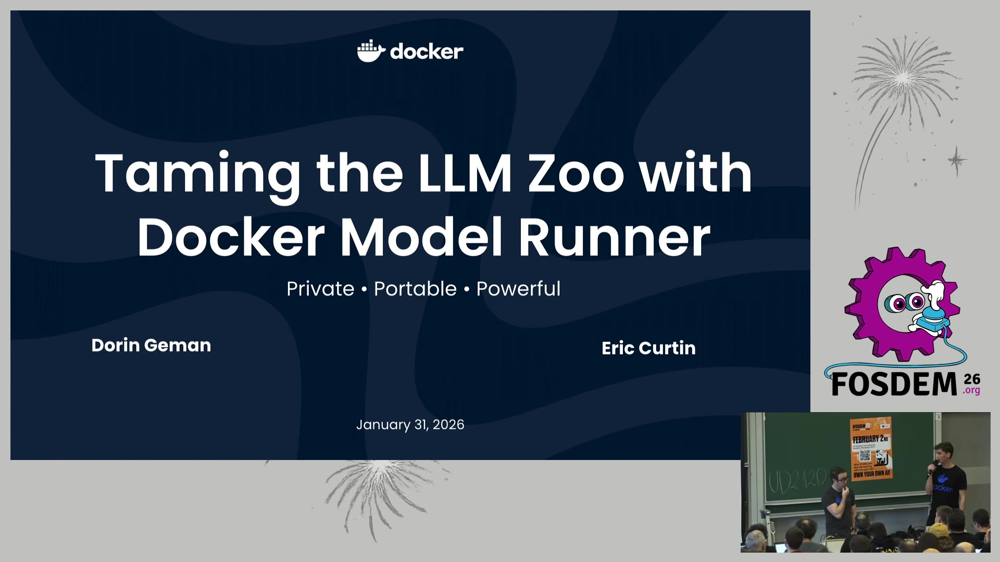

# Taming the LLM Zoo with Docker Model Runner（FOSDEM 2026 · AI Plumbers）

> 🎬 视频直链（WebM，114MB）：https://video.fosdem.org/2026/ud2120/VGXWNS-taming_the_llm_zoo_with_docker_model_runner_inference_with_oci_artifacts_llama_c.av1.webm
> 🎬 MP4 版（522MB）：https://video.fosdem.org/2026/ud2120/VGXWNS-taming_the_llm_zoo_with_docker_model_runner_inference_with_oci_artifacts_llama_c.mp4
> 📄 来源页面：https://archive.fosdem.org/2026/schedule/event/VGXWNS-taming_the_llm_zoo_with_docker_model_runner_inference_with_oci_artifacts_llama_c/
> ⏱ 时长：22 分 40 秒（本地 ffprobe 实测）· 讲者：Eric Curtin、Dorin Geman（Docker 官方）· 2026-01-31，UD2.120 (Chavanne)

## 📺 视频讲了什么

这是 Docker 官方两位工程师在 FOSDEM 2026 "AI Plumbers" 分会场介绍 **Docker Model Runner（DMR）** 的产品演讲。核心主张一句话：**把 AI 模型当成 OCI 制品（OCI artifact）来分发**——就像 Docker 用镜像仓库终结了"在我机器上能跑"一样，DMR 想用任意 OCI Registry（不限于 Docker Hub）终结模型分发对 Ollama/HuggingFace 单一仓库的依赖。演讲覆盖 CLI 工作流（search/pull/run）、docker-compose 里声明模型、Docker Desktop GUI、后端引擎路由（GGUF → llama.cpp，Safetensors → vLLM），并有现场 hands-on demo。

## 🔑 关键内容

**画面里看到的：**

- **为什么不用 Ollama/HF 仓库？** 幻灯片列了 5 条罪状：单点故障、敏感模型被迫放公网、公网推拉比内网贵、厂商锁定、" bespoke repos 是一种新型存储仓库"。解法演进三连："用 Ollama/HF repo" → "用 Docker Hub" → **"用任意 OCI Registry（或 HuggingFace）"**。
- **智能引擎路由**："Docker Model Runner now intelligently routes GGUF models to llama.cpp (for edge/local efficiency) and Safetensors to vLLM (for cloud scale)"——同一套 API，按模型格式自动选引擎。
- **平台对比表**：Macbook Pro M4（llama.cpp：单用户单流、低延迟、启动快、C++、嵌入式）vs DGX Spark vs NVIDIA H200（vLLM：多用户多流、高吞吐、启动慢、Python、"Big Fat SW and HW"）。
- **demo 命令**：`docker model search --limit=10 smollm2`、`docker model pull ai/smollm2`（Docker Hub 源）、`docker model pull hf.co/unsloth/SmolLM3-135M-Instruct-GGUF`（HF 源）、`docker model run ministral3` 交互问答、`docker model requests --model ministral3 | jq .` 审计 API 请求。Docker Desktop GUI 里能看到模型列表、Requests 面板显示 **440 tokens/sec**。
- **compose 声明模型**：services 里 `models: [llm, embedding-model]`，顶层 `models:` 定义 `model: ai/smollm2`、`context_size: 4096`、`runtime_flags: ["--temp","0"]`——模型成为和应用并列的一等公民。
- **API 三兼容**：OpenAI Chat Completions/Responses、Ollama API（供 Open WebUI/AnythingLLM）、Anthropic Messages（供 Claude Code）。
- **vllm-metal 分层架构图**：vLLM Core → vllm_metal 插件层（MetalPlatform/MetalWorker/MetalModelRunner）→ MLX Backend（SDPA Attention、RMSNorm、RoPE）+ PyTorch Backend（权重加载/转换）→ Apple Silicon 统一内存。这是 vLLM 上 Mac 的官方路线。

**资料补充（非画面）：**

- DMR 目前支持 llama.cpp / vLLM / Diffusers 三个引擎，vLLM 集成于 2025-11 官宣（vllm.ai 博客），Linux 上 `docker model install-runner --backend vllm --gpu cuda` 即可启用（Docker 官方文档）。
- 幻灯片提到"98% 财富 500 强软件公司使用内部 OCI registry"——这是 DMR 打企业市场的核心论据：模型走内网 Harbor/Artifactory，不出公网。

## 🛠 值得学的点（写给转 AI Infra 的 Java 工程师）

1. **"模型即制品"是 AI 时代的 Maven 中央仓库问题**。Java 生态早就懂：依赖要版本化、可从私有 Nexus 拉取、可审计。DMR 把这套搬给了模型——理解 OCI artifact 规范（不只是镜像，任意文件都能进 registry）是看懂这条路线的钥匙。
2. **llama.cpp vs vLLM 的选型逻辑可以背下来**：单用户低延迟选 llama.cpp（C++，嵌入式），多用户高吞吐选 vLLM（Python，continuous batching + PagedAttention）。这和你 10-30 笔记里 MIG/MPS 多模型共享 GPU 是同一张决策表。
3. **compose 里 `models:` 段 + OpenAI 兼容 API** 意味着 agentic 应用的"模型依赖"可以和 app 容器一起声明、一起部署——对标 Spring Boot 里 `application.yml` 声明数据源的思路，未来写 AI 应用的部署清单大概率长这样。

## ⚠️ 局限

- 视频理解基于画面抽帧，**音频内容（讲者口语、Q&A）基本听不到**，demo 环节的现场操作细节仅能从幻灯片截图和镜头切换推断。
- 幻灯片小字部分可能有识别误差（如版本号、token 速率数字）。
- 522MB 的 MP4 直链在模型侧下载超时，本次改用 114MB WebM 版成功理解；MP4 链接留给需要更高画质的读者。
- 配图为本地 ffmpeg 从 WebM 提取的真实关键帧（1920×1080，file 已验证）。

