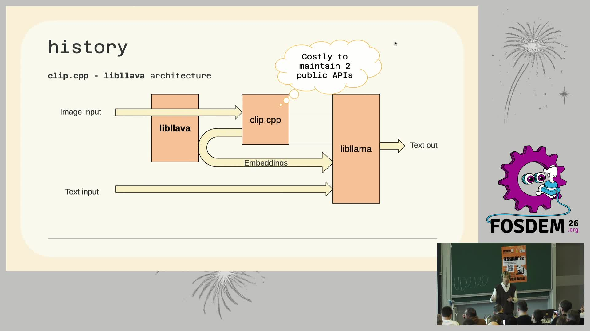
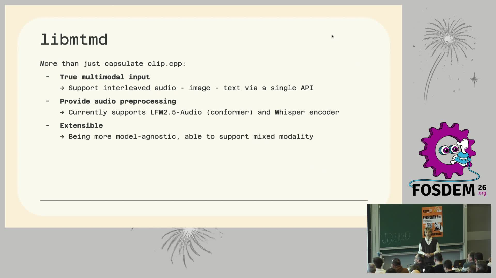
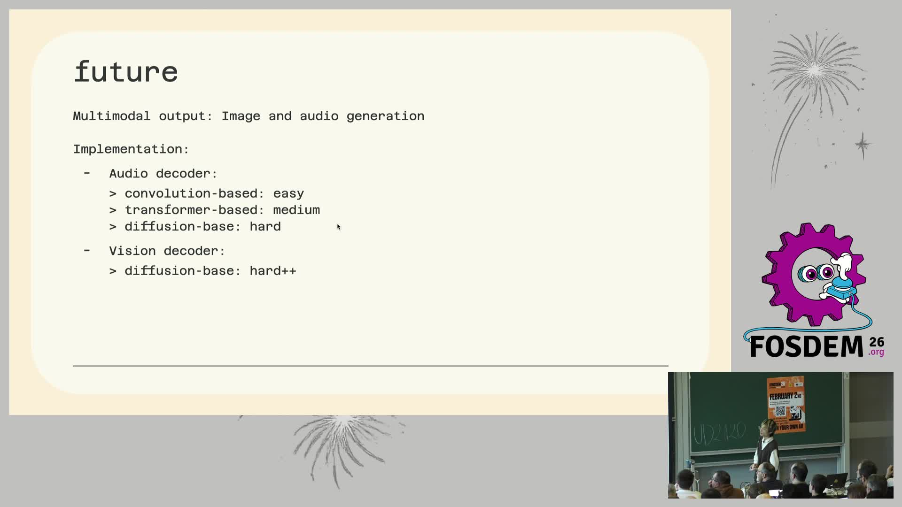

# llama.cpp 的多模态进化：libmtmd 一统视觉/音频输入（FOSDEM 2026）

> 🎬 视频直链：https://video.fosdem.org/2026/ud2120/LRZJEH-llama-cpp-multimodal.mp4（450MB，19 分 37 秒）
> 📄 来源页：https://archive.fosdem.org/2026/schedule/event/LRZJEH-llama-cpp-multimodal/
> 🎤 演讲者：Xuan-Son Nguyen（Hugging Face 工程师、llama.cpp 核心维护者，GitHub @ngxson）
> 📅 录制于 FOSDEM 2026（2026-01-31，布鲁塞尔）AI Plumbers devroom

## 📺 视频讲了什么

llama.cpp 是目前最流行的本地大模型推理引擎（把 LLM 跑在你自己的电脑/手机上，不依赖云端 API）。这场演讲讲的是它如何支持"多模态"（multimodal，即模型不只能读文字，还能看图片、听音频）。演讲者用 shell 命令风格的目录（`whoami / history / libmtmd / future / contribute`）串起全场：先回顾 2023 年以来碎片化的旧方案，再重点介绍新统一库 **libmtmd**（mtmd = MulTiMoDal）的架构与 API，现场用 macOS 终端演示 Gemma 3 4B 看图，最后展望多模态输出（TTS 语音合成、视频输入）的路线图，并给出开源贡献建议。

## 🔑 关键内容

**1. 历史包袱：两套 API 维护成本高**（画面所见）
早期方案是 libllava + clip.cpp：图片走一条链路（图像→libllava→clip.cpp→嵌入向量→libllama），文字直接进 libllama。幻灯片上的思考气泡直白写着 "Costly to maintain 2 public APIs"。2024 年 5 月视觉支持甚至一度从 llama-server 移除（时间线上配了个 😭），直到 2025 年 5 月 libmtmd 落地才回归，2025 年 12 月进入 llama-cli。

**2. libmtmd 架构：一个公共 API 吃掉所有模态**（画面所见）

- 核心思路：把 clip.cpp 封装进 libmtmd 内部，对外只暴露 `mtmd_tokenize()` 一个入口——prompt 里用 `<__media__>` 占位符标记图片/音频位置，函数负责把它们切成 chunks 再喂给 libllama，且线程安全。
- 拆成两步的原因（幻灯片脚注）：tokenize 可并行、按 chunk 处理能做 KV 复用（KV Cache：推理时缓存已算过的中间结果避免重算）。
- 不只是包一层：支持音频-图像-文本**交错**的真多模态输入，内置音频预处理（Whisper encoder、LFM2.5-Audio conformer），且 model-agnostic（模型无关，新视觉模型不用改核心代码）。
- 资料补充：这套机制依赖 mmproj（multimodal projector，多模态投影器）格式的权重文件，把图像编码器的输出"翻译"成 LLM 能理解的嵌入向量（来源：Simon Willison 博客 simonwillison.net/2025/May/10/llama-cpp-vision/）。

**3. 现场演示**（画面所见）
macOS 终端跑 `llama-cli -hf ggml-org/gemma-3-4b-it-GGUF`（Metal 后端），`/image bliss.png` 载入 Windows XP 经典"Bliss"壁纸问 "what is this?"，模型正确认出是 XP 默认壁纸。屏幕统计：Prompt 125–311 t/s、生成 64–79 t/s——4B 小模型在 Mac 上看图完全流畅。

**4. 未来方向**（画面所见）

- 多模态**输出**：计划支持 TTS（LFM2.5-Audio）；难度分级很诚实——音频解码器卷积式 easy、transformer 式 medium、扩散式 hard；视觉解码器（扩散式）hard++。
- 视频输入：整段载入会爆内存，必须做流式 API（mtmd 按需向解码器"要帧"）；为此要不要引入 ffmpeg 第三方依赖？倾向 dlopen（运行时动态加载，可选依赖），讨论见 llama.cpp issue #18389。

**5. 贡献建议**（画面所见）：大改先开 discussion、复用已有抽象（如 `build_vit()`）；特别一条——"用 AI 探索代码库，但别用 AI 写代码"（mtmd 代码库年轻，AI 生成的复杂代码不符合项目方向）。

## 🛠 值得学的点（写给想转 AI Infra 的 Java 工程师）

1. **门面模式（Facade）的教科书案例**：libmtmd 把 clip.cpp 藏进内部、对外只留一个 tokenize 入口——和你在 Java 里用 Facade 收敛多套遗留 API 是同一招。识别"两套公共 API 维护成本高"这个坏味道并动手重构，是 Infra 项目的核心能力。
2. **占位符 + chunk 的流式处理思路**：`<__media__>` 标记 → 切 chunk → KV 复用，本质是把大对象处理拆成可缓存、可并行的小单元，类似 Java 里分片上传/流式反序列化的设计。
3. **可选依赖的工程权衡**：视频输入需要 ffmpeg，但"打包两个版本 UX 差"→ 选 dlopen。对应 Java 世界的 optional dependency / SPI 运行时探测，Infra 项目里这种分发权衡无处不在。

## ⚠️ 局限

- 视频理解基于画面抽帧，**音频未转写**：演讲者口头解释的细节、问答环节（视频后半段约 5 分钟 Q&A）的内容无法获取。
- 幻灯片小字（如 `mtmd_tokenize()` 完整签名、时间线具体日期）识别可能不全，本文数字以能辨认的为准。
- 关键帧由本机 ffmpeg 从原视频抽取，非官方配图。
