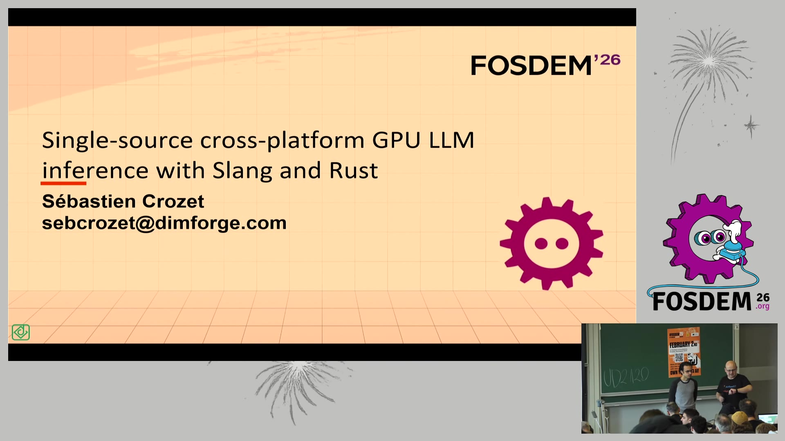
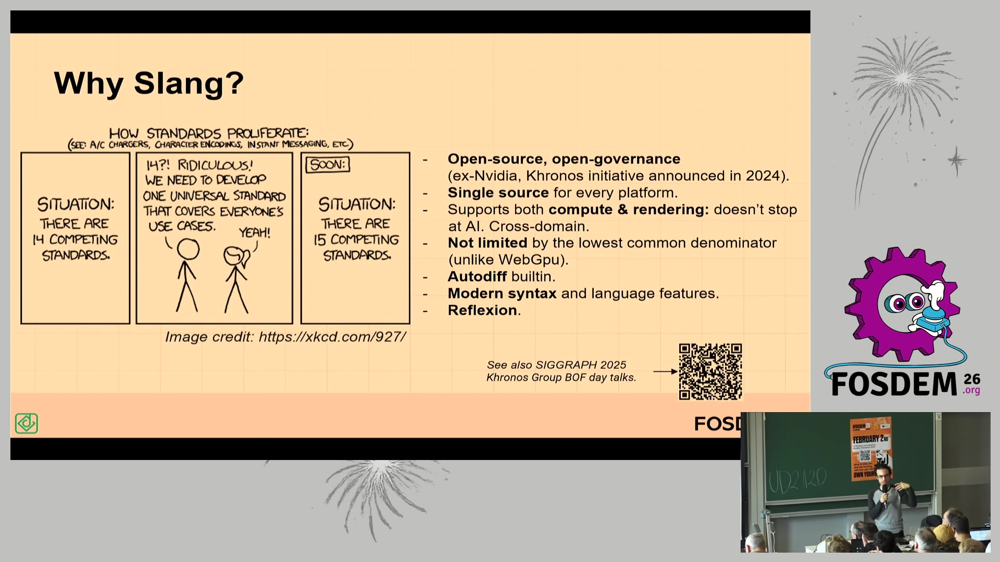
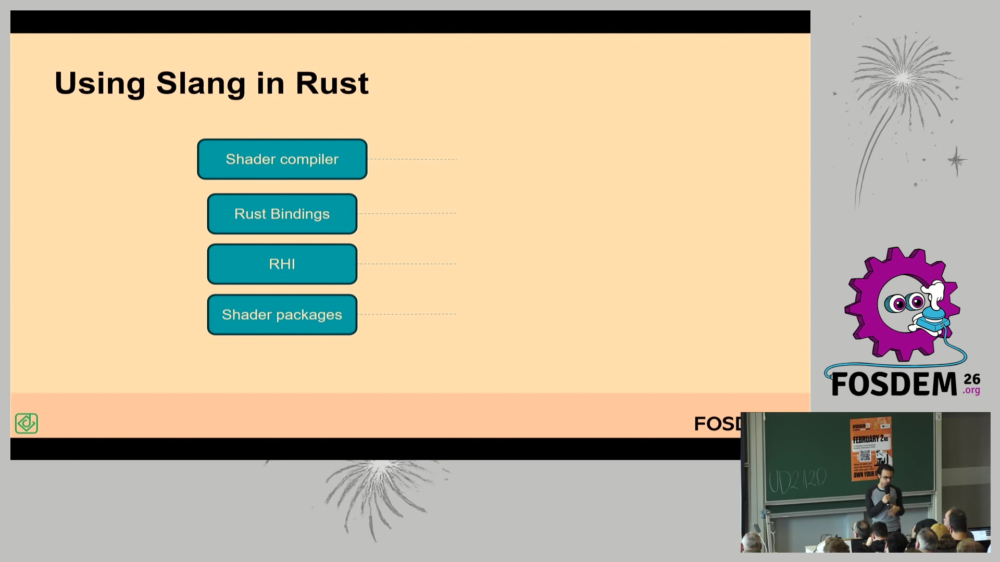
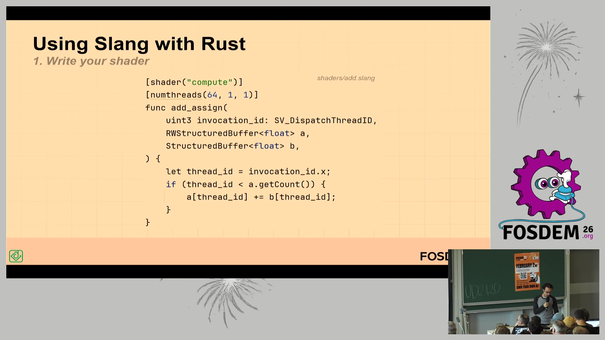

# 一次编写、处处运行：用 Slang + Rust 做跨平台 GPU LLM 推理（FOSDEM 2026）

- **视频直链**：https://video.fosdem.org/2026/ud2120/QU9UF3-slang-cross-platform-inference.mp4
- **来源页面**：https://archive.fosdem.org/2026/schedule/event/QU9UF3-slang-cross-platform-inference/
- **时长**：约 19 分钟（AI Plumbers devroom，2026-01-31，UD2.120）
- **演讲者**：Sébastien Crozet（DimForge 创始人，Rust 生态知名库 nalgebra / Rapier 的作者）

## 📺 视频讲了什么

这是 FOSDEM 2026 "AI Plumbers" 分会场的一场 20 分钟短演讲。演讲者从自己写物理引擎的背景出发，指出 GPU 张量算子开发的最大痛点：同一个 kernel（GPU 上跑的计算函数），要为 CUDA、Metal、WebGPU 等每个平台重写一遍。他的答案是 Khronos 的 Slang 着色语言 —— "写一次 shader，编译到所有平台"，并展示了自己围绕它搭的一整套 Rust 工具链（shader-slang 绑定、slang-hal、stensor、slai），最终目标是做一个跨平台的 Rust LLM 推理库。演讲有清晰的代码演示和坦率的局限分析。

## 🔑 关键内容

**动机（画面）**：幻灯片直言"Writing tensor operators on the GPU is **hard** (╯°□°)╯︵┻━┻"，现状被 per-backend 实现主导。GPU 程序员本来就稀缺，如果每个算子要写 10 遍，社区根本发展不起来。

**Slang 是什么（画面 + 资料补充）**：Slang 同时是一门 GPU 编程语言和它的编译器。它最早由 NVIDIA 内部开发，2024 年 11 月捐给 Khronos（管理 OpenGL/Vulkan 标准的开放联盟）成立 Slang Initiative，变成开放治理的开源项目。编译目标覆盖面很广：SPIR-V（Vulkan）、HLSL（DirectX）、MSL（Apple Metal）、WGSL（WebGPU）、CUDA、OptiX，甚至 PyTorch 和纯 CPU C 代码。资料补充：Valve 已用它迁移了整个 Source 2 引擎的 HLSL 代码库，只改了约 10 行；Autodesk 的 Aurora 渲染器也基于它实现单源码光线追踪。

**为什么选 Slang 而不是别的（画面）**：演讲者列了理由 —— 开源开放治理、单源码跨平台、compute 和 rendering 都支持（推理结果可以直接接渲染，数据全程留在 GPU 上不用同步回 CPU）、不像 WebGPU 那样被"最小公分母"标准限制（可以按平台写条件分支，native 上用更高效的实现）、内置自动微分（Autodiff，对训练有用，他自己承认还没用过）、现代语法（相比 WGSL/GLSL "光语法就值回票价"）、支持反射（Reflection，编译器能告诉你 shader 参数的绑定布局，不用手工管理 binding group/index 这种易错细节）。

**Rust 工具链四层架构（画面）**：要在 Rust 里真正跑起来需要四块 —— ① Slang 编译器本体（C++）；② shader-slang / minislang Rust 绑定；③ **slang-hal**（RHI，渲染硬件接口 —— CPU 侧的"创建 buffer、启动 kernel"也要跨平台抽象，他称这是最难的部分，目前只支持 compute、只实现了 WebGPU 和部分 CUDA 后端）；④ 上层库 stensor（张量运算）、slai（LLM 推理，已跑通 Llama 和 Whisper 模型）、nexus/slosh。C++ 用户有现成选择：微软已经给 Slang 做了 RHI 实现。

**代码演示（画面）**：一个向量加法 kernel 三步走。第一步写 `add.slang`：`[shader("compute")] [numthreads(64,1,1)] func add_assign(uint3 invocation_id: SV_DispatchThreadID, RWStructuredBuffer<float> a, ...)` —— 演讲者特别强调张量参数是**函数参数**而不是传统着色语言的全局变量，"2026 年了这还需要特意提，挺荒谬的"，但这让代码可读性大幅提升。第二步 Rust 侧用 `#[derive(Shader)] #[shader(module = "add")]` 声明式导入。第三步 `launch()` 启动，全程看不到任何 binding group 设置或后端选择代码 —— 泛型参数 `<B: Backend>` 在编译期特化到 WebGPU 或 CUDA。

**坦率的局限（画面）**：Slang "接近理想"但有三个摩擦点 —— 没有包管理器；CPU/GPU 代码无法共享（Slang 和 Rust 是两门语言，结构体定义要写两遍，不匹配时极难调试）；IDE 支持只有 VSCode。因此他的下一个实验是 **rust-gpu / rust-cuda**（直接把普通 Rust 编译成 SPIR-V/PTX），能复用 cargo 包管理和 CPU/GPU 代码共享。他还会用 GPU 物理仿真为嵌入式 AI 生成训练数据集。Q&A 里他确认：目前 Rust 侧泛型只到"选后端"这一层，还不能参数化 group size 之类。

## 🛠 值得学的点（写给想转 AI Infra 的 Java 工程师）

1. **"单源码、多后端"是 infra 层的通用命题**。Java 世界里 JDBC 抽象数据库、JVM 抽象 CPU 架构；GPU 世界现在正处在"没有 JDBC"的蛮荒期，Slang/RHI 就是这个层。看懂这个类比，你就知道该盯的是抽象层设计（接口稳定性、编译期特化 vs 运行期分发），而不是某个 CUDA kernel 的写法。Rust 的泛型 + derive 宏 ≈ Java 的泛型 + 注解处理器，思路完全同构。
2. **反射（Reflection）驱动的绑定自动化**值得偷师：让编译器输出元数据、由框架自动装配，等价于 Spring 靠注解 + 反射做依赖注入。凡是"手工维护两套映射表"的设计（binding index ↔ 函数参数），都有被反射消灭的一天。
3. **关注 Khronos Slang 生态位**：它是目前唯一同时覆盖 NVIDIA/Apple/Web/CPU 的开源着色语言，且已进 Vulkan SDK。AI 推理正在从"只跑在 CUDA"走向 Metal、WebGPU、NPU 多端（参考本周日报过的 llama.cpp Vulkan/mtmd 工作），单源码编译是这条路的底层基础设施。

## ⚠️ 局限

- 视频理解基于画面帧采样 + FOSDEM 官方 VTT 字幕（字幕是语音自动转写，专有名词错误较多：CUDA→"QDA/queue that"、Khronos→"Kronos"、Sébastien Crozet→"Sebastian Kose"、SPIR-V→"sprv"，我已按上下文修正，个别处理解可能有偏差）。
- bl vision 未处理音频；幻灯片上的 QR 码内容无法读取（指向 Khronos SIGGRAPH 2025 BOF 演讲，据口述）。
- slai 的性能数字演讲中未给出（项目自称仍在实验阶段），无法评估其与 llama.cpp/candle 的实际差距。

## 🧠 关键概念表

| 术语 | 白话解释 | 为什么重要 |
|---|---|---|
| Slang | Khronos 旗下的开源 GPU 编程语言+编译器，一份代码编译到所有 GPU 平台 | 解决"每个平台重写 kernel"的核心痛点 |
| Kernel | 在 GPU 上并行执行的计算函数 | LLM 推理的性能都藏在 kernel 里 |
| RHI | 渲染硬件接口：把"建 buffer、发 kernel"等 CPU 侧 GPU 调用也抽象成统一 API | 光有跨平台 shader 不够，调用侧也得跨平台 |
| SPIR-V / PTX | 分别是 Vulkan 和 NVIDIA 的 GPU 中间字节码 | 类比 JVM 字节码：编译目标，不是给人读的 |
| 自动微分 | 编译器自动推导函数的导数计算 | 训练神经网络的核心能力，Slang 内置 |
| 反射 | 编译器吐出 shader 的参数布局元数据供框架自动装配 | 消灭手工 binding 管理这类易错样板代码 |
