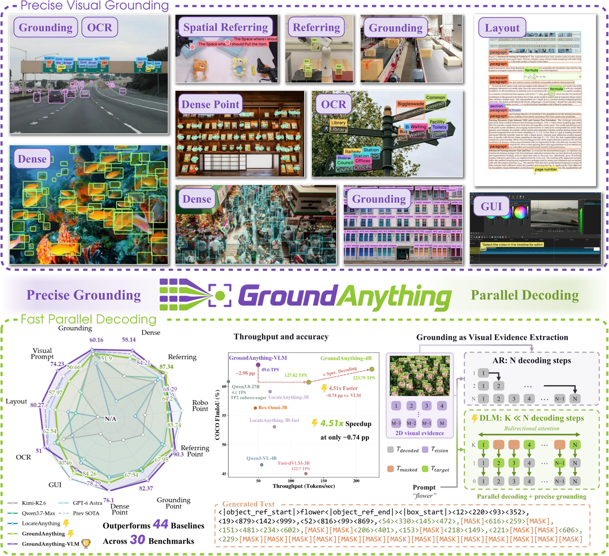
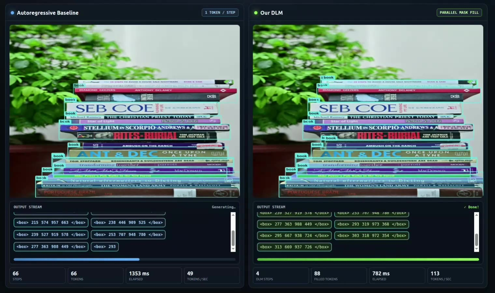

# GroundAnything：用扩散语言模型并行解码做视觉定位，速度快 2-4 倍

> 📅 2026-11-07 视频精读
> 🎬 视频直链（demo，45MB，1 分 17 秒）：https://huggingface.co/GroundingPI/GroundAnything/resolve/d1819bbe01b5a16cebd67ecaca207d2696e3af59/assets/demo.mp4
> 🎬 视频直链（并行解码对比，8MB，约 17 秒）：https://huggingface.co/GroundingPI/GroundAnything/resolve/0f8e30894c3ca86378d01ae51ec69c217c78151b/assets/decoding.mp4
> 📄 来源页面：https://github.com/groundingpi/GroundAnything ｜ 论文 https://arxiv.org/abs/2609.39600 ｜ 模型 https://huggingface.co/GroundingPI/GroundAnything
> ✅ 两个视频均通过 bl vision（qwen3-vl-plus）成功理解，无 skip

## 📺 视频讲了什么

GroundAnything 是一个 4B 参数的开源视觉定位（visual grounding，即"给一张图和一句描述，模型框出图中对应物体的位置"）基础模型。官方 demo 视频展示了三类能力：开放词汇视频检测（人形机器人、企鹅、车流、飞鸟等实时打框）、GUI 接地操作（用自然语言在 GarageBand 界面里插入音轨、在网页上点"不感兴趣"按钮）、以及核心卖点——**并行解码**。后半段是一个双栏实时对比：左边传统自回归模型（Autoregressive，像打字机一样一个 token 一个 token 往外蹦），右边它家的扩散语言模型（DLM，Diffusion Language Model，像填字游戏一样先把整句铺满空格 [MASK]，再几步并行填完），同样的输出内容，右边只要 4 步、耗时约为左边的 1/2 到 1/4。

## 🔑 关键内容

**画面里直接看到的（视频理解结果）：**

1. **双栏对比界面的量化数字**：8 组示例（书堆、饮料瓶、城市交通、鱼群、寿司、墙面诗句、文档布局、抽屉旋钮点定位）。自回归基线每步 1 token，输出 52-199 个 token 就要跑 52-199 步，耗时 1560-3588ms，吞吐 33-56 tok/s；DLM 固定 4 步并行掩码填充，完成同样 token 数只要 562-1461ms，吞吐 93-136 tok/s——**约 2-3 倍加速**，多数场景基线还在 "Generating…" 时 DLM 已显示 "✓ Done!"。

   

2. **输出协议很直观**：类别用 `<ref> book </ref>` 包裹、坐标用 `<box> x1 y1 x2 y2 </box>`（1000 个量化坐标 token）、点标注用 `<point> x y </point>`。这套结构化 token 流让"定位"变成了纯文本生成问题，任何 LLM 推理框架都能服务它。

3. **任务覆盖面广**：不止画框——OCR 文字接地（把墙上诗句逐词框出来）、文档布局分析（DocLayNet 论文页面的 headline/paragraph/figure 分区）、GUI 元素定位（广告按钮、音轨列表项），全走同一套接口。

**资料补充（论文/HF 模型卡）：**

4. **架构**：MoonViT-V2（Kimi K3 的视觉编码器）+ Qwen3-4B-Instruct 语言主干，2×2 空间聚合投影层。从自回归 checkpoint 直接"转换"成扩散模型：加一个 mask token，联合训练因果预测和分块去噪（block size B=32）。
5. **成绩**：AR 变体 GroundAnything-VLM 在 30 个 grounding benchmark 上平均 72.42%（同尺寸 SOTA）；扩散版用熵引导解码平均 61.75%（vs MTP 路线的 LocateAnything 53.32%）。可选的自推测解码（self-speculative，扩散起草 + 因果验证，类似"实习生打草稿老师改"）达 4.51× 吞吐加速（223.8 vs 49.6 tok/s），COCO F1mIoU 只掉 0.74 个百分点。
6. **工程侧**：提供 vLLM/SGLang 部署配方，服务端口 8101（DLM）/8102（VLM），Python 客户端一行 `client.predict("example.jpg", "the red car", task="bbox")`。

## 🛠 值得学的点（写给转 AI Infra 的 Java 工程师）

1. **"序列化输出"是 LLM 推理延迟的结构性根源**——坐标这种本来互相独立的数字，被 AR 模型强行排成一队逐个吐。这和 Java 里把可并行的循环硬写成串行 reduce 是一个道理；扩散解码相当于把 for 循环改成了 parallel stream，但代价是要"多轮迭代收敛"（4 步而非 1 步并行）。
2. **自推测解码 = 草稿 + 验证模式**：用便宜的并行方式起草、用精确的因果方式批量验证，这个"proposer/verifier"结构和 JVM 的 JIT 分层编译（C1 快速编译、C2 精确优化）、甚至数据库的乐观锁（先提交再检测冲突）思想上同源，是很好的系统设计类比素材。
3. **结构化 token 输出是模型与推理框架的契约**：GroundAnything 把坐标量化进词表，使任何 OpenAI 兼容服务都能跑它。做 AI Infra 时，"把领域语义编码进 vocabulary 而非后处理"是减少胶水代码的通用套路。

## ⚠️ 局限

- 视频理解基于抽帧画面，**听不到音频**（demo 本身无解说，损失不大），所有数字来自画面 OCR，个别帧的计数器读数可能有 ±1 误差。
- demo 视频只展示成功案例，看不出失败模式（密集小目标、遮挡场景的漏检率无从得知）。
- "2-3 倍加速"是 demo 界面自报数字，具体硬件/精度未标注；论文的 4.51× 是输出 token 吞吐，**不等于端到端任务时间**（alphaxiv 的独立解读特别指出了这一点）。
- 本次 HF CDN 直链在模型侧下载超时，实际用 `curl -L` 解析出的签名 CDN URL（us.aws.cdn.hf.co）喂给 bl 才成功——原始 resolve 链接仍列在上方供人用。
