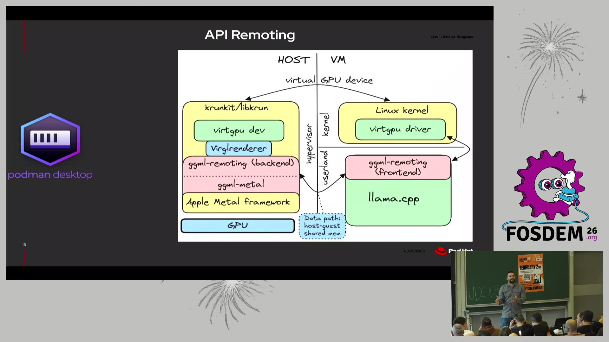
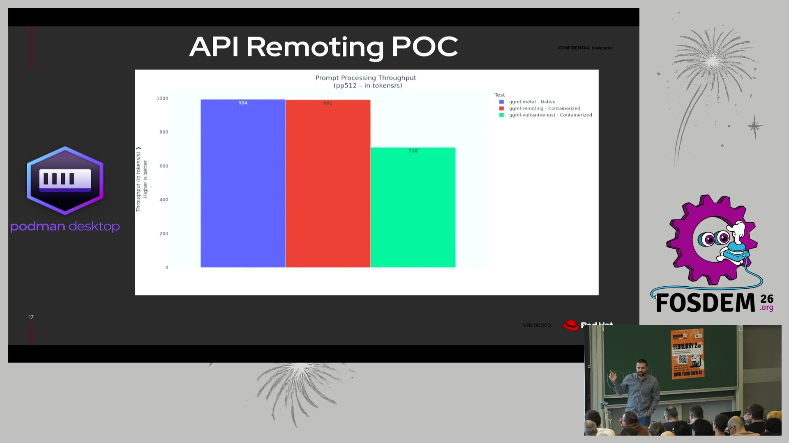

# GGML API Remoting：让 macOS 容器里的 llama.cpp 跑出原生 GPU 速度（FOSDEM 2026）

- **视频直链**：https://video.fosdem.org/2026/ud2120/C9NF8K-api_remoting_for_llama_cpp_near-native_gpu_speed_in_macos_containers.mp4（MP4，431MB）
- **来源页面**：https://archive.fosdem.org/2026/schedule/event/C9NF8K-api_remoting_for_llama_cpp_near-native_gpu_speed_in_macos_containers/
- **时长**：约 19 分 40 秒（ffprobe 实测 1180s）
- **讲者**：José Castillo Lema（Red Hat）等，FOSDEM 2026 AI Plumbers devroom

## 📺 视频讲了什么

macOS 上跑 Linux 容器（Podman Desktop / Ramalama 这套工具链）必须经过一层虚拟机（libkrun，一个用 Apple 虚拟化框架的轻量 VM）。VM 一挡，GPU 加速就没了——在容器里跑 llama.cpp 推理慢得可怜。这场演讲展示了他们的解法：**GGML API Remoting**（把容器里的张量计算调用"远程转发"到宿主机上执行），让容器化推理达到几乎等于原生 Metal 的速度。方案已在 2026 年 1 月合并进 llama.cpp 上游。

## 🔑 关键内容

**1. 问题：虚拟 GPU 的四条路只剩一条能走**（画面：幻灯片排除法）
GPU 直通会独占宿主机显示、硬件辅助直通缺支持、纯设备模拟太慢，最后收敛到**半虚拟化**（para-virtualization：guest 和 host 约定一套协作协议，guest 主动"求助"host 干活，而不是假装有个真 GPU）。

**2. 旧路径的瓶颈不在虚拟化，在翻译层**（画面：性能柱状图）
原方案是容器内 Vulkan → Venus → host 端 MoltenVK（把 Vulkan 调用翻译成 Apple Metal 的兼容层）→ Metal。实测：原生 Metal 约 323 t/s（token/秒，即每秒生成多少个词），原生 MoltenVK 约 203 t/s，VM 内 Vulkan 约 201 t/s——VM 开销几乎为零，**掉速的是 MoltenVK 这一层翻译**。

**3. 新方案：绕过 Vulkan，直接远程调用 GGML**（画面：HOST/VM 双栏架构图，见下图）
GGML 是 llama.cpp 的张量计算库，本身就有后端接口。他们在 guest 里塞一个 `ggml-remoting` 前端拦截 GGML 调用，经 virtio 通道转发到 host，由 host 上的后端调真正的 ggml-metal 执行，数据走 **host-guest 共享内存**（两边映射同一块物理内存，零拷贝）。

**4. 实测数字**（画面：POC 基准柱状图，见下图；两次视频理解读数略有出入，取约数）
- Prompt 处理 pp512：原生 Metal ≈ 990+ t/s，remoting 容器化 ≈ 990+ t/s，Vulkan(Venus) 容器化 ≈ 720 t/s——**容器化损耗约 0%**。
- Token 生成：151.6 t/s（原生）vs 145.3 t/s（remoting），每 token 6.6ms vs 6.7ms，差距 ~4%；小模型开销占比更大（每次调用的 hypercall 延迟是固定的，算得越少越吃亏）。

**5. 安全边界很诚实**（画面：安全考量页 + 资料补充）
优点：hypervisor 以普通用户权限跑，GPU 只执行可信 host 代码，恶意 guest 内核摸不到 GPU。局限：backend 库活在 hypervisor 地址空间（崩了会拖垮 VM）、多容器共享一个 backend 进程无隔离——**明确说了不是 multi-tenant safe**，定位是开发者本机工具，不是云上多租户方案。上游状态：llama.cpp 补丁已合并，virglrenderer 的通用传输组件还在 review。

## 🛠 值得学的点（写给转 AI Infra 的 Java 工程师）

1. **"分层测速定位瓶颈"是 AI Infra 的基本功**：这个项目的关键洞察是 VM 内(201) ≈ 原生 MoltenVK(203)——一层层对比后才发现虚拟化无罪、翻译层才是元凶。类比 Java：先确认慢在 GC、锁还是 IO，别一上来就重写。
2. **API Remoting ≈ 你熟悉的 RPC，只是下沉到了张量库层**：拦截调用→序列化参数→远端执行→共享内存回传结果，和 Dubbo/gRPC 的思路同构；区别在数据面用共享内存零拷贝。看懂这个，再看 vLLM 的多进程架构、Ray 的对象存储都不陌生。
3. **吞吐 vs 延迟的账要分开算**：pp512（大批量矩阵乘，算力密集）零损耗，token 生成（每次算一个 token，调用频繁）有 ~4% 损耗——固定 RPC 开销在高频小调用下被放大。设计任何远程调用系统都逃不开这笔账。

## ⚠️ 局限

- bl vision 读的是视频画面，**音频内容不可得**，讲者的口头补充和 Q&A 细节缺失。
- 柱状图数字为画面估读，两次识别有 ±3% 出入（如 323 vs 422、995 vs 994），正文取保守约数；测试硬件型号幻灯片未给出（只写 "different hardware"）。
- token generation 图表的模型名分辨率不足，疑似含 qwen3-0.6b/4b、llama3.1-8b、gpt-oss 系列，未经逐字确认。

---
*生成：2026-11-08 每日技术视频精读 cron（bl vision describe / qwen3-vl-plus，两轮提问 + 关键帧抽取）*
