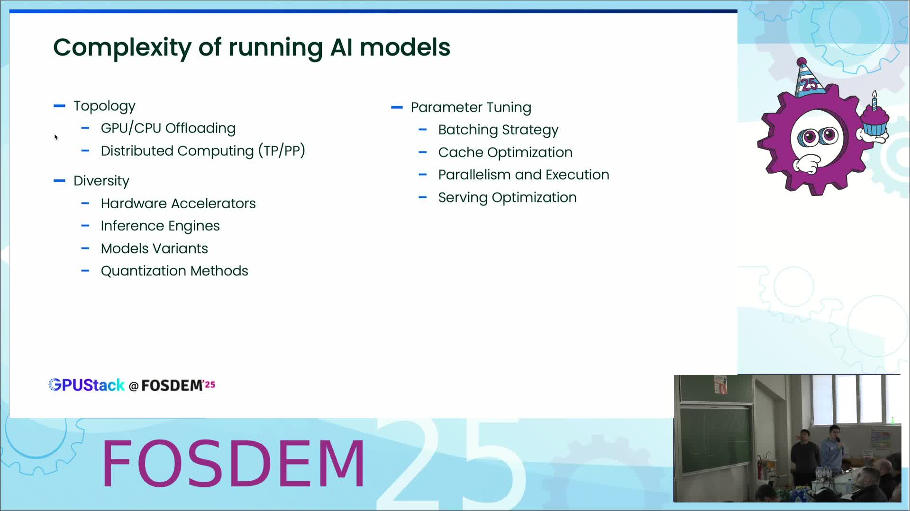
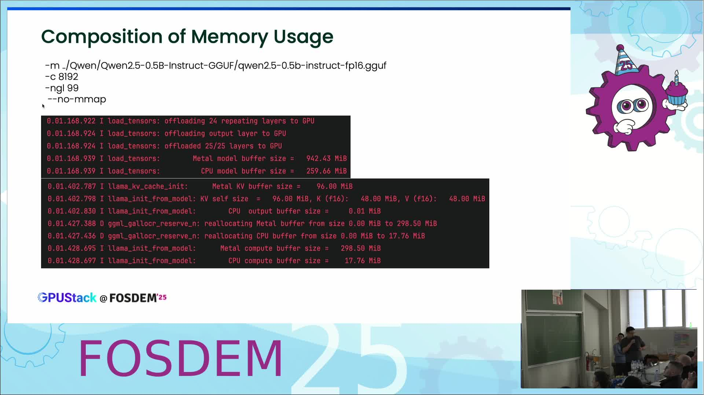

# GPUStack：像管 Kubernetes 一样管 AI 模型集群（FOSDEM 2025）

- **视频直链**：https://video.fosdem.org/2025/ub2252a/fosdem-2025-5487-gpustack-building-a-simple-and-scalable-management-experience-for-diverse-ai-models.mp4
- **来源页面**：https://archive.fosdem.org/2025/schedule/event/fosdem-2025-5487-gpustack-building-a-simple-and-scalable-management-experience-for-diverse-ai-models/
- **时长**：21 分 17 秒（ffprobe 实测 1277 秒）
- **讲者**：Lawrence Li（GPUStack 创始人）、Frank Mai（gguf-parser、llama-box 作者）

## 📺 视频讲了什么

GPUStack 是一个开源的 GPU 集群管理平台，目标是让"普通人而不只是专家"能在自己的异构硬件上跑各种 AI 模型（LLM、Embedding、图像生成、语音）。演讲前半是产品演示：Web UI 自动发现 NVIDIA/Apple 等硬件、部署模型时自动选推理后端并填参数；后半是技术深挖：作者写的 gguf-parser 如何**不下载模型文件**就精确估算内存占用（误差百 MiB 级，开 flash attention 后仅约 24 MiB）。核心主张一句话：工具要"懂环境、懂模型、懂推理引擎"才能把复杂性藏起来。

（视频画面截帧，由 ffmpeg 从原视频 500s/900s 处截取）

## 🔑 关键内容

**画面里看到的（视频理解结果）：**
- **环境感知**：Workers/GPU 表格自动列出主机、厂商、温度、利用率、VRAM——同一集群里既有 RTX 4090（CUDA）也有 Apple M4（Metal），异构硬件统一监控。
- **模型感知**：Models 页带类型徽章（LLM/Embedding/Image），tooltip 直接显示后端（llama-box）、副本数、推理参数（`--ctx-size 8192`）和**预留内存**（约 10.18 MiB / 23.6 GiB）——调度决策可视化。
- **引擎感知**：Deploy Model 对话框从 Hugging Face 搜模型（GGUF/Safetensors 两个 tab），自动选 backend 并填参数；架构图显示控制面与引擎版本解耦——vLLM v0.6.6/v0.7.0 和 llama-box 多版本可并存。
- **内存估算方法论**：总内存 = Footprint + Weight + KV Cache + Computation。KV Cache 可由 GGUF 元数据纯算术推出：attention K/V 长度 = embedding_length ÷ head_count，再乘 head_count_kv（GQA）、ctx-size、block_count、量化类型的行大小。画面给出 qwen2 的真实元数据（block_count 24、embedding_length 896、head_count_kv 2）做逐步演算。
- **估算 vs 实测**：四张折线图，Qwen2.5 Q8_0 从 0.5B 到 14B，RAM/VRAM 误差 95~167 MiB；随上下文 4k→64k 误差稳定在约 116 MiB；加 `-fa 1` 后降到约 24 MiB。
- **gguf-parser 特性**：No File Required（分块读远程 GGUF 头，不用下载几十 GB 的权重就能估算）、还能预估最大 TPS、区分模型用途（Embedding/Reranker/LLM），Go 语言编写。

**资料补充（非画面内容）：** GPUStack 由 Sealos 团队（国内开源云操作系统公司）孵化，GitHub 仓库 gpustack/gpustack；"llama-box"是他们对 llama.cpp 的封装发行版。这些是搜索背景，视频画面中未展开。

## 🛠 值得学的点（写给想转 AI Infra 的 Java 工程师）

1. **"解析元数据而非加载实体"的设计**：gguf-parser 只读文件头就能算内存，类似 Java 里读 class 文件字节码做静态分析而不用反射加载类——处理大工件（模型/镜像/数据集）时这是通用的降本模式。
2. **控制面与执行引擎解耦**：GPUStack 把 vLLM/llama-box 当作可替换、可多版本并存的"运行时"，和 Kubernetes 的 CRI/容器运行时抽象同构。想理解 AI Infra 平台层，这是最好的参照系——你已有的 Java 微服务治理经验可以直接映射。
3. **KV Cache 内存公式值得背下来**：面试和容量规划都用得上——上下文越长、层数越多，KV Cache 线性膨胀；GQA（head_count_kv < head_count）和量化 KV（`--cache-type-k/v`）是两大省内存手段。

## ⚠️ 局限

视频理解基于画面，**听不到音频**，讲者对"为什么这样设计"的口头论证缺失；UI 演示截图里的小字（表格具体数值、tooltip 完整文本）可能识别不全或有出入；估算误差图表的数值是从折线图目测的近似值。
