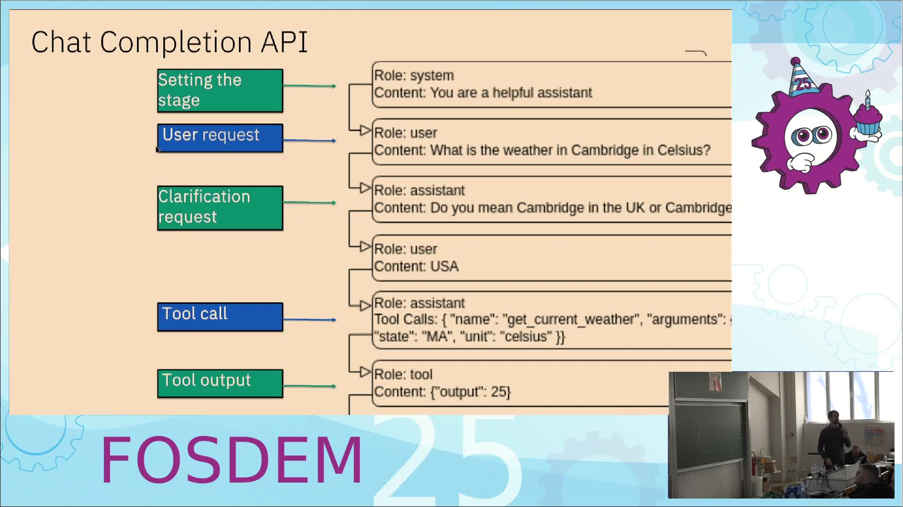
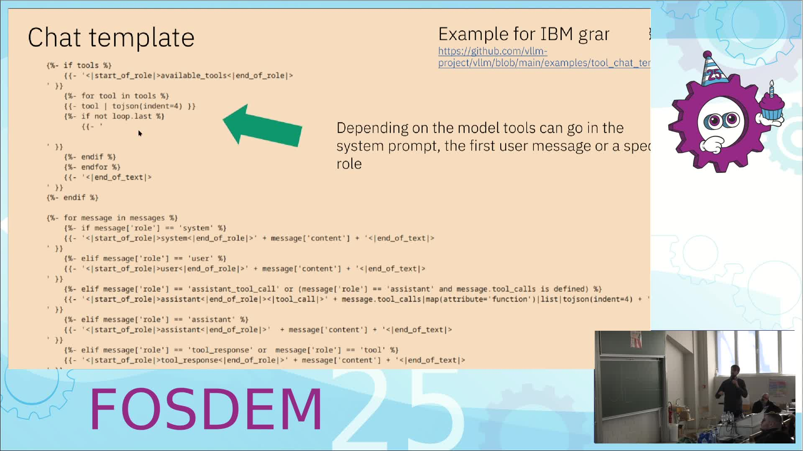

# vLLM 里的 LLM 工具调用：从 API 到 Prompt 全链路（FOSDEM 2025）

- **视频直链**：https://video.fosdem.org/2025/ub2252a/fosdem-2025-6214-llm-tool-use-in-vllm.mp4
- **来源页面**：https://archive.fosdem.org/2025/schedule/event/fosdem-2025-6214-llm-tool-use-in-vllm/
- **时长**：12 分 20 秒（ffprobe 实测 740 秒）
- **讲者**：Max de Bayser（IBM Research，vLLM 贡献者）

## 📺 视频讲了什么

这场 12 分钟的演讲把 Agent 最核心的能力——**工具调用（Tool Use / Function Calling，即让模型"点菜"调用外部函数，比如查天气、订餐厅）**——在 vLLM（最流行的开源 LLM 推理服务器之一）里从 API 端点一路拆到模型看到的原始 prompt。讲者用 IBM Granite 模型做例子，展示了 JSON 工具描述如何被 Jinja 模板渲染成带角色标记的纯文本、模型如何输出转义 JSON 的 tool call、以及 vLLM 如何把它解析回 OpenAI 兼容的结构化响应。后半段还讲了工具调用能力是怎么"训"出来的（多任务微调），最后给出 vLLM 当前的限制清单。

（视频画面截帧，由 ffmpeg 从原视频 300s/400s 处截取）

## 🔑 关键内容

**画面里看到的（视频理解结果）：**
- 完整管道分 7 步：`vllm serve` 拉起 FastAPI 服务 → 客户端带 `tools`（JSON Schema 描述的函数列表）+ `messages` 调 `/v1/chat/completions` → vLLM 用该模型的 Jinja chat template 把 tools 序列化进 prompt（Granite 放进 `<|start_of_role|>available_tools<|end_of_role|>` 段）→ 模型输出 `<|tool_call|>` + 一行 JSON → vLLM 解析成 `finish_reason='tool_calls'` 的结构化响应 → 开发者的 executor 真正执行工具 → 结果以 tool 角色回填再问模型，得到最终自然语言回答。
- 一个容易踩的坑（幻灯片明确展示）：模型输出的 `arguments` 是**字符串里再套一层转义 JSON**（`"{\"city\": \"Dallas\"}"`），编排层需要二次解析。
- `tool_choice` 四栏对照表：`required` 在 vLLM **不支持**；指定具体 function 或 required 都可能**逼模型幻觉编造参数**（幻灯片上有 ⚠ 标注）；`none` 时输出不该被当 tool call 解析；`auto` 允许复杂工作流但客户端要能处理"直接回答 / 反问澄清 / 调用工具"三种输出。
- 训练侧：Granite-20b-FunctionCalling 用 142K 样例、7 类任务（并行函数调用、函数链、参数-值对检测等）做 QLoRA 微调，1 台 8×A100 服务器训 3 个 epoch。
- vLLM 社区数据（幻灯片）：35K Stars、690 位贡献者，commit 占比图显示单一组织份额持续下降。

**资料补充（非画面内容）：** 演讲提到的 arXiv 论文为 Granite Function Calling（2407.00121）与 API-BLEND（2402.15491）；讲者推荐的编排框架 BeeAgent 现已并入 IBM 的 agent 生态。

## 🛠 值得学的点（写给想转 AI Infra 的 Java 工程师）

1. **把 tool calling 当"协议翻译"问题看**：模型只认文本，API 层只做 JSON↔文本的双向翻译，工具执行完全在框架侧——这个分层和 Java 世界"Controller 不写业务、Service 不碰 HTTP"是同一个思想，迁移心智负担很小。
2. **chat template 是隐形依赖**：换模型必须换模板，tools 进 system prompt 还是特殊角色因模型而异。做推理平台时要把模板当一等公民管理（GPUStack 那类平台就是这么做的）。
3. **`tool_choice` 的取舍**是生产级 Agent 的必修课：强制调用换来确定性但引入幻觉风险，auto 灵活但客户端状态机更复杂——设计 API 时先想清楚要哪种。

## ⚠️ 局限

视频理解基于画面（幻灯片+截图），**无法听到演讲音频**，讲者的口头补充、Q&A 和语气强调都缺失；代码截图中的小字（如完整 Jinja 模板）可能识别不全；幻灯片编号"4.1 重复"是画面原样如此，非转录错误。
