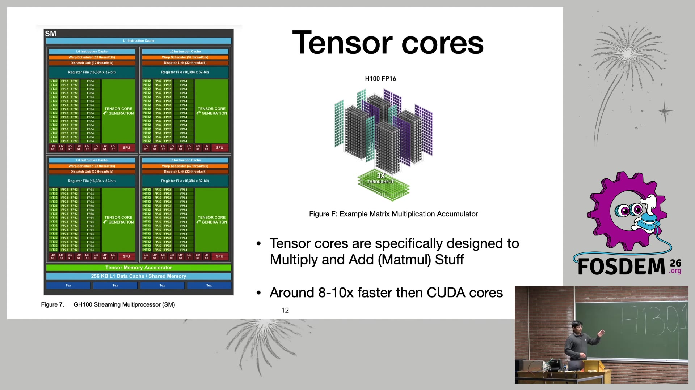
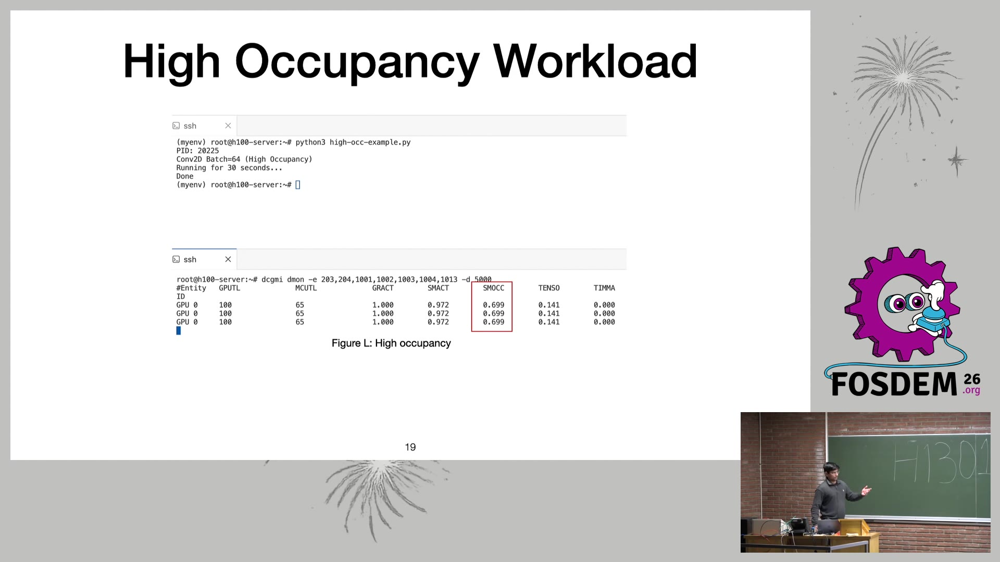

# 超越 nvidia-smi：用 DCGM 看穿 GPU 真实利用率（FOSDEM 2026）

- **视频直链**：https://video.fosdem.org/2026/h1301/BBYZLU-gpu-performance-monitoring.av1.webm （AV1/WebM 50.2MB；另有 MP4 323MB）
- **来源页面**：https://archive.fosdem.org/2026/schedule/event/BBYZLU-gpu-performance-monitoring/
- **时长**：14 分 44 秒（ffprobe 实测 884 秒）
- **讲者**：Yash Panchal（Percona 质量工程师，自述因 AI 兴起开始研究 GPU 监控）
- **配套博客**：https://dev.to/panchalhimself/beyond-nvidia-smi-part-1-26le

## 📺 视频讲了什么

这场 Software Performance track 的演讲只回答一个问题：**nvidia-smi 显示的 "GPU-Util 100%" 根本不能说明 GPU 被用满了**。讲者在一块 H100 上分别跑 FP32 和 FP16 负载，nvidia-smi 两者都显示 100%，但用 NVIDIA DCGM（Data Center GPU Manager）的 `dcgmi dmon` 一看：FP32 时 Tensor Core 利用率是 0，FP16 时才到 0.92——也就是说 FP32 负载把价值数十万的 Tensor Core（专门做矩阵乘的硬件单元，比通用 CUDA 核快 8-10 倍）完全闲置了。后半段讲解该盯哪些指标（SM Activity/Occupancy、Tensor Active、内存带宽）、怎么用 dcgmi 设温度告警，以及 DCGM Exporter + Prometheus + Grafana 的生产监控栈。

（ffmpeg 从原视频 380s / 560s 处截帧）

## 🔑 关键内容

**画面里看到的（bl 视频理解结果）：**
- 核心类比（来自日程页）：只看 nvidia-smi 就像"看高速公路上有没有车"来判断路况，而不是看几条车道满了。GPU-Util 100% 只表示"某个时刻有 CUDA kernel 在跑"。
- 对照实验：`fp32.py` vs `fp16.py`（PyTorch Conv2D），nvidia-smi 都 100%；`dcgmi dmon` 的 TENSOR 列分别是 **0.0000** 和 **~0.92**。
- 四个关键 DCGM 指标：`PIPE_TENSOR_ACTIVE`(1004，Tensor Core 总体)、`IMMA_ACTIVE`(1013，INT8)、`HMMA_ACTIVE`(1014，FP16/BF16)、`DFMA_ACTIVE`(1015，FP64)；另有 `SM_ACTIVE`(1002) 和 `SM_OCCUPANCY`(1003)。
- H100 规格表（幻灯片红框）：FP32 仅 60 TFLOPS，TF32 Tensor Core 100，FP16 Tensor Core **1000/2000**（含稀疏），FP8 最高 4000——硬件为低精度矩阵乘而生，用错数据类型等于浪费 90%+ 算力。
- Occupancy 演示：Conv2D batch=64 时 SM 占用率 ~0.69，batch=1 时 GPU-Util 仍 100% 但占用率只有 ~0.36——"高利用、低占用"。
- 实用技巧：`dcgmi policy --set 0,0 -f 60` + `dcgmi policy --vreq` 可做温度越限告警（现场演示 61°C 触发 thermal violation 消息）。
- 工具对比表：SM 级监控 nvidia-smi 完全没有，DCGM 给平均值，Nsight Compute 给 SM 级细节（偏 profiling）；生产环境推荐 DCGM Exporter → Prometheus → Grafana。

**资料补充（非画面）：** 讲者把内容整理成了 dev.to 两篇博客；DCGM 本体是 open-core（部分开源），dcgm-exporter 在 github.com/NVIDIA/dcgm-exporter。视频官方还提供 VTT 字幕文件（本机 YouTube 字幕被封，但 FOSDEM 的 VTT 直接可下载，是个好信源）。

## 🛠 值得学的点（写给想转 AI Infra 的 Java 工程师）

1. **"利用率"是个语义陷阱**：这和 Java 里"线程池 active=100% 不等于吞吐打满"是一回事。运维 LLM 服务时，vLLM/SGLang 的 GPU 占用要结合 DCGM 的 Tensor Active + 内存带宽看，才知道该不该加卡。
2. **推理多数是 memory-bound**：讲者强调"大 VRAM + 低带宽 = 消费级卡跑推理慢的根因"。选卡/评估 QDII 里的算力概念时，带宽（HBM3 ~3.35TB/s on H100）比显存容量更决定 decode 速度。
3. **监控栈可以直接抄**：dcgm-exporter 的 Prometheus 指标 + 现成 Grafana dashboard，等价于 Java 世界的 micrometer + node-exporter 套路，学习成本极低，是 AI Infra 岗位面试的高频话题。

## ⚠️ 局限

视频理解基于画面 + 官方 VTT 字幕抽查，音频本身未直接转录；dcgmi 输出截图中的小字数值可能有识别误差；演讲排期为 40 分钟槽位，录像仅 14:44，可能不含完整 Q&A。
