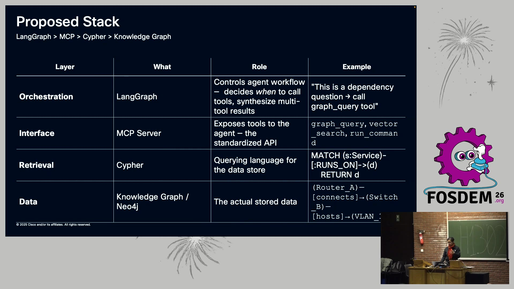
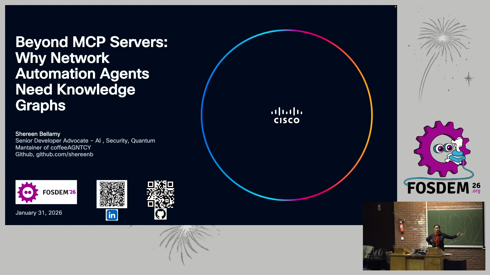

# Beyond MCP Servers：为什么网络自动化 Agent 需要知识图谱（FOSDEM 26）

- **视频直链**：https://video.fosdem.org/2026/h1302/VSW38B-beyond_mcp_servers_why_network_automation_agents_need_knowledge_graphs.mp4（镜像 dotsrc.org，510MB）
- **来源**：FOSDEM 2026，H.1302 厅（Agentic AI devroom）；演讲者 Shereen Bellamy（Cisco 高级开发者倡导者，AGNTCY coffeeAGNTCY 参考应用维护者），录制于 2026-01-31，全长约 20 分钟
- **相关项目**：AGNTCY（Linux Foundation "Internet of Agents" 生态，agntcy.io）

## 📺 视频讲了什么

演讲者以虚构的全球咖啡企业参考应用 coffeeAGNTCY 为背景：一个拍卖主管 Agent（LangGraph 构建）通过 A2A/SLIM 协议协调巴西、哥伦比亚、越南三个农场 Agent，天气和支付走 MCP Server。当她给这套多 Agent 系统加上"网络基础设施感知"能力时，发现直接让 MCP 返回原始拓扑 JSON 会撑爆上下文窗口（一次查询约 5 万 token）且 LLM 遍历易漏连、产生幻觉。她尝试了三种方案后得出结论：**网络拓扑本来就是结构化数据，不该再让 LLM 硬啃，而应直接建模成 Neo4j 知识图谱，MCP Server 里跑 Cypher 精确查询**——同样的问题从约 50K token 压缩到约 200 token 的准确答案。

## 🔑 关键内容

（以下均基于 bl 视频理解逐帧读取幻灯片，背景补充来自 web_search）

- **方案一：MCP 直接返回原始数据**（画面看到）：问"支付数据库上游是什么"，MCP 把全部 50 台设备、200 条链路的 JSON 塞进上下文，LLM 自己遍历 → 约 50K token，可能漏连接、幻觉。
- **方案二：从文档抽图（KAG / GraphRAG）**（画面看到）：KAG 关系抽取准确率仅约 80%，会漏隐含连接；GraphRAG 擅长摘要但 token 贵、拓扑一变就要重建社区。教训：**两者都是"从非结构化文档抽图"，而网络拓扑本来就是结构化的，何必再抽一遍？**
- **方案三（最终答案）：Graph + MCP Server**（画面看到）：领域直接建模为 Neo4j 知识图谱（节点如 Router/Switch/Service/Prefix/Rule，关系如 CONNECTS_TO/RUNS_ON/ROUTE_VIA/DEPENDS_ON），MCP Server `network_kg_service.py` 暴露 `analyze_link_failure`（爆炸半径分析）、`get_upstream_devices`/`get_downstream_devices`、`find_network_path` 等工具，内部执行 Cypher：
  ```cypher
  MATCH (db)<-[:CONNECTS_TO]-(upstream) RETURN upstream
  ```
- **推荐四层栈**（画面看到，见配图）：LangGraph（编排）→ MCP Server（接口）→ Cypher（检索）→ Neo4j 知识图谱（数据）。
- **图带来的新能力**（画面看到）：链路故障影响分析（"Link-X 挂了哪些服务会宕"）、单归属前缀路由依赖、防火墙规则依赖（"删掉 fw-101 影响哪些服务"）。
- **现场演示**（画面看到）：Buyer Conversation UI 中输入 "run auction"，supervisor 编排三个农场 Agent 拍卖，中途调用图工具检查网络健康，UI 实时绿色高亮活跃 Agent；追问时 `find_path` 返回原始 JSON（hops: 2, traversal_time_ms: 0.1），直观对比了"精确答案 vs 原始数据"的 token 差距。
- 版本清单（画面看到）：AGNTCY App SDK v0.4.1、A2A v0.44、SLIM v0.11.0、LangGraph v0.4.1、Neo4j Aura（托管实例）。




## 🛠 值得学的点（写给想转 AI Infra 的 Java 工程师）

1. **"检索层做重活、LLM 只收结论"是省 token 的核心思路**。Cypher 查询在数据库侧完成图遍历，MCP 只返回 200 token 精确答案——类比你熟悉的：把过滤下推到数据库，而不是把全表拉到 Java 内存里 for 循环。Agent 系统设计同理：能让确定性引擎（SQL/Cypher/代码）干的活，绝不交给 LLM 推理。
2. **区分"该抽图"与"不该抽图"**。GraphRAG/KAG 适合从文档堆里挖知识（约 80% 准确率，有维护成本）；但运维数据、网络拓扑、组织架构这类天然结构化的数据，直接建图 + 查询语言，精度和成本都碾压抽取方案。选型时先问一句：数据源头是什么形态？
3. **爆炸半径（blast radius）分析是 SRE 场景落地知识图谱的杀手级应用**。链路/规则/服务的依赖图一旦建好，"这个变更影响谁"从人肉翻文档变成一条 Cypher——这个模式可以平移到微服务依赖治理、发布影响面评估。

## ⚠️ 局限

- 视频理解基于画面帧，**音频内容（演讲者口语、问答环节）无法转写**，个别观点表述是从幻灯片文字推断的。
- Neo4j 驱动版本号在帧中分辨率不足，识别为约 v1.8.34，可能不准。
- 幻灯片上的 GitHub 仓库二维码未能解析出具体 URL（应为 github.com/shereenb 下的 coffeeAGNTCY 相关仓库，未逐一验证）。
