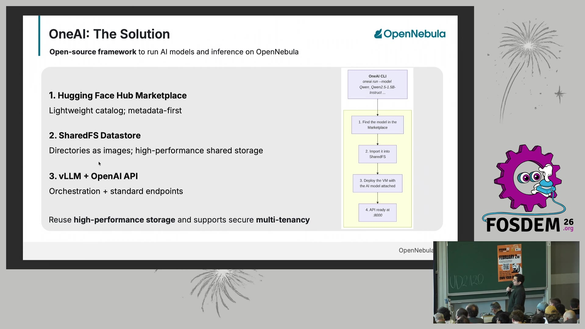
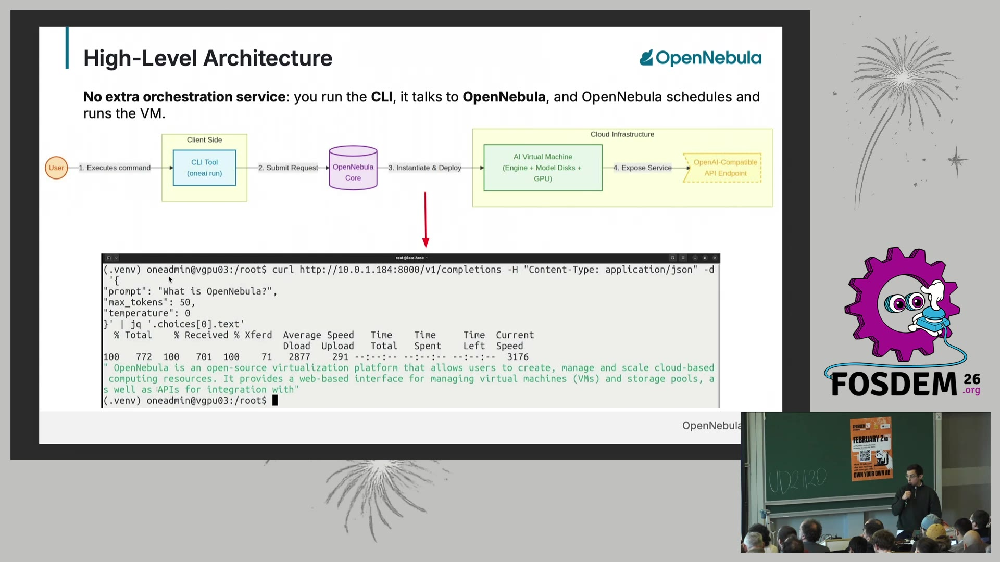
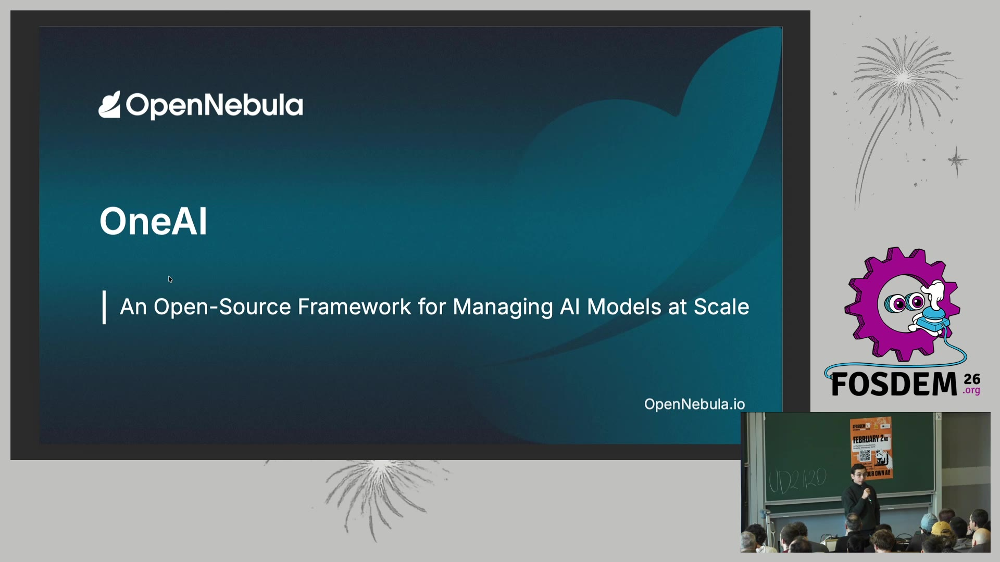

# OneAI：用 OpenNebula 大规模管理 AI 模型（FOSDEM 26）

- **视频直链**：https://video.fosdem.org/2026/ud2120/7PAYWS-oneai_an_open-source_framework_for_managing_ai_models_at_scale.mp4（389MB MP4）
- **来源**：FOSDEM 2026，AI Plumbers devroom，UD2.120 (Chavanne)；演讲者 Daniele Mingolla（OpenNebula Systems AI 软件工程师），2026-01-31 14:20，时长约 17 分 45 秒（ffprobe 实测 1065s）
- **议程页**：https://archive.fosdem.org/2026/schedule/event/7PAYWS-oneai_an_open-source_framework_for_managing_ai_models_at_scale
- **相关项目**：OpenNebula（17 年历史的开源 IaaS/云边平台，全球 5000+ 云，最大部署 16 个 DC / 30 万核心）

## 📺 视频讲了什么

演讲介绍 OpenNebula 新开源的 **OneAI** 框架：在自建云/集群上完成 AI 模型"发现 → 存储 → 部署 → 暴露 API"的全生命周期管理，底层用 vLLM 提供 OpenAI 兼容推理接口。核心卖点是**复用企业已有的 HPC 共享存储和虚拟化平台，不引入额外编排层**——一条 `oneai run` 命令即可从 Hugging Face 模型名直达跑起来的推理 VM。演讲者明确说明 OneAI 和 SharedFS datastore **仍在开发中**，将随未来 OpenNebula 版本发布。

## 🔑 关键内容

（画面内容来自 bl 视频理解逐帧读取；背景补充来自 FOSDEM 议程页与官方 slides PDF）

- **问题定义**（画面看到）：推理规模化有四个碎片化痛点——模型发现（模型都放哪了？）、存储（100GB+ 权重文件拷贝昂贵）、部署（怎么上 GPU）、API 暴露（怎么给应用用）。
- **三支柱方案**（画面看到，配图1）：
  1. **HF Hub Marketplace**：metadata-first 轻量目录，只索引 Hugging Face 模型元数据（DESCRIPTION/LINK/TASK 等属性），部署时才真正物化文件——大幅省存储；
  2. **SharedFS Datastore**："目录即镜像、零复制"，共享文件系统上的模型目录直接当 VM 镜像挂载，一份副本并发服务多个 VM 实例；
  3. **vLLM + OpenAI API**：推理 VM 模板 = 模型盘 + 引擎盘 + GPU，vLLM appliance 从磁盘加载模型，每个 VM 暴露 OpenAI 兼容 endpoint，应用零改码。
- **端到端流程**（画面看到，配图2）：CLI `oneai run --model Qwen_Qwen2.5-1.5B-Instruct --engine-image-id 17 --cpu 8 --memory 16Gi --gpu 1 --gpu-type h100` → OpenNebula Core 调度 → GPU 直通 VM → `curl :8000/v1/completions` 即得响应。
- **GPU 调度**（画面看到）：CLI 指定数量/型号后，调度器匹配配置了 PCI pass-through 的主机空闲 GPU；VM 内 `lspci | grep -i nvidia` 直接看到 H100，vLLM 原生使用——"infrastructure-native placement, no custom scheduler needed"。
- **资料补充**（非画面）：议程摘要提到第三支柱还有一个 **AI Service REST API** 编排层，负责 provision 部署、监督 vLLM 引擎进程；OpenNebula 7.x 的 AI Factory Blueprints 已提供 vLLM appliance + H100/L40S 基准测试文档，OneAI 是把这套手动流程产品化。
- **Demo 环节**（画面看到）：约 11:38 和 12:55 两次出现 Demo 过场页，实质演示以幻灯片内嵌终端截图呈现（部署命令 + curl 推理返回 + lspci 验证 GPU），未见长时间 live 敲键盘画面。

## 🛠 值得学的点（写给想转 AI Infra 的 Java 工程师）

1. **"元数据目录 + 延迟物化"是管理大文件资产的通用模式**。Marketplace 只存 HF 模型的元数据，部署时才下载/挂载——和 Java 生态里 Maven 的 POM-first 解析、Docker Registry 的 manifest/blob 分离是同一个思路：目录要轻，产物按需拉。设计任何"制品仓库"都可以套用。
2. **"目录即镜像、零复制"直击 LLM 时代存储痛点**。传统 VM 镜像是块设备语义，拷 100GB 权重就是 100GB IO；SharedFS 让共享存储上的目录直接被多个 VM 挂载，一份副本服务 N 个部署。类比 NFS 挂载 vs 全量拷贝——AI Infra 里存储成本常超过 GPU 之外的所有项，这个取舍值得记住。
3. **GPU PCI pass-through + 基础设施原生调度，先跑通再谈 K8s**。OneAI 不引入 Ray/K8s 自定义调度器，直接用虚拟化平台的 GPU 直通和已有 scheduler。对中小团队：单节点 vLLM + 直通 GPU 就能覆盖大部分推理场景，不要一上来就堆编排层。

## ⚠️ 局限

- 视频理解基于画面帧，**音频（演讲口语、Q&A）无法转写**，观点表述主要从幻灯片文字推断。
- Demo 环节在采样帧中只是过场页 + 终端截图，实际演示细节（加载耗时、吞吐数字）未能观察到。
- OneAI 处于开发中，画面中的 CLI 语法和属性名到正式发布可能变化。
