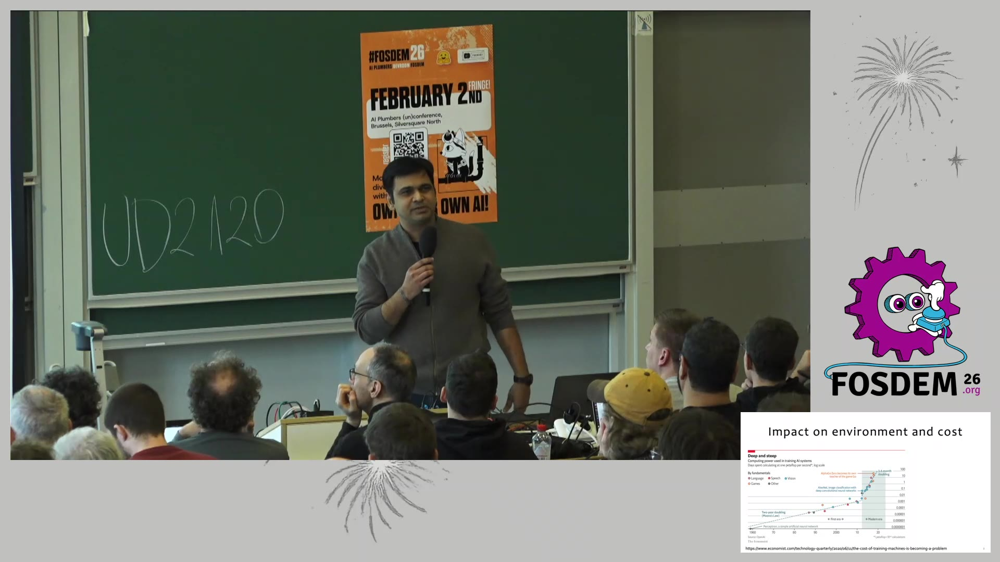
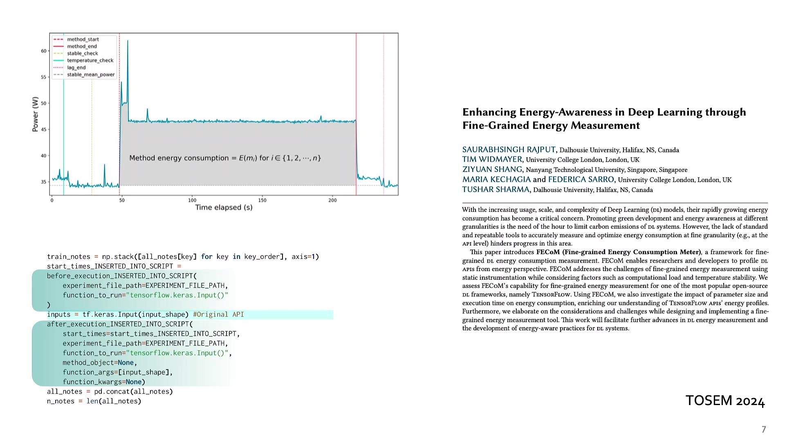
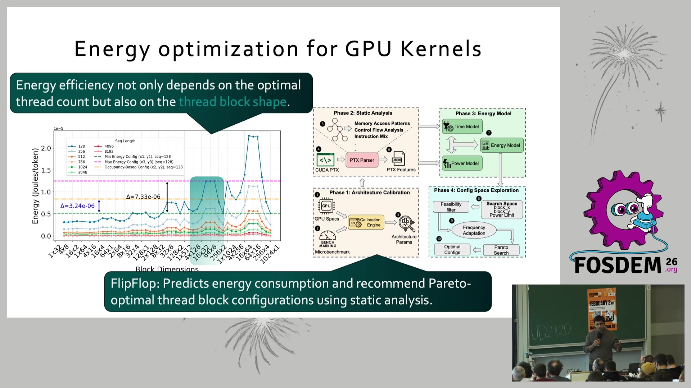

# 智能的隐藏成本：从代码到 GPU Kernel 的 AI 能耗足迹（FOSDEM 2026）

- **视频直链**: https://video.fosdem.org/2026/ud2120/SPJDGF-energy-footprint-ai.mp4
- **来源页面**: https://fosdem.org/2026/schedule/event/SPJDGF-energy-footprint-ai/
- **时长**: 7 分 01 秒（421 秒）
- **讲者**: Dr. Tushar Sharma（加拿大 Dalhousie 大学 SMART Lab）
- **场合**: FOSDEM 2026 · AI Plumbers Devroom · UD2.120 (Chavanne) · 2026-01-31

## 📺 视频讲了什么

这是一场短而密的演讲，主题是"AI 到底费多少电，以及怎么测量和优化"。讲者先用图表说明 AI 训练能耗的爆炸式增长，然后给出他的核心主张：**测量先于优化**——能耗应该成为和延迟、吞吐同等的一等指标。演讲介绍了两层工具：代码级的细粒度能耗测量（CodeGreen，能把每个函数的耗电测出来）和 GPU kernel 级的能耗预测（FlipFlop，不跑代码就能推荐最省电的线程配置）。结尾列出了实验室一系列 ICSE/FSE/TOSEM 论文。

## 🔑 关键内容

**画面里看到的（幻灯片内容，按时间顺序）：**

1. **能耗爆炸的数字**（约 1:06 处幻灯片）：AI 训练算力翻倍周期从摩尔定律的约 2 年缩短到 3.4 个月；GPT-3 单次训练耗电 1287 MWh、排碳 550 吨，相当于一个普通家庭 120 年用电；GPT-4 又是 GPT-3 的约 40 倍。Wells Fargo 预测：到 2030 年仅美国 GenAI 用电将达 652 TWh（占美国 2023 年总用电 4000 TWh 的 16%），其中推理占比快速上升——**电老虎正从训练转向推理**，这对做推理基础设施的人是直接相关的。

2. **测量工具箱**（约 3:30 处）：硬件侧用功率计；软件侧 GPU 走 NVIDIA-SMI/NVML、AMD-SMI，CPU 走 Perf/Scaphandre/PyRAPL/jRAPL。讲者的 FECoM 论文（TOSEM 2024）用**静态代码插桩**（在方法前后自动插钩子）+ 稳定性检查 + 温度检查，把能耗归因到单个方法——类似给每段代码装"分电表"。

3. **最反直觉的一页**（约 5:49）：优化 GPU workload 时，"把 SM occupancy（流式多处理器占用率，即 GPU 上同时干活的线程比例）拉满"是经典性能直觉，但**occupancy 最优 ≠ 能耗最优**。实验图显示 joules/token 随 thread block（线程块，GPU 上一起调度的一组线程）的形状和尺寸变化显著——同样的线程总数，块排布不同，能耗差出一截。FlipFlop（ICSE 2026）通过 CUDA PTX 静态分析建能耗模型，免运行搜索 Pareto 最优的 block 配置。

4. **Green AI 全景图**（约 5:07）：节能手段按层拆分——训练（混合精度、梯度稀疏化）、推理（剪枝、量化、蒸馏、边缘部署）、数据管道（压缩、去重）、架构（能量感知 NAS）、系统设计（碳感知调度）。

**资料补充（非视频画面）：** CodeGreen 已开源（https://github.com/SMART-Dal/codegreen ，`pip install codegreen`），用 tree-sitter AST 自动插桩，支持 Python/C/C++/Java，后端覆盖 Intel RAPL、NVML、ROCm SMI；论文称与 RAPL 真值相关性 R²=0.9934，checkpoint 开销约 100ns，比传统采样式 profiler 低 25-100 倍。它还支持 `--budget` 参数在 CI 里做"能耗门禁"。

## 🛠 值得学的点（给想转 AI Infra 的 Java 工程师）

1. **能耗是新的可观测性维度**。你已经熟悉 JVM 的 GC 日志、火焰图；CodeGreen 对 Java 的支持意味着可以把"每个方法多少焦耳"接入现有 APM 思路。推理服务的成本大头是电费，joules/token 正在成为和 tokens/s 并列的 SLA 指标。
2. **"occupancy 拉满"的性能直觉在 GPU 上要打个问号**。做 vLLM/SGLang 这类推理系统的性能调优时，kernel launch 配置（block 形状）不只是性能参数也是能耗参数——这是 Java 世界"线程池调优"的 GPU 对应物，但约束更微妙。
3. **测量方法论可迁移**：插桩 + 稳定性检查 + 温度检查这套细粒度测量设计（对应 Java 里的 JMH 严谨基准测试思路），是把工程严谨性带进 AI Infra 的好例子。

## ⚠️ 局限

- bl vision describe 基于抽帧理解，**音频完全听不到**：讲者的口头解释、案例细节、现场问答均缺失，以上均基于幻灯片画面文字与图表。
- 幻灯片上的小字（如论文标题、图表坐标轴刻度）可能识别不全；GPT-4 "40 倍"等数字以画面 OCR 为准，未逐帧复核原始出处。
- 7 分钟短演讲本身信息密度受限，很多工具只有名字没有深入演示。
