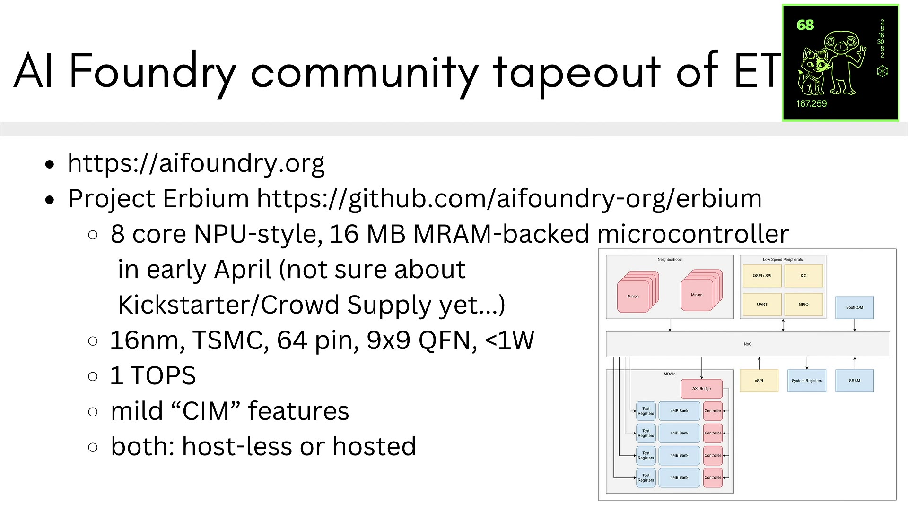
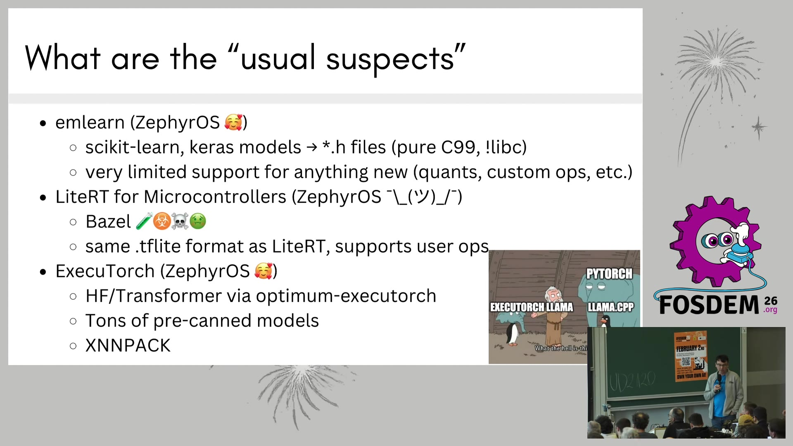
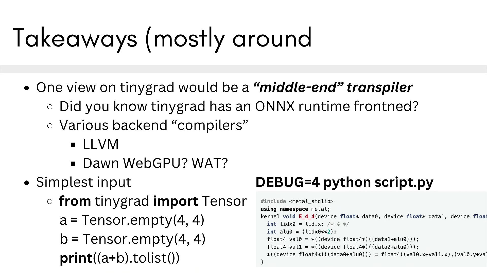
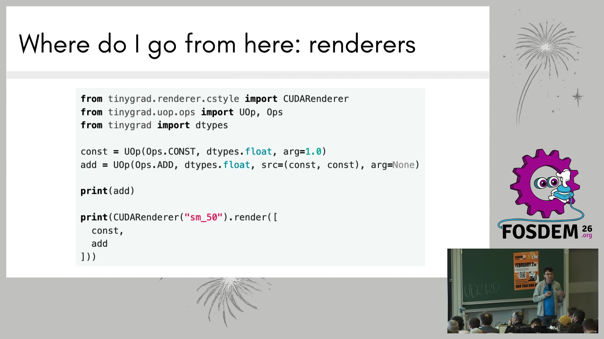

# 用 tinygrad 和 AI 编程给"社区造芯"写后端：微控制器 NPU 上的推理栈（FOSDEM 2026）

- **视频直链**: https://video.fosdem.org/2026/ud2120/VYEMQR-running_tinygrad_and_ggml_on_microcontroller_npus.mp4（136MB MP4；镜像 dotsrc.org 已验证 video/mp4 200）
- **来源页面**: https://archive.fosdem.org/2026/schedule/event/VYEMQR-running_tinygrad_and_ggml_on_microcontroller_npus/
- **时长**: 6 分 15 秒（闪电演讲）
- **讲者**: Roman Shaposhnik（AI Foundry CTO，Apache 软件基金会 VP Legal）
- **场合**: FOSDEM 2026 · AI Plumbers Devroom · UD2.120 (Chavanne) · 2026-01-31

## 📺 视频讲了什么

一场信息密度极高的闪电演讲：讲者所在社区正在流片一颗全开源的 16nm RISC-V NPU 芯片（AI Foundry 的 "Project Erbium"），但市面上给微控制器跑 AI 的现成软件栈（emlearn、LiteRT-Micro、ExecuTorch）都不合心意。他选了 geohot 写的极小神经网络框架 **tinygrad** 作为"中间层转译器"，并用一个额外约束完成实验：**整个后端让 Claude Code 一周内自动生成**——理由是"tinygrad 小到能装进 Claude 的上下文窗口"。结果真的生成了可加载的 ELF 产物和渲染器代码，方向验证成功。

## 🔑 关键内容

**画面/字幕里看到的：**

1. **Erbium 芯片规格**（约 0:22 幻灯片）：8 核 NPU 式微控制器，16MB MRAM（磁阻内存，断电不丢数据），台积电 16nm，64 针 9×9 QFN 封装，功耗 <1W，**1 TOPS** 算力，带轻度存内计算（CIM）特性，可独立运行也可挂主机，预计 4 月初出货。它是千核芯片 Esperanto ET-SoC-1 的缩小版。

2. **"常规嫌疑人"吐槽**（约 1:24）：emlearn（sklearn/keras 转纯 C99 头文件，Zephyr 友好但模型支持太窄）；LiteRT-Micro（"Bazel 🧪☣️💀🤢"——构建系统是减分项）；ExecuTorch（预置模型多但太年轻、太重）。配一张诺亚方舟 meme：企鹅 EXECUTORCH-LLAMA 和 LLAMA.CPP 面对大象 PYTORCH。

3. **tinygrad = 转译器**（约 3:20）：tinygrad 把一切神经网络拆成仅 3 类算子（Elementwise/Reduce/Movement Ops），CONV 和 MATMUL 都是组合出来的。有 ONNX 前端、LLVM/WebGPU/WAT 等后端。演示：4 行 Python 的 4×4 矩阵加法，`DEBUG=4` 直接打印出向量化的 Metal GPU kernel 源码。

4. **CLAUDE.md 方法论**（约 4:02，全场最亮点）：他展示的提示词就三条——读 mesozoic-egg 的 tinygrad 笔记博客、仿照 WebGPU 后端结构写新后端、参照 yolov8 例子写导出 ELF 的模型导出器。一周实验产出"能跑的雏形"；未竟事项：生成的 C 代码不够紧凑，还需研究 tinygrad 的 pattern matching 优化。

5. **Renderer 扩展点**（约 5:04）：手写 UOp 链构建计算图，`CUDARenderer("sm_50").render(...)` 一行渲染成 CUDA kernel——给新 NPU 写后端需要的代码量就这么点。

**资料补充（非视频画面）**：Erbium 规格书（erbium.readthedocs.io）确认 8 核 16 线程、每核带 8-lane 向量单元 + Tensor 扩展，int8 峰值 128 ops/cycle/core；MRAM 读延迟 <3ns，可当"会算数的 Flash"用。tinygrad 笔记博客系列在 mesozoic-egg.github.io/tinygrad-notes。

## 🛠 值得学的点（给想转 AI Infra 的 Java 工程师）

1. **"代码库小到能装进 LLM 上下文"正成为选型标准**。tinygrad 对 PyTorch 的杀手锏不是性能而是可读性——AI 能整库理解就能整库改造。类比 Java 世界：你会更愿意让 AI 给 Spring Boot 小项目还是给一个百万行遗留系统写补丁？选 AI-friendly 的小而美依赖，是 agent 时代的新工程判断力。
2. **推理引擎的分层可类比 JVM**：tinygrad 的"算子 IR → renderer → 目标 kernel"就是"字节码 → JIT → 机器码"。看懂 vLLM/SGLang 的调度层之前，先在 tinygrad 里把整条编译链读通，成本最低。
3. **用规范文档 + 参照实现驱动 AI 生成后端**是可直接复用的工作流：博客（原理）+ 现有 backend（样板）+ 明确产物（ELF），三者齐了 AI 一周顶一个人一月。做内部工具移植时照抄这个套路即可。

## ⚠️ 局限

- 视频理解为纯画面分析，听不到音频；本次靠 FOSDEM 官方 VTT 字幕补全了讲者原话，内容可信度高，但字幕是自动转录（如 "MRAM" 被转成 "AMRAM"、"emlearn" 转成 "M-Learn"），个别术语已按上下文修正。
- 演讲只有 6 分钟，是方向性介绍：没有真机跑分、没有 Erbium 实物演示（芯片当时还没到手），"生成 ELF"是开发机上的中间产物。
