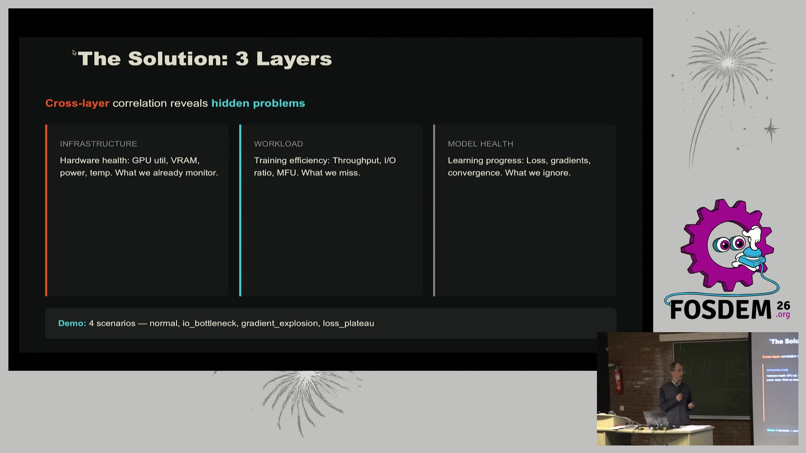
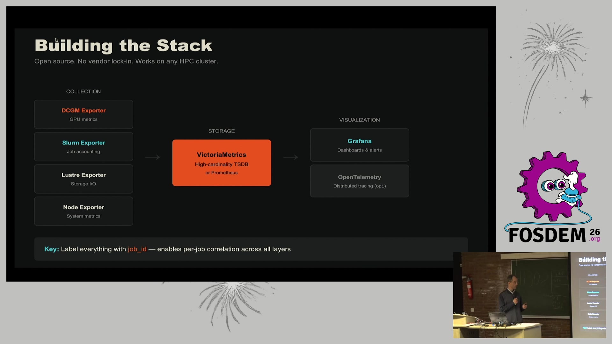
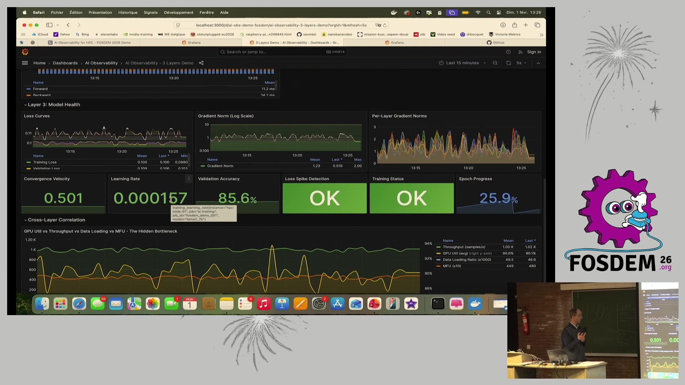

# GPU 95% 利用率却在白烧钱：HPC 上 AI 负载的"认知 SLI"观测体系（FOSDEM 2026）

- **视频直链**：https://video.fosdem.org/2026/h1308/FYLDFE-observability_for_ai_workloads_on_hpc_beyond_gpu_utilization_metrics.av1.webm （AV1/WebM 43.8MB；另有 MP4 292MB）
- **来源页面**：https://archive.fosdem.org/2026/schedule/event/FYLDFE-observability_for_ai_workloads_on_hpc_beyond_gpu_utilization_metrics/
- **时长**：约 12 分 44 秒（ffprobe 实测 763 秒）
- **讲者**：Samuel Desseaux（HPC, Big Data & Data Science track，Room H.1308）
- **PoC 仓库**：演示中展示的 `erythx/HPCOBS`（GPL-3.0，docker-compose 一键复现）——截至本文写作时该 URL 返回 404，可能已改名/转私有，未验证

## 🎯 30 秒版本

GPU 利用率 95% 不代表训练在有效推进——可能一半时间在等磁盘读数据。这场演讲提出给 AI 负载建三层观测（基础设施→工作负载→模型健康），全部打上 job_id 标签做跨层关联，用纯开源栈（VictoriaMetrics + Grafana）实现"语义告警"：不是"GPU 温度高了"，而是"基础设施一切正常但训练停滞了"。

## 📺 视频讲了什么

开场钩子是一个真实感十足的场景：你的训练任务跑了 72 小时，GPU 利用率一直 95%，结果发现模型早就停止学习了——你在监控硬件，而不是工作负载。讲者提出传统指标对 AI 负载是"盲视"：GPU Utilization 92% 的同时吞吐量可能掉了 40%。解法是三层指标体系加跨层关联，最后 live demo 展示了一个可 `docker-compose up` 复现的完整栈：训练模拟器产生指标 → VMagent 抓取 → VictoriaMetrics 存储 → Grafana 三层仪表盘实时跳动，还内置了 normal / io_bottleneck / gradient_explosion / loss_plateau 四个故障场景开关。

（ffmpeg 从原视频 200s / 360s / 680s 处截帧）

## 🔑 关键内容

**画面里看到的（bl 视频理解结果）：**

- **三层框架**：Layer 1 基础设施（GPU 利用率、Tensor Core 利用率、显存、功耗）；Layer 2 工作负载效率（训练吞吐量、数据加载占比、MFU、step 时间分解）；Layer 3 模型健康（loss 曲线、梯度范数、收敛速度、验证准确率）。MFU（Model FLOPs Utilization，模型算力利用率——理论峰值算力中真正用于有效计算的比例）是金标准，**<30% 需要关注**；数据加载占比 **>15% 即为瓶颈**；梯度范数 >100 是爆炸、<0.01 是消失。
- **核心原则 "Correlate, don't aggregate"**：每条指标强制带 job_id/user/partition/node 标签，才能回答"吞吐掉的时候是哪个作业占了资源""为什么这个节点比同伴慢 3 倍"（straggler，拖后腿的慢节点）。
- **为何选 VictoriaMetrics**（高基数时序数据库，可理解为能扛住海量标签组合的 Prometheus 兼容替代）：对比 Prometheus 10x 压缩比（1000 节点一年 18TB→1.8TB）、百万级样本/秒摄入、100% PromQL 兼容可直接替换。HPC 场景一个集群可产生 40 万+ GPU 时间序列，普通 Prometheus 扛不住。
- **live demo 实证**：Grafana 里 GPU 利用率平直在 ~90-95%（看起来很健康），但 Data Loading Ratio 尖峰到 ~45-50%、MFU 只有 ~45%——正是 io_bottleneck 场景的"隐藏瓶颈"画像：GPU 在等存储（Lustre/GPFS 这类并行文件系统的延迟尖峰被称为"沉默杀手"）。
- **"Monday Morning" 三条行动清单**：① 加上 DCGM 的 Tensor Core + 内存带宽指标（5 分钟搞定）；② 按作业监控存储 I/O 延迟；③ 对分布式作业的节点完成时间差（max-min）设 straggler 告警。

**资料补充（web_search / 日程页）：**

- 讲者把这套指标称为 "Cognitive SLIs"（AI 系统的服务等级指标）。日程页提到该框架还覆盖能耗与成本核算，并涉及欧盟 AI Act 的日志合规要求与 HPC 运维的交叉——视频里这部分只是一笔带过。
- 告警范式转移的对比表（画面里也出现）：传统告警"GPU 温度高/内存>90%/节点失联" vs 语义告警"训练停滞但基础设施健康/检测到隐藏 I/O 瓶颈/模型收敛恶化"。
- 与 2026-11-11 笔记《超越 nvidia-smi》互补：那篇讲"单卡内部 Tensor Core 是否被用起来"（DCGM 视角），这篇讲"整个训练作业跨硬件/负载/模型三层是否健康"，DCGM Exporter 正是本栈 Layer 1 的采集器之一。

## 🛠 值得学的点（给想转 AI Infra 的 Java 工程师）

1. **这就是 APM 思路搬到 GPU 集群**：你做 Java 时熟悉 Micrometer + Prometheus + Grafana 那套（JVM 内存/GC 是 Layer 1，QPS/延迟是 Layer 2，业务成功率是 Layer 3）。AI Infra 的观测是同构的，只是 Layer 2 换成了吞吐/MFU、Layer 3 换成了 loss/梯度范数。你已有的监控栈经验直接可迁移。
2. **高基数（high cardinality）是 HPC 监控的真痛点**：每作业×每节点×每 GPU 的标签组合让时间序列数爆炸，这是 VictoriaMetrics 这类 TSDB 存在的理由——理解"为什么 Prometheus 在 40 万序列下吃力"比会背 PromQL 更值钱。
3. **demo 仓库的"故障场景注入"模式值得抄**：用环境变量切换 io_bottleneck/gradient_explosion 场景来演示监控价值，这和你写 Spring Boot 时用 profile 切换故障注入做混沌演练是同一招，做内部平台推广时非常好用。

## ⚠️ 局限

- 视频理解只能看画面，**音频内容（讲者的口头解释、语调强调）完全缺失**，叙事细节靠幻灯片文字重建。
- live demo 是本地 docker-compose 模拟器产生的合成指标，**不是真实 HPC 集群数据**，实际 Lustre 延迟毛刺长什么样没有展示。
- 演讲仅约 13 分钟（含 demo），OpenTelemetry 对 PyTorch/JAX 的埋点模式只在架构图出现一次，无代码级细节；AI Act 合规部分未展开。
- 提到的 GitHub 仓库 `erythx/HPCOBS` 当前 404，无法核实其内容是否与演示一致。
