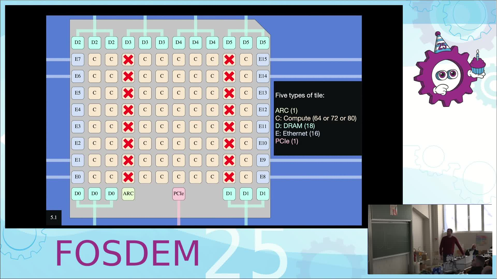
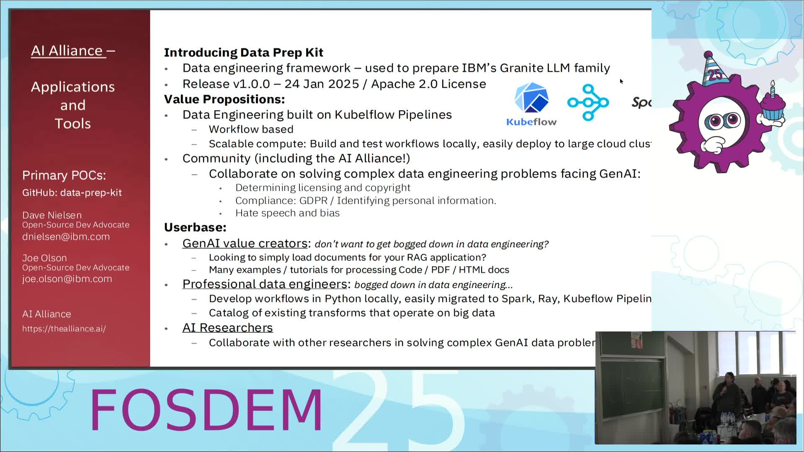

# Scoping out the Tenstorrent Wormhole：一颗非 GPU 的 AI 芯片长什么样

- **视频直链**：https://video.fosdem.org/2025/ub2252a/fosdem-2025-5118-scoping-out-the-tenstorrent-wormhole.mp4（另有 65MB av1.webm 版）
- **来源页面**：https://archive.fosdem.org/2025/schedule/event/fosdem-2025-5118-scoping-out-the-tenstorrent-wormhole/
- **时长**：约 20 分钟（FOSDEM 2025，Low-level AI Engineering devroom，讲者 Peter Cawley / @corsix）
- **加映**：同日同会场的 5 分钟闪电演讲《Data Prep Kit: Open Source Data Engineering for LLMs》（Joe Olson，IBM），直链 https://video.fosdem.org/2025/ub2252a/fosdem-2025-6761-data-prep-kit-open-source-data-engineering-for-llms.mp4

## 📺 视频讲了什么

Peter Cawley（LuaJIT 圈知名 hacker，演讲时自嘲"与 Tenstorrent 无关……暂时"）用 20 分钟把 Tenstorrent Wormhole n300s 这块 AI 加速卡从外到内"剥洋葱"：板卡照片 → 板级框图 → 芯片内 100+ 个 tile（小格子）的网格 → 片上网络 NoC → 每种 tile 内部结构 → Tensix 矩阵引擎的数据通路。全程幻灯片逐层 zoom-in（72 页），没有实时代码演示，但密度极高：每页都给出精确的地址空间和规格数字。它回答的核心问题是：**一块不用 CUDA 的 AI 芯片，和 NVIDIA GPU 到底哪里不一样**。

## 🔑 关键内容

（以下除标注外均为视频画面中读到的内容）

- **板级**：一张卡上两颗 Wormhole 芯片，周围 12 颗 2GiB GDDR6（全卡 24GB），两个 QSFP-DD 光口笼（Warp 100，100GbE 以太网直连其它卡），PCIe 4.0 x16 只连到第一颗芯片，芯片之间另有互连。对照官方规格（资料补充）：n300s 全卡 466 TFLOPS FP8、300W。
- **芯片 = tile 网格**：单颗芯片由 5 种 tile 拼成——ARC(1，管电源/复位/时钟/温度)、Compute(80)、DRAM(18)、Ethernet(16)、PCIe(1)。Compute tile 会"harvesting"（收割：出厂测试后禁用有瑕疵的 tile 降档卖，所以实际可用 64/72/80 个）——类似 GPU 的 4090 vs 4080 用同一颗芯片的思路。
- **NoC（片上网络，把 tile 网格连成"内部局域网"）**：每条链路 32 字节宽，做异步 memcpy（参数原型直接印在幻灯片上：dst_x, dst_y, dst_addr, src_x, src_y, src_addr, num_bytes——搬数据要写坐标，像给网格城市寄快递），还支持矩形组播和原子操作。两套独立 NoC（紫/青箭头）分担读写流量。
- **Compute tile 内部**：5 个 RISC-V 小核（管数据搬运/调度）+ 1464 KiB SRAM + Tensix 协处理器。Tensix 数据通路：Data Unpack（SRAM→SrcA/SrcB 寄存器）→ Matrix 矩阵引擎（Dst ← SrcB⊗SrcA，fp8 全速、fp16 半速）+ Vector（32 车道 fp32/int32 SIMD）→ Data Pack 写回 SRAM。
- **PCIe tile**：Host→Device 只有 488 MiB 窗口（156×1MiB + 10×2MiB + 20×16MiB 拼出来），Device→Host 4 GiB（4 个 1GiB 大页）。对比 GPU 的大 BAR 空间，主机和芯片之间的数据搬运约束明显不同。
- **加映 DPK**（画面）：IBM 为 Granite 模型家族做的开源数据工程框架，v1.0.0 于 2025-01-24 发布，Apache 2.0，基于 Kubeflow Pipelines，本地 Python 工作流可无缝迁到 Ray/Spark 集群，内置版权判定、GDPR 个人信息识别、仇恨言论过滤等 transforms（资料补充：GitHub 仓库 data-prep-kit/data-prep-kit 有 30+ 个 transform，支持 Parquet/NDJSON，有 arXiv 论文 2409.18164）。

*演讲中段：在 tile 网格图上叠加 NoC 数据流箭头（视频截帧）*

*Data Prep Kit 的唯一一页幻灯片（视频截帧）*

## 🛠 值得学的点（写给想转 AI Infra 的 Java 工程师）

1. **理解"非 GPU"推理硬件的关键心智模型是网格+消息传递，不是 SIMT**。Wormhole 没有 CUDA 那种" thousands of uniform cores"，而是 80 个各带 5 个 RISC-V 核的 tile，靠 NoC 按坐标显式搬数据。这和 Java 世界熟悉的分布式系统（节点 + 网络 + 序列化）反而更同构——把单芯片当"片上微服务集群"看，AI Infra 的软件栈（调度、局部性、带宽）就是分布式系统工程。
2. **内存模型决定服务架构**：全芯片只有 ~120MB SRAM + 24GB GDDR6，没有 HBM。模型必须切块流水进 SRAM——这解释了为什么 Tenstorrent 押注多卡以太网互连（每张卡都带 400GbE），对应到推理服务层就是"scale-out 优先"的部署形态，和 vLLM/llm-d 这类调度层要处理的问题直接相关。
3. **DPK 这类工具是 AI Infra 的"上游"**：训模型/RAG 之前 80% 的工作是数据清洗去重。它"本地 Python 开发→Ray/Spark 集群部署"的路径设计，和 Java 工程师熟悉的"本地单测→K8s 部署"是同一种工程哲学，值得作为自建数据管道的参考架构。

## ⚠️ 局限

- 视频理解模型看不到音频，讲者的口头解释、语气强调和 Q&A 全部缺失，只能读幻灯片文字和图示。
- 72 页幻灯片采样抽帧，部分页面的小字（如 Tensix 内部寄存器名）可能有 OCR 误差；tile 网格图中字母块的确切排布以原视频为准。
- mp4 大文件模型端下载会超时，本次实际用 65MB 的 av1.webm 版完成理解（内容相同）。

## 🧠 关键概念速查

| 术语 | 白话解释 |
|---|---|
| Tensix Core | Tenstorrent 的计算单元：5 个 RISC-V 核 + 矩阵引擎 + SRAM 打包成的"核中核" |
| NoC | Network-on-Chip，芯片内部的"局域网"，tile 之间靠它按坐标搬数据 |
| Harvesting | 芯片出厂按良品率禁用部分核心降档卖（如 80 核禁成 72/64） |
| GDDR6 | 显卡常用显存（比 HBM 便宜、带宽低），Wormhole 用它而非 HBM |
| Kubeflow Pipelines | K8s 上的 ML 工作流编排框架，DPK 的底座 |
