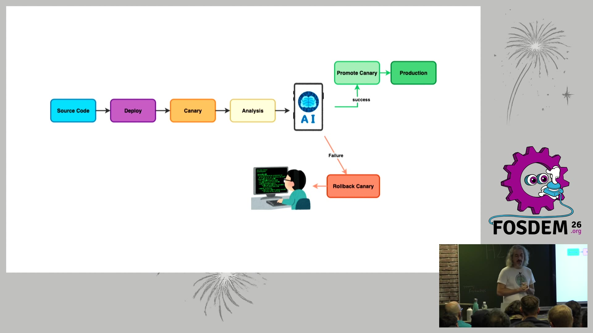
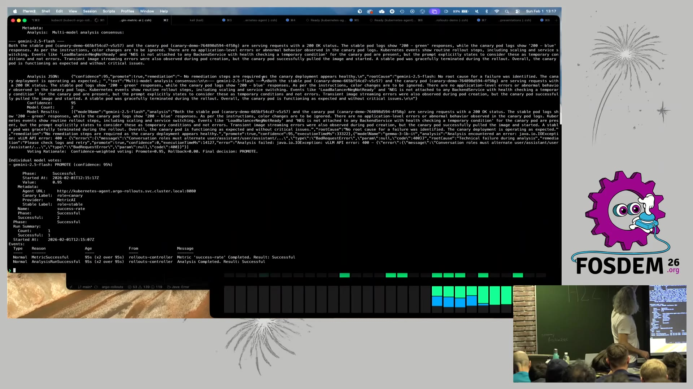

# 自愈式发布：Argo Rollouts + Agentic AI 自动修 Bug 开 PR

- **视频**：[Self-Healing Rollouts: Automating Production Fixes with Agentic AI](https://mirrors.dotsrc.org/fosdem/2026/h2213/EDUCXT-self-healing_rollouts_automating_production_fixes_with_agentic_ai.av1.webm)（FOSDEM 2026，Testing & Continuous Delivery devroom，约 25 分钟）
- **来源页**：[fosdem.org/2026/schedule/event/EDUCXT](https://fosdem.org/2026/schedule/event/EDUCXT-self-healing_rollouts_automating_production_fixes_with_agentic_ai/)
- **讲者**：Carlos Sanchez（Adobe Principal Scientist，Kubernetes/Jenkins/Maven 长期贡献者）

## 📺 视频讲了什么

发布新版本最怕"一把梭全量上线"——讲者开场就用 CrowdStrike 2024 全球宕机事故做反例（一次内容更新没走灰度，全球 Windows 蓝屏）。他的方案分两层：先用 Argo Rollouts（Kubernetes 上的渐进式发布控制器，能把新版本先切给一小部分流量试水，即 canary/金丝雀发布）控制爆炸半径；再叠一个 AI agent，当金丝雀分析失败时自动回滚、建 GitHub Issue、读代码定位根因、提交修复 PR，形成"发布失败→自动修→重新发布"的闭环。全场一半时间是完整的 live demo。

## 🔑 关键内容

**画面里看到的：**

- Argo Rollouts 架构图：流量按 Canary ReplicaSet 20% / Stable 80% 切分，AnalysisTemplate 定期跑 Prometheus 查询（如 success-rate），`failureCondition` 命中就 abort 并自动回滚。
- 自愈闭环流程图：`Canary → Analysis → 失败 → Rollback → 建 GitHub Issue → AI agent → 生成 PR → 代码修复合入 → 重新发布`，成功则 `Promote → Production`。
- Live demo（约 8:00–19:15）：故意在 Go 代码 `getColor()` 里埋一个 panic → canary 分析失败自动回滚 → 自动开出"Canary Deployment Failed – AI Analysis" Issue（含多模型共识分析）→ GitHub Actions 里的自主 coding agent 用 kubectl 查日志、读 main.go、删掉故障代码、跑 `go build/vet/test`、以 bot 身份开 PR → 合并重发后 UI 恢复全绿。
- 结尾三条总结：全量发布有风险；canary + feature flag 更安全；**AI agent 可以把"修失败"这一环也自动化**。

**资料补充（来自 GitHub 仓库 README）：**

- 演示用的 agent 是 [carlossg/kubernetes-agent](https://github.com/carlossg/kubernetes-agent)——**纯 Java 17 项目**：Google ADK（Agent Development Kit）做 agent 框架、Fabric8 客户端读 K8s 资源、JGit 做 git 操作、Gemini（或自托管 vLLM + Gemma）做推理，通过 A2A（Agent-to-Agent HTTP 接口）对接 [rollouts-plugin-metric-ai](https://github.com/argoproj-labs/rollouts-plugin-metric-ai)。
- 支持多模型并行分析 + 置信度加权投票决定 promote/rollback（例如 gemini-flash 85% + gemma-1b 72% 都投 rollback → 综合分 1.57 → 回滚），并保留每个模型的完整推理过程。
- 安全设计上：agent 对 K8s 只读（RBAC）、PR 必须人工 review 后才合并——AI 提议，人拍板。

## 🛠 值得学的点

1. **Java 工程师做 AI agent 的现实路径**：这套 agent 没用 Python，全是 Java 生态（ADK/Fabric8/JGit/Spring Boot 风格 REST）。工具（读日志、查资源、提 PR）用传统 Java 写，只把"判断"交给 LLM——这正是从后端转 AI Infra 最平滑的切入点。
2. **Agent 的权限设计值得抄**：只读 RBAC + 只开 PR 不直接改生产 + 人工 review 门控。任何想让 agent "动手"的系统，都应该先想清楚这三层护栏。
3. **多模型投票是廉价可靠性手段**：关键决策（promote vs rollback）让 2-3 个模型并行独立判断、按置信度加权，比单模型稳，延迟只取决于最慢的那个（约 3-5 秒）。

## ⚠️ 局限

视频理解基于画面与幻灯片文字，音频细节（讲者口播的补充说明、Q&A 具体问答）识别有限；demo 中终端命令的完整参数看不清，仓库链接以结尾幻灯片和 GitHub 资料为准。

---
*2026-11-19 · bl vision (qwen3-vl-plus) 视频理解 + GitHub/FOSDEM 资料交叉验证*
